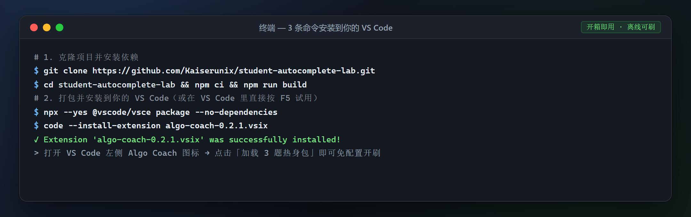

<div align="center">

# Algo Coach

**An Anti-Spoiler Competitive Programming Coach for VS Code · 6 Online Judges · Local Sample Runner**

[简体中文](README.md) · **English**

[](package.json)
[](package.json)
[](#supported-online-judges)
[](#3-minute-quick-start)
[](LICENSE)

[3-Minute Quick Start](#3-minute-quick-start) · [How Anti-Spoiler Works](#why-not-give-the-full-answer) · [6 Supported Judges](#supported-online-judges) · [Optional AI Setup](#optional-ai-setup) · [FAQ](#faq)

</div>

---

**Tired of AI autocomplete spoiling the entire algorithm on a single `Tab`, or juggling browser tabs just to read statements, test samples, strip local debug code, and track what to review?**

**Algo Coach** brings **problem search, side-by-side problem reading, 5-language local sample testing, anti-spoiler completions, step-by-step Socratic hints, clean one-click submission, and spaced-repetition review** directly into VS Code — cutting out busywork while keeping the real problem-solving in your hands.


---

## 3-Minute Quick Start

> Requirements: [VS Code](https://code.visualstudio.com/) (`1.93+`) and [Node.js](https://nodejs.org/) (`20+`).



```bash
git clone https://github.com/Kaiserunix/student-autocomplete-lab.git
cd student-autocomplete-lab
npm ci && npm run build
npx --yes @vscode/vsce package --no-dependencies
code --install-extension algo-coach-0.2.1.vsix
```

### Solve Your First Problem

1. **Open the sidebar**: Click the **Algo Coach** icon in VS Code's left Activity Bar.
2. **Start right away (no AI key or OJ login required)**:
   - Click **Load 3-Problem Warmup** to try standard I/O, function mode, and debugging offline;
   - Or switch to **Bank**, type a problem ID (`#1`, `P1873`, `1900A`, `abc350_c`) or paste any supported problem URL to import it.
3. **Code & run samples locally**:
   - Click **Split** to read the formatted problem statement and math formulas beside your editor;
   - Press **`Ctrl+Alt+R`** (or click **Run Samples**) to test locally in **C++ / Python / C / Rust / Java** with line-by-line diffs on mismatches.
4. **Get unstuck without spoilers**:
   - When a sample fails or you're stuck, click **Trace Counterexample** or open **Coach** for progressive **L1 → L5** hints. Full walkthroughs stay locked behind a two-step confirmation so you never spoil yourself by accident.
5. **Submit cleanly to the official judge**:
   - Click **Copy & Open** — Algo Coach strips your local debug blocks, copies clean submission code to your clipboard, and opens the official submit page. Just paste and submit.

---

## Why Not Give the Full Answer?

Reading an editorial and solving a problem independently are worlds apart. Algo Coach keeps **inline code completion** strictly isolated from **coaching**:


- **Saves typing on boilerplate (Green / Neutral zones)**: Headers, fast I/O setup, and routine declarations still get crisp 1–3 line completions.
- **Stays quiet on core logic (Red zone)**: Inside `while`/`for` conditions, right after your idea comments, or when writing key formulas (`dp`, `mid`, `ans`), autocomplete **automatically pauses** so you think it through yourself (you can still trigger syntax help manually with `Alt+\`).
- **Anti-blind-accept**: Optional word-by-word `Tab` acceptance keeps you in control of every token.

---

## Tour of the 4 Tabs


| Tab | What It's For | Most Useful Everyday Actions |
| :--- | :--- | :--- |
| **Solve** | Your main coding workspace | Open **Split Reader**, switch C++/Python/Java/Rust/C, press `Ctrl+Alt+R` to run samples, add custom edge cases, copy clean code & open submit page |
| **Coach** | Step-by-step guidance when stuck | Pick where you're stuck (No Idea / TLE / WA / Impl Stuck), step through **L1 → L5** hints, trace failing cases, or run a **Complexity Review** after AC |
| **Bank** | Find problems & daily reviews | Import by ID/URL, **search across multiple judges at once**, check **Today's Due Reviews**, or load curated sheets (Hot 100 · Blind 75 · NeetCode 150) |
| **Stats** | Track your growth | 7-day activity KPIs, concept mastery meters, recurring blind spots & mistake notebook, and 1-click undo for misrecorded results |
| **⚙ Settings** | Presets, AI & local compilers | Switch Starter / Focus / Contest presets, 1-click DeepSeek or local Ollama setup, add public OJ usernames, and detect local compilers |

---

## Supported Online Judges

Everything works natively out of the box — no external CLI tools or server setup needed:

| Platform | Quick Import Examples | Keyword Search | Local Runner | Official Verdict Sync |
| :--- | :--- | :---: | :---: | :--- |
| **LeetCode CN (`leetcode.cn`)** | `#1`, `#146`, `LCR 007`, URL | ✅ | ✅ Function mode | Zero-login sync via public Profile ID (+ 90s auto-poll) |
| **LeetCode Global (`leetcode.com`)** | `lc-global:1`, URL | ✅ | ✅ Function mode | Zero-login sync via public Username (+ 90s auto-poll) |
| **Codeforces** | `1900A`, `CF1900A`, URL | ✅ | ✅ Standard I/O | Zero-login sync via public Username (+ 90s auto-poll) |
| **AtCoder** | `abc350_c`, URL | ✅ | ✅ Standard I/O | Zero-login sync via public Username (+ 90s auto-poll) |
| **Luogu (`luogu.com.cn`)** | `P1001`, `P1873`, `B2001`, URL | ✅ | ✅ Standard I/O | Optional browser userscript auto-sync, or 1-click `AC / WA / TLE / RE` |
| **NowCoder (`nowcoder.com`)** | Problem URL, `acm-<id>` | — | ✅ Standard I/O | Optional browser userscript auto-sync, or 1-click `AC / WA / TLE / RE` |

> **Safe by design — zero OJ login inside VS Code**:
> - Algo Coach **never reads browser cookies**, **never stores OJ passwords**, and **never bypasses CAPTCHA / Turnstile**.
> - **Two optional ways to auto-sync verdicts**:
>   1. **Zero-Login Public Sync (Default)**: Add your public username(s) under `⚙ Settings → Public OJ Handles` (Codeforces, LeetCode CN/Global, AtCoder). After you click **Copy & Open**, Algo Coach automatically polls for up to 90 seconds.
>   2. **Browser Companion Userscript (Optional, all 6 judges)**: Copy the pre-configured Tampermonkey script from `Bank → Clipboard / 6-OJ Sync`. After you submit in your own logged-in browser, it relays the visible verdict back to VS Code over a token-authenticated localhost endpoint.
> - Logged in on a different browser than your OS default? Just click **Copy URL** + **Copy Code** and paste into your preferred browser.

---

## Optional AI Setup

**You can import problems, read statements, run local tests, use offline guidance, and track reviews without configuring any AI.** When you want full AI coaching and anti-spoiler completions, open `⚙ Settings → AI & Env`:

1. **DeepSeek (Cloud)**: Click the **DeepSeek** preset, paste your API key, click **Save** → **Check**.
2. **Ollama (Free & Local, No Key)**: Start [Ollama](https://ollama.com/) locally (e.g. `qwen2.5-coder:7b`), click **Ollama** → **Save**.

> OpenAI, Anthropic Claude, and any OpenAI-compatible endpoint are also supported. API keys are stored securely in VS Code's built-in `SecretStorage`.

---

## FAQ

<details>
<summary><strong>1. Local sample run says a compiler is missing — what should I do?</strong></summary>

Open `⚙ Settings → AI & Env → Local Compilers` and click **Detect**. Algo Coach scans for C++, Python, C, Rust, and Java and shows what's available or how to install it. You can also skip local runs anytime and click **Copy & Open** to submit directly on the judge.

</details>

<details>
<summary><strong>2. Can I turn off typing sounds, practice ranks, or shortcut tips?</strong></summary>

Yes! Open `⚙ Settings → Experience` — every optional module (typing sounds, AC chimes, practice rank badge, warmup pack, shortcut tips) can be toggled independently. Typing sounds are off by default.

</details>

<details>
<summary><strong>3. I accidentally clicked the wrong verdict (AC/WA). How do I undo it?</strong></summary>

Click **Undo** directly on the confirmation toast, or open **Stats → Undo Recorded Result** anytime to revert recent entries and recalculate your mastery and review schedule.

</details>

<details>
<summary><strong>4. For Contributors: Development, Testing & Project Layout</strong></summary>

```bash
# Run full checks (tsc --noEmit + arch boundaries + 35 Vitest files / 258 tests + esbuild)
npm run verify
```

Open the repository root in VS Code and press `F5` (**Run Algo Coach Extension**) to launch the Extension Development Host.

```text
src/
├─ core/          # Domain logic (AI router, anti-spoiler engine, coaching ladder, FSRS learner)
├─ problems/      # Native 6-OJ adapters & localhost bridge
├─ runner/        # 5-language local runner (stdio + LeetCode function harness)
├─ submitBridge/  # Debug stripper, HTTPS submit bridge, 4-OJ sync & 6-OJ userscript builder
├─ experience/    # Mode presets, warmup pack, shortcut tips, rank & audio policy
├─ extension/     # VS Code host wiring, sidebar controller & split problem reader
└─ webview/       # Sidebar & reader UI, Markdown+math renderer, Web Audio synthesizer
```

</details>

---

## License

[MIT](LICENSE) © 2026 [Kaiserunix](https://github.com/Kaiserunix)
