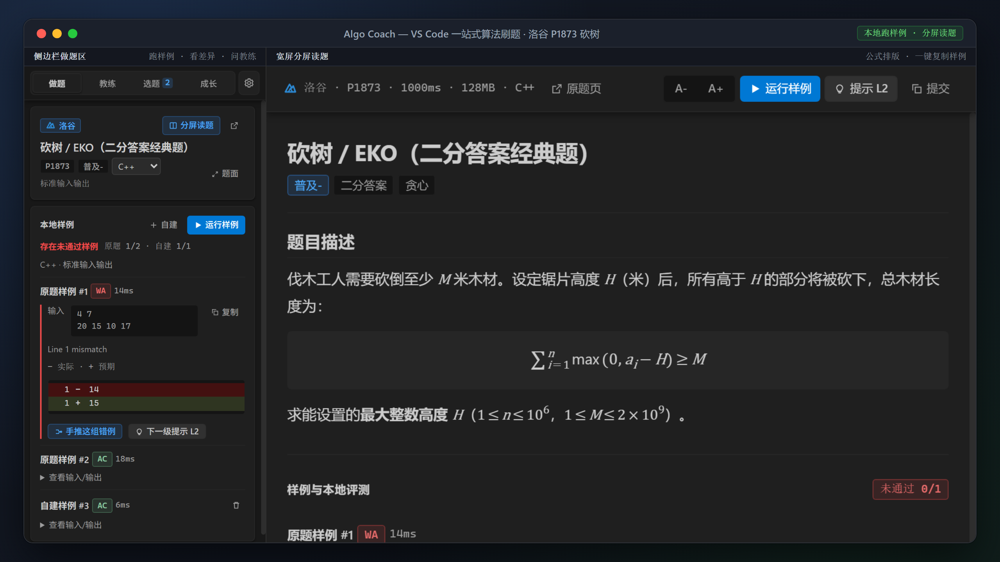
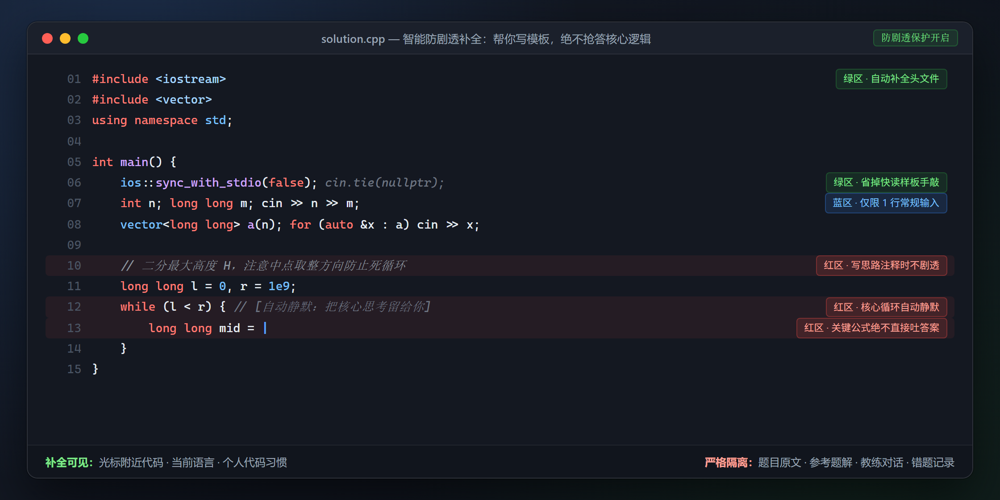
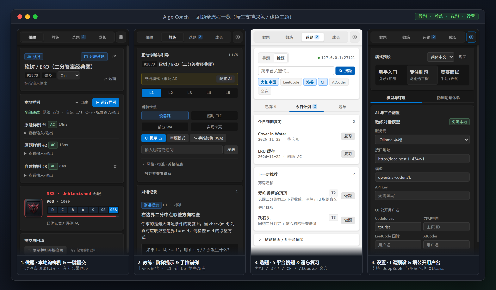

<div align="center">

# Algo Coach (`algo-coach`)

**An Anti-Spoiler Competitive Programming Coach for VS Code · Native 6-OJ · Local 5-Lang Runner · FSRS**

[简体中文](README.md) · **English**

[](package.json)
[](package.json)
[](.github/workflows/ci.yml)
[-3794ff?style=flat-square)](test/webview/antiGptSlop.test.ts)
[](LICENSE)

[Anti-Spoiler Architecture](#why-not-give-the-full-answer-anti-spoiler-isolation) · [Workspace & Reader](#workspace-layout-and-split-problem-reader) · [6-OJ Matrix & Sync](#native-6-oj-ingestion-and-verdict-sync) · [Quick Start](#quick-start-and-local-verification) · [Model Setup](#dual-model-setup-for-deepseek-and-ollama)

</div>

---

**Tired of autocomplete spoiling the whole algorithm on a single `Tab` keystroke, or juggling browser tabs just to fetch statements, strip local test harnesses, and log OJ verdicts?**

Algo Coach unifies **statement-blind 1–3 line anti-spoiler completions**, an **L1–L5 Socratic coaching ladder**, **native 6-OJ ingestion with multi-platform search and a split problem reader**, and a **5-language local runner with automated official verdict sync & `ts-fsrs` spaced repetition** inside a local-first VS Code workflow.



---

## Why Not Give the Full Answer (Anti-Spoiler Isolation)

Understanding an editorial and solving a problem independently are separated by key moments of reasoning. Algo Coach enforces a hard physical boundary between the **Autocomplete Path** and the **Coaching Path**, verified continuously by [arch boundary check](scripts/checkArchBoundaries.mjs) and isolation unit tests:



| Channel | ✅ Allowed Context | 🚫 Architecturally Blocked (Never Injected) |
| :--- | :--- | :--- |
| **Inline FIM (1–3 lines)** | Code immediately around cursor, language ID, Clean Code habits | **Problem statements, editorials, mistake history, mastery stats, coach chat, and natural-language comments** |
| **L1–L5 Coach (Explicit Trigger)** | Problem statement, code summary, current hint level, OLM profile | Never skips levels to dump full code (full walkthrough requires explicit two-step "Give Up" confirmation) |

- **`<20KB` Zero-WASM 3-Zone Lexical Engine** (`src/core/autocomplete/`):
  - **Green Zone** (headers, fast I/O templates, STL utilities): `450–600ms` debounce, 1–3 lines.
  - **Neutral Zone** (declarations & boilerplate): `900–1200ms` debounce, strictly 1 line.
  - **Red Zone** (comment-following lines, core solution logic, `if`/`while`/`for` conditions, `dp`/`mid`/`ans` RHS): **automatically suppressed**; explicit `Alt+\` remains available when requested.
- **Anti-Blind-Accept Guardrails**: `Tab` word-by-word acceptance (`strictWordAccept`), active-recall micro-friction (`multi-choice` / `lead-and-reveal`), and a 6s post-WA cooldown.

---

## Workspace Layout and Split Problem Reader

Built on a focused `4 Primary Tabs + Top-Right Gear` layout (`Solve | Coach | Bank | Stats` + `⚙`), bound 100% to native VS Code `--vscode-*` theme tokens (zero hardcoded colors, zero gradients, zero Unicode emoji) and verified down to `260px` sidebar widths:



| View | Core Workflow & Spatial Highlights |
| :--- | :--- |
| **Solve** | Compact `76px` problem anchor (long statements collapsed by default, 1-click inline expand or side-by-side **Split Reader**) with **Local Samples** promoted above the fold. Failing samples link straight to `Trace Counterexample`; all-green runs link to `Complexity Review`. The Submit card provides **Copy Code** / **Copy URL** foolproof fallbacks (for users signed in on a non-default browser), **4-OJ zero-login verdict sync (+ 90s auto-poll)**, and 1-click manual verdict buttons with Toast **Undo**. |
| **Coach** | Problem header + 1-click AI setup shortcut when offline; deterministic L1–L5 ladder + 30s Pattern Mapper + counterexample dry-runs; preferences tucked into a collapsible drawer; every reply includes a transparent **Context Audit Receipt** and misconception mute action. |
| **Bank** | Unified **Import / Search Omnibar** with **multi-OJ chip toggles + All + concurrent interleaved search** (plus partial-source failure notice) and live `127.0.0.1:27121` bridge indicator; underlined sub-tabs for **Saved**, **Today** (FSRS due queue + zero-token 3-bucket recommendations), and **Sheets** (Hot 100 · Blind 75 · NeetCode 150 · 3-Problem Offline Warmup); drawer includes **1-click 6-OJ Tampermonkey userscript copy**. |
| **Stats** | Focused 3-card analytics (7-day KPI strip, Concept Mastery meter table, Blind Spots & Mistake Notebook) + 1-click **Void & Recompute** over the latest 5 events. |
| **Settings (`⚙`)** | Clean `Back` button returning to the previous tab; houses **AI & Env** (DeepSeek / Ollama presets + **4 public OJ handle fields** + 3-step Health Check + Toolchain Doctor) and **Experience** (flags, autocomplete code habits, Web Audio synthesizer). |

- **Split Problem Reader (`src/extension/problemReaderPanel.ts`)**: Borderless editor-beside canvas powered by a `<12KB` dependency-free Markdown + LaTeX renderer (`markdownMath.ts`), complete with per-sample copy actions and keyboard hint triggers.

---

## Native 6-OJ Ingestion and Verdict Sync

No external MCP servers or Python CLI wrappers needed — all 6 judges use built-in HTTP/HTML/GraphQL adapters with timeout guards and anti-bot challenge detection:

| Platform | Native Problem & Search Support | Accepted Input Formats | Local Run, Submit & Verdict Sync |
| :--- | :--- | :--- | :--- |
| **LeetCode CN (`leetcode.cn`)** | ✅ Guest GraphQL full statement, function signature metadata, keyword search & curated index | `#1`, `#146`, `lc#1`, `力扣1`, `LCR 007`, slug, URL | Function harness local runner + **Zero-login `recentSubmissions` sync (+ 90s auto-poll)** + optional userscript |
| **LeetCode Global (`leetcode.com`)** | ✅ Guest GraphQL full statement, function metadata & search | `lc-global:1`, slug, URL | Function harness local runner + **Zero-login `recentSubmissionList` sync (+ 90s auto-poll)** + optional userscript |
| **Codeforces** | ✅ Full statement & samples + `problemset.problems` search | `1900A`, `CF1900A`, URL | Stdio local runner + **Zero-login `user.status` sync (+ 90s auto-poll)** + optional userscript |
| **AtCoder** | ✅ Full task statement & samples + `kenkoooo` public problem search | `abc350_c`, URL | Stdio local runner + **Zero-login `kenkoooo v3` sync (+ 90s auto-poll)** + optional userscript |
| **Luogu (`luogu.com.cn`)** | ✅ Structured Lentille statement, LaTeX & sample pairs + search | `P1001`, `P1873`, `B2001`, URL | Stdio local runner + **6-OJ userscript auto-push** or manual 1-click verdict with Toast undo |
| **NowCoder (`nowcoder.com`)** | ✅ Statement parsing, formula-image-to-LaTeX & sample extraction | URL / `acm-<id>` | Stdio local runner + **6-OJ userscript auto-push** or manual 1-click verdict with Toast undo |

> **Two Automatic Official Verdict Sync Options (Zero Cookies · Zero Passwords · Zero CAPTCHA Bypass)**:
> - **Option A — Zero-Login Public Sync (Default)**: Add your public handle(s) for Codeforces, LeetCode CN, LeetCode Global, and/or AtCoder under `⚙ Settings → Public OJ Handles`. Clicking **Copy & Open** triggers up to 90s of bounded background polling (or trigger anytime via **Sync OJ**).
> - **Option B — Authenticated 6-OJ Companion Userscript (Optional)**: Under `Bank → Clipboard & Bridge`, copy the generated Tampermonkey script [algo-coach-verdict-bridge.user.js](resources/companion/algo-coach-verdict-bridge.user.js) pre-configured with your localhost port and `SecretStorage` token (`x-algo-coach-token`). After you submit and pass any human verification in your own logged-in browser, the script observes only the rendered verdict text and posts to `LocalhostBridge`'s strict-`Origin`-allowlisted `POST /verdict`.
> - **Fallback Safety**: Built-in `POST /` **Competitive Companion** listener (`127.0.0.1:27121` auto-fallback + DNS Rebinding protection) plus clipboard/Markdown merge. Never reads browser cookies or bypasses Turnstile/CAPTCHA gates.

---

## Local 5-Language Runner · FSRS · Opt-Out Experience Modules

- **5-Language Local Runner (`src/runner/`)**: Native execution for **C++ / Python / C / Rust / Java**, supporting both Stdio (ACM/OI) and LeetCode Function Harnesses without polluting user source files, complete with `sha256` compile caching, process-tree TLE kills, 1 MiB OLE caps, and **Toolchain Doctor**.
- **Two-Layer Learner Profile (`src/core/learner/`)**: Append-only `learningEvents.v2.jsonl` + explicit `userOverrides.v2.json` (human mutes, voids, habits), paired with **`ts-fsrs`** spaced repetition and deterministic recommendation rationales.
- **3 Mode Presets + Fully Togglable Modules (`src/experience/`)**: `starter` / `focus` *(default)* / `contest`.
  - **Starter Pack**: 5-step VS Code Walkthrough, 3 zero-AI offline warmup problems, and restorable rainbow bracket/guide presets.
  - **DMC Stylish Rank**: `D · Draft` through `SSS · Unblemished` with custom metallic WebP crests and 6-OJ SVG badges; hand-typing unlocks up to `B`, sample passes unlock `A/S`, and official `AC` unlocks `SSS`.
  - **Procedural Web Audio Mechanical Key Sounds (Off by Default)**: Zero external audio files, 1-click status bar mute, automatic pause on blur.

---

## Quick Start and Local Verification

Requirements: VS Code `^1.93.0`, Node.js `>=20.0.0`.


```powershell
git clone https://github.com/Kaiserunix/student-autocomplete-lab.git
cd student-autocomplete-lab
npm ci
npm run verify   # tsc --noEmit + architecture boundary check + 35 Vitest files (242 tests) + esbuild bundles
```

- Open the repository root in VS Code and press `F5` (**Run Algo Coach Extension**) to debug in the Extension Development Host.
- To build and install a local `.vsix`, run `npx --yes @vscode/vsce package --no-dependencies` and `code --install-extension algo-coach-0.2.1.vsix`.

### Dual-Model Setup for DeepSeek and Ollama

Open top-right `⚙ Settings → AI & Env` to apply **DeepSeek** or **Ollama (Local, No Key)** presets in 1 click and run the 3-step connectivity self-check. API keys stay strictly inside VS Code `SecretStorage`:

| Role | Recommended Model (DeepSeek) | Base URL | Ollama Local Example (No Key) |
| :--- | :--- | :--- | :--- |
| **Chat (Coach / Review)** | `deepseek-chat` / `deepseek-reasoner` | `https://api.deepseek.com/v1` | `http://localhost:11434/v1` |
| **FIM (Anti-Spoiler Autocomplete · Optional)** | `deepseek-chat` | `https://api.deepseek.com/beta` *(`/beta` required for FIM)* | `http://localhost:11434/v1` |

---

<details>
<summary><strong>Project Structure & Highlights Since v0.1.0-beta.1 (Click to Expand)</strong></summary>

```text
src/
├─ core/
│  ├─ contracts/          # Shared domain schemas & Webview protocol (zero vscode imports)
│  ├─ ai/                 # Multi-provider clients, dual-role Chat/FIM router & health check
│  ├─ autocomplete/       # 3-zone lexical engine, cooldown/circuit breaker, isolation gate
│  ├─ contextProjection/  # Stateless prompt assembly, DeepSeek FIM fidelity & audit trail
│  ├─ coach/              # L1–L5 ladder, Pattern Mapper, dry-run trace & spoiler guardrails
│  └─ learner/            # OLM + ts-fsrs + idempotent JSONL event log + user overrides
├─ problems/              # Native 6-OJ adapters, httpClient & LocalhostBridge (/ & /verdict)
├─ runner/                # 5-language local runner (Stdio + LeetCode harness + Toolchain Doctor)
├─ submitBridge/          # HTTPS submit guard, debug stripper, 4-OJ sync & 6-OJ userscript builder
├─ experience/            # Mode presets, starter warmup, shortcut coach, DMC rank & sound policy
├─ extension/             # Thin VS Code host (SidebarController, ProblemReaderPanel, SecretStorage)
└─ webview/               # 4+Gear native UI, split reader renderer, zero-dep LaTeX & Web Audio
resources/
├─ ui/                    # Rank WebP badges, empty-state art & 6-OJ SVG icons
└─ companion/             # 6-OJ visible-DOM Tampermonkey userscript template
docs/assets/              # Carbon showcase screenshots
```

**Key Upgrades Over `v0.1.0-beta.1`:**
1. Replaced external MCP / Python CLI / high-risk auto-submit & OAuth code with native 6-OJ adapters, a compliant HTTPS submit bridge, and a zero-`vscode` domain layer.
2. Added a 5-language local runner (Stdio + LeetCode Function Harness), `ts-fsrs` spaced repetition, and an interactive Pattern Mapper / WA counterexample loop.
3. Shipped the `4 Tabs + Gear` spatial UI and Split Problem Reader guarded by automated Anti-GPT-Slop & bundle budgets (`webview.js` `80.0 KB` / `reader.js` `24.5 KB`).
4. Added **selectable 5-OJ aggregated search**, **Copy Code / Copy URL browser fallbacks**, and **Option A (4-OJ zero-login sync + 90s background auto-poll) + Option B (token-guarded `POST /verdict` + 6-OJ Tampermonkey userscript)**.

</details>

## License

[MIT](LICENSE) © 2026 [Kaiserunix](https://github.com/Kaiserunix)
