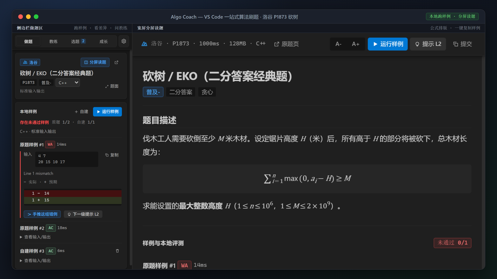
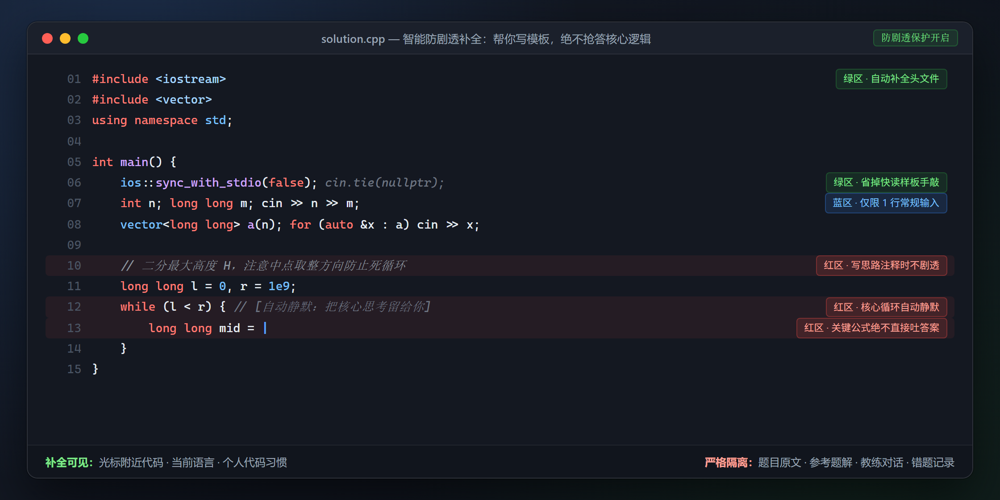
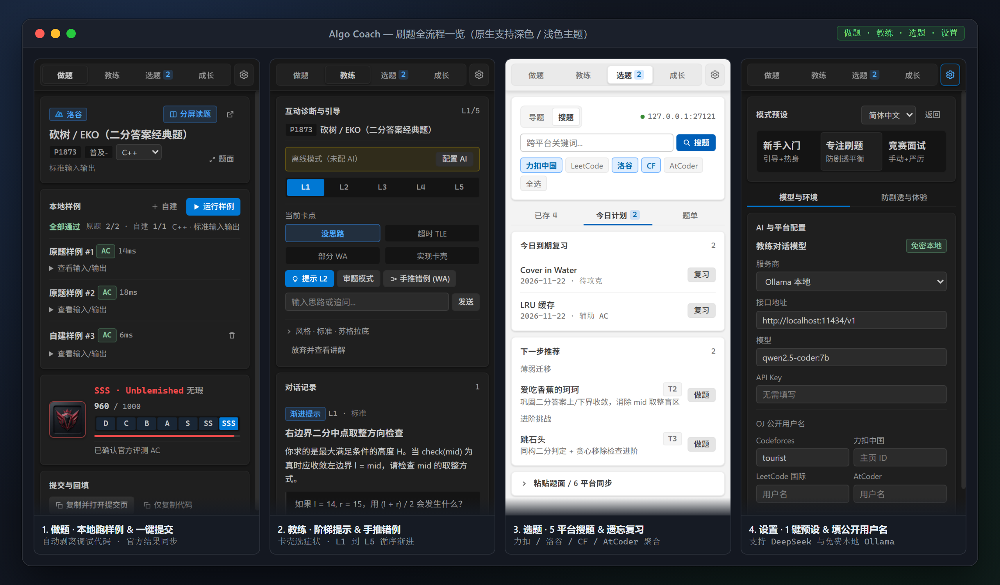
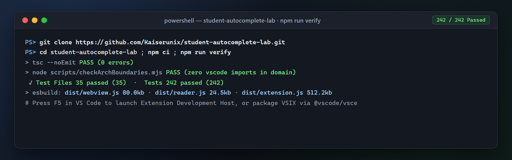

<div align="center">

# Algo Coach (`algo-coach`)

**不替你交卷的 VS Code 多平台算法私教 · Native 6-OJ · Anti-Spoiler · FSRS**

**简体中文** · [English](README.en.md)

[](package.json)
[](package.json)
[](.github/workflows/ci.yml)
[-3794ff?style=flat-square)](test/webview/antiGptSlop.test.ts)
[](LICENSE)

[为什么不剧透](#为什么不直接给完整答案架构级防剧透隔离) · [界面与空间动线](#4-空间架构与分屏读题器) · [6-OJ 能力矩阵](#原生-6-oj-抓题与提交流程完全去-mcp) · [30 秒快速开始](#快速开始与本地验证) · [双模型配置](#deepseek--ollama-双模型配置)

</div>

---

**用 Copilot 刷算法题，一按 `Tab` 整道题全剧透了？切浏览器导题、配环境、手工测边界、来回抄评测结果太繁琐？**

Algo Coach 把 **「盲视题面的 1–3 行防剧透短补全」**、**「L1–L5 苏格拉底阶梯教练」**、**「原生 6-OJ 抓题 + 多平台聚合搜题 + 分屏读题器」** 与 **「5 语言本地跑样例 + 官方结果同步 + FSRS 遗忘复习」** 融为一套本地优先的 VS Code 工作流——省掉重复模板手敲与切页摩擦，把真正的算法思考留给你自己。



---

## 为什么不直接给完整答案？（架构级防剧透隔离）

“看懂一份题解”与“自己独立 AC”之间隔着关键几次推演。Algo Coach 在代码架构层对 **短补全通道** 与 **教学通道** 实施物理隔离，并由 [arch boundary check](scripts/checkArchBoundaries.mjs) 与隔离单元测试持续守卫：



| 通道 | ✅ 可见上下文 | 🚫 架构级严格隔离（永不可见） |
| :--- | :--- | :--- |
| **短补全（Ghost Text / FIM，1–3 行）** | 光标附近源码、语言标识、个人 Clean Code 习惯 | **题面原文、参考题解、错题本、掌握度、教练对话与自然语言注释** |
| **L1–L5 教练（侧栏主动触发）** | 当前题面、代码摘要、历史提示层级与 OLM 画像 | 不跳过阶梯直接吐完整题解（仅二次确认「放弃并查看讲解」后解锁） |

- **`<20KB` 零 WASM 词法三区引擎** (`src/core/autocomplete/`)：
  - **Green Zone**（头文件、快读、STL API）：`450–600ms` 触发，1–3 行机械补全。
  - **Neutral Zone**（常规声明与输入输出）：`900–1200ms` 触发，严格限 1 行。
  - **Red Zone**（注释后首行、核心函数体、`if`/`while`/`for` 条件槽、`dp`/`mid`/`ans` 赋值右值）：**自动静默**，仅允许显式 `Alt+\` 触发。
- **防盲按护栏**：支持 `Tab` 逐词接受（`strictWordAccept`）、主动回忆微摩擦（`multi-choice` / `lead-and-reveal`）及 WA 后 6 秒冷却 / 连按熔断。

---

## 4+⚙ 空间架构与分屏读题器

采用高内聚 `4 主 Tab + 右上角 ⚙` 空间结构（`做题 | 教练 | 选题 | 成长` + `⚙`），100% 绑定 VS Code 原生 `--vscode-*` 主题令牌（零硬编码色值、零渐变、零 Unicode Emoji），`260px` 极窄侧栏实测零截断：



| 视图 | 核心高频动线与设计细节 |
| :--- | :--- |
| **做题 (`Solve`)** | 顶部 `76px` 紧凑题面锚点（默认折叠长题面，一键展开或开启宽屏 **分屏读题器**），**本地样例**上提至首屏；WA Diff 底部直连 `手推这组错例`，全 AC 直连 `面试复杂度复盘`；提交卡同时提供 **仅复制代码** / **复制链接** 防呆回退（未在默认浏览器登录时免折腾）、**4 平台免登录官方结果同步（含提交后 90s 后台轮询）** 与手动回填（Toast **1 键撤销**）。 |
| **教练 (`Coach`)** | 题号上下文条 + 离线未配 AI 时展示一键跳转引导；L1–L5 确定性阶梯 + 30 秒 Pattern Mapper + 错例干跑；偏好与语气折叠收敛为抽屉；每条回复附带透明 **上下文审计回执** 与错因屏蔽按钮。 |
| **选题 (`Bank`)** | 顶部融合 **导题 / 搜题 Omnibar**（支持 **5 平台芯片多选 + 全选 + 并发轮询聚合** 与单源异常独立降级提示）与 `127.0.0.1:27121` 桥接在线状态灯；下设二级 Tab：**已存** / **今日计划**（FSRS 到期复习 + 0 Token 三桶去重推荐）/ **题单**（Hot 100 · Blind 75 · NeetCode 150 · 3 题离线热身包）；抽屉内支持 **1 键复制 6 平台油猴回传脚本**。 |
| **成长 (`Stats`)** | 纯粹 3 卡分析（7 天轨迹 KPI / 知识点掌握度 / 活跃盲区与近期错题）+ 最近 5 条评测 **1 键作废并重算画像**。 |
| **⚙ 设置** | 一键 `返回` 上一视图，内置 **模型与环境**（DeepSeek / Ollama 免密本地预设 + **4 平台公开 OJ 用户名** + 3 步健康自检 + Toolchain Doctor）与 **防剧透与体验**（训练开关 + 补全编码习惯 + Web Audio 音效）。 |

- **宽屏分屏读题器 (`src/extension/problemReaderPanel.ts`)**：编辑器右侧无边框原生画布，内置 `<12KB` 零依赖 Markdown + LaTeX 公式排版（`markdownMath.ts`），支持样例一键复制与 `Alt` 提示联动。

---

## 原生 6-OJ 抓题与提交流程（完全去 MCP）

无需安装外部 MCP Server 或 Python CLI 适配器，所有 6 大平台均原生直读题面与样例，保留完整超时控制与反爬挑战检测：

| 平台 | 原生抓题与搜题 | 快捷输入格式 | 运行、提交与官方结果回传 |
| :--- | :--- | :--- | :--- |
| **力扣中国 (`leetcode.cn`)** | ✅ Guest GraphQL 完整题面、函数签名 + 关键词搜题 + 精选路线 | `#1`、`#146`、`lc#1`、`力扣1`、`LCR 007`、slug、URL | 函数 Harness 跑样例 + **免登录 `recentSubmissions` 同步（含 90s 后台轮询）** + 可选油猴脚本 |
| **LeetCode Global** | ✅ Guest GraphQL 零登录完整题面、函数签名 + 关键词搜题 | `lc-global:1`、slug、URL | 函数 Harness 跑样例 + **免登录 `recentSubmissionList` 同步（含 90s 后台轮询）** + 可选油猴脚本 |
| **Codeforces** | ✅ 原生抓题完整题面与样例 + `problemset.problems` 公开搜题 | `1900A`、`CF1900A`、URL | Stdio 跑样例 + **免登录 `user.status` 同步（含 90s 后台轮询）** + 可选油猴脚本 |
| **AtCoder** | ✅ 原生任务页题面与样例 + `kenkoooo` 公开题库搜题 | `abc350_c`、URL | Stdio 跑样例 + **免登录 `kenkoooo v3` 同步（含 90s 后台轮询）** + 可选油猴脚本 |
| **洛谷 (`luogu.com.cn`)** | ✅ Lentille 结构化完整题面、LaTeX 与多组样例 + 搜题 | `P1001`、`P1873`、`B2001`、URL | Stdio 跑样例 + **6 平台油猴脚本实时回传** 或 手动 1 键回填（支持撤销） |
| **牛客 (`nowcoder.com`)** | ✅ 原生解析题面、公式图片自动转 LaTeX 与样例 | 题目 URL / `acm-<id>` | Stdio 跑样例 + **6 平台油猴脚本实时回传** 或 手动 1 键回填（支持撤销） |

> **两种官方结果自动回传路径（零 Cookie / 零密码 / 零绕过人机验证）**：
> - **方案 A（默认，免登录公开同步）**：在 `⚙ 设置` 填入公开用户名（Codeforces / 力扣中国 / LeetCode 国际 / AtCoder），点击「复制并打开提交页」后自动在后台最多轮询 90 秒（也可随时点击「同步官方结果」手动拉取）。
> - **方案 B（可选，全 6 平台油猴实时回传）**：在 `选题 → 粘贴题面 / 插件同步` 一键复制已注入本机端口与随机令牌（`x-algo-coach-token`，持久化于 `SecretStorage`）的 Tampermonkey 脚本 [algo-coach-verdict-bridge.user.js](resources/companion/algo-coach-verdict-bridge.user.js)；交题后由你在自己已登录的浏览器标签页完成官网人机验证，脚本仅读取页面可见判题结果并回传至本机 `LocalhostBridge` 受严格 `Origin` 白名单保护的 `POST /verdict`。
> - **可靠兜底**：继续兼容 `POST /` **Competitive Companion** 浏览器推题（`127.0.0.1:27121` 端口顺延 + DNS Rebinding 防护）与离线 Markdown / 剪贴板智能合并器。扩展绝不读取浏览器 Cookie，绝不绕过 CAPTCHA / Turnstile。

---

## 本地 5 语言评测器 · FSRS · 可独立关闭的体验模块

- **本地 5 语言评测器 (`src/runner/`)**：原生支持 **C++ / Python / C / Rust / Java**，同时支持 ACM/OI Stdio 与 LeetCode Function Harness（临时驱动保持源码零污染），配备 `sha256` 编译缓存、进程树 TLE 强杀、1 MiB OLE 截断与 **Toolchain Doctor**。
- **双层学习档案 (`src/core/learner/`)**：单一事实源 `learningEvents.v2.jsonl`（幂等追加）+ `userOverrides.v2.json`（人类显式屏蔽、作废与习惯）；内置 **`ts-fsrs`** 调度遗忘曲线，推荐理由全确定性透明生成。
- **三档模式预设 + 全可关闭模块 (`src/experience/`)**：`starter`（新手入门）/ `focus`（专注刷题·默认）/ `contest`（竞赛面试）。
  - **新手教程包**：5 步原生 VS Code Walkthrough、3 道免 AI 离线热身题、可 100% 无损还原的彩虹括号与缩进线预设。
  - **DMC Stylish Rank**：`D · Draft` → `SSS · Unblemished`，配套定制金属质感 WebP 徽章与 6 OJ 几何 SVG 徽标；手敲封顶 `B`、过原题样例破境 `A/S`、官方 AC 解锁 `SSS`。
  - **程序化 Web Audio 机械键盘音效（默认全关）**：零外部音频资产，状态栏一键静音，失焦自动静音。

---

## 快速开始与本地验证

环境要求：VS Code `^1.93.0`、Node.js `>=20.0.0`。



```powershell
git clone https://github.com/Kaiserunix/student-autocomplete-lab.git
cd student-autocomplete-lab
npm ci
npm run verify   # tsc --noEmit + 架构边界守卫 + 35 文件 242 项 Vitest 单测 + esbuild 打包
```

- 在 VS Code 打开仓库根目录，按 `F5` 运行 **Run Algo Coach Extension** 即可启动 Extension Development Host 调试；
- 如需打包为本地 `.vsix` 安装至主力 VS Code，可运行 `npx --yes @vscode/vsce package --no-dependencies` 并使用 `code --install-extension algo-coach-0.2.1.vsix`。

### DeepSeek / Ollama 双模型配置

在右上角 `⚙ 设置 → 模型与环境` 支持一键套用 **DeepSeek 预设** 或 **Ollama 本地（免密）** 并运行 3 步连通自检；所有 API Key 仅存 VS Code `SecretStorage`，绝不写入代码仓或状态快照：

| 角色 | 推荐模型（DeepSeek 示例） | Base URL | Ollama 本地示例（免 Key） |
| :--- | :--- | :--- | :--- |
| **Chat（教练对话 / 复盘）** | `deepseek-chat` / `deepseek-reasoner` | `https://api.deepseek.com/v1` | `http://localhost:11434/v1` |
| **FIM（防剧透补全 · 选填）** | `deepseek-chat` | `https://api.deepseek.com/beta` *(FIM 必须 `/beta`)* | `http://localhost:11434/v1` |

---

<details>
<summary><strong>目录结构与相对 v0.1.0-beta.1 的核心演进（点击展开）</strong></summary>

```text
src/
├─ core/
│  ├─ contracts/          # 共享领域契约与 Webview 协议（零 vscode 依赖）
│  ├─ ai/                 # 多 Provider 客户端、Chat/FIM 双角色路由与 3 步健康自检
│  ├─ autocomplete/       # 3 区词法分类、自适应触发/熔断、物理隔离网关、输出过滤
│  ├─ contextProjection/  # 无状态上下文编排、DeepSeek FIM 保真渲染与脱敏审计
│  ├─ coach/              # L1–L5 阶梯、Pattern Mapper、错例手推、输出防剧透硬门
│  └─ learner/            # OLM + ts-fsrs + 幂等事件流 + 人类覆盖层 + 三桶推荐
├─ problems/              # 原生 6-OJ 完整抓题 Adapter、统一 httpClient、Bridge (/ & /verdict)
├─ runner/                # 5 语言本地评测器（Stdio + LeetCode Harness + Toolchain Doctor）
├─ submitBridge/          # 合规 HTTPS 提交桥、调试块剥离、4 平台免登录轮询与 6 平台油猴脚本生成
├─ experience/            # 场景预设、新手教程包、快捷键教练、DMC 段位、音效策略
├─ extension/             # 薄 VS Code 宿主（SidebarController + ProblemReaderPanel 等）
└─ webview/               # 4+⚙ 原生主题侧栏、分屏读题器、零依赖 LaTeX 排版、Web Audio 合成器
resources/
├─ ui/                    # 4 阶段位 WebP 徽章、空态插画与 6 平台 OJ SVG 徽标
└─ companion/             # 6 平台可见 DOM 判题结果回传 Tampermonkey 模板脚本
docs/assets/              # README Carbon 实机展示素材
```

**相对线上 `v0.1.0-beta.1` 的核心演进：**
1. 移除全部外部 MCP / Python CLI / 高风险实验性自动交题与 OAuth 模块，统一为原生 6-OJ 抓题 + 合规提交桥 + 零 `vscode` 依赖洁净领域层。
2. 新增 5 语言本地评测器（Stdio + LeetCode Function Harness）、`ts-fsrs` 遗忘曲线调度与 30 秒 Pattern Mapper / WA 错例手推闭环。
3. 完成 **4 主 Tab + 右上角 ⚙** 空间重构与宽屏分屏读题器，内置 Anti-GPT-Slop 静态红线守卫（`webview.js` `80.0 KB` / `reader.js` `24.5 KB`）。
4. 新增 **可选 5 平台聚合搜题**、**提交页防呆回退**（仅复制代码 / 复制链接），以及 **方案 A（CF / LC-CN / LC-Global / AtCoder 4 平台免登录同步 + 90s 后台自动轮询）+ 方案 B（Token 鉴权 `/verdict` + 6 平台油猴脚本）**。

</details>

## License

[MIT](LICENSE) © 2026 [Kaiserunix](https://github.com/Kaiserunix)
