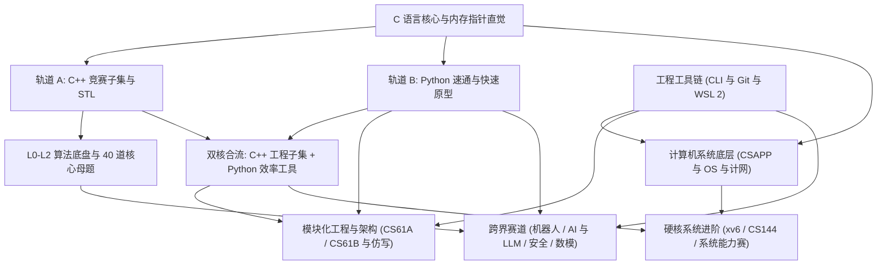

# 第 1 章 导言与大一大二能力全景图

> [!NOTE]
> 本书面向全国计算机科学、软件工程、网络工程、物联网、智能科学、信息安全以及有志跨入 CS 赛道的理工科**大一、大二本科生**编写。全文以全国通用的自学与竞赛逻辑为主线，不夹杂特定院校的行政条文；长江大学同学如需查阅本校竞赛分级认定、东校区考点信息与跨院组队实操，请直接翻阅书末[附录 A：长江大学竞赛认定与校内速查](./附录A-长江大学竞赛认定与校内速查.md)。

刚迈入大学计算机相关专业时，几乎每个人都会撞上一场“信息洪流”：课表上是按部就班的高数、线代与大物，社交平台和学长学姐口中却轮番刷屏着“ACM 算法竞赛”“海外神课”“GitHub 开源项目”与“大模型智能体”。看了一圈攻略，收藏夹塞得满满当当，打开电脑却依然不知道今晚第一步该敲哪行代码。

这本索引小书不打算再给你添一份压得人喘不过气的“四年必读书单”。它只想陪你做一件更实在的事：**把大学前两年真正值得投入、能持续带来正反馈的核心能力理清先后顺序，让你每一步都踩在稳固的台阶上。**

---

## 1.1 为什么你需要一张“前置依赖地图”，而不是死板的学期课表？

在大一和大二的自学路上，让人半途而废的往往不是不够努力，而是掉进了三个极度消耗心气的怪圈：

1. **“收藏即学会”的信息过载**：刚入学就把十几门海外名课、几十份开源文档和“四年通关清单”塞进收藏夹。盯着别人列出的“大一上刷完 A、大一下啃完 B”倒计时表越看越焦虑，精力全耗在换教材和重做计划上，亲手写通的可运行程序却屈指可数。
2. **“从第 1 页死啃砖头书”的弃坑陷阱**：满怀热血买回七八百页的经典巨著——要么逐页背诵 C 语言语法细枝末节，要么零基础就抱起满篇伪代码与数学证明的理论专著硬啃。熬不过两周就卡在某个抽象定义上寸步难行：既没做出小作品，也没在判题系统上拿过几个绿灯，热情很快被磨光。
3. **“盲目跟风凑比赛”的无效忙碌**：单门语言的内存直觉、调试手感和基础算法还没练稳，就匆忙报了一堆跨界比赛凑人数。一学期下来，不是在改排版画演示文稿，就是在复制粘贴跑不通的开源代码——看似履历热闹，实则既没长出独立排错的工程底气，比赛也多半草草收场。

为什么照搬“大学四年标准时间表”这么容易翻车？因为大家习惯把自学当成**“按月份死板切分的学期课表”**，却忽略了两个现实：第一，各高校开课顺序不同（有的大一上先教 C，有的先教 Python，有的大二才开数据结构）；第二，每个人真正定下心开始探索的时间点也各不相同。

计算机科学本是一门讲究“层层搭积木”的学科。因此，本书彻底抛弃“大一上 X 月、大一下 Y 月”的一刀切排法，改用一条更契合知识生长规律的主线：**用“前置依赖图（DAG，有向无环图）”来组织你的能力进阶**。

不管你是刚入学的零基础萌新、刚修完 C 语言准备提速的大一下同学，还是大二才收心补课的追赶者，只需在依赖地图上找准当前已点亮的坐标，就能一眼看清三件事：

- **前置条件（Prerequisites）**：迈出这一步前，手里必须先握紧哪几块看家基本功；
- **核心能力节点（Capability）**：现阶段最精炼、最易消化出成果的资源与训练动作是什么；
- **解锁下游（Unlocks）**：踏稳这一级台阶后，前方哪些硬核课程、竞赛赛道和真实项目会自然向你敞开。

至于如何在不拖垮课业与绩点（GPA）的前提下把这些节点装进两年作息，我们把三条可自选的成长节奏线集中收口在[第 6 章](./06-路线编排与好学心法.md)；各类赛事客观的报名与办赛月份窗口，则统一整理在[第 3 章](./03-算法与数据结构竞赛索引.md)、[第 5 章](./05-泛CS竞赛与跨界方向索引.md)与[附录 A](./附录A-长江大学竞赛认定与校内速查.md)方便随时翻查。站在起点先看清四座能力岛屿的轮廓，每一步努力才不会走成原地打转的消耗。

---

## 1.2 大一大二 CS 核心能力四支柱（盘子装什么、不装什么）

大一大二只有四个学期和两个长假。把盘子端稳的关键，在于分清**哪些是前两年踮脚就能吃透、能立刻带来正反馈的黄金主干，哪些则应坦然留给大三以后的深水区**。本书把前两年的成长底座收敛为四大支柱：

1. **支柱一 · 多语言路线与工程工具底盘（[第 2 章](./02-多语言路线与编程基本功索引.md)）**——*先建机器直觉，再配趁手兵器*。从 C 语言出发摸清内存地址与指针脉络，再按个人目标走通 `C → C++ → Python` 或 `C → Python → C++` 双轨并最终合流；首月先借零折腾环境跑通代码，寒假再补齐命令行、Git 与 WSL 2（Windows 原生 Linux 子系统）底座。
2. **支柱二 · 算法抽象与数据结构内功（[第 3 章](./03-算法与数据结构竞赛索引.md) & [第 7 章](./07-算法实战训练与作业精选.md)）**——*把代码边界控制力练成肌肉记忆*。通过独立思考与手写实现，练出心算时空复杂度、把控边界条件以及用“自动对拍”（用稳对的暴力程序与待测程序同跑随机小数据比对答案）揪出隐蔽漏洞的基本功。借蓝桥杯、天梯赛、RAICOM-CAIP、CCF CSP 与 ICPC/CCPC 实战，配合 40 道梯级母题把 L0~L2（从语法模拟到区域赛铜银底盘，见第 3 章分级）算法骨架焊牢。
3. **支柱三 · 计算机系统直觉与代码架构启蒙（[第 4 章](./04-系统基础与代码架构索引.md)）**——*走出几百行单文件 `main.cpp` 的舒适区*。一边借中文系统缓冲课与 CSAPP（《深入理解计算机系统》）核心实验看清“程序如何在硬件与操作系统上跑起来”，一边通过 UC Berkeley CS61A / CS61B 与微型开源项目仿写，学会用模块化接口和单元测试驾驭千行级项目。
4. **支柱四 · 多赛道竞赛试炼与跨界应用探索（[第 5 章](./05-泛CS竞赛与跨界方向索引.md)）**——*带着代码底盘去交叉赛道当主力*。把独立编码与调试底盘迁移到机器人与智能硬件、人工智能与深度学习、大模型与 AIGC（生成式 AI 应用）、信息安全夺旗赛（CTF）、数学建模及系统能力大赛中——大一低成本探路，大二锁定一条支线做出硬核作品。

为了帮你卸下不必要的“超载包袱”，下表明确划出了大一大二的**克制边界**：

| 能力领域 | 大一大二黄金投入区（本书重点展开） | 主动留白给大三以后（切勿过早内耗） |
| :--- | :--- | :--- |
| **语言与工程工具** | C 语言内存模型、C++ 竞赛/现代工程子集、Python 速通、大二按需点亮一门第三语言、Shell / Git / WSL 2 基础 | 集邮式同时学五六门语言；深究冷门模板元编程；花几周重度魔改编辑器配置 |
| **算法与竞赛训练** | 复杂度心算、L0~L2 核心算法与数据结构（模拟、二分、搜索、基础 DP、图论、常规树状结构）、40 道精选母题（+ 4 道 CSES 拓展）与周赛实战 | L2 尚未稳固就硬啃网络流、多项式或偏怪模板；把《算法导论》从第 1 页当入门书死磕 |
| **系统与代码架构** | 中文系统缓冲课、CSAPP 不劝退三件套、大二精选 1~2 门系统/工程公开课（如 CS61B `sp21` / MIT 6.1810 / CS144）、千行级开源仿写 | MIT 6.824 分布式系统、CMU 15-445 数据库内核、大规模微服务集群与高并发调优 |
| **跨界探索与求职** | 机器人 ROS 2 仿真与单片机入门、吴恩达 + 李沐《动手学深度学习》、Dify 与开源 LLM 原型、Web/Misc CTF、数模 Python 编程手 | Stanford CS231n 深入科研改造、追逐顶会论文发表、过早背诵脱离实践的秋招面试八股 |

> [!TIP]
> 把高阶深水区主动留白给大三，绝不是放低要求。大一大二还有高数、线性代数、概率论、离散数学和大学英语等校内基石课；稳住绩点（GPA）的同时把核心底座磨亮，到了大三面对分布式系统、数据库内核或专业科研时，你的推进速度反而会比“大一贪多嚼不烂”快上一倍。

---

## 1.3 全书能力前置依赖总图（Global Dependency DAG）

下面这张前置依赖总图浓缩了全书第 2 章到第 7 章的主干流向。阅读时请顺着箭头从上往下看：只有当箭尾指向的底座稳固后，顺着箭头走下去才会轻松顺滑。

从这张依赖图里，你可以读出三条极省弯路的闯关规律：

1. **双底座并行，绝不卡死起跑线**：C 语言建立的内存与指针直觉，加上命令行、Git、WSL 2 等工程工具链，是托起后续系统与工程实践的两块基石；但在大一刚起步的第一个月，你完全可以先用零配置编辑器（见[第 2 章 §2.6](./02-多语言路线与编程基本功索引.md)）跑通第一行 C++ 或 Python，绝不必因为折腾复杂环境而被挡在门外。
2. **双轨各取正反馈，殊途同归合流**：选轨道 A 可以趁热切入算法训练；选轨道 B 也能凭借 Python 先去 CS61A 工程启蒙或 AI、数模等跨界赛道拿到第一波正反馈，等后续遇到高性能计算、底层系统实验或算法赛需求时再回补 C++，水到渠成地完成双核合流。
3. **系统深潜与跨界突围都长在底盘上**：CSAPP 等系统底层课建立在 C 指针直觉与 Linux 命令行之上。往后走，MIT 6.1810（基于纯 C 的教学操作系统内核 `xv6`）会顺着 C 语言继续向内核深挖；Stanford CS144（亲手实现 TCP 网络协议栈）与部分系统能力大赛赛道则同时需要双核合流后的现代 C++ 工程功底。在机器人、大模型等跨界战队里，前面积累的 L0~L2 算法抽象与调试习惯，同样直接决定了你是挑大梁的核心开发，还是只能打下手改文档。

---

## 1.4 如何使用这本索引小书（四要素卡片读法与分人群快速入口）

市面上的很多经验帖都有一个通病：**甩出一长串书名和网址就撒手不管**——既不交代前置门槛，也不提醒哪几章最容易让人弃坑。为了彻底治好这个痛点，本书从第 2 章到第 6 章对每一项核心推荐资源都严格配备了**“资源可用性四要素卡片”**（或包含完整四要素的横评矩阵）：

- **① 定位与适合谁（含前置依赖）**：帮你第一时间明确对待这份材料的**三种阅读姿态**——是必须亲手敲通每一行代码的**精读主干**（核心视频课、现代语法精简教程与必做 Lab），还是遇到盲区才按目录翻阅的**查字典工具书**（如《C Primer Plus》、OI Wiki、`cppreference`、CTF Wiki，严禁从第 1 页线性通读），抑或是先记下坐标、等代码量达标后再拆封的**高阶留白书**（如 K&R 第 2 版、《C++ Primer》、《流畅的 Python》、《算法导论》）。
- **② 为什么选它而非同类（含错位神书剖析）**：不仅点明它相比同类资源的看家优势，更会坦诚拆解那些名气如雷贯耳、却最容易把大一新生按在起跑线上摩擦的“错位大部头”——讲透它们为什么按工业级语言规范或纯数学证明来铺陈，从而避免你把案头词典错当成破冰启蒙书。
- **③ 正确打开方式与预计耗时**：颗粒度直接落到今晚就能执行的动作——开几倍速、精确锁定哪几章与哪几个 Lab、哪些冗余章节直接跳过、搭配什么练习验真，以及按日常节奏需要投入多少小时或几周。
- **④ 劝退点与平滑替代路**：透明标出免费与付费边界（帮你避开高价营销课与盗版倒卖坑）、英文或环境门槛、最常见的卡壳点，以及一旦觉得吃力可以无缝切换的平替方案。

这本小书不需要你从第 1 页正襟危坐读到最后一页。现在就对照下表认领你眼下的真实坐标，花 30 秒直接翻到最能帮你破局的那一章：

| 你目前的起点与诉求 | 推荐立即前往的章节入口 | 读完第一步该动手做什么 |
| :--- | :--- | :--- |
| **零基础大一新生**（刚入学，还没写过几百行代码） | [第 2 章 §2.1~2.2 & §2.6](./02-多语言路线与编程基本功索引.md) + [第 6 章 §6.2~6.3](./06-路线编排与好学心法.md) | 选一门 C 入门视频敲通指针，装好 CP Editor 在 30 分钟内跑通首题（若高校首课先教 Python，先看 §2.2 提示） |
| **已学完 C 语言**（想主攻算法竞赛、冲蓝桥/天梯/CSP/ICPC） | [第 2 章 §2.3](./02-多语言路线与编程基本功索引.md) → [第 3 章](./03-算法与数据结构竞赛索引.md) → [第 7 章](./07-算法实战训练与作业精选.md) | 用 5~7 天切入 C++ 竞赛子集与 STL，把第 7 章 Set 1~2 导入本地练手 |
| **对纯刷题暂不感冒**（想早点做出 AI、机器人、系统或 Web 作品） | [第 2 章 §2.2 & §2.4](./02-多语言路线与编程基本功索引.md) → [第 4 章](./04-系统基础与代码架构索引.md) / [第 5 章](./05-泛CS竞赛与跨界方向索引.md) | 用 1~2 周速通 Python 做出实用脚本，再在 CS61A 或 AI/机器人入门课中挑一个动手 |
| **想直接挑精选原题开练**（已有语言基础，缺一份去水分的梯级作业单） | [第 7 章：算法实战训练与作业精选](./07-算法实战训练与作业精选.md) + [题单资产包说明](./problem-lists/README.md) | 按 40 道母题表与导入脚本把题目同步进编辑器，每题限时 25 分钟独立思考，每天稳攻 1~2 题 |
| **大一下或大二想重新梳理全局**（担心起步晚、怕多线同时推进烂尾） | [第 6 章 §6.1 & §6.4](./06-路线编排与好学心法.md) | 认领三条节奏线中的一条，参考“追赶裁剪方案”砍掉冗余教程，单线程稳步推进 |
