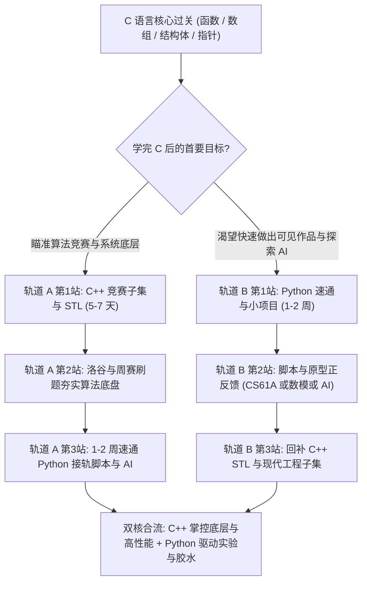

# 第 2 章 多语言路线与编程基本功索引

大一在编程语言上最常见的消耗，往往是掉进两个极端：要么抱着七百页大部头逐页死背运算符优先级，两个月没写出过两百行的完整程序；要么今天追 Python、明天转 Java、后天摸 Go，学期末每门都停在打印 `Hello World`。

想跳出无效忙碌，最省力的办法就是顺着前置依赖走：**先借 C 语言看清内存与指针脉络，再走通 C++ 与 Python 的双轨分流与双核合流；首月先用零折腾环境破冰，再趁寒假或任意整块 1~2 周配齐受用四年的命令行、Git 与 WSL 2 工具链。**

---

## 2.1 C 语言破冰：视频建立内存直觉，厚书只当案头词典

多数理工科专业大一首课讲 C 语言，图的不是那套语法，而是它几乎没有中间层封装——每一行代码都在直接面对内存地址、函数调用栈帧（每次调函数时在内存里临时开辟的工作格）与字节布局。

入门最容易翻车的学法，是买来砖头厚书从第 1 页死磕细枝末节，或在 `i++ + ++i` 等**未定义行为**（C 标准未规定结果、换个编译器算出来都不一样的写法）上钻牛角尖。**大一 C 语言真正通关只需对齐 4 项验收标准**：

1. **控制流与函数拆分**：脱离模板把模拟问题拆成职责清晰的多函数程序，告别把三百行全塞进 `main()`。
2. **数组、字符串与结构体**：用一维/二维数组处理批量数据，明白字符串以 `'\0'` 结尾，懂得处理 `scanf` 混合读入时的换行符残留并用安全的 `fgets` 替代已废弃的 `gets`，会用 `struct` 打包数据。
3. **指针与内存直觉**：看懂取址 `&` 与解引用 `*`、值传递与传址区别、数组传参退化为指针，以及 `malloc`/`free`（堆区动态内存申请与释放）配对与 `NULL` 检查（绕晕时立刻打开[第 6 章 §6.3 的 Python Tutor](./06-路线编排与好学心法.md)看实时画出的内存箭头）。
4. **基础排错闭环**：会看编译器报错行号，开启 `-Wall -Wextra`（编译器常用警告开关）提前揪出未初始化变量等隐患，能用单步调试或关键打印十分钟内定位越界与死循环。

### 2.1.1 C 语言入门选品四要素对比矩阵

下面 6 项资源各司其职。入门阶段**切忌视频和厚书同时铺开两套体系**，请按自身起点认领 **1 门主力视频课 + 1 个在线题库**动手开敲：

| 资源名称（核实作者与入口） | ① 定位与前置要求 | ② 为什么选它而非同类 | ③ 正确打开方式与预计耗时 | ④ 劝退点与平滑替代路 |
| :--- | :--- | :--- | :--- | :--- |
| **浙大翁恺《程序设计入门——C语言》**（中国大学 MOOC / B 站高播合集）+ [PTA 拼题 A](https://pintia.cn/) | 零基础大一首选，无需编程前置，重在建立程序执行模型与指针直觉 | 相比照本宣科念 PPT 的传统网课，善用内存示意图与生活类比讲透指针；相比百小时长合集更凝练，不拖节奏 | 1.25 倍速看课，每看完一节在本地敲通示例，并独立刷完对应 PTA 或洛谷入门练习；**约 3~4 周（40~50 小时）** | 早期录像使用的 Dev-C++ 界面偏旧，部分作业偏期末风格；如自律偏弱需手把手带装环境与带练小项目，转下方比特鹏哥 |
| **比特鹏哥《C语言程序设计》**（B 站免费完整合集） | 纯零基础、自学易走神、需要保姆级手把手带练编译与调试的新生 | 从编译器安装、逐行调试到“三子棋 / 扫雷”小项目全程带练，细节掰开揉碎，接地气且免费 | **只挑基础语法与指针深度剖析章节跟练，切忌 100% 全看**；每看两集停下来改参数重敲；**约 4~6 周** | 全套课时超百小时，全集追完会严重拖慢进入 C++ 与算法节奏；摸熟调试手感后立刻切回翁恺收尾或进洛谷刷题 |
| **Stephen Prata《C Primer Plus》（第 6 版）** | 案头语法百科与查漏工具书（全阶段备查），不作零基础第一教材 | 讲解极其温和细致，对标准库与语法边缘细节覆盖极全，严谨度远胜常见应试教材 | **严禁逐页通读**：视频里某块语法（如文件 IO、位运算、复杂声明）没听懂时按目录翻对应章节；随用随翻 | 近 700 页砖头厚书，大一新生从第 1 页硬啃通常两周内弃坑；想系统精读一本精干纸书，请换下方 King《现代方法》 |
| **K. N. King《C语言程序设计：现代方法》（第 2 版）** | 偏好精干纸质教科书的读者（零基础或大一配合校内课系统精读） | 结构现代、例程清晰、覆盖 C99 关键特性且比《C Primer Plus》紧凑得多；每章末尾的 **Q&A（问与答）专栏**直击真实踩坑疑问 | 重点精读 **第 1~17 章**（打通到指针、字符串、结构体、动态内存与链表）+ 按需翻阅 **第 22 章（文件 IO）**，跳过生僻库与国际化章节；**约 4~6 周** | 篇幅仍比视频慢且略带英文翻译腔；看纸书犯困者请果断回到“翁恺视频 + PTA/洛谷” |
| **Brian W. Kernighan & Dennis M. Ritchie《C程序设计语言》（第 2 版·新版，简称 K&R）** | **进阶二刷圣经**，前置需已写过 2,000 行以上 C 代码并熟悉基础指针 | C 语言之父手笔，微言大义，两百余页浓缩了 C 的设计哲学与紧凑惯用法（**注：全书基于 ANSI C / C89 标准**） | 大一寒假或学完基础算法后再精读，并手做指针、字符串与内存管理习题（需知悉其早于 C99 `bool`/`for` 内声明等特性）；**约 2~3 周** | **大一零基础第一本书必自闭**：《C Primer Plus》花十页铺垫的概念这里一句带过，且技巧藏在无详答的习题里；卡住请退回翁恺与 PTA |
| **[菜鸟教程 Runoob](https://www.runoob.com/)** | 30 秒极速语法速查卡片（绝非主教材） | 打开浏览器秒查 `printf` 格式符、运算符优先级、标准库函数原型与极简样例，零等待成本 | 仅在写代码忘记函数参数顺序或格式字符时查 30 秒，查完即关 | 缺乏体系思维、内存图解和练习闭环，绝不能把点完网页当成学会了 C 语言 |

> [!WARNING]
> **避坑提醒：别把 C 语言书单变成桌上的“收藏展示柜”**
> 很多同学桌上同时摞着《C Primer Plus》、K&R 和学校教材，结果写起循环数组还是频频越界。入门期请死守一条分工铁律：**视频负责建立动态直觉，在线判题系统（OJ）负责暴露边界漏洞，厚书永远只安静地留在桌角当词典**。

---

## 2.2 学完 C 之后的黄金分岔口：双轨路线设计与殊途同归

跨过 C 语言核心语法与指针关后，你就站到了大一最关键的分岔口：**下一步先学 C++ 还是先学 Python？**

网上争论往往各执一词——打算法赛的学长劝你“立刻学 C++，Python 跑得慢容易超时”；做 AI 和项目的同学又说“快学 Python，写十行顶 C 写一百行”。其实两边各只说了半截真相。真正聪明的安排不是“二选一互斥”，而是**顺着你眼下最迫切的正反馈决定先后顺序，并在大二前完成双核合流**。

这两条平等的主干道，各自适配的人群与推进节奏一目了然：

1. **轨道 A（`C → C++ → Python` · 竞赛与底层优先轨）**
   - **适合人群**：准备参加蓝桥杯（C/C++ 组）、团体程序设计天梯赛、睿抗 RAICOM-CAIP、ICPC/CCPC 或 CCF CSP 等算法赛事的同学，以及对操作系统、网络底层和机器人电控视觉着迷的同学。
   - **为什么顺滑**：C++ 在竞赛层面对 C 常用写法几乎无缝兼容。你无需推翻刚练熟的手感，只需趁热花 **5~7 天**补齐引用传参、`cin/cout` 加速和 **STL 标准模板库**（C++ 自带的动态数组、队列、红黑树等现成百宝箱），就能立刻进入[第 3 章](./03-算法与数据结构竞赛索引.md)与[第 7 章](./07-算法实战训练与作业精选.md)刷题拿反馈。等算法骨架搭稳后，大一下或大一暑假只需 **7~10 天**即可轻松速通 Python，接上数学建模、脚本自动化和 AI 实验。
2. **轨道 B（`C → Python → C++` · 快速作品与 AI 优先轨）**
   - **适合人群**：暂时对黑框标准输入输出刷题提不起劲，急需做出可视化图表、小型游戏、自动脚本或 AI 对话原型来点燃热情的同学，以及打算先修 UC Berkeley CS61A 或提前备战数模编程手的同学。
   - **为什么同样走得通**：掌握 C 的控制流与函数后，花 **1~2 周**速通 Python 能以极低成本做出真实有用的作品，迅速建立自信。但走轨道 B 必须提前明确一个清醒认知：**轨道 B 只是“先甜后补”，绝不是永久绕开 C++ 的避风港**——当你后续要打含金量更高的 C++ 组算法赛、修习 Stanford CS144 网络实验或编写机器人 ROS 2 实时节点时，依然需要回头补齐 C++ STL 与现代工程子集；好在届时你已有扎实的编程经验，回补 C++ 同样可按“有基础速通”高效完成。

> [!NOTE]
> **如果你们学校大一上首课先教 Python（而非 C 语言）怎么办？**
> 直接先按下方 §2.4 走通 Python 语法与小项目（零基础请勿略过前三章直接跳读，推荐搭配 CS50P 或《Python 编程：从入门到实践》打牢控制流与编程逻辑），再在大一下或寒假**务必按 §2.1 回补 C 语言指针、栈帧与内存地址直觉**——否则进入[第 4 章](./04-系统基础与代码架构索引.md) CSAPP 与系统底层实验时会缺少机器层面的心智模型。

### 2.2.1 “有 C 基础速通” vs “纯零基础慢学”核心辨析与范式迁移避坑

学第一门语言花 4~6 周很正常，因为你在同时建立“变量、循环、栈帧”等通用概念（纯零基础必须选完整带练的入门课程与分步习题，一步步打通）；但学第二门语言时，**最忌讳重新打开一套百小时零基础全集从头听起**。有 C 基础的正确策略是：**直接换用面向有经验者的官方文档或精讲，跳过 30%~40% 重叠语法，把 100% 注意力投向新语言的范式差异与高危坑位**：

| 学习维度 | 纯零基础首门语言学法（约 3~6 周） | 有 C 基础学第二门语言速通法（约 1~2 周） |
| :--- | :--- | :--- |
| **选品与控制流** | 选节奏完整的入门课（如翁恺 C、CS50P 全程或《从入门到实践》全书），按部就班练熟循环与函数 | **改用精简速通材料（OI Wiki / Python 官方 Tutorial）**，大胆跳过前 30%~40% 基础章节，30 分钟核对差异即可 |
| **内存与数据模型** | 靠画内存格子和调试器，从零弄明白变量地址、栈区生命周期与值传递 | **以 C 内存模型为标尺看差异**：C++ 看“引用 `&` 安全别名、容器值拷贝开销与 RAII 自动资源管理（详见 §2.3.2）”；Python 看“变量即对象引用、可变与不可变传参” |
| **容器与标准库** | 习惯在 C 里手动维护数组长度、手写排序与简易链表 | **直接上标准库替代手搓**：C++ 直抓 `vector`、`string`、`map`、`set`、`priority_queue` 与 `sort`；Python 直抓切片、推导式、字典集合与 `venv` |
| **练习检验闭环** | 刷基础语法题与小型控制台游戏建立手感 | **用实战闭环验收**：C++ 立刻去[第 7 章](./07-算法实战训练与作业精选.md)刷通 Set 1~2；Python 立刻写出 2 个批处理/绘图脚本 |

从 C 向 C++ 与 Python 切换时，下面 **8 个经典的“C 语言惯性陷阱”** 几乎每个大一新生都会踩到，动笔前不妨先逐条排雷：

- **C → C++ 竞赛迁移 4 大必避坑**：
  1. **读写加速禁混用**：IO 加速须成对写 `ios::sync_with_stdio(false); cin.tie(nullptr);`（解除 `cin` 每次读入前自动刷新 `cout` 的绑定），且**开启后严禁在同一程序混用 `scanf/printf` 与 `cin/cout`**。
  2. **换行拒绝 `endl`**：用 `'\n'` 替代每次都强制刷新输出缓冲区的 `endl`，否则几万行大量输出照样超时（TLE）。
  3. **大容器传参必加引用**：传入 `vector` 或 `string` 等大容器时记得加引用 `const vector<int>&`（需要原地修改则去 `const`），避免每次调用触发全量拷贝。
  4. **善用现代简写**：多用 C++17 结构化绑定 `auto [x, y]` 与范围循环 `for (auto& v : a)` 精简代码。
- **C → Python 迁移 4 大必避坑**：
  1. **二维列表浅拷贝陷阱**：初始化二维数组**严禁写 `[[0]*m]*n`**（那是把同一行列表的引用浅拷贝了 `n` 份，改一格整列跟着变），必须写推导式 `[[0]*m for _ in range(n)]`。
  2. **真除法与向负无穷整除**：`/` 是浮点真除法，`//` 才是整数整除且向负无穷取整（例如 Python 里 `-3 // 2 == -2`，而 C 里向零截断 `-3 / 2 == -1`）。
  3. **无限精度与递归栈上限**：Python `int` 原生支持任意精度不会 32 位溢出，但默认递归深度上限约 `1000`，写深搜需调 `sys.setrecursionlimit()`。
  4. **默认参数禁放可变对象**：定义函数时不要用可变对象作默认参数（如 `def f(a=[])` 会在多次调用间共享同一个列表，应改用 `a=None`）。

看清了两条轨道各自的风景与脚下暗坑，你就能放心地跳上最适合自己的那班列车，朝前方的双核合流高架进发了。

---

## 2.3 C++ 进阶双层索引：7 天竞赛子集 vs 现代 C++17/20 工程子集

谈到 C++，新手踩过最大的坑就是**把“打算法竞赛用的 C++”和“写大型软件系统用的现代 C++”混成一锅粥**。C++ 是一门经过近四十年演化的庞大语言，但大一大二不同阶段各自只需要它的一个精准切片：打算法赛只用到其中约 20% 的精悍子集；而写中大型工程，才需要搬出现代 C++17/20 的资源管理与抽象机制。请严格按需分层取用，绝不混用。

### 2.3.1 第一层：C++ 竞赛极简子集（5~7 天直接开刷）

- **① 定位与适合谁（含前置依赖）**：已掌握 C 语言函数、数组、结构体和基础指针，准备立刻切入算法练习与竞赛（蓝桥杯、天梯赛、CSP、ICPC/CCPC）的大一同学。
- **② 为什么选它而非同类**：我们直接组合 **[OI Wiki C++ 板块](https://oi-wiki.org/)** 与 **[cppreference 中文站](https://zh.cppreference.com/)**。它们不像厚重的工程教材那样先用三百页铺陈面向对象继承、虚函数表和复杂模板特化，而是帮你精准锁定考场上高频使用的核心子集：
  - **语法与读写提速**：`ios::sync_with_stdio(false); cin.tie(nullptr);` 读写加速、引用 `&` 传参、`auto` 与 C++17 结构化绑定、范围 `for`、Lambda 匿名函数；
  - **高频 STL 容器**：`vector`、`string`、`stack`、`queue`、`deque`、`priority_queue`、`set`、`map`、`unordered_map`、`pair`、`tuple`；
  - **核心算法库函数**：`<algorithm>` 里的 `sort`、`lower_bound`、`upper_bound`、`unique`（顺手记住一条实战常识：Codeforces 上默认哈希的 `unordered_map` 可能被针对性数据卡到退化，要求稳时优先用 `map` 或**离散化**——即把跨度极大的稀疏数值映射为紧凑排名下标）。
- **③ 正确打开方式与预计耗时**：先花 **3 天**通读 OI Wiki 的“C++ 语法基础 / STL 容器 / 算法库”对应条目，把每个容器的插入、删除、查询复杂度与迭代器用法在本地敲一遍；之后直接进入[第 3 章](./03-算法与数据结构竞赛索引.md)与[第 7 章](./07-算法实战训练与作业精选.md)开刷母题，写题时记不清某个成员函数参数或返回值（例如 `lower_bound` 找不到时返回什么）再打开 `zh.cppreference.com` 精准查阅。**总耗时 5~7 天（约 12~15 小时），第 8 天必须已经开始做题，不要长期滞留在语法教程里。**
- **④ 劝退点与平滑替代路**：`cppreference` 严格遵循 C++ 国际标准文案，函数声明里满屏尖括号模板参数，初学者第一次看很容易头晕。卡住时不要死读标准签名，直接翻到该页面最下方的 **Example（示例代码）** 栏照着改，或者到[《Hello 算法》](https://www.hello-algo.com/)与洛谷入门题单看现成 AC 代码里的 STL 写法。

### 2.3.2 第二层：现代 C++17/20 工程子集（3~5 周建立工程能力）

当你准备走进[第 4 章](./04-系统基础与代码架构索引.md)挑战 Stanford CS144 网络协议栈、改造开源 Web 服务器，或参与[第 5 章](./05-泛CS竞赛与跨界方向索引.md) ROS 2 机器人 C++ 节点开发时，仅有竞赛子集是不够的，这时需要补充现代 C++17/20 工程子集。下面两份核心教程分别主打“英文系统深耕”与“中文快速增量”，按自身节奏二选一为主、互为补充：

1. **英文系统标杆：[LearnCpp](https://www.learncpp.com/)**
   - **① 定位与适合谁**：已完成轨道 A 竞赛子集或有扎实 C 基础、希望系统掌握现代 C++ 类型安全、对象生命周期与泛型工程写法的同学。
   - **② 为什么选它而非同类**：全球开发者公认结构最清晰、持续迭代至 C++20/23 的免费在线教程，每节直讲现代最佳实践与内存安全避坑，远强于国内沿用二十年的过时 C++98 课件。
   - **③ 正确打开方式与预计耗时**：有 C 基础可快速扫过 **Ch 1–2、4–8**（控制流与循环在 **Ch 8**；**Ch 3 调试专题**建议按需精读），随后把主力精力集中攻克 **Ch 12–15**（引用与指针、类封装与 **RAII**——即“资源获取即初始化”，借对象离开作用域自动析构的机制托管内存与锁，告别手写 `free` 漏释放）、**Ch 16–17**（`std::vector` 与 `std::array`）、**Ch 22**（移动语义与智能指针）、**Ch 24–26**（继承、虚函数与模板）；每天 1~2 小时约 **3~5 周**。
   - **④ 劝退点与平滑替代路**：全英文且章节偏细长，容易读着读着走神；同时注意 **`LearnCpp` 目前并不包含多线程并发专题章节**。想快速打通全局或补齐现代并发特性，可切换或搭配下方的欧长坤教程。

2. **中文现代特性直通车：欧长坤《现代 C++ 教程》（[在线阅读](https://changkun.de/modern-cpp/) / [GitHub 仓库](https://github.com/changkun/modern-cpp-tutorial)）**
   - **① 定位与适合谁**：已有 C/C++ 基础、想在几天内一次性补齐 C++11/14/17/20 核心现代化语法与并发工具的速通学习者。
   - **② 为什么选它而非同类**：中文开源圈极精炼的现代特性直通车，删繁就简直奔重点，且专门涵盖 `std::thread`、`mutex`、`future` 等现代并发库，恰好补上 `LearnCpp` 的空白。
   - **③ 正确打开方式与预计耗时**：跳过第 1 章历史背景，用 **3~5 天（8~12 小时）**重点通读 **第 2~5 章**（语言可用性增强、Lambda 与**右值移动语义**——直接“过户”临时对象底层内存而非重新深拷贝、现代容器、智能指针与 RAII）并按需精读 **第 7 章（并行与并发）**，第 6 章正则与第 8 章 `<filesystem>` 留作按需翻查，把书中关键短例在本地编过跑通。
   - **④ 劝退点与平滑替代路**：它重在讲解现代增量特性，而把基础 OOP 与封装默认当作已知前提；遇到类设计、RAII 生命周期或模板语法细节没看透时，立刻回到 `LearnCpp` 对应章节（Ch 12–15、22、24–26）补细。

### 2.3.3 视频直觉双选辨析与《C++ Primer》错位剖析

| 资源名称（核实作者与入口） | ① 定位与前置要求 | ② 为什么选它而非同类 | ③ 正确打开方式与预计耗时 | ④ 劝退点与平滑替代路 |
| :--- | :--- | :--- | :--- | :--- |
| **The Cherno《C++ 系列教程》**（YouTube / B 站双语字幕合集） | 有 C 基础，想真正建立内存布局、编译链接、虚函数表与性能直觉的大一~大二同学 | 资深游戏引擎一线工程师亲自演示，单集 15~20 分钟切入痛点，把编译器和底层内存如何配合讲得极其通透 | **聚焦前 50 集左右的编译器/链接器原理、栈与堆内存布局、指针引用、虚函数表、智能指针与 `std::vector` 优化专题**（跳过偏游戏引擎工具的扩展集），每集本地编译验证；**约 2~3 周** | 英文语速较快，且不是针对算法刷题设计；配中文字幕观看，并搭配欧长坤《现代 C++ 教程》补全现代语法糖 |
| **B 站 `恋恋风辰` C++ 系列教程** | **仅限大二**已明确走 C++ 后端开发、高并发网络服务器或 Boost.Asio 路线的同学 | 网络并发实战与源码剖析极深入，贴近国内 C++ 服务端开发真实生态 | 务必在补齐现代 C++ 工程子集与[第 4 章](./04-系统基础与代码架构索引.md)计网/系统基础后，再跟着拆解网络与并发模块 | **大一新生与算法竞赛选手请勿点开**：与大一阶段完全错位，提前硬看容易被大量异步回调与工程架构细节淹没 |
| **Stanley B. Lippman、Josée Lajoie、Barbara E. Moo《C++ Primer》（第 5 版）** | **大二工程深耕期**案头权威参考书，前置需有实际 C++ 项目书写经验 | 800 多页全面覆盖 C++11 工业级类型系统、标准库与类设计规范，严谨度极高 | **严禁作为大一竞赛入门第一本书**：在大二写系统或工程项目遇到类型转换、类封装与动态内存疑惑时按目录查阅；可重点挑第 8 章（IO 库）与第 13 章（拷贝控制，第 495 页后）精读 | 前 300 页（Part I 第 1~7 章）就密集铺陈 `const/constexpr`、类型转换、函数重载与类封装细则，第 13 章才到拷贝控制；大一竞赛生顺读极易卡在繁琐语法细则中一道题没刷就弃坑，且全书止步 C++11；竞赛入门退回 **OI Wiki + cppreference**，现代工程先看 **LearnCpp** 或 **欧长坤教程** |

---

## 2.4 Python 高效索引：有基础 1 周速通、项目实战与进阶分界

学过 C 再学 Python，最大优势在于你已完全理解循环、分支、函数与基本数据结构逻辑。此时切忌再去追动辄上百小时的“纯零基础启蒙课”——把宝贵周末耗在听老师重讲“什么是 `for` 循环”纯属低效自耗。下面把有基础速通、工程习惯与书籍选型严格区分开：

### 2.4.1 有 C 基础 1 周速通核心组合

1. **首推主干：[Python 官方中文 Tutorial](https://docs.python.org/zh-cn/3/tutorial/)** + 口语辅助 **[廖雪峰 Python 教程](https://www.liaoxuefeng.com/)**
   - **① 定位与适合谁（含前置依赖）**：已掌握 C 或 C++ 基本逻辑、想用 **7~10 天**迅速写出地道（Pythonic）代码的本科生。
   - **② 为什么选它而非同类**：官方 Tutorial 导言即说明“面向已有一定编程经验的读者”，不废话解释基础概念，直抓与 C 差异最大的核心特性——切片（Slicing）、列表与字典推导式、可变（`list`/`dict`）与不可变（`int`/`str`/`tuple`）对象引用陷阱、生成器、模块导入，以及第 12 章专讲的 `venv` 虚拟环境（隔离不同项目的第三方包版本防冲突）与 `pip` 包管理。
   - **③ 正确打开方式与预计耗时**：在终端打开 Python 交互式解释器（REPL，敲一行立刻回显结果的命令行沙盒），跳过引论第 1~2 章与标准库第 11 章，边敲边通读 **第 3~10 章 + 第 12 章（虚拟环境与包）**；第 8~10 天写完 **2 个实用小脚本**（如批量重命名课程资料、解析 CSV 成绩单或绘制数据曲线）。总耗时 **7~10 天（15~20 小时）**。
   - **④ 劝退点与平滑替代路**：官方文档行文偏克制书面；若读到装饰器、闭包或类继承觉得抽象，立刻打开**廖雪峰 Python 教程**或**[菜鸟教程 Python3](https://www.runoob.com/python3/python3-tutorial.html)**对照看口语化示范。

2. **工程思维与英文能力双修公开课：[哈佛 CS50P（CS50's Introduction to Programming with Python）](https://cs50.harvard.edu/python/)**（David J. Malan 主讲）
   - **① 定位与适合谁**：想趁机锻炼英文技术听力，并把异常处理、正则表达式、单元测试（`pytest`）、文件 IO、面向对象和地道进阶写法练成自动评测闭环的大一~大二同学。
   - **② 为什么选它而非同类**：全球顶尖制作水准、完全免费，每周配套工业级自动评测 Problem Sets，彻底治好“跑通一个本地例子就以为没 Bug”的随意习惯。
   - **③ 正确打开方式与预计耗时**：全课共 **Week 0–9 + Final Project**。有 C 基础可 **1.5 倍速快进 Week 0–2**（函数、条件、循环），**Week 3（Exceptions 异常处理）因 C 语言无该机制建议按正常节奏敲完**，随后把主力放在 **Week 4–9**（Libraries、Unit Tests、File I/O、Regex、OOP，以及补足推导式、类型标注与 `*args`/`**kwargs` 的 **Week 9 Et Cetera**）和结课大作业，约 **3~4 周**。
   - **④ 劝退点与平滑替代路**：全英文授课且配套作业耗时高于文档速通——若时间紧迫只想中文视频快扫语法切入数据处理，可看 **B 站黑马程序员 Python 精简合集**（务必 2 倍速跳过基础语法，直奔容器、文件读写与第三方库）。

### 2.4.2 Python 纸质书阶段严格切分（两本畅销名书的正确出场时机）

许多大一同学一搜 Python 书单就同时买回下面两本书，结果一本读太快觉得浅、另一本翻三页完全看不懂。其实它们服务于完全不同的代码里程数阶段：

| 书名与作者 | ① 定位与前置要求 | ② 为什么选它而非同类 | ③ 正确打开方式与预计耗时 | ④ 劝退点与平滑替代路 |
| :--- | :--- | :--- | :--- | :--- |
| **Eric Matthes《Python 编程：从入门到实践》（第 3 版）** | 适合刚走上轨道 B、想在大一寒假做出“人生第一个完整软件作品”的初学者 | 不像纯语法书那样学完还不知道能干什么，全书后半部分手把手带你搭建真实可运行的综合应用 | **第 1~11 章基础只花 2~3 天速扫**（重点翻第 9~11 章的类、`pathlib` 文件读写与 `pytest` 测试），把核心时间全部投入**第 12~20 章的 3 个完整实战项目**（Pygame 2D 游戏第 12–14 章、Matplotlib/Plotly 可视化第 15–17 章、Django Web 第 18–20 章）；挑 1~2 个项目做完约 **2~3 周** | 前 11 章面向纯零基础，有 C 基础如果一页页精读会觉得过于啰嗦；如仅需脚本和工具，前 11 章用官方文档 1 周替代即可 |
| **Luciano Ramalho《流畅的 Python》（第 2 版）** | **中高阶神作，绝非入门书！** 仅适合大二已写过数千行真实 Python 代码者 | 全书深入剖析 Python 数据模型（魔术方法）、序列协议、对象引用与垃圾回收、装饰器、异步协程与元编程，是摆脱“用 C 语言思路硬写 Python”的必经之路 | 等你在 AI 训练、Web 后端或自动化工程里积累了一定代码量后再来精读核心章节（**第 1~3 章、第 6 章对象引用与可变性、第 7 章、第 9 章及并发章节**），配合项目随翻随用 | **大一千万别买来当入门书**：没有数千行真实项目困惑时硬读各种协议与元类只会满头雾水；入门阶段请退回官方 Tutorial 与《从入门到实践》 |

---

## 2.5 大二按需解锁第三语言（不贪多，用场景倒推 1~2 周速通）

**铁律：大一绝不集邮式学五六门语言！** C 底盘加 `C++ / Python` 双核足以覆盖 90% 以上的大一需求。到大二，仅当具体名课（如 CS61B）或竞赛项目需要时，按场景倒推花 **1~2 周**从下面三门里按需点亮一门：

1. **Java（修 CS61B 或软件杯 / 服创 / 后端工程赛）**
   - **① 定位与适合谁**：已有 C++/Python 基础，需快速切入强类型 OOP 工程或 Spring Boot 后端的大二同学。
   - **② 为什么选它们**：国际课程路线选免费带自动评测的 **[赫尔辛基大学《Java Programming I & II》](https://java-programming.mooc.fi/)**；国内工程赛生态选 **B 站黑马程序员或尚硅谷 Java 基础精简版**（免费），直接衔接框架开发。
   - **③ 打开方式与耗时**：走赫尔辛基 MOOC 时（Part 1–7 为第一部，Part 8–14 为第二部，配免费 TMC 自动评测插件），有基础者**跳过 Part 1–2**，速扫 **Part 3**（数组与 `ArrayList`），精攻 **Part 4–5**（OOP 封装）+ **Part 8–9**（`HashMap`、接口、继承与多态）+ **Part 11**（异常），写 Spring Boot 时顺手翻阅 **Part 10**（Stream 与 Lambda），**1~2 周**即可无缝进[第 4 章](./04-系统基础与代码架构索引.md) CS61B `sp21`。
   - **④ 劝退点与替代路**：别在大二刚转 Java 时就抱起上千页《Java 编程思想》硬啃，先把项目跑通，大部头留作案头词典。

2. **JavaScript / TypeScript（Web 全栈 / AIGC 界面 / 4C 计设）**
   - **① 定位与适合谁**：准备做网页应用、大模型对话前端或 4C 全栈赛道，具备 C 或 Python 基础。
   - **② 为什么选它们**：**[《现代 JavaScript 教程》](https://zh.javascript.info/)** 结构清晰且全中文免费；叠加 **[TypeScript 官方 Handbook](https://www.typescriptlang.org/docs/handbook/)**，帮习惯强类型的同学少踩动态类型坑。
   - **③ 打开方式与耗时**：跳过变量循环，集中攻克三大差异区——**闭包作用域、原型链、异步事件循环（`Promise` 与 `async/await`）**（约 **1~2 周**），随后接 TS 文档建立类型约束。
   - **④ 劝退点与替代路**：前端工具更新极快，初学切忌同时折腾三四个构建工具，先用官方脚手架跑通前后端联调。

3. **Go（云原生 / 高并发后端 / 轻量 CLI 工具）**
   - **① 定位与适合谁**：探索高并发服务端或分布式小工具，具备 C 指针与基础网络概念。
   - **② 为什么选它们**：Go 语法克制，无需看几十小时视频；官方交互教程 **[《A Tour of Go》](https://go.dev/tour/)** 配代码速查库 **[《Go by Example》](https://gobyexample.com/)** 最高效。
   - **③ 打开方式与耗时**：浏览器 **半天~1 天**通关 `A Tour of Go`，抓住值/指针、隐式接口与 `goroutine / channel`；随后边写迷你 HTTP Server 边把 `Go by Example` 当词典查，**约 1 周**实战。
   - **④ 劝退点与替代路**：别硬套 C++ 类继承思维，顺着“组合优于继承”与 `if err != nil` 显式错误处理写几天就顺手了。

---

## 2.6 编程工具链护城河：命令行、Git、WSL 2 与零折腾编码环境

大一还有个常见时间黑洞叫“工具链原始人模式”：桌面上躺着 `作业_改3_最终版.cpp`，离开 IDE“一键运行”就不会终端编译。首月先用零折腾编辑器跑通首题，再趁寒假或任意整块 1~2 周补齐命令行、Git 与 WSL 2，往后三年做实验和打比赛都会顺畅数倍：

### 2.6.1 四大工具链护城河四要素配置卡片

1. **[MIT Missing Semester 中文版](https://missing-semester-cn.github.io/)**（原英文站：[MIT Missing Semester](https://missing.csail.mit.edu/)）
   - **① 定位与适合谁**：大一寒假必修的 CS 生存技能课，只要会写基础 C 代码就能听懂。
   - **② 为什么选它而非同类**：专讲课堂略过、工程师每天却离不开的命令行、脚本、Git 与调试，比碎片博客成体系得多。
   - **③ 正确打开方式与预计耗时**：**精选 4 讲**即可——**第 1 讲（Shell）、第 2 讲（Shell 工具与脚本）、第 4 讲（数据整理）、第 6 讲（Git）**，边看边在终端敲通；**1~2 周（10~15 小时）**。**第 7 讲（调试及性能分析）**留待进入[第 4 章](./04-系统基础与代码架构索引.md) CSAPP 与系统实验前再回来补看。
   - **④ 劝退点与平滑替代路**：全看易在 Vim 高阶配置里迷路；日常 Vim 只需会 `i` / `Esc` / `:wq` / `dd` / `yy` 应付应急改配置即可。

2. **[Learn Git Branching](https://learngitbranching.js.org/)** + **[《Pro Git》中文第 2 版](https://git-scm.com/book/zh/v2)**
   - **① 定位与适合谁**：快速建立 Git 分支拓扑直觉与云端备份习惯，零门槛。
   - **② 为什么选它而非同类**：交互闯关直观展示 `branch / merge / rebase` 节点跳动，比死背参数快十倍；《Pro Git》免费且最权威。
   - **③ 正确打开方式与预计耗时**：花 **2~3 小时**打通 `Learn Git Branching` 主线关卡，再翻《Pro Git》**第 1~3 章**，当天就把作业和算法板子推上 GitHub 或 Gitee。
   - **④ 劝退点与平滑替代路**：别死背几十个生僻参数，日常 95% 只用到 `status / add / commit / push / pull / branch / checkout / merge`。

3. **[WSL 2（微软官方中文文档）](https://learn.microsoft.com/zh-cn/windows/wsl/)**
   - **① 定位与适合谁**：Windows 笔记本跑 Linux 工具链、做[第 4 章](./04-系统基础与代码架构索引.md)系统实验及[第 5 章](./05-泛CS竞赛与跨界方向索引.md) ROS 2 仿真的首选环境。
   - **② 为什么选它而非同类**：零双系统分区风险，比虚拟机省近一半内存，且与 VS Code `Remote - WSL` 无缝联动。
   - **③ 正确打开方式与预计耗时**：在管理员 PowerShell 执行 `wsl --install` 装好 Ubuntu，寒假把 C++ 编译、Git 与 Python 环境迁入 WSL，**1~2 小时**配通。
   - **④ 劝退点与平滑替代路**：底层 USB 串口直通（如部分 STM32 烧录器/实车相机）较繁琐，大二涉及实车调试时再装双系统。

4. **[CP Editor](https://cpeditor.org/)** vs **VS Code + CPH / Algo Coach + Competitive Companion**
   - **① 定位与适合谁**：专治新手“配三天环境没写出第一行代码就弃坑”的两阶段方案。
   - **② 为什么选它们**：**CP Editor** 专为竞赛打造，免写 `tasks.json / launch.json`，配好 MinGW-w64 与 Competitive Companion 即可一键抓题与本地对拍；**VS Code** 全栈最强但首次配置门槛较高。
   - **③ 正确打开方式与预计耗时**：**首月直接先用 CP Editor**（约 **30 分钟**跑通第一道 AC），摸熟命令行后再切入 **VS Code** 生态，结合[第 7 章](./07-算法实战训练与作业精选.md) **Algo Coach** 插件导题与复盘。配编译参数时请严格区分平台：
     - **Windows 原生 MinGW-w64**：**默认不含 `libasan`，直接加 `-fsanitize=address` 会报找不到 `libasan` 而编译失败**！原生 Windows 请用 `g++ -std=c++17 -O2 -Wall -Wextra -Wshadow`（开启 `-O2` 配合 `-Wall -Wextra` 有助于捕获未初始化变量，`-Wshadow` 可揪出同名局部变量遮蔽 Bug；查 STL 越界可临时加 `-D_GLIBCXX_DEBUG`）。
     - **WSL 2（Linux GCC）、macOS Clang 或 Windows MSYS2 Clang64**：开启 `g++ / clang++ -std=c++17 -O2 -g -Wall -Wextra -fsanitize=address,undefined`（若在 Windows 下使用微软 MSVC 编译器，则对应开启 `/fsanitize=address`），运行瞬间即可精准揪出数组越界、**UAF**（Use-After-Free，内存释放后又被悬空指针非法访问）与有符号整数溢出。
     - **测速铁律**：`-D_GLIBCXX_DEBUG` 与 `-fsanitize=...` 均会明显拉低运行速度，**仅限本地调试排错，测真实耗时前务必移除**。
   - **④ 劝退点与平滑替代路**：第一天盲目折腾 VS Code JSON 配置极易卡死在中文路径与乱码上——先用零配置工具拿下首个绿灯，再驯服通用编辑器。

> [!TIP]
> 当这四件工具长进日常习惯后，你在[第 3 章](./03-算法与数据结构竞赛索引.md)用自动对拍找 Bug、在[第 4 章](./04-系统基础与代码架构索引.md)用终端跑 CSAPP 与 `xv6` 实验、以及去[第 7 章](./07-算法实战训练与作业精选.md)一键导入 40 道母题时，都会体会到趁手兵器带来的巨大轻松感。

