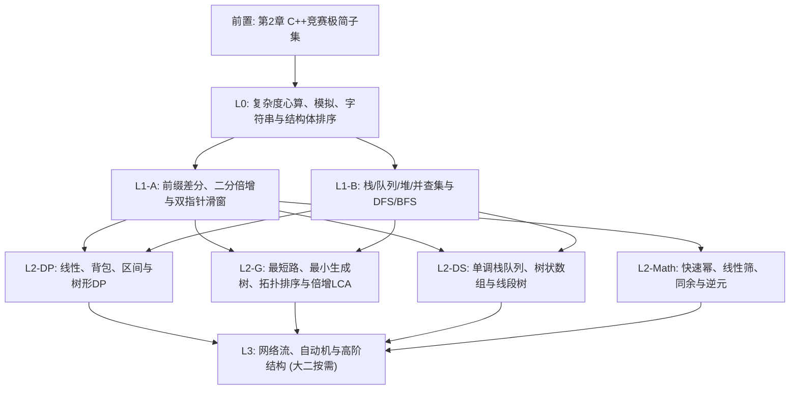

# 第 3 章 算法与数据结构竞赛索引

算法与数据结构训练，是大一大二投入产出比最高、技术迁移半径最广的硬核底盘。

看一眼真实的选拔规则就明白：无论是学科竞赛、保研夏令营机试，还是技术一面二面白板手撕代码，核心筛人环节永远是**物理断网、禁用自动生成工具、限时独立手写提交**。更实在的是，算法训练倒逼你在敲第一行代码前先心算时空上限，写完后用极端边界排查 `int` 溢出、数组越界与死循环。一旦长出这套直觉，哪怕大二大三跨界做机器人导航、大模型编排、AI 算子或高并发后端（见[第 5 章：泛 CS 竞赛与跨界方向索引](./05-泛CS竞赛与跨界方向索引.md)），扫一眼代码也能揪出性能退化与逻辑隐患。

本章不按“大一上、大一下”死卡月份，而是先带你摸清赛事梯度，再顺着 **L0 → L3 能力前置依赖图**锚定起跑线，用四要素画像筛掉错位神书与高价卖课陷阱，最后靠对拍与心流节奏把思维落进键盘。

---

## 3.1 算法赛事与能力认证全景梯度（从第一张证书到区域赛奖牌）

新生刚接触算法赛最易掉进两种误区：要么以为“必须一步登天拿 ICPC 区域赛奖牌才算起步”，看一眼全英文难题就打退堂鼓；要么被焦虑营销裹挟盲目报班，没看穿国内主流程序设计竞赛**高度同源**的规律——为 4 月蓝桥杯练熟的模拟、搜索与 DP，几乎可**零切换成本**搬上天梯赛、睿抗 CAIP 与 CCF CSP 考场，练一套手艺就能连闯四关。

### 3.1.1 主流算法赛事与认证全景梯度表

下表按“破冰热身 → 个人/团体首证 → 权威机试硬通货 → 顶级团队殿堂”排列，助你一眼看清赛制差异与时间窗口（表中长江大学认定级别仅作轻量参考，具体管理办法、加分规则与考点细则统一查阅[附录 A：长江大学竞赛认定与校内速查](./附录A-长江大学竞赛认定与校内速查.md)）。

| 梯度层级 | 赛事 / 认证名称 | 赛制与组队形式 | 常规报名与比赛月份 | 对应能力区间 | 定位与认定参考 |
| :--- | :--- | :--- | :--- | :--- | :--- |
| **第 1 梯 · 起步热身** | **校内新生赛 / 校队选拔赛** | 个人或 3 人组队；多为 ACM 或 IOI 赛制 | 11–12 月（新生赛）；次年 2–3 月（校队选拔） | L0 ~ L1 | 克服初次限时上机紧张感、摸底校内集训队门槛的第一站 |
| **第 2 梯 · 个人稳健首证** | **[蓝桥杯软件类](https://dasai.lanqiao.cn/)**（C/C++、Java、Python） | 个人 4 小时，含**结果填空题 + 编程大题**；OI 盲测型（赛中无实时反馈，以最后一次提交按测试点计分） | 前一年 10–12 月报名；4 月省赛、6 月国赛 | L1 为主 | 大一下最稳妥的第一张全国赛试金石 `[长大 B 类 · 见附录 A]` |
| **第 2 梯 · 团体手速试炼** | **[团体程序设计天梯赛 GPLT](https://gplt.patest.cn/)**（赛场依托 [PTA](https://pintia.cn/)） | 10 人成团、个人独立上机 3 小时；分基础级 L1（100 分）/ 进阶级 L2（100 分）/ 登顶级 L3（90 分）实时按点计分 | 1–3 月报名；4 月全国总决赛 | L1 ~ L2 | 极度锤炼基础手速与树/图稳度，设**阶梯解锁门槛** `[长大 B 类]` |
| **第 2 梯 · 同源一赛双吃** | **[睿抗机器人开发者大赛 RAICOM](https://www.raicom.com.cn/)（CAIP 编程技能赛）** | 个人 2 小时机考；类似 OI/IOI 实时按测试点取最高分 | 3~6 月，按赛道分批报名；5–7 月省赛、暑期至秋季国赛 | L1 ~ L2 | **高亮推荐**：与蓝桥/天梯能力完全同源，零切换成本再拿一张证书 `[长大 B 类]`（机器人赛道见[第 5 章](./05-泛CS竞赛与跨界方向索引.md)） |
| **第 3 梯 · 硬核能力认证** | **[CCF CSP 计算机软件能力认证](https://www.cspro.org/)** | 个人 4 小时 5 题（满分 500）；实时评测，单题按历史最高通过测试点得分 | 考前约 1 个月报名；近年常态化为**每年 4 次**（3 月、5–6 月、9 月、12 月） | 250~300+ 分对应 L2 稳固 | 保研夏令营机试免试/加分及求职硬通货 `[长大东校区官方考点 · 见附录 A]` |
| **第 3 梯 · 进阶实战过渡** | **[百度之星](http://astar.baidu.com)**（近年常于码蹄集平台开赛）/ **省级程序设计竞赛（如 HBCPC）** | 百度之星为个人 ACM 赛制；省赛为 3 人 1 机 5 小时 ACM 赛制 | 百度之星 4–8 月报名、8–9 月初赛；省赛多在 4–6 月 | L2 | 区域赛前高强度实战热身；百度之星 `[长大 B 类]`，省赛 `[长大 C 类 · 见附录 A]` |
| **第 4 梯 · 算法最高殿堂** | **[ICPC](https://icpc.global/) / [CCPC](https://ccpc.io/)**（国际/中国大学生程序设计竞赛） | **3 人共用 1 台电脑** 5 小时；经典 ACM 赛制（错题罚时 20 分钟、最后 1 小时封榜、允许带纸质模板） | 7–8 月网络赛报名；8 月底–9 月初网络赛、9 月底~11 月区域赛；ICPC EC-Final 常在 12 月~次年 1 月、CCPC Final 常在次年 5 月 | L2 ~ L3 | 国内高校计算机算法竞赛最高荣誉标杆 `[长大 A 类]` |

> [!TIP]
> **新手上场前必懂的三种赛制机制与拿分实操策略**：
> 1. **ACM 赛制（ICPC/CCPC/Codeforces/百度之星）**：只有通过全部隐藏测试点才算通过（Accepted, AC）。排名先比过题数、同题数比总耗时——每次非编译错误的未通过提交（如答案错误 WA、超时 TLE）都会在 AC 时叠加 **20 分钟罚时**。封榜前可实时看榜跟题，极考验“想清再敲、一次写对”的准度。
> 2. **OI/IOI 实时多点赛制（天梯赛/RAICOM CAIP/CCF CSP）**：单题拆成多个独立计分测试点，写不出满分正解时，老实写暴力或特殊性质分支也能拿 30%~60% 部分分，**“分段暴力骗分”是必备考场策略**。其中**天梯赛 GPLT** 独设**阶梯解锁门槛**（通常个人 L1 基础级总分须超 60 分，L2 成绩才计入有效总分；L2 须超 25 分，L3 才计入有效总分；10 人团亦设 L1 总和超 800 分、L2 总和超 400 分等门槛），切忌没稳拿 L1 就跨级死磕难题；而 **CCF CSP** 冲 250~300+ 分的黄金打法是：**前两题（L0~L1）稳拿满 200 分 + 第 3 题长题面大模拟细心抢 50~100 分 + 第 4 题靠暴力或特判再刮部分分**。
> 3. **盲测赛制（蓝桥杯软件类）**：赛中看不到隐藏测试点反馈，编程大题以最后一次提交为准。平时若习惯靠 OJ 试错十次才 AC，上盲测赛极易翻车，必须养成自造极端用例与对拍的习惯；不过前几道**结果填空题**只需交最终答案，本地完全可手算、写暴力 C++ 跑几分钟，甚至借 Python 秒算高精度大数后再直接输出，切勿被 1 秒限时束缚手脚。

### 3.1.2 为什么重点点名睿抗（RAICOM）CAIP 编程技能赛？

许多同学打完 4 月蓝桥杯和天梯赛就进入比赛空窗期。其实睿抗旗下的 **CAIP 编程技能赛** 同样是纯粹的个人上机算法赛，考点聚焦在模拟、排序、搜索、并查集、基础图论与 DP。它在 5~7 月办省赛、暑期至秋季办国赛，刚好接过 4 月赛事的接力棒——不用买开发板、不必另学框架，凭现成 C++ 底盘就能再收一张国赛证书（对机器人仿真有兴趣者可查阅[第 5 章](./05-泛CS竞赛与跨界方向索引.md) CAIM/CAIR 赛道）。

看清这座由近及远的赛事航标灯塔后，下一步就是拆解灯塔内部那棵层层点亮的算法技能树。


---

## 3.2 L0 ~ L3 算法能力前置依赖图（不跳级、不背死板模板）

学算法最常见的弯路，是还没分清数据规模能承受什么复杂度就开始抄“模板大全”；或者连 DFS 递归边界都没理顺，就硬啃网络流与平衡树。

进入 **L0** 前，请确保已完成[第 2 章：多语言路线与编程基本功索引](./02-多语言路线与编程基本功索引.md)第 2.3 节的 **C++ 竞赛极简子集**（熟练使用 `cin/cout` 加速、引用 `&`、`vector`、`string`、`sort` 与 `pair`），并在本地配好零折腾编译器（推荐第 2 章的 CP Editor 或 VS Code）。本章不再重复语法与环境配置。



### 3.2.1 四个能力阶梯的精确边界与过关标准

**L0 · 语法与模拟底盘（敲开算法门的第一块砖）**
- **核心能力清单**：
  1. **时空复杂度与数值范围心算**：把“看见输入规模 $N$ 先反推复杂度”刻进本能。评测机 1 秒约跑 $10^7 \sim 10^8$ 次基本运算，下表即考场反推标尺。数值与内存底线同样要脱口而出：只要结果或中间乘积可能突破 $2 \times 10^9$（32 位有符号整数上限），立刻全换 `long long`；内存限制 256 MB 约能存 $6 \times 10^7$ 个 `int`（或 $3 \times 10^7$ 个 `long long`），且超 $10^5$ 的大数组务必开在全局区或 `std::vector` 堆上，切忌在函数内定义百万级局部数组导致栈溢出（运行错误 Runtime Error, RE）。
  2. **模拟与高精度直觉**：把题面规则（如日期跨年、模拟排队、棋盘移动）不重不漏地翻译成循环与分支。
  3. **基础字符串与结构体排序**：字符数组/`std::string` 解析、`std::sort` 自定义比较函数与多关键字排序。

| 题目输入规模上限 $N$ | 可接受最高时间复杂度 | 常见对应算法思维方向 |
| :--- | :--- | :--- |
| $N \le 10$ | $O(N!)$ 或 $O(N \cdot 2^N)$ | 全排列枚举、暴力回溯搜索 |
| $N \le 20$ | $O(2^N)$ 或 $O(N^2 \cdot 2^N)$ | DFS 指数搜索、状态压缩 DP |
| $N \le 500$ | $O(N^3)$ | Floyd 全源最短路、区间 DP、三重循环暴力 |
| $N \le 5000$ | $O(N^2)$ | 朴素二重枚举、基础线性/背包 DP |
| $N \le 10^5 \sim 5 \times 10^5$ | $O(N \log N)$ | 排序、二分、堆优化 Dijkstra、树状数组、线段树 |
| $N \le 10^6 \sim 10^7$ | $O(N)$（慎用重常数容器） | 双指针、前缀差分、单调栈/队列、线性筛、线性 DP |
| $N \le 10^{18}$ | $O(\log N)$ 或 $O(1)$ | 数学公式推导、二分答案、快速幂、矩阵快速幂 |

- **L0 过关标准**：读完长模拟题后，能先在草稿纸列清边界状态并估准 $N$ 量级与 `long long` 需求，不靠调试器乱试也能一两次提交 AC。

**L1 · 核心普及基本功（对应蓝桥省一 / 天梯 L1+L2 得分主力 / RAICOM CAIP）**
- **核心能力清单**：
  1. **线性优化三板斧**：一维/二维前缀和与差分（把区间加减与求和压到 $O(1)$）、二分查找与**二分答案**（只要所求最值具单调性就能转二分判定）、双指针与滑动窗口。
  2. **贪心思维**：先尝试手造反例检验局部最优是否全局成立，再写代码，切忌“拍脑袋猜结论就交”。
  3. **搜索骨架**：DFS（深搜回溯、排列组合枚举与剪枝）与 BFS（队列求无权图/迷宫最短步数、多源 BFS）。
  4. **核心基础数据结构**：栈、队列、`priority_queue`（二叉堆）、哈希表（`unordered_map`）与**并查集**（用路径压缩 + 按秩合并，近乎 $O(1)$ 解决“两元素是否同属一个连通圈子”的合并与查询）。
- **L1 过关标准**：面对单调最值题，能独立写出 `check(mid)` 验证函数与二分开闭区间不死循环；网格与状态图 DFS/BFS 能在 20 分钟内写完且不漏判重与越界边界；并查集连通块问题能一次写对。
- **解锁去向**：练稳 L1，大一下冲蓝桥杯省一、在天梯赛突破 L1 门槛拿下 L2 核心分、在 RAICOM CAIP 拿奖均已十拿九稳。

**L2 · 进阶铜银骨架（对应 CCF CSP 250~300+ / ICPC 与 CCPC 区域赛冲铜保底）**
- **核心能力清单**：
  1. **动态规划入门到进阶**：线性 DP（最长上升子序列 LIS / 最长公共子序列 LCS）、背包问题（0-1/完全/多重背包）、区间 DP 与树形 DP。永远紧抓**状态定义（`dp[i]` 代表什么含义）→ 转移方程 → 初始边界与遍历顺序**，绝不死背三层循环格式。
  2. **图论核心骨架**：带权图最短路（**非负权图默认一律写堆优化 Dijkstra，绝不要图省事写 SPFA**——现代赛题常专门构造网格图、分层图等特制数据将 SPFA 卡到 $O(NM)$ 超时；仅含负权边或判负环时才用 Bellman-Ford/SPFA，全源小图用 Floyd）、最小生成树（Kruskal/Prim）、拓扑排序（有向无环图 DAG 上递推 DP 的基石），以及树上的**倍增 LCA（最近公共祖先，用 $2^k$ 跳步快速定位树上两节点交汇点）**。
  3. **进阶数据结构**：单调栈（找左/右首个更大或更小元素）、单调队列（滑窗最值与优化 DP）、**树状数组（Fenwick Tree）**、**线段树基础与懒标记（Lazy Propagation）**（专治“区间修改 + 区间查询”，懒标记即“账先记在父节点、查到子孙再顺手下发”的省时妙招）。
  4. **基础数论模块**：快速幂、欧几里得 `gcd`、线性筛素数、同余基础与乘法逆元（把模意义下的除法转化为乘法）。
- **L2 过关标准**：遇到 DP 题能先在纸上写清状态定义与转移方程再敲代码；能默写带懒标记的线段树/树状数组与堆优化 Dijkstra，并主动排查 `inf` 加法溢出、取模负数、图论重边/自环等高频暗坑。
- **解锁去向**：打通 L2 并经中等题磨炼后，CCF CSP 基本站稳 250~300+ 分，3 人团队在 ICPC/CCPC 区域赛具备冲铜望银的底气。

**L3 · 高阶冲击区（大二按需选修）**
- **包含范围**：最大流与费用流、二分图匹配（匈牙利算法）、KMP/Trie/AC 自动机/后缀数据结构、平衡树与树链剖分、SG 函数博弈论（公平组合游戏必胜态判定）与组合容斥进阶。

> [!WARNING]
> **严禁 L2 未稳时扎进 L3 偏怪算法**：
> 不少新人误以为“学了树链剖分、网络流才算高手”，花两周硬抄黑题模板，赛场上却把一道 L1 二分或 L2 普通背包写挂。除非目标已锁定区域赛金银牌且 L2 信手拈来，否则大一大二绝大部分竞赛与机试的胜负手都落在 **L1 到 L2 的建模熟练度与一次写对率**上。

---

## 3.3 图文百科与视频课程四要素横评（免费王牌 vs 付费避坑）

网上算法教程多到能塞满网盘，但你的时间极其宝贵。本节只留经历届选手实战检验、且免费/付费边界透明的王牌资源，逐一按**四要素画像**拆解。

### 3.3.1 图文百科与互动教材“三剑客”

| 资源名称（官方入口） | ① 定位与适合谁（含前置） | ② 为什么选它而非同类 | ③ 正确打开方式与耗时 | ④ 劝退点与平滑替代路 |
| :--- | :--- | :--- | :--- | :--- |
| **[《Hello 算法》](https://www.hello-algo.com/)**（靳宇栋 `@krahets` 开源，[GitHub](https://github.com/krahets/hello-algo)） | **L0 → L1 零基础动画建立数据结构空间直觉 No.1**（前置：刚过 C++/Python 基础语法关） | 拥有 500+ 步进动画图解与 10+ 语言一键对比运行，全站免费开源，理解平滑度远胜传统纯文字《数据结构》教材 | 按目录顺序边看动画边敲完数组、链表、栈队列、哈希、树、堆、图、分治、回溯与基础 DP；**约 3~4 周（30~40 小时）** | 定位偏向通用数据结构与求职基础，**不包含**并查集进阶、树状数组、线段树、数论等竞赛深水区 → 刷完立刻切 `OI Wiki` + 洛谷题单 |
| **[OI Wiki](https://oi-wiki.org/)** | 贯穿大一到大三的中文算法竞赛“新华字典”（L0 ~ L3，前置：基本编程能力） | 国内开源社区维护最全的竞赛知识库，除了算法外还覆盖 C++ STL 特性、对拍技巧、Testlib（竞赛标准造数据与校验库）与复杂度常识 | **铁律：严禁从第 1 页线性通读！** 刷题遇到新名词（如并查集、Dijkstra、线段树）时再检索对应词条，看懂推导与模板后立刻去刷文末例题 | 多人协作编写，部分词条学术味偏重或推导略跳 → 看不懂时立刻去 B 站搜**左程云/灵神**视频或看洛谷高赞题解 |
| **[CP-Algorithms](https://cp-algorithms.com/)** | **L2 → L3** 攻克数学推导、数论、字符串与图论证明（前置：L1 扎实 + 基本英文读文档能力） | 源自俄罗斯经典 `e-maxx.ru/algo`，数学证明与边界条件极度透彻，正好补足 `OI Wiki` 部分词条“步骤略跳”的短板 | 当 `OI Wiki` 的某个进阶算法（如扩展欧几里得、同余、Treap、后缀自动机）没看透时，对照打开英文版精读推导过程 | 全英文且零基础入门铺垫，**大一上切勿拿它当首本入门教材** |

**不同起点的选型与接棒决策**：若此前毫无数据结构概念（连链表指针、递归栈帧都发晕），先花 3~4 周靠**《Hello 算法》**动画建直觉，刷完基础 DP 后**立刻交棒给 `OI Wiki` + 洛谷题单**补全并查集、图论与区间结构；若已能在洛谷顺畅写通 L0 模拟和基本递归，直接把 **`OI Wiki`** 当主词典随刷随查，仅在个别概念缺乏空间感时翻看《Hello 算法》动图即可，无需从头通刷。

### 3.3.2 四大视频课程与平台客观横评（含费用透明度与防坑指南）

新手看视频最易落入两极：要么把上百集网课当连续剧刷却不敲代码，要么被焦虑话术诱导花一两千元买中小学导向直播班或年费 VIP。下面四张卡片帮你把账算清：

**1. B 站 `左程云`《算法和数据结构通关课》**
- **费用属性**：**完全免费**（B 站免费播放，配套代码与测试题库见 [`algorithmzuo/algorithm-journey`](https://github.com/algorithmzuo/algorithm-journey)）。
- **① 定位与适合谁**：适合已完成 C/C++ 基础语法、正在打通 **L0 后期 → L2（含图论、线段树、树套树）** 的大一上后期至大二同学。
- **② 为什么选它而非同类**：细讲“每行边界为何这么写、草稿纸怎么推例子”且每题附真实 OJ 评测链接，免费质量远超不少高价训练营。
- **③ 正确打开方式与耗时**：**切忌从第 1 集硬刷全套（超百讲极易倦怠）**！当视频专题字典用——卡在递归回溯、二叉树 DP 或并查集时点开对应几讲（每专题 2~4 小时），听懂后**立刻关视频用 C++ 独立写出并提交 AC**。
- **④ 劝退点与平滑替代路**：默认多用 Java 演示，C++ 选手需按思路自行转写——这恰是最好的“防照抄”训练。**提醒：该课在 B 站与 GitHub 完全免费公开，谨防二手平台打包倒卖！**

**2. B 站 `灵茶山艾府`（`0x3f`）《基础算法精讲》+ 科学题单**
- **费用属性**：**完全免费**（B 站视频 + [`EndlessCheng/leetcode-go`](https://github.com/EndlessCheng/leetcode-go) 与力扣讨论区题单）。
- **① 定位与适合谁**：适合 **L1 → L3** 阶段，兼顾蓝桥/ICPC 思维训练与未来大厂笔试的大一后期至大三同学。
- **② 为什么选它而非同类**：主打**“反死背模板”的本质拆解**——用**红蓝染色法与开闭区间**统一二分查找彻底消灭 `+1/-1` 死循环；用**相向双指针与同向滑窗**提炼线性单调约束；教你**先写记忆化搜索再一步步转 1:1 递推 DP 与空间优化**，且附 C++/Python/Java/Go 四语代码及**按 Elo 难度分（像天梯分一样客观量化题目水位）升序的十余份科学题单**，稳贴心流爬坡区。
- **③ 正确打开方式与耗时**：看一集精讲，随即按对应题单从 `1200 → 1500 → 1800` 分阶梯刷题，每个核心专题投入 **1~2 周**。
- **④ 劝退点与平滑替代路**：力扣采用“核心代码模式”，不考 `main()`、快读、多组数据清理与严苛卡常（卡常数因子导致的极限超时），**只刷力扣直接上蓝桥或 ICPC 会水土不服**，必须搭配洛谷或 AtCoder 补齐标准 IO 训练。

**3. AcWing《算法基础课》/《算法提高课》（闫学灿 `yxc`）**
- **费用属性**：**付费课程**（[AcWing 官网](https://www.acwing.com/)，单门标价约 200~300 元，3 人拼团折后约百余元，含少量试看）。
- **① 定位与适合谁**：距蓝桥杯或 CCF CSP 仅剩 1~2 个月，急需突击搭起 **L1 → L2** 常规模板骨架的同学（前置：基础 C++ 语法）。
- **② 为什么选它而非同类**：高度结构化，用极简板子、思维导图与“闫氏 DP 分析法（从集合划分与属性视角拆解状态与转移）”快速打包常用模型，省去自拼题单的摸索成本。
- **③ 正确打开方式与耗时**：《算法基础课》适合集中 **4~6 周**突击；每听完一节立刻关讲义默写三遍，再找 3~5 道非原题变式检验理解。
- **④ 劝退点与平滑替代路**：**最大隐患是把速成拐杖当终点，沦为离开原题就不会改的“背模板机器”**——应付蓝桥常规题好使，遇到 CF/ICPC 构造与贪心变体则易卡壳。时间充裕或预算有限者，用 **`《Hello 算法》` + 左程云 + 灵神 + 洛谷官方题单** 即可零成本更扎实替代。

**4. 洛谷网校与蓝桥云课：划清“免费基础设施 vs 无需购买网校/会员”红线**
- **费用属性**：基础题库、官方题单、题解社区与大量历年真题**免费**；网校直播班、VIP 年费会员及冲刺营**付费**（数百至数千元）。
- **① 定位与适合谁**：**免费公开区**适合所有大一大二选手作日常刷题主战场与考前真题模拟场（前置：掌握基础输入输出）。
- **② 为什么只用免费区而不买高价班**：洛谷高价网校面向**中小学信息学奥赛（NOIP / CSP-J/S）**按周末班慢节奏设计；大学生自主检索与阅读力强得多，完全不必花几千元请人盯着上课，更无需为打一场蓝桥杯开高价年费 VIP。
- **③ 正确打开方式与耗时**：日常用 **[洛谷官网](https://www.luogu.com.cn/)** 免费官方题单与社区题解推进；考前 **1~2 周** 上 **[蓝桥云课](https://www.lanqiao.cn/)** 刷近 3~5 年免费真题熟悉云端界面。
- **④ 劝退点与平滑替代路**：少在洛谷灌水区浪费时间；遇到蓝桥云课仅限 VIP 的题解时，搜题名去洛谷或 B 站看免费讲解即可，一分冤枉钱不必花。

握稳这套线上动态图解与免费精讲视频的资源罗盘，就能绕开盲目报班与死磕晦涩大部头的暗礁；那么面对书店里厚重的纸质算法书，又该如何挑出合手兵器？


---

## 3.4 纸质教材鉴选与《算法导论》错位陷阱深度拆解

很多大一新生入学前会兴冲冲买回一摞厚重的黑皮或蓝皮算法名著摆在书桌 C 位，结果翻开两周后便沦为“显示器增高架”。不是你学不会算法，而是**把属于不同阶段、甚至不同学科定位的工具书，放错了出场时间**。

### 3.4.1 四本主流竞赛纸质教材四要素对比

| 纸质书名称与作者 | ① 定位与前置条件 | ② 为什么选它而非同类 | ③ 正确打开方式与耗时 | ④ 劝退点与平滑替代路 |
| :--- | :--- | :--- | :--- | :--- |
| **《深入浅出程序设计竞赛（基础篇）》**（汪楚奇 / 洛谷学术组著） | **L0 → L1** 大一零基础入门首选纸书（前置：仅需刚学完 C/C++ 基本分支与循环） | 幽默直观、图例充足，而且书中全部例题与习题**直接绑定洛谷题号**，彻底打通“纸上读概念 → 网上交评测”闭环 | 边读边上洛谷交完对应章节练习题，**约 4~6 周**读完并站稳 L1；进阶篇留待 L1 稳固后再按需选购 | 若本来就习惯直接看线上互动图解（《Hello 算法》+ 洛谷题单），可以完全省下这笔购书费 |
| **《算法竞赛》**（罗勇军、郭卫斌著，清华大学出版社） | **L1 → L3** 贯穿大一大二的 C++ STL 规范案头词典（前置：已掌握 L0 语法与基础模拟） | 相比早期偏向纯 C 风格的传统竞赛厚书，全书代码全线采用现代竞赛规范 STL，专题划分精准契合蓝桥杯、ICPC 与 CSP | **绝不要从第 1 页往后通读！** 当成桌边工具手册——练到并查集、线段树或数论时翻开精读对应一节并手敲例题 | 前期直接拿来当入门书会觉得节奏太紧凑、概念跳跃 → 先过完《Hello 算法》或《深入浅出（基础篇）》再查它 |
| **《算法竞赛进阶指南》**（李煜东著） | **L2 稳固后（CF 1400+，大一暑假~大二）** 冲击省一、区域赛铜银牌的核心进阶书 | 国内选手极受推崇的模型思维圣经，重数学归纳、状态拆解与技巧归类，例题与习题紧贴区域赛与国内省赛高频考法 | 挑当前需要补强的单一专题（如状压 DP、树上倍增、莫队/分块这类离线区间分治）备好草稿纸慢推，**读通一页常需半小时**，每周消化 1 小节 | **大一 L0/L1 新生硬啃必受挫**：默认跳过一切基础铺垫；L1 未稳前请先刷通洛谷黄绿题单 |
| **《挑战程序设计竞赛（第 2 版）》**（“白书”，秋叶拓哉、岩田阳一、北川宜稔著） | **L1 后期~L2 进阶查漏（CF 1300~1600+）** 国际视野经典技巧选讲 | 日本顶级竞赛老将执笔，以经典 POJ（北大 OJ）与 GCJ（Google 国际编程赛）原题为线串起贪心、DP、图论与计算几何，思路提炼精干锐利 | 按专题选读其“模型转化”思路（如尺取法即双指针滑窗、折半枚举、二分最大化平均值）并上 OJ 找题练手，**按专题查读约 4~6 周** | 成书年代较早，**部分代码写法偏老（含大量宏定义、POJ 老旧 `stdio` 风格与少量早期 C++ 写法）**且步幅跳跃大 → 现代 C++ 写法请以《算法竞赛》或 OI Wiki 为准 |

### 3.4.2 深度拆解：为什么大一绝对不要直接硬啃《算法导论》（CLRS）？

社交平台常有人一句“学算法直接啃《算法导论》”，对绝大多数大一新生却是高概率弃坑的错位建议。按四要素拆开 **Thomas H. Cormen 等著《算法导论》（CLRS，第 3/4 版）**：
1. **① 真实定位与前置**：MIT 编写的约 **1,300 页** **计算机理论科学形式化证明巨著**，前置需修完《离散数学》（归纳法、图论形式化、概率期望）并具备一定代码手感。
2. **② 错位根源**：全书一行能直接编译的 C++ 都没有，统一采用下标从 1 开始的 **1-indexed 伪代码**；它既不教 STL 容器接口也不讲考场建图建模，而是用十几页渐近极限、循环不变式与摊还分析（势能法）去严格证明“红黑树为何能保平衡”“快排期望比较次数为何是 $O(N \log N)$”。大一连递归出口与数组越界都还在反复调试，尚未切身痛过“普通二叉搜索树退化成单链表”，上来就啃满纸数学引理，只会陷入“每个字都认识，合上书却写不出十行能跑的代码”的挫败感。
3. **③ 真正惊艳的打开方式**：留到**大二下或大三**修完《离散数学》与《数据结构》、亲手 AC 过两百道以上算法题后，再请出来当**理论案头词典**按章翻查主定理、摊还分析、红黑树旋转、最大流最小割定理或 NP 完全性证明——届时你会发现，它像为你熟悉的代码世界点亮了底层的数学聚光灯。
4. **④ 大一英文经典无缝平替**：想趁大一练英文原版阅读，这两本才真正友好：
   - **Robert Sedgewick & Kevin Wayne《算法（第 4 版）》（[algs4 官网](https://algs4.cs.princeton.edu/)）**：定位为**大一友好的通用工程数据结构英文读本**（4~6 周挑读排序、查找树、图与字符串，解剖级图解配真代码）；**避坑**：全书用 Java 且偏软件工程，**不含动态规划、博弈与竞赛数论**，适合建直觉但不能替代竞赛书。
   - **Antti Laaksonen《[Competitive Programmer's Handbook（CPH）](https://cses.fi/book/book.pdf)》**：定位为**专为竞赛新人打造的免费英文精简手册**（开源 PDF **仅约 300 页**，全现代 C++ 书写并直绑 CSES 母题，3~5 周通读）；**避坑**：行文凝练无动画，适合跨过 L0 后对照 CSES 刷读。

---

## 3.5 六大 OJ 平台矩阵、周赛作息与自动化对拍实战

配齐教材只是备好了装备，真正决定算法内功涨得快不快的，是每天坐在电脑前刷题的平台生态、难度控制与独立排错工作流。

### 3.5.1 六大 OJ 平台与题单四要素可用性矩阵

| 平台 / 题单（官方入口） | 定位与适配区间 | 为何选它（核心优势） | 正确打开方式与节奏 | 劝退点与避坑提示 |
| :--- | :--- | :--- | :--- | :--- |
| **[洛谷官方题单](https://www.luogu.com.cn/training/list)** | **L0 ~ L3**（尤其大一上 L0~L1 主战场） | 全中文题面、红橙黄绿蓝紫黑 7 档难度色块极直观、拥有国内最丰富的题解区 | 顺着官方入门/普及题单推进，卡题先看“思路提示”而非直接整段抄首篇题解 | 少在讨论区灌水浪费时间；蓝桥杯前注意适应盲测无实时反馈心态 |
| **[灵神难度分题单](https://github.com/EndlessCheng/leetcode-go)**（+ 力扣讨论区） | **Elo 1100 ~ 2200+**（L1~L3 思维与面试双修） | 按精确计算过的难度分升序排布，几乎杜绝突然遇到超纲题的崩溃感 | 按专题从低到高推进，维持“跳一跳够得着”的心流节奏 | 核心代码模式不练标准 IO 和 `long long`/空间卡常，必须配合洛谷或 AtCoder 互补 |
| **[AtCoder ABC](https://atcoder.jp/)** + **[AtCoder Problems (`kenkoooo`)](https://kenkoooo.com/atcoder/)** | 新手 → 铜银牌（每场 **A~G 共 7 题**，大一大二主攻 A~E/F） | **最推荐大一参加的国际周赛！** 每周六晚 **20:00（北京时间）** 准时开赛、不用熬夜；题面短小干净少长篇大论 | 周六打真实周赛，平时在 `kenkoooo` 看难度色块图打 Virtual Contest（虚拟赛）按颜色刷透 A~D/E | 后期 E/F/G 题偏数学计数与 DP 状态推导，打完赛后务必看官方题解补透 1~2 题 |
| **[Codeforces](https://codeforces.com/)** + **Carrot 插件** | Div.4/3（大一，Div.4 最友好、数字越小越难）→ Div.2/1（大二冲牌） | 全球含金量最高的思维、构造与贪心试炼场，题量与社区生态全球第一 | **强烈建议大一上白天打 Virtual Participation（虚拟赛）**；安装浏览器扩展 **Carrot** 实时估算表现分 | 常规场多在深夜 **22:35** 开始且英文题面偏长；**切忌为了熬夜打 CF 搞垮第二天早八与专业课 GPA** |
| **[CSES Problem Set](https://cses.fi/problemset/)** | **L1 → L2** 核心骨架验真（**400 道**纯净母题） | 全站题目没有任何花哨故事包装，直指经典算法原型（DP/图论/区间/树），无缝对应免费电子书 *CPH* | 最适合寒假或暑假集中用 2~3 周检验“自己到底能不能不看模板写出经典模型” | 几乎没有文字题解区且数据较卡常，不适合完全零基础当第一站 |
| **[牛客竞赛](https://ac.nowcoder.com/)** | 周赛/小白月赛（大一）→ 多校营（大二冲牌） | 全中文赛制与出题习惯最贴近国内蓝桥、天梯、ICPC/CCPC 区域赛及校内选拔 | 大一主刷**每周举办的“牛客周赛”**与**约每月 1~2 场的“牛客小白月赛”**攒实战手感，顺手打高校同步校赛 | **大一暑假前切勿直接硬刚“牛客暑期多校训练营”**，难度直奔区域赛金银牌，极易打崩信心 |

### 3.5.2 心流控难与高质量补题：少即是多

刷题涨分慢多源于难度错配（认知科学原理见[第 6 章：路线编排与好学心法](./06-路线编排与好学心法.md)第 6.2 节）：
- **锁死心流甜点区**：集中刷**当前稳定水平 + 100~200 分**的题（如稳过 CF 1000 或洛谷橙题后，主攻 CF 1100~1300 或黄题）；刷水题是机械劳动，跨级 500 分硬刚只会消耗信心。
- **25~30 分钟卡题止损**：独立思考 25~30 分钟毫无头绪时，只看题解前两句破题提示，想通后**合上题解从零手敲**，并在笔记中只记一句“当时哪步等价转化没看出来”。
- **一场高质量补题胜过十场裸赛**：周六打完 AtCoder ABC 过 3 题，赛后花 1 小时把第 4 题补懂并独立 AC，下次就能稳冲 4 题；只打不补，打完二十场仍在原地踏步。

### 3.5.3 独立排错杀手锏：三文件自动化对拍

遇到“样例全过却满屏 WA”或蓝桥杯盲测无反馈时，盯着代码干瞪眼效率极低。最快揪出隐蔽 Bug 的利器是**三文件自动化对拍**——用绝对不会错的暴力解，高频拷打高效正解。

同目录下建好 3 个极简文件：
1. **`sol.cpp`**：待测的高效正解（如 $O(N \log N)$ 线段树或贪心）。
2. **`brute.cpp`**：逻辑朴素的暴力解（如 $O(N^2)$ 或 $O(2^N)$ 枚举，专跑极小数据当裁判）。
3. **`gen.cpp`**：用 `<random>` 的 `std::mt19937` 生成**极小规模**合法随机数据（刻意压到 $N \in [1, 8]$、数值 $[1, 10]$，反例越小越能三分钟手算看穿 Bug）。**随机种子大坑预警：严禁用 `time(0)` 播种**——`time(0)` 按秒跳动，1 秒跑上千次会产出上千份相同数据！务必改用纳秒时钟 `std::chrono::steady_clock::now().time_since_epoch().count()`、`std::random_device`，或在 `gen.cpp` 中读取脚本传入的 `argv[1]`（如下方 `"$i"`）作为种子，既防撞数又便于按编号复现。

在 Linux / WSL / macOS 终端编译后运行跨 Unix 兼容循环（`diff -b` 忽略行尾空白，避免 GNU 专属参数在 macOS BSD `diff` 报错）：

```bash
for ((i = 1; ; i++)); do
    ./gen "$i" > in.txt
    ./sol < in.txt > out1.txt
    ./brute < in.txt > out2.txt
    if ! diff -b out1.txt out2.txt > /dev/null; then
        echo "Found counterexample on case $i"
        break
    fi
done
```

若在原生 Windows 运行：**CMD** 中用 `fc out1.txt out2.txt`；**PowerShell** 中切记 **`fc` 是内置命令 `Format-Custom` 的别名，直接敲会报错**，须写全 **`fc.exe out1.txt out2.txt`** 或用 `Compare-Object`。不到 1 秒便能跑完上千组小数据并定格在第一组反例 `in.txt`，抄纸手算即可秒杀边界 Bug；再结合第 2 章分环境启用的编译告警与调试参数，当你在周六傍晚霞光里改完最后一处边界、看着屏幕亮起翠绿 Accepted 时，那份踏实感就是算法训练最好的奖赏。

> [!NOTE]
> **下一步直接开练**：想立刻上手一套严选自洛谷/Codeforces/AtCoder/力扣的 **40 道梯度母题（另含 4 道 CSES 纯净拓展题）**，并用 VS Code 的 `Algo Coach` 插件一键管理刷题记录，请直达[第 7 章：算法实战训练与作业精选](./07-算法实战训练与作业精选.md)。


