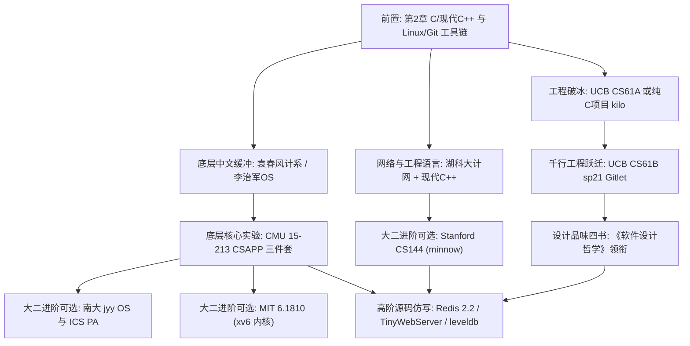

# 第 4 章 系统基础与代码架构索引

如果只写过算法竞赛题，很容易产生一种错觉：写程序不过是“一个 `main.cpp` + 全局数组 + 标准输入输出”，敲完百八十行拿到 AC 就万事大吉。

可一旦走出 OJ 温室，两道工程高墙会立刻迎面撞来。第一道墙是**“看不穿黑盒底下发生了什么”**：为什么遍历二维数组按行写和按列写速度差出十倍？为什么多线程一开就诡异卡死或段错误？为什么自己写的网络通信总丢包或粘包（TCP 字节流中多条消息首尾粘连分不清边界）？第二道墙是**“代码一过千行就失控崩盘”**：刚试着拆多文件，却因模块边界模糊、全局变量满天飞，修好一个 Bug 顺带踩爆另外三个功能。

本章专治这两大痛点：**向下扎根计算机系统底层直觉，向上完成代码模块化与架构启蒙**。同时严守“大一大二能力盘子”——绝不把大三甚至研究生阶段的分布式与数据库内核一股脑塞给你，让你踏实做到开一门、成一门。

---

## 4.1 走出单文件 main.cpp：如何正确打开 csdiy.wiki 而不被神课压垮？

聊到系统与工程自学，几乎每位 CS 学子都会刷到同一张导航页——北大 `PKUFlyingPig` 学长开源维护的[《CS 自学指南》（`csdiy.wiki`）](https://csdiy.wiki/)。先用四要素为它定准坐标：

- **① 定位与适合谁**：中文互联网最权威的全球顶尖 CS 公开课总导航（前置：已完成[第 2 章：多语言路线与编程基本功索引](./02-多语言路线与编程基本功索引.md)的 C/C++ 基础与 Linux/Git 工具链入门）。
- **② 为什么选它而非同类（及头号误区拆解）**：相比社交平台东拼西凑的“必看网课清单”，`csdiy.wiki` 把每门名校课的前置门槛、Lab 耗时、实验环境与前人踩坑录写得明明白白。但大一新生最常踩的坑，是**把这张“四年顶配全栈菜单”误当成了“大一大二必吃任务单”**！看到别人晒 CSAPP、MIT 6.1810、CS144、CMU 15-445、MIT 6.824，一口气全塞进收藏夹同时开坑，结局往往是期中周前全线烂尾，还顺手拖垮高数和线代 GPA。
- **③ 正确打开方式与耗时边界**：**大一大二只做“少而精”的减法，且主动与校内必修课借力共振**。大一寒假到大一下，先用中文缓冲课捅破术语窗户纸，再挑 1 门编程抽象课或纯 C 千行小项目破冰；**整个大二学年，最多精选 1~2 门海外硬核实验课并啃下核心 Lab**（每门预留 6~10 周整块精力）。最聪明的策略是与大二校内课同步对齐——用袁春风与 CSAPP 降维反哺《计算机组成原理》，用李治军与 6.1810/jyy 反哺《操作系统》，用湖科大与 CS144 反哺《计算机网络》，把“课外自学与课内争绩点冲突”变成双向加分的正循环。
- **④ 劝退点与大三留白区**：原版名课全英文讲义与底层 Debug 动辄按“天”计。为防过载，请果断将高年级深水区——如 **CMU 15-445（数据库内核）**、**MIT 6.824（分布式系统）** 与多后端编译原理实现——留白给大三，不在大一大二超前内耗。

下图展示了本章“底层系统理解”与“上层代码架构”双线并进、又在高阶源码阅读处合流的前置拓扑：

---

## 4.2 计算机系统底层第一阶：消除英文与术语恐惧的中文黄金缓冲

海外底层神课常让初学者两周弃坑，往往不是理解力不够，而是“全英文术语 + 陌生硬件概念 + 终端报错”三座大山同时砸下来。若在大一下至大二上先花 **2~4 周** 看完对应中文精品课，搭起物理画面感再去啃英文 Lab，阻力会骤降一大半。

### 4.2.1 南京大学 袁春风《计算机系统基础》（中国大学 MOOC / 同名教材）

> [!NOTE]
> **先厘清南京大学计算机系统生态的“三代分工”，别把课程混为一谈**：
> 1. **袁春风教授**：主讲《计算机系统基础》MOOC 与同名教材，站在程序员视角打通高级语言到机器执行与存储的映射；
> 2. **余子濠教授**：开创 NEMU 硬件模拟器与 ICS PA（计算机系统基础实验）框架；
> 3. **蒋炎岩（jyy）老师**：接力并深度迭代 ICS PA 实验体系与《操作系统》公开课。
> 建议先听袁春风老师的理论课铺路，大二有整块假期时再挑战 jyy 的实验体系。

- **① 定位与适合谁**：适合大一下至大二上零底层经验的同学，建立“C 代码如何变汇编、如何链接加载、数据如何存入内存与 Cache”的中文全局骨架（前置：[第 2 章](./02-多语言路线与编程基本功索引.md) C 指针、数组与结构体）。
- **② 为什么选它而非同类**：传统《计算机组成原理》常困在硬件电路门级视角，学生背完一学期总线与控制器，依然写不好指针和缓存友好代码；袁春风体系完全从程序员视角出发，概念与 CSAPP 无缝对齐。
- **③ 正确打开方式与耗时**：中国大学 MOOC 上该系列拆为《计算机系统基础（一）》《计算机系统基础（二）》等递进课程；配合校内计组课，**1.25x~1.5x** 倍速重点看**数据的机器级表示、程序的机器级表示（汇编与函数每次调用开辟的栈帧）、链接与存储器层次结构**，约 **3~4 周（20~30 小时）**。
- **④ 劝退点与平滑替代路**：偏概念剖析，光听不拆二进制易忘；看完核心章节后，立刻接 `4.3` 节 **CSAPP 前三个 Lab** 亲手验证。

### 4.2.2 哈工大 李治军《操作系统》（中国大学 MOOC / B 站高播经典合集）

- **① 定位与适合谁**：适合大二上初学 OS、怕被纯英文现代多核内核吓退的同学（前置：C 指针与栈/队列基础）。
- **② 为什么选它而非同类**：不照本宣科念定义，而是沿“如何把一台裸机一步步配成支持进程切换与文件读写的系统”主线，直接掰开精简的 **Linux 0.11 源码**，剖析系统调用、中断、上下文切换（CPU 在进程间保存与恢复寄存器现场）与内存分页，画面感极强。
- **③ 正确打开方式与耗时**：在校内《操作系统》开课前或同步学期中，**1.5x 倍速**通看主干讲解，手画“从按下开机键到用户进程切换”全链路草图，约 **2~3 周（20~25 小时）**。
- **④ 劝退点与平滑替代路**：早期 Linux 0.11 实验环境偏旧（涉及老版 x86 虚拟机 Bochs 与旧 GCC 兼容），为建直觉只需看懂课程并画清流程，不必在陈旧环境上死磕两天；想动手改现代 RISC-V 内核，直接跃迁至 `4.3` 节 **jyy OS** 或 **MIT 6.1810**。

### 4.2.3 B 站 `湖科大教书匠`（高军）《计算机网络微课堂》（免费）

- **① 定位与适合谁**：适合大二快速打通五层协议栈、MAC/ARP、IP 路由、TCP 三次握手与拥塞控制的动画入门课（前置：基础编程常识）。
- **② 为什么选它而非同类**：拥有全网罕见的**高精度逐帧协议交互动画**，把易混的滑动窗口、流量控制与拥塞窗口演进拆得一目了然，单集短小精悍。
- **③ 正确打开方式与耗时**：**1.5x 倍速**刷完，每学完传输层或网络层就手画状态转换与报文封装图（需纸书对照可选配套《深入浅出计算机网络（微课视频版）》），约 **2~3 周（18~24 小时）**。
- **④ 劝退点与平滑替代路**：原理动画极清晰，但**不含真实协议栈编码**；应对校内课或概念面试已足够，想亲手实现可靠传输层则直接挑战 `4.3` 节 **Stanford CS144**。

---

## 4.3 计算机系统底层第二阶：四门殿堂级硬核实验课裁剪指南

中文缓冲帮我们看清了地图，真正让系统内功长进骨头里的，是在终端与调试器里啃下名校 Lab。本阶铁律是**严守前置门槛 + 不劝退裁剪**——大二一年千万别贪多，挑准 **1~2 门** 做穿核心实验便已远超同龄人。

先用“一分钟选课总览矩阵”锁定目标，具体裁剪刀法与避坑细节紧随其后：

| 课程 / 实验入口 | 一句话定位 | 严格前置门槛 | 推荐裁剪目标 | 预计耗时 |
| :--- | :--- | :--- | :--- | :--- |
| **[CMU 15-213 / CSAPP 3e](https://csapp.cs.cmu.edu/)** | 大一暑假~大二上底层首战首选 | C 指针与位运算 + Linux 基础命令 | **不劝退三件套**（Data/Bomb/Attack） | 6~8 周 |
| **[南大 ICS PA](https://nju-projectn.github.io/ics-pa-gitbook/)** & **[jyy OS](https://jyywiki.cn/)** | 大二及以上硬核国产系统天花板 | 扎实 C 语言 + Makefile/GDB（大一禁冲） | 先 jyy OS 视频，整块假期再 PA0~PA3 | 4~6 周 / 120~200h+ |
| **[MIT 6.1810](https://pdos.csail.mit.edu/6.1810/)** | RISC-V 教学内核 `xv6` 实战 | C 指针 + QEMU/GDB + CSAPP 基础 | 前 5~6 个核心 Lab + `xv6 Book` | 8~10 周 |
| **[Stanford CS144](https://cs144.github.io/)** | 现代 C++20 手写 TCP 协议栈 | [第 2 章](./02-多语言路线与编程基本功索引.md)现代 C++ + CMake + 湖科大计网 | `minnow` Checkpoints 0~3/4 | 6~8 周 |

### 4.3.1 首选第一战：CMU 15-213 /《深入理解计算机系统》（CS:APP 第 3 版）

- **① 定位与适合谁**：大一暑假至大二上叩开底层大门的首选第一站（前置：写顺 C 指针与位运算，并在第 2 章掌握基本 Linux 操作与 GCC/GDB 调试）。
- **② 为什么选它而非同类**：Randal E. Bryant 与 David R. O'Hallaron 的这门课（务必认准涵盖 **x86-64** 架构的**第 3 版**，勿看 32 位第 2 版）将原本割裂的计组、汇编、编译链接与 OS 熔铸一体——学完它，你才能从缓存行（Cache Line）视角看透“为什么二维数组按行遍历比按列快十倍”，也能用汇编视角推演函数调用栈帧。
- **③ 正确打开方式与耗时（“不劝退三件套”刀法）**：
  - **配对原版录像与实验包**：B 站与课程站提供两位作者亲授的 **CMU 15-213 Fall 2015** 高清录像，配合官网[CS:APP 3e 自修实验包页](https://csapp.cs.cmu.edu/3e/labs.html)下载 Lab 材料。
  - **坚决裁剪教材与实验**：**切忌从第 1 页死啃 700+ 页英文厚书，也绝不要强求做完 CMU 学期全套 7 个 Lab**！只精读第 **1、2、3、6、8、9** 章（漫游、信息表示、汇编表示、存储器层次、异常控制流、虚拟内存），集中火力攻克前三颗高正反馈实验，约 **6~8 周（50~70 小时）**：
    1. **Data Lab**：只用受限按位运算符实现整数与浮点逻辑，彻底吃透补码；
    2. **Bomb Lab**：拿到无源码二进制文件，用 GDB 与 `objdump` 反汇编像侦探一样顺藤摸瓜拆掉 6 颗汇编“数字炸弹”，成就感爆棚；
    3. **Attack Lab**：利用缓冲区溢出构造栈帧攻击载荷，直观理解返回地址与内存安全边界。
- **④ 劝退点与平滑替代路**：Cache / Shell Lab 可按兴趣选做，但 **Malloc Lab 与 Proxy Lab** 调试极耗时，大二忙时果断在 Attack Lab 收尾。**Apple Silicon（M 系列 ARM 芯片 Mac）实操避坑**：Bomb Lab 与 Attack Lab 下发的是 x86-64 ELF（Linux 标准可执行二进制格式）文件，ARM Mac 原生终端无法直接运行，需借 `--platform linux/amd64` Docker 容器或 Rosetta 2 Linux 虚拟机跑通；被英文讲义卡住时，先看 `4.2` 节袁春风对应章节缓冲。

### 4.3.2 国内硬核标杆：南京大学 ICS PA & 蒋炎岩 jyy《操作系统》

- **① 定位与适合谁**：面向**大二及以上**、已走过至少一轮底层基础且拥有强独立排错耐力的同学。**严禁大一零基础新生直接硬冲 PA！**
- **② 为什么选它而非同类（看清两门课的鲜明分工）**：
  - **[jyy《操作系统》](https://jyywiki.cn/)**：核心哲学是**“程序即状态机”与“一切皆可写代码实证”**。蒋炎岩老师在 B 站录播里几乎不念定义，而是现场带你用 `strace`（系统调用追踪器）、命令行 MiniLabs 与并发检查脚本，把枯燥的信号量、条件变量和崩溃一致性变成亲眼可见的实验，前期几乎零环境阻墙，对工程调试观的洗礼极为震撼；
  - **[南京大学 ICS PA](https://nju-projectn.github.io/ics-pa-gitbook/)**：国内系统级实验的硬核练兵场。实验从 **PA0（工具链与 Git 环境）** 起步，经 **PA1（简易调试器 SDB）** 到 **PA2（推荐选简洁现代的 `riscv32` 架构，实现取指-译码-执行、基础运行库 `klib` 与串口/时钟/键盘/VGA 外设模拟）**；再由 **PA3（异常与中断 Trap、ELF 可执行文件加载、系统调用与简易虚拟文件系统 VFS）** 亲手打造全系统模拟器 **NEMU**，在其上跑起操作系统 Nanos-lite 与小游戏，时间充裕还可推进 **PA4（分时多任务与虚拟存储分页）**。尤为精彩的是 PA2 引入的 **`DiffTest`（差分测试）**——正是把[第 3 章](./03-算法与数据结构竞赛索引.md)的算法“对拍”升维到了硬件层：每执行一条指令，就与开源硬件虚拟机 **QEMU** 等成熟参考模拟器逐拍比对寄存器与内存状态，哪条指令译码出错瞬间抓包。
- **③ 正确打开方式与耗时（低阻力两步走）**：先花 **4~6 周** 追完 B 站 **jyy《操作系统》+ `jyywiki.cn` 讲义**并复现课堂脚本；确认拥有**连续一整块寒暑假（120~200 小时以上）**且能熟练驾驭 `Makefile` 与 `GDB` 后，再挑战 **PA0 + PA1~PA3**。
- **④ 劝退点与平滑替代路**：PA 讲义践行严格的“RTFM / STFW（自己读手册、自己查问题）”风格，遇到工具链小坑或段错误绝不喂饭。前两周若在环境或 C 宏技巧上卡死，请先退回 **CSAPP 三件套** 攒满底盘再来。

### 4.3.3 内核实战与系统大赛前哨：MIT 6.1810（原 6.S081）

- **① 定位与适合谁**：适合大二下至大三、已打完 CSAPP 基础，打算在真实 OS 内核写代码，或备战[第 5 章](./05-泛CS竞赛与跨界方向索引.md)“全国大学生计算机系统能力大赛（OS 赛道）”的同学。
- **② 为什么选它而非同类**：先认清课号沿革防搜资料迷路——该课早年是本研合上的 **`6.828`**，后拆出本科生核心 OS 实验课 **`6.S081`**，并自 **2022 年秋季起定名为 `6.1810`**（全网 `6.S081` 与 `6.1810` 笔记大多通用）。它基于现代 **RISC-V** 与教学内核 **`xv6`**，源码仅数千行却五脏俱全，且自带 **`make grade` 本地一键评测脚本**，无需校内服务器即可随时本地打分。
- **③ 正确打开方式与耗时**：进入 [MIT 6.1810 官网](https://pdos.csail.mit.edu/6.1810/)，严守**“先精读对应章节 `xv6 Book` → 再写对应 Lab”** 的顺序，优先拿下前 5~6 个核心 Lab（Utilities / Syscalls / Page Tables / Traps / Copy-on-Write Fork 写时复制进程创建等），约 **8~10 周**。
- **④ 劝退点与平滑替代路**：内核态触发页表或锁异常时，QEMU 虚拟机往往直接静默卡死或重启；感觉陡峭时先补 **李治军《操作系统》** 的内核栈原理与 **jyy OS** 的调试手艺。

### 4.3.4 网络工程与现代 C++ 双杀：Stanford CS144

- **① 定位与适合谁**：适合大二下至大三，想写透网络协议栈或走高性能后台与基础架构方向的同学（前置：[第 2 章](./02-多语言路线与编程基本功索引.md)第 2.3 节现代 C++ 工程子集 + Linux CMake + `4.2` 节湖科大计网基础）。
- **② 为什么选它而非同类**：告别停留在抓包或调 `socket()` 的传统实验，[Stanford CS144](https://cs144.github.io/) 现已全面转向现代 C++20 **`minnow`** 代码框架（取代早期 `sponge`）。你将沿 Checkpoints 0~3/4 亲手用现代 C++ 实现可靠内存字节流（**`ByteStream`**）、乱序切片重组器（**`Reassembler`**）、接收端（**`TCPReceiver`**）与发送端（**`TCPSender`**）直至打通协议栈核心（注：不同学期手册在 Checkpoint 4 之后的编号微调以当年官网 handout 与类似 `cmake --build build --target check0` 的逐关测试目标为准），一举双杀计网协议与现代 C++ 工程规范。
- **③ 正确打开方式与耗时**：按官网 Checkpoint 逐关推进，每写完一关立即跑通内置单测与内存检查，核心部分约 **6~8 周**。
- **④ 劝退点与平滑替代路**：对现代 C++ 对象生命周期、字符串视图与边界条件极严苛；若在 Checkpoint 0/1 被语法卡壳，先回[第 2 章](./02-多语言路线与编程基本功索引.md)刷完 LearnCpp 或欧长坤《现代 C++ 教程》再继续。

当你在终端里顺着汇编指令齿轮拆掉 Bomb Lab 引线、亲手接通内核与协议栈脉络，计算机就不再是神秘黑盒，而是一座齿轮咬合清晰可见的透明钟楼。

---

## 4.4 代码模块化与软件架构启蒙：从写能跑的脚本到驾驭千行工程

很多同学哪怕专业课高分、算法赛拿奖，第一次面对“1,500 行以上、十几个文件互相调用、需求不断迭代”的工程项目时，照样会手忙脚乱——所有逻辑塞在一个巨型函数里，变量叫 `a1`、`flag2`，改一处崩全盘。跨过这道断层需要两件事：**1~2 个逼你写满几千行模块化代码的工程大作业**，加上**在痛点时刻翻开的四本软件设计好书**。

### 4.4.1 两门让代码结构脱胎换骨的公开课

**1. UC Berkeley CS61A（[课程官网](https://cs61a.org/)）**
- **① 定位与适合谁**：大一寒假至大一下（尤其契合[第 2 章](./02-多语言路线与编程基本功索引.md) Python 轨道同学），完成从“拼过程脚本”到“用抽象屏障控制复杂度”的跃迁（前置：Python 基础语法）。
- **② 为什么选它而非同类**：以经典《SICP》（《计算机程序的构造和解释》）为内核、用清爽 Python 串起四大递进项目——**Hog（控制流骰子模拟）→ Cats（高阶函数打字测试）→ Ants（OOP 塔防架构）→ Scheme（经典 Lisp 方言）解释器**，让你第一次直观体会数据抽象与递归解构的威力；且配套评测工具支持 **`python3 ok --local`**，无需 Berkeley 校内账号即可在本地离线运行全部自动评测。
- **③ 正确打开方式与耗时**：有第 2 章基础者**直接跳过前两周基础语法**，集中攻克高阶函数、树递归、OOP 与 **Ants / Scheme 解释器** 项目，约 **6~8 周**。
- **④ 劝退点与平滑替代路**：全英文题目规则较长（如 Hog 边缘规则），不必强求附加选做满分，吃透核心骨架与抽象思想即可。

**2. UC Berkeley CS61B（Josh Hug 主讲）——【关键实操避坑：认准 `sp21` 公开评测版！】**
- **① 定位与适合谁**：**大二上走出单文件 `main.cpp`、掌握多文件分包、持久化与 JUnit（Java 标准单元测试框架）的黄金工程课**（前置：有 C++/Python 基础后，按[第 2 章](./02-多语言路线与编程基本功索引.md)第 2.5 节花 1~2 周速通 Java OOP 与集合）。
- **② 为什么选它与项目脉络**：通过 **Project 0（`2048` 逻辑）→ Project 1（`Deque` 双端队列与音效合成）→ Project 2（`Gitlet`）→ Project 3（`BYOW` 2D 地图探索引擎）** 层层递进。其中王牌项目 **`Gitlet`** 要求从零手写一个支持 `init`、`add`、`commit`、`checkout`、`branch`、`merge` 的**迷你 Git 版本控制系统**——写完几千行代码、处理过对象序列化存盘（把内存对象转为字节流写入磁盘）与三路合并冲突后，工程组织感会直接脱胎换骨。
- **③ 正确打开方式与耗时**：先用 1 周补齐 Java 类与集合，再按 `sp21` 课表推进核心 Lab 与 Project 0~3（重心放在 **Gitlet**），约 **8~10 周**；本地直接装主流 LTS 版 **JDK 17**（`sp21` 原生基于 Java 15，JDK 17 可顺畅兼容编译，避免用过老 JDK 8 或过新预览版踩旧骨架兼容坑）。
- **④ 劝退点与避坑**：**切忌在算法密集集训或期末考周并行开做 Gitlet**，请预留大二上宽裕期或寒假整块推进；Java 生疏先用赫尔辛基 Java MOOC 热身。

> [!IMPORTANT]
> **CS61B 自学者头号实操避坑（必须锁定 `sp21`）**：
> 近年新学期（如 sp24、fa24 等）CS61B 的 Gradescope（海外高校通用的在线作业自动评测平台）已收紧为仅限校内学生访问。自学者请务必锁定 **[Spring 2021（`sp21`）官网](https://sp21.datastructur.es/)** 与骨架仓库 **[`Berkeley-CS61B/skeleton-sp21`](https://github.com/Berkeley-CS61B/skeleton-sp21)**——这是目前长期向公众开放免费 Gradescope 评测（常见公开课程加入码 `MB7ZPY` 或 `P5WVGW`）的完整经典版本。

### 4.4.2 软件设计品味四本书单：按时机读，落到具体设计抉择

架构书最忌在还没被乱代码折磨过时硬背名词。下面四本书不仅讲究开卷时机，前两本的正面碰撞更藏着写好千行工程的密钥：

**1. 大二首推第一本：John Ousterhout《软件设计哲学》（*A Philosophy of Software Design*）**
- **① 定位与适合谁**：写过首个 800~1,000 行以上多文件项目（如 Gitlet 或工程课设）的大一暑假~大二同学。
- **② 为什么选它而非同类**：斯坦福大师手笔、**不到 200 页极好读**。它直指软件架构唯一的第一性原理——**控制复杂度**，提出极有洞见的**“深模块（Deep Modules：对外接口极简，内部吞下复杂逻辑）优于浅模块”**与信息隐藏原则。
- **③ 正确打开方式与耗时**：找一个周末一口气通读（**约 6~8 小时**），顺手复盘自己上一个千行仓库哪里写成了接口臃肿的浅模块。
- **④ 劝退点与替代**：刚写完 `Hello World` 时读无从共鸣，务必先写过一个多文件项目再来翻。

**2. Robert C. Martin《代码整洁之道》（*Clean Code*）——与《软件设计哲学》的正面辩证对照**
- **① 定位与适合谁**：大二写团队项目期间，用于戒掉 `tmp1`、`doWork()` 和五百行大杂烩函数的微观规范手册。
- **② 为什么选它而非同类**：帮新手迅速建立命名规范、注释边界与异常处理等日常卫生底线，让队友一眼读懂意图。
- **③ 正确打开方式与耗时**：**只速览前 5~7 章**（命名、函数、注释、格式、边界与错误处理），**约 1~2 周**碎片时间扫完；后半部老旧 Java 企业框架案例直接跳过。
- **④ 关键辩证避坑（放到真实模块里看懂深模块 vs 碎函数）**：书中推崇“把函数拆得极短（甚至两三行一拆）”，初看整洁，机械照搬却极易踩坑。就拿 Gitlet 的提交模块来对照：按《软件设计哲学》的**深模块**思想，对外只需暴露一个极简的 `commit(message)` 方法，把参数校验、读取暂存区快照、计算 SHA-1 哈希指纹、写入对象文件与原子移动分支指针全部内聚隐藏在模块内部；反之，若教条照搬《Clean Code》拆碎原则，硬拆出 `validateArgs()`、`prepareStageStream()`、`openTempObject()`、`flushHeadPointer()` 七八个仅三五行的浅函数并在文件间跳转传参，反而把底层存储细节泄露到了接口层，让读者看懂一次提交得上下跳七个函数！**把这两本书摆在同一个模块设计上对照辩证读，才是大二工程审美成型的最佳捷径**。

**3. 《Head First 设计模式》（第 2 版，Eric Freeman & Elisabeth Robson 著）**
- **① 定位与适合谁**：**必须在写过千行 OOP 项目、亲身被满屏 `if-else` 嵌套折磨过之后再读**（大二上后期~大二下）——当你写游戏实体行为或后端多渠道分发，对着三百行 `if (type == "A") ... else if ...` 每加一种新规则就得改遍全文件时，再翻开策略模式、工厂模式与观察者模式，才会如释重负。
- **② 为什么选它而非同类**：比晦涩的 GoF（四人帮）原著《设计模式》轻松十倍，用图文对话从维护痛点切入，自然引出策略、观察者、装饰者、工厂、适配器等高频模式。
- **③ 正确打开方式与耗时**：挑最常用的前 8~10 种精读并改写进自己项目重构，**约 2~3 周**；生僻模式混个眼熟即可。
- **④ 劝退点与避坑**：**严禁没写过工程就空背 23 种设计模式名**，往 150 行小脚本里硬塞模式只会制造过度设计。

**4. Martin Fowler《重构：改善既有代码的设计》（第 2 版）**
- **① 定位与适合谁**：大二下~大三团队协作或接手“祖传代码”时的工程手术手册（前置：懂模块化与单元测试）。
- **② 为什么选它而非同类**：教你如何在**不改变外部行为的前提下，靠小步重构 + 自动化测试安全网**整理烂代码，告别“一动就崩”的恐惧。
- **③ 正确打开方式与耗时**：**只精读前 4 章**（第 1 个案例、原则、坏味道清单、构筑测试网），**约 1 周**；后部几十种手法留作查阅字典。
- **④ 劝退点与替代**：第 2 版示例采用 JavaScript（不熟可先速览[第 2 章](./02-多语言路线与编程基本功索引.md)第 2.5 节），领会思想后直接用于 C++/Java/Python 即可。

学会用深模块与清晰接口收拢复杂度后，昔日缠成一团的千行单文件代码，就能在你手下重构为边界分明、严丝合缝的积木城堡。

---

## 4.5 读懂真实代码：大一大二微型开源项目三级阅读与仿写阶梯

读十本架构书，不如亲手拆解并仿写一个精悍的微型开源项目。读源码切忌从首字母文件第 1 行往下硬啃，高效姿势是三步法：**① 按 README 编译跑通功能 → ② 抓住一条核心主干调用链（如收到一次请求或按键）顺藤摸瓜，暂时忽略辅助宏与日志 → ③ 亲手加一个小特性或改一处逻辑验证理解**。

### 4.5.1 第 1 阶（大一下~大二上 · ~1,000 行级 · 走出 `main.cpp` 首选）

**1. `Build Your Own Text Editor`（[`kilo`](https://viewsourcecode.org/snaptoken/kilo/)）**
- **① 定位与适合谁**：刚过 C 语言语法、第一次想亲手完成近千行可交互工程的大一下~大二上同学（前置：C 指针、结构体与文件 IO）。
- **② 为什么选它而非同类**：鲜为人知的传承彩蛋是，原版 `kilo` 正是由 **Redis 之父 Salvatore Sanfilippo（`antirez`）** 用不到 **1,000 行纯 C、零第三方依赖**写就的终端文本编辑器，后由 **Paige Ruten（`snaptoken`）** 拆成一百多步的逐行手敲教程！从第 1 阶的 `kilo` 读到第 2 阶的早期 Redis，你能一脉相承地感受同一位传奇 C 大师克制干净的工程美学。
- **③ 正确打开方式与耗时**：顺着教程分步手敲，重点体会“用全局 `editorConfig` 结构体收拢状态 + 分层拆分终端原始模式、行缓冲渲染与搜索”的手法，**约 1~2 周（10~15 小时）**。
- **④ 劝退点与替代**：依赖 Linux/macOS 标准终端控制接口 `termios`，Windows 同学请直接在 **WSL 2** 下编译运行，勿在原生 CMD 硬改 Win32 API。

**2. `Build Your Own X`（[`codecrafters-io/build-your-own-x`](https://github.com/codecrafters-io/build-your-own-x)）**
- **① 定位与适合谁**：写完 `kilo` 或想用 C++/Python/Go 仿写小轮子的同学。
- **② 为什么选它而非同类**：按语言分类汇聚了迷你 Shell、迷你 Git、迷你 HTTP Server 等高质量造轮子教程。
- **③ 正确打开方式与耗时**：**一次只挑 1 个**千行以内小项目，花 **1~2 周** 从头写完并写清 README 推上 GitHub。
- **④ 劝退点与替代**：**切忌把仓库 Star 进收藏夹当已读**；避开大体积 3D 渲染或完整 OS 项，优先选 Shell / CLI / HTTP Server。

### 4.5.2 第 2 阶（大二上~大二下 · 数千行级 · 网络并发与工业级数据结构）

**1. Redis 早期版本（推荐切至 [Redis GitHub](https://github.com/redis/redis) 的 `2.2` 系列标签）**
- **① 定位与适合谁**：学完基础数据结构与网络概念、想观察工业级 C 代码落地的大二同学（前置：扎实 C 指针）。
- **② 为什么选它而非同类**：先看清版本演进——`1.0` 尚处早期极简原型，尚未引入跳表有序集合与成熟哈希扩容；而切到 **`2.2` 系列标签**，全仓约两万行，核心组件单文件却仅**数百到千余行**。你能在这里一次集齐 `antirez` 教科书级工业四件套：二进制安全（不因中间含 `\0` 截断）的动态字符串 **`sds.c`**、用双哈希表分批搬迁扩容防卡顿（渐进式 Rehash）的 **`dict.c`**、支撑有序集合的多层链表跳表 **`zskiplist`**，以及几百行优雅封装 Linux/macOS 高并发 IO 多路复用接口 `epoll`/`kqueue` 的单线程事件循环 **`ae.c`**。
- **③ 正确打开方式与耗时**：克隆仓库后用 `git checkout` 切换到具体 `2.2.x` 发布标签（如 `git checkout 2.2.15`），**只集中精读 `sds.c`、`dict.c`、`ae.c` 与跳表核心实现**并画出结构体内存布局图，**约 2~3 周**。
- **④ 劝退点与替代**：**切忌大二直接拉取最新 Redis 7.x 主干硬啃**，集群、多线程 IO 与历史兼容宏会让新手瞬间迷路。

**2. `qinguoyi/TinyWebServer`（[GitHub 仓库](https://github.com/qinguoyi/TinyWebServer)）**
- **① 定位与适合谁**：大二走 C++ Linux 后端路线，想打通 `epoll`、线程池、HTTP 状态机与异步日志的同学（前置：[第 2 章](./02-多语言路线与编程基本功索引.md) C++ 与 Linux 基础）。
- **② 为什么选它而非同类**：数千行代码注释齐备且带压测工具，是理解 Linux 并发服务器模型最直观的练手跳板。
- **③ 正确打开方式与耗时**：用 **2~3 周** 跑通压测并理顺主从事件循环与线程池流转逻辑，随后脱离原仓独立重构。
- **④ 劝退点与平滑替代路**：原仓为求教学简洁，大量沿用旧式 `pthread` 裸锁、手动 `new/delete` 与 C 风格字符数组，切忌照搬进新工程；若已完成 `CS144` 并熟稔现代 C++，从 200 行 `epoll` Echo 服务出发亲手演进出精简 HTTP 服务器，是含金量更高的进阶路。

> [!WARNING]
> **醒目避坑：严禁原封不动 Fork `TinyWebServer` 写进简历**：
> 该项目在求职简历中已高度同质化，原样搬运极易引发面试官审题疲劳。高价值打开方式是：**吃透其状态机与线程模型后，结合第 2 章与 CS144 的现代 C++17/20（智能指针、现代并发原语与单测）独立重写并附上压测对比**——唯有亲手重构，它才真正属于你的作品。

### 4.5.3 第 3 阶（大二暑假~大三 · 万行级工业经典 · 切勿大一碰）

**`google/leveldb`（[GitHub 仓库](https://github.com/google/leveldb)）**
- **① 定位与适合谁**：**大二暑假至大三**，已完成 CSAPP 与现代 C++ 工程训练、想观摩顶级存储引擎设计的同学（**大一严禁硬啃**）。
- **② 为什么选它而非同类**：由 **Jeff Dean 与 Sanjay Ghemawat** 联手操刀的 LSM-Tree（日志结构合并树，将随机写转化为顺序追加写）单机键值（KV）存储引擎，不到两万行核心代码，在 `Slice`、`Status`、`Env` 抽象与并发规范上堪称典范。
- **③ 正确打开方式与耗时**：**勿通读全仓**，紧盯写入路径 **`DB::Put()`（预写日志 WAL → 内存活跃表 MemTable）** 与读取路径 **`DB::Get()`（MemTable → 只读内存表 Immutable MemTable → 磁盘排序文件 SSTable 布隆过滤器判存与多级归并）** 两条主干调用链，用 **3~5 周** 写结构笔记并手写跳表或 `Arena` 内存池做单测。
- **④ 劝退点与替代**：底层原子内存序与后台文件合并（Compaction）锁粒度较晦涩；若吃力，先打牢 **CSAPP + CS61B/现代 C++** 与第 2 阶项目再挑战。

---

走到这里，你已经握紧“算法与数据结构内功”和“计算机系统与代码架构直觉”两块基石。接下来的[第 5 章：泛 CS 竞赛与跨界方向索引](./05-泛CS竞赛与跨界方向索引.md)，将带你把这套底盘能力迁往机器人、AI 大模型、软件安全、数模与系统能力大赛的广阔舞台。

