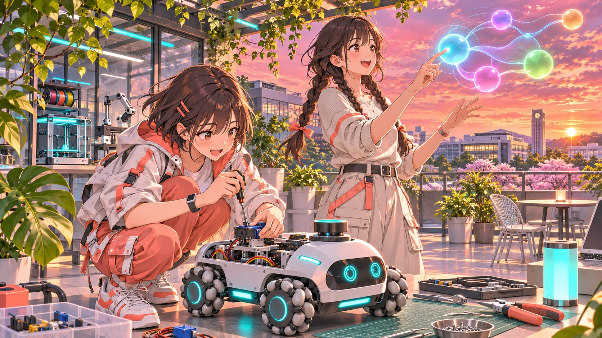
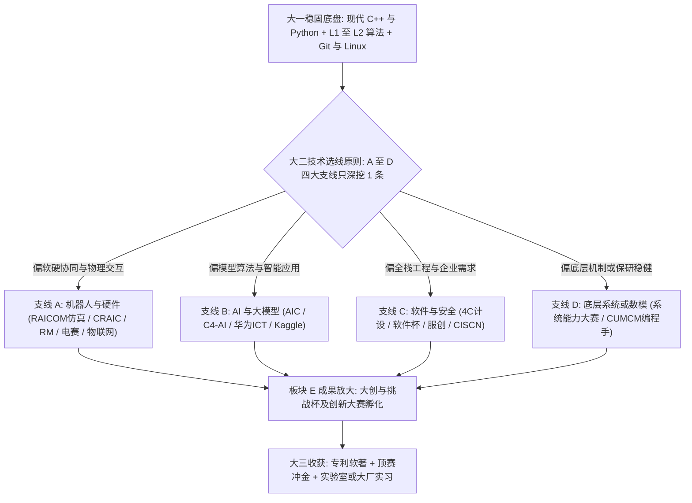

# 第 5 章 泛 CS 竞赛与跨界方向索引

走完[第 2 章](./02-多语言路线与编程基本功索引.md)的多语言底盘、体验过[第 3 章](./03-算法与数据结构竞赛索引.md)的算法赛，或顺着[第 4 章](./04-系统基础与代码架构索引.md)接触系统与工程后，许多同学会渴望把代码变成看得见的作品：让小车自主避障巡航、微调大模型与智能体、开发高并发软件与安全系统，或打一场 74 小时的数学建模。

本章是你的**泛 CS 跨界全赛道导览图**，按认可度梳理五大跨界板块，并将各方向**对大一大二最友好、零成本或低成本上手的公开课、开源仓库与免费云算力**拆解为“四要素卡片”。第 3 章纯算法赛与第 4 章 CSAPP / `xv6` 系统课均以锚点衔接不再重复；校级认定与本地速查见[附录 A](./附录A-长江大学竞赛认定与校内速查.md)。

---

## 5.1 选赛先看清规则：高教社 84 项榜单三档口径与能力迁移矩阵

每逢春秋季，学院群都会刷屏比赛海报。填报名表前，先花三分钟建立**认可度坐标系**。中国高等教育学会《全国普通高校大学生竞赛分析报告》发布的 **84 项全国普通高校大学生竞赛目录**，是高校评定综测、保研、奖学金与报销的硬基准，选赛须分清三档口径：

1. **【84 项榜单硬认定】**：直接位列 84 项正式目录的主赛（如 RoboMaster、电赛、数模国赛、4C 计设、软件杯、服创、物联网、AIC、CISCN、创新大赛、挑战杯），校级认可度最稳。
2. **【84 项母赛延伸 / 近年转正项——报名前核对本校目录】**：含两类：一是 84 项母赛近年新增交叉子项（如 C4-AIGC 创新赛、蓝桥杯视觉艺术设计赛 AIGC 方向）；二是近年转正进入正式榜单的顶流技术赛（如 **2023 年正式转正纳入 84 项目录第 63 项的全国大学生计算机系统能力大赛**）。强校普遍已同步认定，部分高校校级目录更新有时间差，报名前务必核对本校当年红头文件（长江大学口径[见附录 A](./附录A-长江大学竞赛认定与校内速查.md)）。
3. **【非 84 项国内榜单 · 国际与产业高价值】**：如美赛（MCM/ICM）、Kaggle、阿里云天池、科大讯飞 AI 开发者大赛、百度飞桨星河社区赛。它们通常不直接计入国内 84 项行政加分表，但在实验室招新与大厂技术面中含金量极高。下场前想清楚：你当前更需要**校内综测保研分**，还是**镇得住简历的实战作品**。

> [!TIP]
> 跨界并不是抛弃前几章的积累从零重来。扎实的手写代码基本功、复杂度直觉、图论搜索与对拍排错习惯，恰恰是你在跨界队坐稳核心主程的通行证——AI 能快速生成片段代码，但只有具备底层与复杂度直觉的人，才能一眼揪出生成代码里的内存越界、算法退化与死循环隐患。

前四章练出的代码内功如何在跨界赛场变现？下表展示了核心基本功向六大跨界赛道的转化：

| 编程与算法核心功底 | 机器人与智能硬件 | AI 算法与大模型 | AIGC 与 Agent 应用 | 软件、网络与大数据 | 信息安全 CTF | 数学建模与底层系统 |
| :--- | :--- | :--- | :--- | :--- | :--- | :--- |
| **C/C++ 指针、内存与位运算** | 单片机寄存器控制；Jetson 视觉零拷贝控帧 | 异构算子开发（昇腾 CANN / CUDA）；数据加载加速 | 端侧推理封装；多媒体编解码与本地插件 | 协议二进制解包；底层高吞吐网关 | Pwn 栈堆漏洞利用；Reverse 汇编逆向 | OS 页表内存管理；CPU 译码；DB 页存储 |
| **图论与搜索（BFS / DFS / 最短路 / A\*）** | SLAM（同步定位与建图）路径规划；动态避障 | 知识图谱推理；GNN（图神经网络）子图采样 | Multi-Agent（多智能体）DAG 编排与防循环路由 | 分布式路由调度；反欺诈关系网分析 | 攻击面路径建模；状态谜题求解 | 数模网络优化；编译器寄存器图着色 |
| **动态规划、贪心与状态机** | 机械臂最优轨迹；多兵种实时决策状态机 | 强化学习价值迭代；序列解码（Beam Search） | 上下文预算裁剪；多模型路由降本 | 负载均衡；实时推荐重排 | 密码差分路径搜索；符号执行化简 | 数模生产排程优化；指令选择优化 |
| **核心数据结构（堆 / 并查集 / 树 / 哈希 / Trie）** | 点云空间检索（KD-Tree）；传感器滤波 | 向量近似检索（HNSW / IVF）；特征去重 | RAG（检索增强生成）分块索引；SimHash 文本去重 | 倒排索引；流式窗口统计；高并发缓存 | 流量 AC 自动机匹配；字典检索 | DB B+ 树索引与缓冲池；OS 调度队列 |
| **复杂度估算与工程优化** | 受限板卡帧率从 10 FPS 推到 100 FPS | 千万级特征防 OOM（内存溢出）；KV Cache（键值缓存）显存估算 | 压低长链路响应延迟；防 Token 指数爆炸 | 扛住并发压测；排查慢查询与泄漏 | 密码折半碰撞（BSGS）；提升脚本吞吐 | 大规模仿真秒出解；系统性能基准刷榜 |
| **独立调试与自动化对拍（GDB / ASan）** | 消除强光与丢帧引起的实车失控 | 构建防泄露的本地交叉验证（Local CV）体系 | 构建离线评测集与边界回归测试 | 接口容错；并发竞态与死锁定位 | 漏洞利用脚本（EXP）复现；AWD（攻防混战）现场热修复 | 检验公式极端边界；排查内核段错误 |

握稳这张底层能力通行证，我们正式驶入五大跨界航道。

---

## 5.2 板块 A · 机器人与智能硬件赛道（赛事图谱 + 零门槛仿真/单片机入门卡）

机器人赛道有着最直观的物理世界反馈，也是 CS 与电子、机械同学跨院联手的黄金猎场。记住一条省钱铁律：**大一大二切忌自费买几千元整车单干，先在电脑上跑通纯软件仿真、再用几十元开发板摸透控制底层**，才是正反馈最高的路线。

### 5.2.1 机器人与智能硬件主力赛事全景图

| 赛事全称 | 榜单口径与校级参考 | 常规年度时间线 | 组队与赛制特点 | 适合切入年级与 CS 分工 | 官方网址 |
| :--- | :--- | :--- | :--- | :--- | :--- |
| **睿抗机器人开发者大赛（RAICOM）** | 84 项第 40 项 · `[长大 B 类]` | 3~6 月，按赛道分批报名 → 5~7 月省赛 → 8~10 月总决赛 | 校/省/国三级；设 CAIP（2h 个人编程）、CAIR（竞技）、CAIM（仿真）、CAIA 赛道；仿真赛免硬件 | **CAIP 大一下即可冲奖**；CAIM/CAIR 大二主攻规划控制 | [raicom.com.cn](https://www.raicom.com.cn) |
| **中国机器人及人工智能大赛（CRAIC）** | 84 项第 51 项 · `[长大 B 类]` | 3 月启动 → 5~6 月省赛 → 7~8 月总决赛 | 省赛晋级国赛；1~3 人团队；含仿真与实体，增设**大模型智慧零售与具身智能专项** | 大一下试水仿真；**大二主力**攻视觉、状态机与大模型规划 | [caairobot.com](https://www.caairobot.com/) |
| **全国大学生机器人大赛（RoboMaster / ROBOCON）** | 84 项第 19 项 · `[长大 A 类]` | 前年 9~12 月出规则 → 5~6 月区赛 → 7~8 月总决赛 | 大兵团跨院战队制（机械+电控+视觉+运营），备赛 8~10 月；RM 为对抗赛，ROBOCON 每年换题 | 大一入队预备（**保住 GPA**）；**大二攻 C++ + OpenCV + TensorRT 视觉自瞄与哨兵** | [robomaster.com](https://www.robomaster.com) / [robocon.org.cn](https://www.robocon.org.cn) |
| **中国机器人大赛暨 RoboCup 中国赛** | 84 项第 37 项 · `[长大 B 类]` | 春季启动 → 暑期~秋选拔 → 10 月中旬决赛 | 团队赛，技术难度高；含足球（**2D/3D 纯软件仿真组**）、救援、服务等赛项 | **大二起**；纯软件生强推 **RoboCup 2D/3D 仿真组**（C++ 实时博弈） | [rcccaa.drct-caa.org.cn](https://rcccaa.drct-caa.org.cn/) |
| **全国大学生智能汽车竞赛** | 84 项第 11 项 · `[长大重点支持 · 见附录 A]` | 3~6 月校赛 → 7 月中旬区赛 → 8 月中旬决赛 | 2~5 人/队（多数竞速组 3 人）；分电磁、光电、智能视觉、完全模型等组别 | **大二~大三**；主攻嵌入式图像搜线、PID/纯追踪控制与帧率优化 | [smartcar.zone](https://www.smartcar.zone) |
| **全国大学生嵌入式芯片与系统设计竞赛（嵌赛）** | 84 项第 43 项 · `[长大 B 类]` | 2 月报名 → 7 月初赛 → 8 月中旬总决赛 | 1~3 人/队；芯片应用、设计、FPGA 赛道，基于海思/ST 等指定平台软硬协同 | **大二~大三**（需计组基础）；主打静态内存、位运算与定点化 | [socchina.net](https://www.socchina.net) |
| **全国大学生物联网设计竞赛** | 84 项第 65 项 · `[长大 B 类]` | 3~5 月报名 → 7 月初赛/区赛 → 8 月中下旬国赛 | 同校不超 4 名学生 + 不超 2 名导师；常联合华为/乐鑫提供套件，覆盖传感、无线通信与云端联动 | **大二主力**；负责嵌入式通信协议、边缘网关与云端后端联调 | [iot.sjtu.edu.cn](http://iot.sjtu.edu.cn) |
| **全国大学生电子设计竞赛（电赛）** | 84 项第 6 项 · `[长大 A 类]` | **单数年（2025/2027）8 月国赛**；**双数年（2026）7 月底省赛** | 严格 3 人同校组队；现场发题后**半封闭 4 天 3 夜**完成制作、编程与报告 | **大二~大三**盯单数年国赛；任主控软件、路径搜索或视觉主程 | [nuedc-training.com.cn](https://www.nuedc-training.com.cn) |

面对这 8 项赛事，CS 同学选品只需盯准 **3 条法则**：
- **法则 1 · 无硬件实验室依托，先打“纯软件仿真组”**：**RAICOM CAIM 仿真、RoboCup 2D/3D 仿真、CRAIC 仿真**零硬件耗材门槛，纯拼 C++/Python 规划与博弈；想碰真机再借校队或跨院硬件队友上 **RoboMaster / 智能车 / 电赛 / 嵌赛 / 物联网**。
- **法则 2 · 抓住睿抗（RAICOM）“一赛双吃”红利**：CAIP 编程赛为 2 小时个人机考，与第 3 章蓝桥杯、天梯赛完全同源，大一下顺手可多拿一张 84 项国赛证书；大二再转 CAIM/CAIR 仿真竞技几乎零切换成本。
- **法则 3 · 算准电赛大小年，进战队先守住 GPA**：电赛执行**“单数年国赛、双数年省赛”**；大一进大兵团战队务必守住高数、线代与 C++ 主课绩点。

### 5.2.2 机器人与智能硬件最友好入门资源（四要素卡片）

> [!NOTE]
> 开始前请先具备[第 2 章](./02-多语言路线与编程基本功索引.md)的 Linux 命令行（含 WSL 2）、C 指针及基础 Python/C++ 能力。

1. **软件与仿真首选：鱼香 ROS《动手学 ROS2》 + 古月居《ROS2 入门 21 讲》**
   - **① 定位与适合谁**：大一下~大二切入机器人仿真（RAICOM 仿真、CRAIC、视觉导航）首选；前置需 Linux 命令与 C++/Python 入门。
   - **② 为什么选它而非同类**：传统教程常卡在换源报错与过时 ROS 1。**鱼香 ROS**（[fishros.com](https://fishros.com/) / 社区 [fishros.org.cn](https://fishros.org.cn/)）以一键安装脚本消灭 90% 配环境故障并带 Nav2 导航实战；**古月居《ROS2 入门 21 讲》**（图文 [book.guyuehome.com](https://book.guyuehome.com/)，源码 [guyuehome/ros2_21_tutorials](https://github.com/guyuehome/ros2_21_tutorials) 配 B 站视频）概念体系严谨。
   - **③ 正确打开方式与预计耗时**：锁定主流 **ROS 2 LTS 版本**（Ubuntu 22.04 配 Humble，或 Ubuntu 24.04 配 Jazzy）用鱼香脚本一键安装。跟《21 讲》跑通节点、话题与服务通信，再掌握 TF 空间坐标变换、URDF 机器人结构建模与 Gazebo 3D 物理仿真小车；**约 3~4 周**。
   - **④ 劝退点与平滑替代路**：全免费；直接学 **ROS 2** 勿学 ROS 1，**严禁大一自费网购几百上千元“ROS 实车开发套件”**（Gazebo 仿真已够练完整算法链路）；WSL 2 跑纯仿真起步够用，一旦涉及实体激光雷达、相机或串口直连，尽早切 Ubuntu 原生双系统。

2. **硬件与电控破冰首选：B 站 `江协科技`《STM32 入门教程》**
   - **① 定位与适合谁**：瞄准电赛、智能车、嵌赛、物联网赛或 RoboMaster 电控组的大一大二生；前置只需 C 指针、结构体与位运算。
   - **② 为什么选它而非同类**：全免费且手绘外设原理图，先以**标准库（SPL）**把底层寄存器与时序原理讲透，对零硬件基础最友好，远胜高价捆绑开发板培训班。
   - **③ 正确打开方式与预计耗时**：自购几十元 STM32 最小系统板（如 F103C8T6）配十几元 USB 转 TTL 串口模块，精练**前 15 讲**——调通 GPIO 引脚输入输出、外部中断、定时器、控电机与舵机的 PWM 脉冲调制及 UART 串口；进复杂团队工程后再平滑切 **STM32CubeMX + HAL 库**提效；**约 3~4 周**。
   - **④ 劝退点与平滑替代路**：总硬件投入不到百元；别被“先啃完上千页芯片手册再点灯”吓住，但接线前务必核对正负极与 3.3V/5V 电平防烧板。CS 生应守住视觉、路径规划与上层控制主程位，勿沉迷焊板子；试学两周无感即果断止损，切回**纯软件视觉 / 仿真组**。

3. **战队工程参照：RoboMaster 开源生态**
   - **① 定位与适合谁**：ROS 2 或 STM32 入门后准备进校战队，或研究视觉自瞄、哨兵决策框架者。
   - **② 为什么选它而非同类**：官方仓库（[github.com/RoboMaster](https://github.com/RoboMaster) / [robomaster.com](https://www.robomaster.com/)）与强校战队沉淀了大量真实开发板固件、视觉自瞄与决策框架，远胜闭门造车。
   - **③ 正确打开方式与预计耗时**：先读官方开发板文档与公开战队培训手册，挑 **1 个具体子模块**（如**装甲板灯条识别 + 卡尔曼滤波预测**或**上下位机串口帧协议解析**）拆读复现；**约 2~3 周**建立战队代码规范。
   - **④ 劝退点与平滑替代路**：代码开源免费但实车耗材极贵——**大一严禁自费买整车单干**，依托校队设备或公开录屏数据集做离线视觉调优。

给铁甲装上控制神经后，若你更着迷于“如何让机器看懂图像、理解语言并自主推理”，下一步便来到人工智能与大模型赛场。

---

## 5.3 板块 B · 人工智能、大模型与 AIGC 赛道（分层图谱 + 免费算力与开源课指路）

AI 与大模型是近年出作品最快的方向，也是“调包焦虑”和“套壳同质化”的重灾区：**拿校内综测与保研分盯 84 项榜单主赛，锤炼科研与大厂算法岗简历则去真实数据集打榜赛比拼硬指标。**

### 5.3.1 综合 AI 与产业真题四大榜单赛

| 赛事全称 | 榜单口径与校级参考 | 常规年度时间线 | 组队与赛制特点 | 适合切入年级与 CS 分工 | 官方网址 |
| :--- | :--- | :--- | :--- | :--- | :--- |
| **中国高校计算机大赛——人工智能创意赛（C4-AI）** | 84 项第 26 项核心子赛 · `[见附录 A]` | 3~4 月启动 → 4~6 月初赛 → 6~8 月区赛 → 11 月中决赛 | 1~3 人/队（可跨校跨专业）+ 1 导师；常设鸿蒙与昇腾 AI 双赛道，重场景落地 | **大二~大三**；做好数据预处理、端侧推理与消融实验 | [c4best.cn](https://www.c4best.cn) |
| **全球校园人工智能算法精英大赛（AIC）** | 84 项第 76 项 · `[长大 B 类]` | 4~5 月报名 → 暑期~10 月区赛 → 10~12 月总决赛 | 含算法挑战、创新（大模型/Agent）、应用（具身）、产业命题及**算法专项赛** | **大一下可先打算法专项赛**；大二冲打榜与智能体 | [aicomp.cn](https://www.aicomp.cn) |
| **华为 ICT 大赛** | 84 项第 42 项 · `[长大 B 类]` | 跨学年制：9~11 月报名 → 11~12 月初赛 → 次年 3~4 月中国决赛 | 同校 3 人 + 1 导师；实践赛含网络、云、基础软件、**昇腾 AI**；近年设**昇腾 AI 算子开发** | **大二~大三**；算子与基础软件赛道看重访存分析与 C++ 排错 | [e.huawei.com](https://e.huawei.com) |
| **“中国软件杯”大学生软件设计大赛** | 84 项第 38 项 · `[长大 B 类]` | 3~6 月开发（6 月底截稿）→ 7 月初赛 → 8 月总决赛 | 不超 4 人（含 1 导师，最多 3 学生，可跨校）；**企业出题**，密集放出大模型与 Agent 真题 | **大二下~大三**（高含金量简历项目）；主攻 RAG 重排与 Agent 状态机 | [cnsoftbei.com](http://www.cnsoftbei.com) |

### 5.3.2 AIGC 与大模型三层认定图谱

除上述四大综合赛外，近年爆发的 **AIGC（生成式人工智能）与大模型赛项** 呈现鲜明的“三层分化”——报名前看清作品投向哪一层，直接决定它能换来校内加分还是工业界履历：

| 分层属性 | 代表赛事与子赛道 | 榜单认定与简历价值 | 2024–2026 核心赛项与参赛要点 | 官方网址 |
| :--- | :--- | :--- | :--- | :--- |
| **第一层：84 项榜单明确内嵌的 AIGC / 大模型赛项** | **4C 计设 AI 赛道** `[长大 B 类]`；**全国大学生数字媒体科技作品及创意竞赛** `[见附录 A]`；**CRAIC / AIC 大模型专项** `[长大 B 类]` | **榜单硬认定 ★★★★★**；综测与保研全线通行 | **4C** 设 AI 应用与 AI+数媒，考察对 AI 工具组合优化；**数媒竞赛**（第 71 项）设 AIGC 数字创意赛道，适合开发 ComfyUI（节点式生成工作流）与交互系统；**CRAIC / AIC** 含智能体与具身专项 | 4C：[jsjds.blcu.edu.cn](http://jsjds.blcu.edu.cn/)；数媒：[cmit.cn](https://www.cmit.cn)；CRAIC：[caairobot.com](https://www.caairobot.com/)；AIC：[aicomp.cn](https://www.aicomp.cn) |
| **第二层：84 项母赛近年新增 / 细分 AIGC 赛项** | **C4-AIGC 创新赛** `[见附录 A]`；**蓝桥杯视觉艺术设计赛（AIGC 方向）** `[见附录 A]` | **需核查本校目录 ★★★★☆**；挂靠 84 项母赛，部分学院对新增或交叉子项有单独口径 | **C4-AIGC**（3~4 月启动）分**应用赛道**（不超 5 人，需编程开发软件/Demo）与**创作赛道**（不超 3 人）；**蓝桥设计赛**含 AIGC 微短剧等方向，需交完整工艺说明 | C4-AIGC：[aigc.vivo.com](https://aigc.vivo.com/)；蓝桥设计：[design.lanqiao.cn](https://design.lanqiao.cn) |
| **第三层：企业 / 社区顶级实战 AI 与大模型赛** | **Kaggle**；**阿里云天池**；**科大讯飞 AI 开发者大赛**；**百度飞桨 AI Studio 星河社区赛** | **非 84 项国内榜单**（校内一般不直接计分）；**工业界与科研简历价值 ★★★★★** | **Kaggle** 全球 ML/LLM 殿堂，奖牌在科研与算法岗极硬；**天池 / 讯飞** 供真实脱敏业务数据；**飞桨 AI Studio** 带免费 GPU 与新手练兵赛 | Kaggle：[kaggle.com](https://www.kaggle.com/)；天池：[tianchi.aliyun.com](https://tianchi.aliyun.com/)；讯飞：[challenge.xfyun.cn](https://challenge.xfyun.cn/)；飞桨：[aistudio.baidu.com/competition](https://aistudio.baidu.com/competition) |

> [!IMPORTANT]
> **在大模型 / AIGC 赛场拒绝“套壳 Demo”**：评委早已厌倦“调开放接口加聊天框”。用好底层工程功底才能胜出：① **Agent 架构**用 DAG 或状态机防死循环并控 Token 预算；② **RAG 检索**手写分块、SimHash/MinHash 去重与多路重排；③ 自建类似“对拍器”的**本地离线评测集**，用可复现指标说话。

### 5.3.3 AI、大模型与免费算力最友好入门资源（四要素卡片）

1. **AI 概念破冰首选：吴恩达（Andrew Ng）《机器学习》&《深度学习》专项课程**
   - **① 定位与适合谁**：适合有[第 2 章](./02-多语言路线与编程基本功索引.md) Python 基础与大一高数线代的大一暑假~大二上学生，用作 AI 宏观扫盲。
   - **② 为什么选它而非同类（避开两个极端）**：一端是零基础硬啃周志华《机器学习》（“西瓜书”）或 Goodfellow《深度学习》（“花书”），开篇密集的概率与矩阵推导极易让大一在前四章弃坑；另一端是只看“10 分钟调包跑通 YOLO”碎片视频，连数据泄露和过拟合都分不清。吴恩达用几何直觉讲透梯度下降、Bias/Variance（偏差与方差）诊断、CNN 与序列模型，先立直觉再补西瓜书数学推导事半功倍。
   - **③ 正确打开方式与预计耗时**：在 [DeepLearning.AI](https://www.deeplearning.ai/)（Coursera 可免费旁听，B 站亦有中字合集）以 **1.5x 倍速**学完《机器学习专项》（3 门）及《深度学习专项》核心课（1~4 门打通神经网络、调参诊断与 CNN，第 5 门序列模型按需选看以衔接 Transformer），做完浏览器填空实验；**约 3~4 周**。
   - **④ 劝退点与平滑替代路**：免费旁听无需买付费证书；想更快手写 PyTorch，学完机器学习专项即可衔接李沐教程。

2. **深度学习动手主战：李沐《动手学深度学习》（PyTorch 版）**
   - **① 定位与适合谁**：听完吴恩达、准备用 PyTorch 写模型打比赛的大二生；前置需 Python、基础矩阵乘法与免费云 GPU。
   - **② 为什么选它而非同类**：全书在 [zh.d2l.ai](https://zh.d2l.ai/) **完全免费开源**，配 B 站李沐团队逐节精讲。最大亮点是每个核心网络同时提供**“PyTorch 简洁 API 版”和“张量从零手写（Scratch）版”**，杜绝黑盒调包。
   - **③ 正确打开方式与预计耗时**：把 Notebook 传到免费云 GPU 边改边跑——**大二必跑范围**：预备知识、线性神经网络、多层感知机（MLP）、CNN 经典架构（含 ResNet）、注意力机制与 Transformer；**初学可暂跳过**：分布式多机多卡训练及部分过旧传统 RNN 繁杂变体。课后题参考 **DataWhale**（[datawhalechina.github.io](https://datawhalechina.github.io/) `d2l-ai-solutions-manual`），跟着书内案例顺手打 1~2 个 Kaggle 入门赛（房价预测或图像分类）；**约 6~8 周**。
   - **④ 劝退点与平滑替代路**：全免费，后半部坡度较陡可跟 DataWhale 笔记打卡；至于 **Stanford CS231n**（[cs231n.stanford.edu](https://cs231n.stanford.edu/)），其纯 NumPy 手推反向传播作业**留到大二下或大三科研拔高再做**。

3. **周末极速原型组合：DeepLearning.AI Short Courses + Dify**
   - **① 定位与适合谁**：想在一个周末搞懂 Prompt、RAG（检索增强生成）与 Agent 工作流并做出演示 Demo 者；仅需基础 Python 或 HTTP/API 概念。
   - **② 为什么选它而非同类**：免去本地环境冲突，先刷免费短课 **DeepLearning.AI Short Courses**（[learn.deeplearning.ai](https://learn.deeplearning.ai/)，每门 1~2 小时带在线 Notebook），再用高星开源低代码平台 **Dify**（[dify.ai](https://dify.ai/) / 文档 [docs.dify.ai](https://docs.dify.ai/)）可视化编排工作流，最快拿完整作品正反馈。
   - **③ 正确打开方式与预计耗时**：刷 2~3 门免费短课（Prompt、Agentic Workflows、MCP），再用 Dify 搭出“校园资料问答助手”；**1 个周末（6~10 小时）**。
   - **④ 劝退点与平滑替代路**：**看清低代码边界**——做创意验证或 4C 轻应用时 Dify 效率极高；但一旦参加软件杯、服创或 C4-AIGC 应用赛，需要自定义检索重排、复杂多步状态机与低延迟部署时，务必立即切换到下方 DataWhale 代码三部曲，别用拖拽界面应付技术答辩。

4. **大模型与智能体开源三部曲：DataWhale 三部曲 + Hugging Face Learn**
   - **① 定位与适合谁**：严守前置分水岭——前两本《LLM-Universe》与《Hello-Agents》只需 Python 与 API 调用基础，大一下即可上手；第三本《Happy-LLM》**必须先学完 PyTorch / D2L，大一严禁硬啃**。
   - **② 为什么选它而非同类**：避开市面上动辄数千元的付费训练营，DataWhale 把整套中文实践代码完全免费开源在 GitHub：
     - **应用起步《LLM-Universe》**（[llm-universe](https://github.com/datawhalechina/llm-universe)）：Python + LangChain + 向量库 + Streamlit 从零手写 RAG 知识库（**2~3 周**）；
     - **智能体《Hello-Agents》**（[hello-agents](https://github.com/datawhalechina/hello-agents)）：拆解 Agent 架构、工具调用、记忆与 **MCP 协议**（Model Context Protocol，大模型对接外部工具的开放标准，[modelcontextprotocol.io](https://modelcontextprotocol.io/)）（**2~3 周**）；
     - **原理微调《Happy-LLM》**（[happy-llm](https://github.com/datawhalechina/happy-llm)）：大二学完 PyTorch 后按逐行注释拆解 Transformer、预训练与 SFT（监督微调）（**4~6 周**）。
   - **③ 正确打开方式与预计耗时**：按“**LLM-Universe → Hello-Agents →（学完 D2L 后）Happy-LLM**”推进，配合 **Hugging Face Learn**（[LLM Course](https://huggingface.co/learn/llm-course) 与 [AI Agents Course](https://huggingface.co/learn/agents-course)）及 [LangChain 文档](https://docs.langchain.com/)查最新接口。
   - **④ 劝退点与平滑替代路**：全免费；框架更新快导致依赖报错时，对照仓库 `requirements.txt` 与 Issues 锁定版本；实验阶段优先用国产平台免费额度或本地 `Ollama` 跑 1.5B~7B 轻量模型，切忌为跑 Demo 买高价课或大额套餐。

5. **零成本免费云 GPU 算力入口（大一大二无需自费买高价显卡）**
   - **① 定位与适合谁**：笔记本无独显或显存不足、需跑 D2L 与小模型 LoRA（低秩轻量微调，0.5B~7B 级）的大一大二生。
   - **② 为什么选它们**：免买硬件、开机写 Notebook，且内地高校直连以下四家远胜网络易断连的 Colab：
     - **Kaggle Notebooks**（[kaggle.com/code](https://www.kaggle.com/code)）：现行默认免费规格为**双 T4（`GPU T4 x2`，两张 16 GB 独立显存卡，合计 32 GB）**，手机认证后每周约 **30 小时**共享配额，**单次最长 12 小时**（闲置约 20 分钟自动回收）；注意未做双卡切分时单卡可用上限为 16 GB；
     - **百度飞桨 AI Studio 星河社区**（[aistudio.baidu.com](https://aistudio.baidu.com/)）：国内直连稳，提供免费 GPU 算力配额（含 V100 时长，具体以平台当期规则为准），一键 Fork 中文项目；
     - **阿里云天池实验室**（[tianchi.aliyun.com](https://tianchi.aliyun.com/)）：直连产业赛数据集的免费实例；
     - **魔搭社区 ModelScope**（[modelscope.cn](https://modelscope.cn/)）：免费 Notebook、高速国内开源模型下载及 **ModelScope MCP 广场**。
   - **③ 正确打开方式与预计耗时**：随学随开（**10 分钟内**跑通首个矩阵乘法），用完记得点 `Stop` 省时长。
   - **④ 劝退点与平滑替代路**：**免费云 GPU 并非持久化硬盘**——Session 释放或超时回收即清空本地临时目录，中间权重务必及时开启持久化或下载备份；此外 32B 以上大参数量模型全参微调仍超免费上限，前两年聚焦中小模型与 RAG 足够。

---

## 5.4 板块 C & D · 软件网络、信息安全、数学建模与底层系统赛道

如果不碰实体硬件、也不卷大模型调参，纯正的软件与系统功底同样有四片高含金量赛场：**板块 C** 聚焦全栈软件、网络大数据与信息安全（CTF）；**板块 D** 则通向跨学科高性价比的数学建模“编程手”，以及本科底层天花板——系统能力大赛。

### 5.4.1 软件工程、网络与大数据三强赛事

注意区分名称相近的两大 84 项老牌国赛——**“4C 计设”（中国大学生计算机设计大赛）**重完整作品交付，而**“C4 高校计算机大赛”**则按大数据、网络技术、移动应用等专项硬碰硬：

| 赛事全称 | 榜单口径与校级参考 | 常规年度时间线 | 组队与赛制特点 | 适合切入年级与 CS 分工 | 官方网址 |
| :--- | :--- | :--- | :--- | :--- | :--- |
| **中国大学生计算机设计大赛（4C）** | 84 项第 25 项 · `[长大 B 类]` | 3~4 月校省提交 → 5 月省赛 → 7~8 月国赛 | 严格**校→省→国**三级；2~5 人为主，含软件开发、物联网、大数据、AI 应用等 11 大类 | 大一下跟队写模块；**大二主力冲国奖**，用真索引与并发后端摆脱纯界面壳子 | [jsjds.blcu.edu.cn](http://jsjds.blcu.edu.cn/) / [2026.jsjds.com.cn](https://2026.jsjds.com.cn) |
| **中国高校计算机大赛（C4：大数据 / 网络技术 / 移动应用）** | 84 项第 26 项 · `[见附录 A]` | 3~4 月启动 → 4~6 月资格赛 → 6~8 月区赛 → 9~11 月决赛 | 1~3 人/队（可跨校跨专业）+ 1 导师；大数据考千万级数据；网络分创意与攻关；移动多由浙大与 Apple 联办 | **大二~大三**；依靠计网、数据结构与性能调优，网络攻关考路由与协议解析 | [c4best.cn](https://www.c4best.cn) / [net.c4best.cn](https://net.c4best.cn) |
| **中国大学生服务外包创新创业大赛（服创）** | 84 项第 24 项 · `[长大 B 类]` | 前年 12 月~2 月启动 → 3 月底截止 → 8 月无锡决赛 | 不超 5 名学生 + 2 导师；强推 **A 类（企业命题，不限校名额）** 与 **D 类（AI 专项，如腾讯开悟）** | **大二~大三**；数十页需求书极锤炼系统拆解与高可靠工程交付 | [fwwb.org.cn](http://www.fwwb.org.cn/) |

#### 软件、网络与大数据实战破冰与技术栈选型卡

前置语言与 Git 基础见[第 2 章](./02-多语言路线与编程基本功索引.md)，模块设计与协议底层衔接[第 4 章](./04-系统基础与代码架构索引.md)（如 CS61B 或 CS144）。三类子方向各锁定一套最小可行栈：

1. **4C / 服创全栈最小交付骨架（`FastAPI` / `Spring Boot` + `Vue` / `React` + `Docker`）**
   - **① 定位与适合谁**：大一下跟队或大二冲刺 4C 软件组与服创 A 类命题者；前置需一门后端语言、SQL 与 HTTP 常识。
   - **② 为什么选它而非同类**：传统校园作品易陷进“静态前端 + 写死假数据”空壳。用 **`FastAPI` 或 `Spring Boot`** 配 **`Vue` / `React`**，再以 **`Docker Compose`** 一键编排服务与数据库，是交付最快、最扛现场答辩抽检的标准方案。
   - **③ 正确打开方式与预计耗时**：先花 **2~3 周**打通“前端表单 → 后端接口 → 数据库持久化 → Docker 一键拉起”主链路；答辩前补齐真实压测指标——如 QPS 每秒查询吞吐率、P95（95% 请求的响应耗时上限）及异常输入兜底。评委最看重的不是堆十个半成品页面，而是**换台电脑能一键跑起来、输错参数不会 500 崩溃**。
   - **④ 劝退点与平滑替代路**：全免费；最忌全队花三周美化登录页却无核心业务逻辑；大一时间紧可由高年级负责前端，自己专注打通后端接口与性能基准。

2. **C4 大数据挑战赛基线（`Pandas` / `LightGBM` + 防泄露本地 CV）**
   - **① 定位与适合谁**：想打表格风控、时序预测与产业数据挖掘赛者；前置需 Python 数据处理基础。
   - **② 为什么选它而非同类**：面对千万级表格数据，盲目套深度网络又慢又易过拟合。公认最强起点是 **`Pandas` / `Polars` 特征工程 + `LightGBM` 树模型基线**，搭配严格按时间或实体分组的本地交叉验证（Local CV，模拟线上评测切分）。
   - **③ 正确打开方式与预计耗时**：**2~3 周**内用往届公开数据集跑通 `读取 → 清洗 → 构造特征 → 5 折交叉验证（训练集轮流切 5 份互验） → 提交` 流水线，每次新增特征只保留有 CV 正收益的改动。
   - **④ 劝退点与平滑替代路**：免费且算力门槛低；头号坑是“时间穿越”（把未来时段信息混进训练特征）导致本地满分、线上崩盘——切分规则务必严格对齐业务预测窗口。

3. **C4 网络技术挑战赛实战入口（`Wireshark` + Linux 虚拟网络环境）**
   - **① 定位与适合谁**：选报网络赛（尤其 B 系列攻关题）且具备计网基础的大二生。
   - **② 为什么选它而非同类**：光背五层协议栈修不通真实丢包与策略路由。**`Wireshark`** 抓包分析配 Linux 虚拟网络（`ip netns`、`Mininet` 或容器拓扑），可在单机零成本复现转发、拥塞与异常流量场景。
   - **③ 正确打开方式与预计耗时**：先按[第 4 章](./04-系统基础与代码架构索引.md)补齐湖科大计网微课堂或 CS144 基础，再用 **2~3 周**针对往届场景抓包拆解报文，编写 Python/C++ 路由调度或异常流量检测脚本。
   - **④ 劝退点与平滑替代路**：全免费；攻关赛切忌停留在“截图展示配置界面”，必须给出可复现的吞吐、丢包率或检测准确率对比实验。

### 5.4.2 信息安全（CTF）赛道与入门四要素卡片

国内网安第一权威赛是 **全国大学生信息安全竞赛（CISCN）**（84 项第 33 项，`[长大 B 类]`，[ciscn.cn](http://www.ciscn.cn)，近年创新实践能力赛常与“长城杯”协同 [ccb.itsec.gov.cn](https://ccb.itsec.gov.cn/)）。赛事跨学年推进（11 月启动 → 12 月下旬初赛 → 次年 3~5 月半决赛 → 夏季国赛），每队不超 4 人，含**作品赛**与**创新实践能力赛**（线上 CTF 解题 + 线下 **AWD 实时攻防混战**，既要攻击对手也要抢修己方漏洞）。CTF 五大方向各吃不同基本功：**Web** 偏 HTTP/SQL 注入与代码审计；**Misc（杂项）** 偏隐写、流量包分析与脚本；**Crypto（密码）** 直通第 3 章数论同余与快速幂；**Pwn（二进制漏洞）与 Reverse（逆向）** 直考 C 指针、栈堆内存与汇编。

1. **扫盲与百科词典：Hello CTF + CTF Wiki**
   - **① 定位与适合谁**：**Hello CTF**（[hello-ctf.com](https://hello-ctf.com/)）面向大一零安全基础；**CTF Wiki**（[ctf-wiki.org](https://ctf-wiki.org/)）全阶段查原理；前置需 Python、HTTP 与 Linux 命令。
   - **② 为什么选它而非同类**：彻底避开一上来推销高价“黑客/渗透 VIP 训练营”的套路，Hello CTF 用简洁路线带你 1~2 周分清五大方向真实日常；CTF Wiki 则是中文社区最全原理词典。
   - **③ 正确打开方式与预计耗时**：**1~2 周**读完 Hello CTF 导览后**只选 Web 或 Misc 中 1 个方向切入**；**严禁从第 1 页线性通读 CTF Wiki**，遇到卡壳题型再按词条查。
   - **④ 劝退点与平滑替代路**：全免费；**新人切忌零基础直冲 Pwn 或 Reverse**——先完成[第 4 章](./04-系统基础与代码架构索引.md) **CSAPP 前 3 个 Lab（尤其 Bomb Lab 与 Attack Lab）** 再回头学，正反馈翻倍。

2. **免费真题靶场双雄：BUUCTF + NSSCTF**
   - **① 定位与适合谁**：读完 Hello CTF 后准备用 **2 周拿前 15~20 个 Flag** 检验自己是否真对网安来电的新手。
   - **② 为什么选它而非同类**：**BUUCTF**（[buuoj.cn](https://buuoj.cn/)）汇聚历年 CISCN 等经典真题且全网 Writeup（解题复盘）极丰富；**NSSCTF**（[nssctf.cn](https://www.nssctf.cn/)）题库更新快、难度标签清晰、在线靶机启动顺畅。
   - **③ 正确打开方式与预计耗时**：每晚挑 1~2 道入门 Web/Misc 真题试做 30 分钟，卡住看 Writeup 理解原理后自己手写 Python 漏洞利用脚本（EXP）跑通提交；**2~4 周**即可积累初赛手感。
   - **④ 劝退点与平滑替代路**：日常练习免费够用；务必严守法律红线，**一切攻防测试仅限合法公开靶场容器内进行，严禁对任何真实站点做未授权测试**。

### 5.4.3 数学建模赛道与入门四要素卡片

数学建模是 CS 学子**备赛周期最短、跨院组队最抢手**的闪电战：

- **全国大学生数学建模竞赛（CUMCM，国赛）**（84 项第 5 项，`[长大 A 类]`，[mcm.edu.cn](http://www.mcm.edu.cn)）：每年 **9 月中旬**连续 **74 小时**，1~3 人同校组队（建模手 + **CS 编程手** + 论文手）。CS 编程手能手写启发式搜索、DP、图论与蒙特卡洛仿真并做敏感性验算，团队性价比极高。
- **美国大学生数学建模竞赛（MCM / ICM，美赛）**（`[非 84 项 · 见附录 A]`，[contest.comap.com](https://www.contest.comap.com/)）：每年 **1 月底~2 月中旬**寒假连续 **96 小时**。虽不进国内 84 项榜单，但适合大一寒假低压力练英文 LaTeX 排版与协作。**注意 2025–2026 年国赛与美赛均严查生成式 AI 使用规范与披露要求（以当年组委会细则为准），严禁照搬 AI 编造数据与参考文献。**

1. **免费视频 + Python 矢量绘图：B 站“清风数学建模”公开基础课 + `Matplotlib` / `Seaborn`**
   - **① 定位与适合谁**：大一寒假打美赛或大二 9 月冲刺国赛的 CS 编程手；前置需 Python 与大一高数线代。
   - **② 为什么选它而非同类**：B 站公开的清风**免费基础合集与课件**已覆盖层次分析、插值拟合、规划与灰色预测；CS 同学用 **Python（`NumPy` / `SciPy` / `PuLP` 或 `OR-Tools` + `Matplotlib` / `Seaborn`）** 替代传统 MATLAB，导出高清矢量图（PDF/EPS）学术质感拉满，遇超大规模组合优化还可将瓶颈模块用 C++ 加速接入。
   - **③ 正确打开方式与预计耗时**：**赛前准备 2~3 周即可上场**！按“评价、预测、优化、分类聚类”挑看免费视频并备好绘图与求解模板；**开赛前 1 周务必与建模手、论文手跑通一次符号约定与图表联调**——编程手头号踩坑点不是算法不够炫，而是图表符号与论文正文脱节，或漏做**敏感性分析（微调核心参数看结论是否依然稳健）与误差检验**。
   - **④ 劝退点与平滑替代路**：清风最新系统班与答疑属**付费服务**，但**首赛完全无需花高价买系统班**，免费公开基础视频配近三年优秀论文精读 3~5 篇足够。

2. **案头代码工具书：司守奎、孙玺菁《Python 数学建模算法与应用》**
   - **① 定位与适合谁**：备考与比赛 74/96 小时期间桌边现查的模型代码手册。
   - **② 为什么选它而非同类**：相比经典 MATLAB 版，**Python 版**无缝对接 CS 开发环境（GitHub 可搜配套开源代码），省去重学 MATLAB 成本。
   - **③ 正确打开方式与预计耗时**：**严禁逐页通读！** 赛前花 **15~20 小时**摸熟目录与输入输出格式、整理个人板子库，赛时按题型定位即改。
   - **④ 劝退点与平滑替代路**：硬啃必枯燥；时间紧可直接对照国赛/美赛特等奖论文与 `SciPy` 官方文档现用现查。

### 5.4.4 底层系统天花板：全国大学生计算机系统能力大赛

面向想造 CPU、OS 或编译器的同学，国内本科顶级试炼场是 **全国大学生计算机系统能力大赛**（**84 项正式目录第 63 项，2023 年新增转正**，`[84 项第 63 项 · 见附录 A]`，平台 [educg.net](https://educg.net/)、OS 赛 [os.educg.net](https://os.educg.net)、编译赛 [compiler.educg.net](https://compiler.educg.net)、龙芯杯 [nscscc.com](https://www.nscscc.com)）。因属近年新增转正项，部分高校目录更新有时间差，报名前核查本校当年目录。

- **六大赛道的大二友好梯度与窗口**：要求**同校组队不可跨校**（常见 3~4 人）；每年 **3~5 月**报名，**5~7 月**在 **QEMU（开源硬件指令集模拟器，可在普通笔记本上免物理板卡运行自研内核）** 或在线评测平台初赛，**8 月中下旬**全国总决赛。赛道前置分化鲜明：**CPU 设计（龙芯杯）**需数字逻辑、计组与 Verilog/Chisel 硬件描述语言前置；**操作系统（OS）、编译系统（毕昇杯）与数据库**属纯软件系统向（另设智能计算与智能系统赛道），软件功底扎实的 CS 生切入更直接。
- **硬性预警与“1 周低成本试水法”**：**大一严禁硬冲！** 请先在[第 4 章](./04-系统基础与代码架构索引.md)扎实完成 CSAPP 核心 Lab 及 `xv6` / jyy OS 铺垫。到大二下评估是否进正赛时，用 **1 周低成本试水**：直接拉取上一届 OS 或编译赛官方开源基线框架，配通工具链并在 QEMU 跑通第一个官方测例；跑得通且享受逐行排查并发与页表的过程，再正式组队。

---

## 5.5 板块 E · 综合创新创业与大创孵化（拒绝空壳 PPT，稳居核心技术位）

走完 A~D 四条技术赛道，最后来看在各高校认定级别封顶的**综合双创与大创孵化板块**。先立住核心认知：**板块 E 并不是与机器人、AI、软件、系统并列的第五套技术栈，而是前面 A~D 四条技术支线真实原型的成果孵化器与放大器。**

| 赛事 / 项目全称 | 榜单口径与校级参考 | 常规年度时间线 | 组队与核心评审看点 | 大一大二正确入场姿势 | 官方网址 |
| :--- | :--- | :--- | :--- | :--- | :--- |
| **中国国际大学生创新大赛** *(原“互联网+”)* | 84 项第 1 项 · `[长大 A+ 类]` | 3~7 月校赛 → 6~8 月省赛 → 9~11 月国赛 | 3~15 人/队（可跨校）；重技术壁垒、论文/专利/软著支撑与落地实绩 | **大一绝不牵头攒商业 PPT！** 大一下/大二凭编码能力进靠谱导师团队任核心原型开发者，锁定前三作者位 | [cy.ncss.cn](https://cy.ncss.cn) / 国际 [pilcchina.org](https://www.pilcchina.org) |
| **“挑战杯”（大挑 & 小挑）** | 84 项第 2、3 项 · `[长大 A+ 类]` | **单双年交替**：大挑奇数年国赛；小挑偶数年国赛 | 大挑不超 10 人，小挑不超 10~15 人；校团委推报，大挑重科研论文与发明 | **大二~大三主力**；大一先任课题组底层代码成员积累实测原型 | [tiaozhanbei.net](https://www.tiaozhanbei.net) |
| **大学生创新创业训练计划（大创 / 国创年会）** | 84 项第 17 项对应国创年会 · `[长大 A 类]` | 依各校春秋立项窗 → 6~7 月公示 → 1~2 年结题 | 创新训练多为 3~5 人；供官方经费，是创新大赛与挑战杯高奖孵化底座 | **大一跟组、大二主导申报**：带 GitHub 小作品或竞赛成绩找 AI/机器人/系统导师自荐 | [gjcxcy.bjtu.edu.cn](http://gjcxcy.bjtu.edu.cn) |

为什么硬核开发者在双创队永远吃香？因为大量本科队伍折戟在“PPT 天花乱坠，一问实测延迟、并发与现场演示就哑火”；你带着真原型和压测数据进来，自然稳居核心排位。

为了帮你在进组时避开“只被安排做杂务排版、摸不到核心代码”的坑，收好这份**“找靠谱导师 / 挑真技术大创队”3 条实战筛查清单**：
1. **看实物产出而非奖状口号**：先查该组近两年是否有可运行的 GitHub 仓库、实测演示视频、软著专利或论文，远离“只有精修 PPT、代码零行”的空壳队；更不要盲目挂名 4~5 个空壳大创——答辩与推免越来越看重实质代码贡献与核心位次，末位挂名既耗精力又难算高权重成果。
2. **入组前谈清分工与排位**：明确自己负责的核心模块（如视觉算法、RAG 后端或控制系统），以及大创/挑战杯/软著署名按实际贡献排序的口径，防落入无限改排版或跑杂务。
3. **看指导密度与算力资源**：优先选择有固定周会反馈、能提供算力或实验设备且带出过真成果的导师与队长，避开“立完项就彻底放养”的挂名组。

---

## 5.6 跨界防翻车铁律：全年冲突高峰避坑表与“大二单支线”法则

看完五大板块，最易踩的坑是“每个方向都很酷，大二全都要报”。客观现实是：**人的精力刚性守恒——技术支线只能单点突破（板块 A~D 四选一），再用板块 E 放大成果**。

选定技术支线后，还须避开全年四大“赛事与期末考连环撞车区”：

| 全年冲突高峰窗口 | 集中撞车的考试与赛事清单 | 常见并发翻车后果 | 避坑硬规矩 |
| :--- | :--- | :--- | :--- |
| **春季 3~5 月（校省赛密集期）** | 蓝桥省赛、天梯国赛、区域程序设计省赛、4C/服创省赛、智能车与电赛校选与期中测验并发 | 多场不同技术栈报名、提交与答辩挤在同一两周，作业与赛题双双应付 | 算法赛同源复用一套底盘；工程赛在春季**仅保留 1 项在研** |
| **夏初 6 月（期末考 × 国赛截稿期）** | 高校期末考试周、蓝桥国赛（如晋级）、中国软件杯 6 月底截稿、大创结题与中期检查 | 为赶软件杯或大创演示连夜改 Bug，导致高数、线代或数据结构首次成绩跌穿 | **守住专业课首次成绩红线**；工程作品务必在 **5 月底前完成主干冻结** |
| **盛夏红区 7 月下旬 ~ 8 月中下旬（极限撞车期）** | **智能车**、**嵌赛**、**物联网设计竞赛**、**电赛**（单数年国赛 / 双数年省赛）、**RoboMaster / ROBOCON**、**CRAIC**、**RAICOM**、**4C 计设**、**软件杯**、**服创**、**系统能力大赛** | 同时赶两套技术栈的代码、实车联调与决赛答辩，通宵两周两头落空，错失暑期系统课与科研窗口 | **每个学年 / 暑假最多主攻 1 项重型工程或硬件赛**；同源个人机考（如 RAICOM-CAIP）因零切换成本可视精力顺手兼顾 |
| **秋季 9~11 月（数模 × ICPC/CCPC × 双创收官期）** | 9 月中旬 **CUMCM 数模国赛 74h**、9 月底~11 月 **ICPC/CCPC 区域赛**、创新大赛/挑战杯国赛路演、C4/AIC 秋季决赛 | 打完数模接区域赛还要改双创路演材料，精力彻底透支 | 大二上若冲刺 9 月数模与秋季区域赛，不兼报同期长周期工程决赛 |

> [!CAUTION]
> **大一大二跨界三条底线：**
> 1. **大一“80% 打底盘 + 20% 低成本探路”**：扎稳第 2、3 章编码与基础算法；寒假可体验美赛，大一下可旁听战队培训或跟大创学习，**绝不在大一牵头多线重型项目**。
> 2. **大二“单支线深挖”**：在板块 A~D 的四条技术支线中**只锁定 1 条最感兴趣的主线**拿国奖，不要集邮挂名十几个队伍。
> 3. **日程编排与科学用 AI**：如何把这些节点与课业排进两年日程表、以及科学运用 AI 当苏格拉底教练而非代写拐杖，请见[第 6 章：路线编排与好学心法](./06-路线编排与好学心法.md)；长江大学同学查阅本校分级认定与校内速查，请见书末[附录 A](./附录A-长江大学竞赛认定与校内速查.md)。

