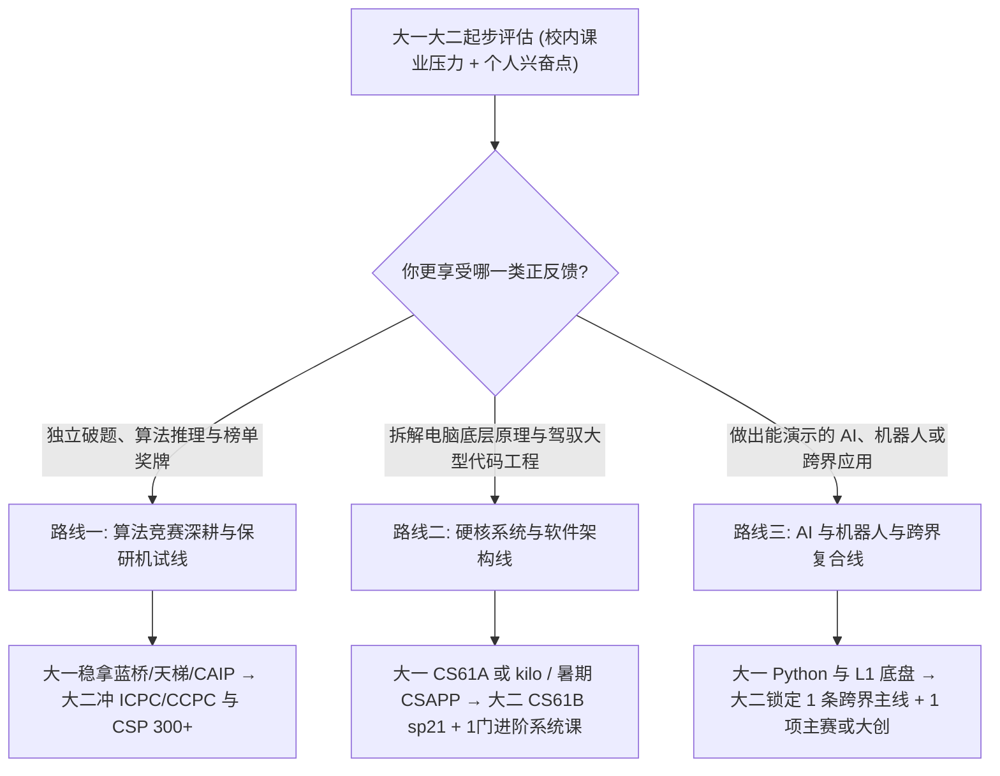

# 第 6 章 路线编排与好学心法

前五章把大学前两年值得投入的语言、算法、系统、架构和跨界竞赛拆成了清晰积木。但现实中让人焦虑甚至半途放弃的，往往不是“资源不够多”，而是**什么都想往背囊里塞，结果背到第三周就寸步难行**。

本章负责合上自学体系的最后两块拼图：先帮你把零散积木拼成能稳跑两年的成长主线；再借认知科学实证与可视化外挂，把“怎么学才不痛苦、还能持续拿正反馈”落成日常动作，并划清大模型助学边界。

---

## 6.1 不做全能超人：三条可自选的两年成长节奏线

先把一句大实话贴在书桌前：**“全都要 = 全烂尾。”**

大学前两年除了专业课，你还要应付高数、线性代数、概率论、大学物理、四六级和各类通识学分。扣除上课、实验与睡眠，大多数同学每天能自由支配的专注时间只有 **1.5~3 小时**。如果把算法集训、CSAPP 实验、机器人实车和大模型开发硬塞进同一个学期，不仅技术线会全线烂尾，连课内绩点（GPA）也会跟着崩盘。

更聪明的做法，是从下面 **三条两年成长节奏线** 里先认领一条作主干。每条线都足够扎实，也随时允许你在寒暑假按兴趣变化平滑换轨。



### 6.1.1 三条节奏线两年积木拼装清单

1. **路线一 · 算法竞赛深耕与保研机试王牌线**
   - **适合谁走**：迷恋逻辑推演与“评测绿灯亮起”的纯粹爽感，想在大一大二多拿高性价比国赛省赛奖项，或为保研夏令营机试、大厂手撕代码打下硬核底座的同学。
   - **主干拼装**：
     - **起步阶段**：走[第 2 章](./02-多语言路线与编程基本功索引.md)轨道 A（C 语言指针通关 → 5~7 天切入 C++ 竞赛子集与 STL → CP Editor 配通环境），第一时间刷透[第 7 章](./07-算法实战训练与作业精选.md) Set 1~2 建立手感。
     - **爬坡阶段**：按[第 3 章](./03-算法与数据结构竞赛索引.md)主攻 L1~L2 算法骨架并攻克 Set 3~4；养成用三文件脚本自动对拍的习惯，周末白天打 AtCoder ABC 与 Codeforces 虚拟赛，集中冲刺蓝桥杯、天梯赛与睿抗 RAICOM-CAIP 拿首批证书；挑一个短假用 1~2 周速通 Python 补齐脚本能力。
     - **大二冲刺**：组成稳定的 3 人固定队伍出战 ICPC / CCPC 区域赛冲击铜银牌，同时参加 CCF CSP 认证争取 250~300+ 分高分；建议大二抽空辅修完 CSAPP“不劝退三件套”（见[第 4 章](./04-系统基础与代码架构索引.md)）或客串一次数模编程手，避免能力面过于单一。

2. **路线二 · 硬核系统与软件工程架构线**
   - **适合谁走**：对纯竞赛偏难技巧题不感冒，却痴迷于“代码究竟怎么变成机器指令、操作系统和网络协议是怎么搭出来的”，渴望亲手驾驭几千行模块化工程的同学。
   - **主干拼装**：
     - **起步阶段**：扎牢 C 语言指针与内存布局，大一寒假把[第 2 章 §2.6](./02-多语言路线与编程基本功索引.md)的命令行、Git 分支与 WSL 2 环境全部打通；算法训练稳稳掌握到[第 3 章](./03-算法与数据结构竞赛索引.md)的 **L1~L2 常规数据结构与基础图论即可收手**（刷通第 7 章 Set 1~3 核心题足矣），不卷高阶偏怪算法。
     - **过渡与暑期筑基**：大一下完成 UC Berkeley CS61A 或纯 C 仿写 `kilo` 终端编辑器走出单文件 `main.cpp`，同步看袁春风、哈工大李治军与湖科大教书匠中文系统课建立全景图；**大一暑假~大二上**趁整块时间集中拿下 **CMU 15-213（CSAPP）不劝退三件套**并精读《软件设计哲学》（见[第 4 章](./04-系统基础与代码架构索引.md)）。
     - **大二主攻（严格控制总量 ≤ 2 门）**：严守[第 4 章](./04-系统基础与代码架构索引.md)“大二全年硬核公开课最多精选 1~2 门”的铁律——先完成 **UC Berkeley CS61B `sp21`（Gitlet）** 经历模块化与单元测试洗礼；随后在 **MIT 6.1810、Stanford CS144、南大 jyy OS / PA** 中**三选一（至多 1 门）**深耕，有余力可组队出击[第 5 章](./05-泛CS竞赛与跨界方向索引.md)计算机系统能力大赛。

3. **路线三 · AI / 机器人 / 应用创造复合线**
   - **适合谁走**：渴望早点做出能实际运行、能向人演示的智能体、深度学习模型、全向轮小车或全栈应用，准备借竞赛与科研实践切入交叉赛道的同学。
   - **主干拼装**：
     - **起步阶段**：可走[第 2 章](./02-多语言路线与编程基本功索引.md)轨道 B（`C → Python → C++`）快速拿脚本与小项目正反馈，也可走轨道 A；无论哪种顺序，**尽量在大一结束前（最迟大一暑假）掌握[第 3 章](./03-算法与数据结构竞赛索引.md) L1 基础算法与核心搜索/图论**（覆盖第 7 章 Set 1~3 前半部分），这是你在跨界战队里挑大梁当核心开发、而非打杂改排版的底气所在。
     - **探路阶段**：按[第 5 章](./05-泛CS竞赛与跨界方向索引.md)零成本入口低阻力试水——AI 与大模型走“吴恩达 + Dify / DataWhale 开源三部曲 + 免费云 GPU（Kaggle / 飞桨 / 魔搭）”；机器人走“鱼香 ROS 2 仿真”或“江协科技 STM32 最小系统板”。
     - **大二聚焦**：恪守**“大二只深挖 1 条跨界支线 + 每年最多主攻 1 项重型工程赛”**的防撞车铁律（如专攻 AIC / 软件杯 / 4C AI 应用 / C4-AIGC，或专攻 RAICOM 仿真 / RoboMaster 视觉算法），并带着可演示原型加入靠谱导师或高年级大创团队锁定核心开发位。

### 6.1.2 寒暑假换轨衔接法、周节奏预算与追赶裁剪方案

选定主线不代表“一锤定终身”，更不能靠牺牲课内绩点来换自学进度。握紧下面两套运行法则，你的两年计划才能既灵活又不翻车：

- **寒暑假换轨零浪费衔接法**：点亮过的前置节点永远是复利资产。**路线一转二/三**时，L1~L2 算法骨架与对拍习惯完全通用，暑假直接开做 CSAPP 三件套，或花 1 周补完 Python 接轨 AI/ROS 2 即可；**路线二转一/三**时，C 指针与 Git/WSL 底座直接复用，补刷第 7 章 Set 2~3 或直接切入开源 AI 工程即可；**路线三转一/二**时，带着 Python 原型经验回补 C++ STL 与 L1~L2，同样能丝滑合流。
- **每周时间预算与考前两周 GPA 保护熔断**：学期中建议周一至周四每晚留 **1~1.5 小时**单线程推进（过 1~2 道题或看 1 节课），周五晚至周末抽出 **1~2 个 3 小时整块时段**打虚拟周赛或啃大作业，每周稳定产出 **10~15 小时**高专注投入（刚好落在每天 1.5~3 小时的舒适带内）。一旦进入**期中/期末考前两周，立即触发“GPA 保护熔断”**——暂停新开系统 Lab 或新比赛，每天仅留 20 分钟做 1 道旧题保温，把主力时间全部交还给高数、线代和专业课复习，牢牢守住推免资格、奖学金与学业底线。

要是你翻开这本小书时已经到了大一下甚至大二，千万别陷入“错过大一黄金期、已经晚了”的自我内耗。后发者最大的优势，恰恰是**心智更清醒、不再盲从冗长入门课**。只要果断挥下三刀——**砍掉百小时零基础重复课、砍掉同期并行多条主线、砍掉不控难度的漫无目的刷题**，按下面这张裁剪表精准发力，两三个月就能稳稳追上大部队：

| 当前所处时间点 | 最常浪费时间的错误补法 | 推荐的精准追赶裁剪方案 |
| :--- | :--- | :--- |
| **大一下刚起步** | 重新打开百小时零基础网课，一节节回看 C 语言循环与基础题 | 用“有 C 基础速通法” **5~7 天**直切 C++ 竞赛子集或 Python 文档；**1 周**配齐 Git + CP Editor；用 **3 周**刷通第 7 章 Set 1~2——注意蓝桥杯常在前一年 11~12 月截止报名、天梯赛校内选拔多在 3 月初，大一下起步更稳妥对接**校赛、天梯赛（若赶上校内选拔）、暑期睿抗 CAIP 及 4C / 软件杯**，暑假即可正常汇入三条主线 |
| **大二才决定转向发力** | 企图在半年内把大一落下的语言课、刷题、CSAPP、CS61B 全部从头补齐 | **立刻启动单线程极限聚焦**：只锁定 **1 个强目标**——要么 3 个月刷穿第 7 章 Set 1~4 直取 CCF CSP 250+；要么集中火力拿下 CSAPP 三件套 + 1 个高质量重构项目（或 1 个 DataWhale 大模型应用原型）作为大二核心代表作 |


---

## 6.2 学习科学去伪存真：为什么“看懂视频”不等于“会写代码”？

路线选定之后，第二个高频痛点立刻浮出水面：**为什么很多同学看网课无比认真、笔记抄得像印刷品，一面对空白编辑器或机考屏幕还是写不出半行代码？**

在给出解药之前，我们先替你戳破一个在大学讲座里流传了十几年、几乎人人都信以为真的科普假象。

### 6.2.1 严谨辟谣：网传“学习金字塔百分比”并无实证支撑

你大概率在各种学长经验贴或公众号里见过那张著名的“学习金字塔（Learning Pyramid）”：上面整整齐齐地标着“听讲两周后留存率 5%、阅读 10%、视听 20%、演示 30%、讨论 50%、实践 75%、教给别人 90%”。

**现代学习科学与教育心理学早已反复考证：这组工整得像等差数列的百分比，没有任何一篇可追溯的原始实证论文支撑。** 它最常被附会到美国学者 Edgar Dale 于 1946 年在《教学视听方法》（*Audio-Visual Methods in Teaching*）中提出的“经验之锥（Cone of Experience）”；可只要翻开 Dale 的 1946 年原著就会发现，**原图只是一张解释媒介抽象程度的定性示意图，图上连一个百分比数字都没有**——那些精确到个位数的留存率，完全是后世商业培训机构杜撰拼贴的伪数据。

戳穿假数字，绝不是为了否定动手实践；恰恰相反，**“主动产出远胜于被动输入”这一大方向，已被现代认知心理学用严格的对照实验彻底坐实**。学计算机的人讲究实证，下面这 **三大经受住实验检验的认知科学支柱**，才是你设计日常编码训练的真正基石：

1. **支柱一 · 提取练习 / 测试效应（Retrieval Practice / Testing Effect）**
   - 心理学家 Roediger 与 Karpicke（2006）在发表于 *Psychological Science* 的经典论文**实验二**中，在**总学习时长完全相等**（四段等时区间）的前提下对比了两组学生（`S` 代表 Study 阅读学习，`T` 代表 Test 闭卷自由回忆测试）：**STTT 组（学 1 次 + 连续闭卷回忆测试 3 次）** 与 **SSSS 组（单纯反复重读 4 次）**。结果在**一周后的延迟测验**中，STTT 组的长期记忆留存率（约 61%）大幅高于（高出逾一半）SSSS 组（约 40%）。更发人深省的是实验揭露的**反转现象**：**在刚学完 5 分钟的即时测验里，反复重读的 SSSS 组得分反而略高于 STTT 组，且重读组对自己“一周后能记住多少”的自信心也远高于测试组！**
   - **落在写代码上的真相**：这种“刚看完觉得全懂了、过两天提笔全忘光”的假象，就是心理学里的**流畅错觉（Illusion of Competence）**。开二倍速看名师推一道动态规划题，把逻辑理顺的是讲师的大脑；只有当你关掉视频、对着空白代码文件亲手敲出状态转移方程并拿到绿灯 AC，知识回路才真正刻进了你的长时记忆。

2. **支柱二 · 刻意练习（Deliberate Practice）**
   - 专家绩效研究者 K. Anders Ericsson 指出，真正拉开高手与普通人差距的，从来不是机械重复一万小时，而是同时踩准三个条件：**紧盯具体薄弱点 + 拆解可够着的小目标 + 获取高频即时的客观反馈**。
   - **落在写代码上的真相**：循环语法早就烂熟于心后，再去连刷五十道不用动脑的入门水题，只能带来虚假的自我感动。真正涨功力的动作，是发现自己写“二分查找边界”或“链表反转指针”十次有八次死循环，于是专门拿出一晚挑 5 道同类母题，靠 OJ 判题、单元测试或本地对拍把每一处边界盲区揪出来亲手修好。

3. **支柱三 · 心流通道（Flow）与最近发展区（ZPD）**
   - 心理学家维果茨基（Lev Vygotsky）提出的**最近发展区（Zone of Proximal Development, ZPD）**，指的是“纯靠自己略感吃力、但借一点提示或脚手架刚好能独立跨过去”的能力生长带；心理学家 Mihaly Csikszentmihalyi 的**心流理论**进一步揭示，当任务挑战度恰好落在这段略高于现有水平的平衡带内，人最容易进入全神贯注的“心流”状态——太简单会无聊走神，跨度太大则会触发习得性无助。
   - **落在算法与工程训练上的真相**：竞赛圈公认的刷题心流甜点，正是 **`当前能力 Rating（竞赛积分/题目难度分）+ 100 ~ 200`**。比如你当前能稳做 Codeforces 1100 分题，主攻 1200~1300 分区间就会充满“跳一跳够得着”的破题快感；要是跨级硬刚 1800 分题，枯坐两小时连题解都看不懂，自信心很快就会被击穿。

---

## 6.3 具象化降维与防劝退：四款交互可视化外挂 + 五条正反馈铁律

很多大一新生学到指针、递归和树图时觉得像天书，并不是脑子笨，而是**人脑的工作记忆槽位非常有限，很难凭空在脑海里同时跟踪十几个变量与指针箭头的跳动**。先把抽象的执行过程“变成肉眼可见的动画”，再动手写代码，认知阻力瞬间就能减半。

### 6.3.1 四款交互式可视化“降维外挂”（四要素配置卡）

| 工具名称与核实网址 | ① 定位与适合谁（含前置） | ② 为什么选它而非同类 | ③ 正确打开方式与耗时 | ④ 劝退点与平滑替代路 |
| :--- | :--- | :--- | :--- | :--- |
| **[Python Tutor](https://pythontutor.com/)**（UCSD 教授 Philip Guo 开源项目，曾获 ACM SIGCSE 时间检验奖） | 专治大一学 C 指针、结构体链表、值传参 vs 地址传参及递归回溯时大脑“栈溢出”的初学者（支持 C / C++ / Python / Java / JS） | 无需配本地断点调试器，浏览器粘入代码点 Next 就能逐行画出**每个变量所在栈帧、指针箭头指向的精确内存格与堆区动态分配** | 看书或刷题遇到指针绕晕的瞬间，把 20~50 行精简代码贴进去逐帧走一遍；**每次 5~10 分钟**立刻通透 | **擅长纯 C 指针、链表与递归栈帧可视化，但不适合可视化复杂 C++ STL 容器内部结构**；且网页沙箱有步数限制，大型工程仍需切回本地 GDB 或 VS Code 断点 |
| **[VisuAlgo](https://visualgo.net/)**（新加坡国立大学出品） | 初学数据结构与基础图论（L0→L1→L2）建立空间动态直觉的本科生 | 涵盖排序、链表、栈队列、二叉搜索树/AVL 平衡树、并查集、二叉堆、最短路与网络流，核心绝活是**支持输入你自己的测试数据并同步高亮伪代码单步演练** | 每学一个新结构（如堆下滤、Dijkstra 最短路松弛、AVL 旋转）前，先花 **10~15 分钟**自定义小数据看两遍动画再敲代码 | 部分高阶模块说明偏英文且菜单较紧凑；若想看配中文详尽图解与多语言源码的读物，搭配[第 3 章](./03-算法与数据结构竞赛索引.md)推荐的《Hello 算法》即可 |
| **[CS Academy Graph Editor](https://csacademy.com/app/graph_editor/)** | 所有在刷树与图论题、手算样例或排查建图 Bug 的算法学习者 | 物理引擎驱动的交互图论画板：直接把题目输入的边表粘贴进左框，右侧瞬间生成可自由拖拽节点、一键切有向/无向与 0/1 起始下标的拓扑图 | 读图论题理不清连通结构或手算样例跟程序输出对不上时，常开此网页，**10 秒粘贴出图**对照排错 | 仅提供静态/拖拽建图辅助，不带算法过程回放；看动态搜索与最短路演练请切回 `VisuAlgo` |
| **[Algorithm Visualizer](https://algorithm-visualizer.org/)** | 能看懂文字思路、但一落到“双指针 `i` 和 `j` 到底在哪停、二维 DP 填表先改哪一格”就发蒙的同学 | 完全开源，左侧放可运行代码、右侧联动展示数组柱状图/二维网格/树形图，代码走到哪一行就实时高亮对应格子的状态变化与日志 | 看回溯剪枝、KMP 失配跳转或二维矩阵状态转移卡壳时，点开对应演示单步播放或改写测试数组；**每次约 10 分钟** | 收录题型不如 `VisuAlgo` 全；若找不到特定冷门算法，把自己的短代码塞进 `Python Tutor` 同样能看清全部变量轨迹 |

### 6.3.2 面向大一大二最实用的 5 条“防劝退与正反馈设计法则”

把前面三大认知支柱和四款外挂拧成一股绳，就是大一大二日常自学最扛打的五条行动铁律：

1. **法则 1 · 30 分钟最小可执行闭环法则（消灭“配环境弃坑”）**
   开启任何新语言、实验或跨界赛道，**前 30 分钟内必须亲眼看到一次真实输出或第一道绿色 AC**（用 CP Editor 过首题、在 Kaggle 云端跑通一行 PyTorch、或在 Dify 搭出首个对话流），绝不陷入“配三天环境没写一行代码”的泥潭。
2. **法则 2 · “20 分钟输入 → 关视频独立敲 1 题”主动提取铁律**
   看懂一个核心机制（15~20 分钟）就立刻按暂停，合上笔记在空白编辑器里凭记忆和理解重敲一遍并提交评测。写到一半卡壳的地方，恰恰就是刚才被“流畅错觉”掩盖的盲区，立刻回看补漏才是真学会。
3. **法则 3 · 心流控难 + 25~30 分钟卡题止损三步法**
   日常刷题锁死 **`当前能力 + 100~200`**（借洛谷难度色块、AtCoder 难度追踪站 `kenkoooo` 或灵神难度分挑题，见[第 3 章](./03-算法与数据结构竞赛索引.md)）。单题独立思考 **25~30 分钟无果即果断止损**：① 只看题解第一句核心提示再想 5 分钟；② 仍卡住则看懂完整题解后**关掉网页从零独立敲过 AC**；③ 记录卡点（如存入[第 7 章](./07-算法实战训练与作业精选.md)刷题插件），**3 天后二刷**，绝不拿整个周末死磕超纲 500 分的难题。
4. **法则 4 · “具象可视化 → 动手实验 → 形式化推导”三步脚手架法则**
   顺应大脑直觉规律：先用 `Python Tutor` / `VisuAlgo` 看清指针与数据结构的动态变化，再借代码实验或 `Bomb Lab` 动手摸透脾气，最后去啃教材里的形式化数学证明，让陡坡变成缓阶。
5. **法则 5 · “主干单线程 + 厚书查字典 + 微里程碑”反过载法则**
   课外自学每学期至多 **1 条主线 + 1 门辅修**（牢记 [csdiy.wiki](https://csdiy.wiki/) 是四年全栈菜单而非大一任务单）；把《C Primer Plus》《C++ Primer》《算法导论》《OI Wiki》《CTF Wiki》放回案头当词典；每 **3~7 天**设一个肉眼可见的微里程碑（如周内刷通第 7 章 Set 1、周六晚 AtCoder 稳过 3 题），让成就感高频回响。

> [!NOTE]
> 这五条法则没有一条逼你每天熬夜苦熬十小时。恰恰相反，**靠 30 分钟闭环、25 分钟止损和每周一个微里程碑呵护下来的好奇心与热情，才是一场两年长跑里最稀缺的燃料**。


---

## 6.4 AI 时代的聪明助学边界：把大模型当苏格拉底教练，而非代写拐杖

对今天的计算机本科生而言，大语言模型与 AI 编程助手就像编译器和搜索引擎一样，是进实验室第一天就会摆在手边的常规工具。我们既没必要装作活在旧时代去盲目排斥它，也绝不能在自己刚刚“长肌肉”的黄金期，让它代劳了所有思考与排错。

最聪明、也最能拉开真实内功差距的做法，是守住下面这份 **“三用三不用”实操边界**：

### 6.4.1 推荐三用：让 AI 替你扫除杂务、建立直觉、反向找茬

1. **用它追问直觉、画图类比与导读陌生源码**：遇到教材里冷冰冰的抽象概念（例如**悬空指针**，即指向已释放内存的危险指针），让大模型按你已有的知识底座打比方——直接限定起点：“我只学过 C 数组和普通指针，请用内存地址格子的类比讲清 C++ 引用和悬空指针有什么区别”；读[第 4 章](./04-系统基础与代码架构索引.md)开源项目或陌生系统调用时，也可让它梳理模块调用链或解释陌生宏定义，而非替你直接写出整个项目的类框架。
2. **用它秒解晦涩报错与环境配置排障**：CMake 配置出错、链接器吐出一长串 `undefined reference`、或是 Python 包依赖冲突——这类环境杂务极耗心神，却几乎不锻炼核心算法与架构思维。把终端完整报错丢给 AI，几分钟锁定排查方向，把省下的两小时留给写代码和读源码。
3. **用它担任“苏格拉底陪练”与反例构造器**：平时写题卡壳或遇到“样例全过、提交全挂（WA）”时，**主动在提示词（Prompt）里锁死“不准直接给答案”的红线**。你可以直接复用这段模板：

```text
我正在做一道 [二分答案 / 区间 DP] 训练题，下面是我的思路和自己写的代码。
请你只做“苏格拉底陪练”，绝对不要直接输出完整正确代码或替我重写：
1. 指出我代码里哪一处边界假设或时间复杂度存在问题；
2. 给我构造一组能让我当前代码算错的极小测试输入数据，让我自己顺着这组反例排查。
```

### 6.4.2 训练三不用：保护核心长肌肉环节与学术红线

1. **核心基本功训练与关键 Lab 关闭整段代码自动生成**：在刷[第 7 章](./07-算法实战训练与作业精选.md)的 40 道基础母题，以及攻克[第 4 章](./04-系统基础与代码架构索引.md) CSAPP Bomb Lab、UC Berkeley CS61B Gitlet 等锤炼底层直觉与模块化设计的核心作业时，请果断关掉整段代码自动补全与一键生成。无论是闭卷断网的算法机考，还是日后在复杂工程里排查跨模块死锁，真正能救场的永远是你亲手推过状态转移、心算过复杂度与逐行盯过边界条件的硬功夫。
2. **未经本地验真，绝不盲信 AI 的复杂度分析与边界证明**：大语言模型最擅长用胸有成竹的语气端出暗藏 $O(N^2)$ 退化、漏掉 `long long` 溢出或边界特判缺失的代码，甚至凭空捏造不存在的库函数参数。参考思路后，亲手算一遍数据范围并跑几组极端边界样例对拍验真，是永远不能省的最后一道关。
3. **严守考场纪律与竞赛学术诚信底线**：所有闭卷程序设计赛（蓝桥杯、天梯赛、CCF CSP、ICPC / CCPC）均为物理断网独立机考，**任何正式线上或线下比赛进行期间严禁向在线大模型粘贴实时赛题求助**；而在允许辅助工具或有明确披露要求的赛事（如数学建模美赛 MCM/ICM 的 AI 使用声明条款、各双创或软件赛的原创性审查）中，务必提前查清当年官方细则并如实申报，绝不用生成内容伪造实验结果或越线代写论文。

> [!IMPORTANT]
> **检验自己是在“驾驭 AI”还是“依赖 AI”的极简试金石**：每次借大模型解决卡点后，立刻合上对话框，试着用自己的话讲出刚才修好了哪处漏洞；如果换一道同类变式题能不看提示独立写过 AC，说明它真成了你的加速教练；如果离开对话框两分钟就大脑空白，那就是切回“手写 + 对拍”基本功训练的信号。

至此，地图、兵器与心法都已交到你手上。别再等明天——翻开下一章[第 7 章：算法实战训练与作业精选](./07-算法实战训练与作业精选.md)，花几分钟把四套精选母题同步进本地工作区，今晚就点亮你的第一排绿色 AC。


