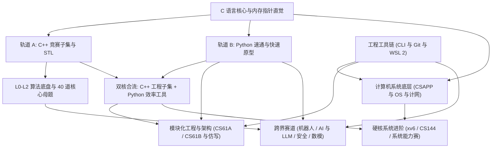
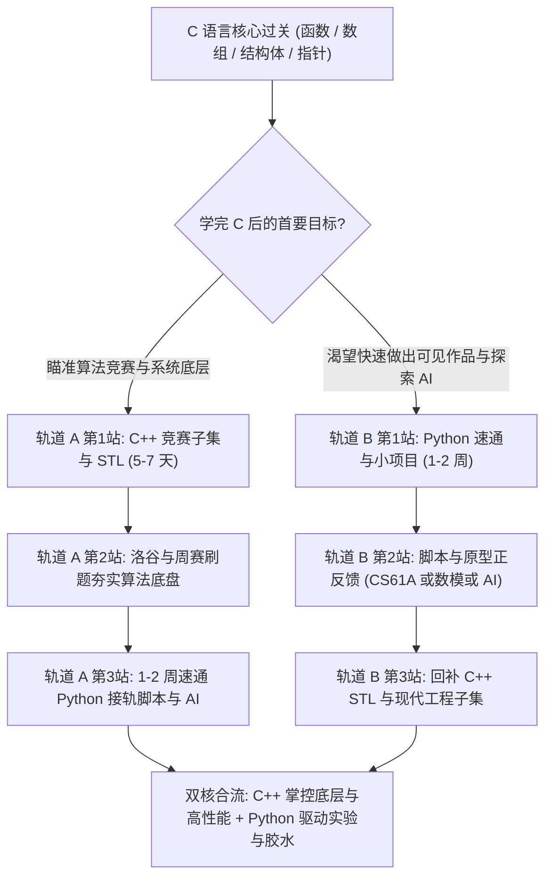
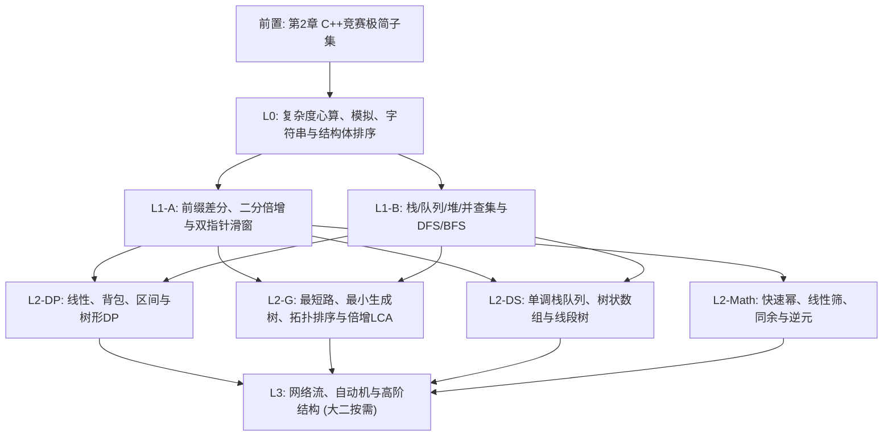
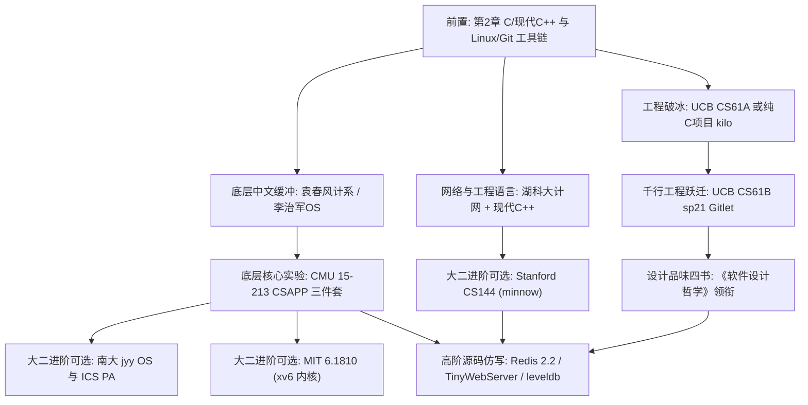
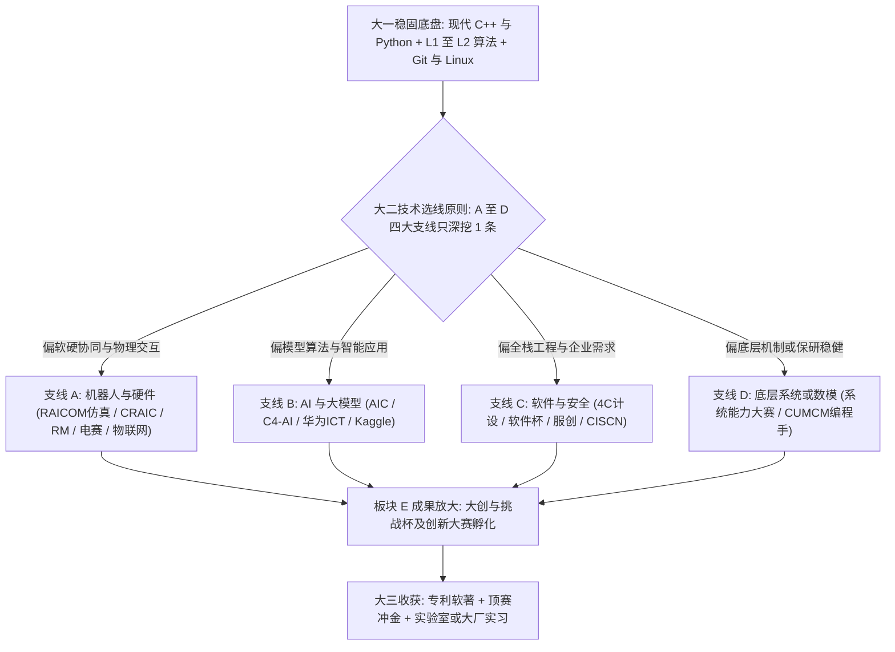
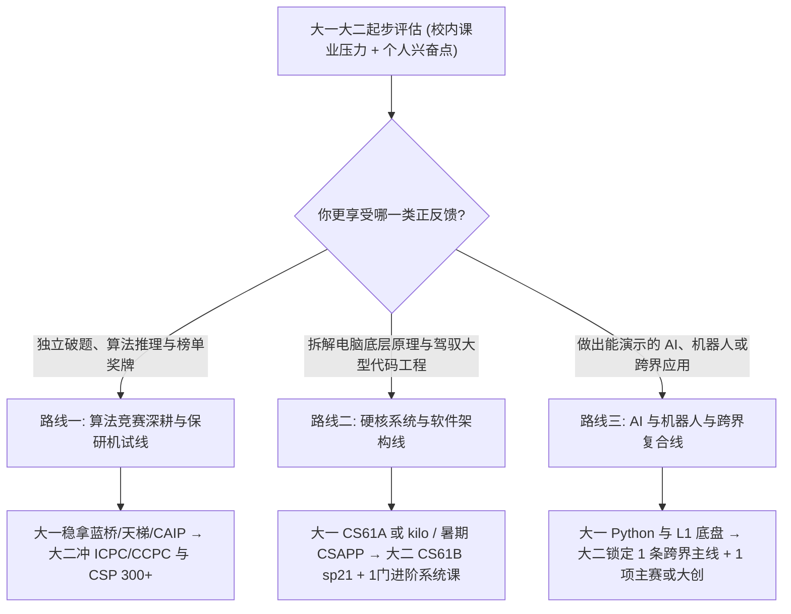
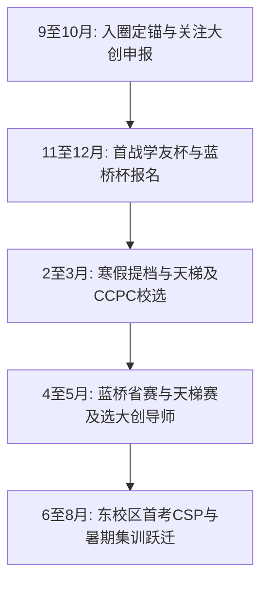

# 大一大二 CS 竞赛与自学体系索引小书


> **副标题**：*从 C 语言破冰、算法底盘、系统与架构启蒙到多赛道跨界的可执行路线与资源鉴选指南*
>
> **版本形态**：单文件完整出版合订本（由 `01` ~ `07` 章及 `附录 A` 自动汇编生成，全书跨章链接已统一映射为内部标题锚点；分章选读与快速画像导航请见 [README.md](./README.md)，配套 40+4 道可导入梯度题单请见 [./problem-lists/README.md](./problem-lists/README.md)）。

---

## 全书总目录（Table of Contents）

- **[第 1 章 导言与大一大二能力全景图](#第-1-章-导言与大一大二能力全景图)**
  - [1.1 为什么你需要一张“前置依赖地图”，而不是死板的学期课表？](#11-为什么你需要一张前置依赖地图而不是死板的学期课表)
  - [1.2 大一大二 CS 核心能力四支柱（盘子装什么、不装什么）](#12-大一大二-cs-核心能力四支柱盘子装什么不装什么)
  - [1.3 全书能力前置依赖总图（Global Dependency DAG）](#13-全书能力前置依赖总图global-dependency-dag)
  - [1.4 如何使用这本索引小书（四要素卡片读法与分人群快速入口）](#14-如何使用这本索引小书四要素卡片读法与分人群快速入口)
- **[第 2 章 多语言路线与编程基本功索引](#第-2-章-多语言路线与编程基本功索引)**
  - [2.1 C 语言破冰：视频建立内存直觉，厚书只当案头词典](#21-c-语言破冰视频建立内存直觉厚书只当案头词典)
  - [2.2 学完 C 之后的黄金分岔口：双轨路线设计与殊途同归](#22-学完-c-之后的黄金分岔口双轨路线设计与殊途同归)
  - [2.3 C++ 进阶双层索引：7 天竞赛子集 vs 现代 C++17/20 工程子集](#23-c-进阶双层索引7-天竞赛子集-vs-现代-c1720-工程子集)
  - [2.4 Python 高效索引：有基础 1 周速通、项目实战与进阶分界](#24-python-高效索引有基础-1-周速通项目实战与进阶分界)
  - [2.5 大二按需解锁第三语言（不贪多，用场景倒推 1~2 周速通）](#25-大二按需解锁第三语言不贪多用场景倒推-12-周速通)
  - [2.6 编程工具链护城河：命令行、Git、WSL 2 与零折腾编码环境](#26-编程工具链护城河命令行gitwsl-2-与零折腾编码环境)
- **[第 3 章 算法与数据结构竞赛索引](#第-3-章-算法与数据结构竞赛索引)**
  - [3.1 算法赛事与能力认证全景梯度（从第一张证书到区域赛奖牌）](#31-算法赛事与能力认证全景梯度从第一张证书到区域赛奖牌)
  - [3.2 L0 ~ L3 算法能力前置依赖图（不跳级、不背死板模板）](#32-l0--l3-算法能力前置依赖图不跳级不背死板模板)
  - [3.3 图文百科与视频课程四要素横评（免费王牌 vs 付费避坑）](#33-图文百科与视频课程四要素横评免费王牌-vs-付费避坑)
  - [3.4 纸质教材鉴选与《算法导论》错位陷阱深度拆解](#34-纸质教材鉴选与算法导论错位陷阱深度拆解)
  - [3.5 六大 OJ 平台矩阵、周赛作息与自动化对拍实战](#35-六大-oj-平台矩阵周赛作息与自动化对拍实战)
- **[第 4 章 系统基础与代码架构索引](#第-4-章-系统基础与代码架构索引)**
  - [4.1 走出单文件 main.cpp：如何正确打开 csdiy.wiki 而不被神课压垮？](#41-走出单文件-maincpp如何正确打开-csdiywiki-而不被神课压垮)
  - [4.2 计算机系统底层第一阶：消除英文与术语恐惧的中文黄金缓冲](#42-计算机系统底层第一阶消除英文与术语恐惧的中文黄金缓冲)
  - [4.3 计算机系统底层第二阶：四门殿堂级硬核实验课裁剪指南](#43-计算机系统底层第二阶四门殿堂级硬核实验课裁剪指南)
  - [4.4 代码模块化与软件架构启蒙：从写能跑的脚本到驾驭千行工程](#44-代码模块化与软件架构启蒙从写能跑的脚本到驾驭千行工程)
  - [4.5 读懂真实代码：大一大二微型开源项目三级阅读与仿写阶梯](#45-读懂真实代码大一大二微型开源项目三级阅读与仿写阶梯)
- **[第 5 章 泛 CS 竞赛与跨界方向索引](#第-5-章-泛-cs-竞赛与跨界方向索引)**
  - [5.1 选赛先看清规则：高教社 84 项榜单三档口径与能力迁移矩阵](#51-选赛先看清规则高教社-84-项榜单三档口径与能力迁移矩阵)
  - [5.2 板块 A · 机器人与智能硬件赛道（赛事图谱 + 零门槛仿真/单片机入门卡）](#52-板块-a--机器人与智能硬件赛道赛事图谱--零门槛仿真单片机入门卡)
  - [5.3 板块 B · 人工智能、大模型与 AIGC 赛道（分层图谱 + 免费算力与开源课指路）](#53-板块-b--人工智能大模型与-aigc-赛道分层图谱--免费算力与开源课指路)
  - [5.4 板块 C & D · 软件网络、信息安全、数学建模与底层系统赛道](#54-板块-c--d--软件网络信息安全数学建模与底层系统赛道)
  - [5.5 板块 E · 综合创新创业与大创孵化（拒绝空壳 PPT，稳居核心技术位）](#55-板块-e--综合创新创业与大创孵化拒绝空壳-ppt稳居核心技术位)
  - [5.6 跨界防翻车铁律：全年冲突高峰避坑表与“大二单支线”法则](#56-跨界防翻车铁律全年冲突高峰避坑表与大二单支线法则)
- **[第 6 章 路线编排与好学心法](#第-6-章-路线编排与好学心法)**
  - [6.1 不做全能超人：三条可自选的两年成长节奏线](#61-不做全能超人三条可自选的两年成长节奏线)
  - [6.2 学习科学去伪存真：为什么“看懂视频”不等于“会写代码”？](#62-学习科学去伪存真为什么看懂视频不等于会写代码)
  - [6.3 具象化降维与防劝退：四款交互可视化外挂 + 五条正反馈铁律](#63-具象化降维与防劝退四款交互可视化外挂--五条正反馈铁律)
  - [6.4 AI 时代的聪明助学边界：把大模型当苏格拉底教练，而非代写拐杖](#64-ai-时代的聪明助学边界把大模型当苏格拉底教练而非代写拐杖)
- **[第 7 章 算法实战训练与作业精选](#第-7-章-算法实战训练与作业精选)**
  - [7.1 为什么先刷透这 40 道母题？与 Algo Coach 导入指南](#71-为什么先刷透这-40-道母题与-algo-coach-导入指南)
  - [7.2 Set 1 · 语法、模拟与边界思维热身（10 题 · 零基础破冰）](#72-set-1--语法模拟与边界思维热身10-题--零基础破冰)
  - [7.3 Set 2 · STL、排序、二分、前缀差分与滑窗贪心（10 题 · 核心基本功）](#73-set-2--stl排序二分前缀差分与滑窗贪心10-题--核心基本功)
  - [7.4 Set 3 · 搜索（DFS/BFS）、最短路/最小生成树与入门 DP（10 题 · 省赛/天梯提分主力）](#74-set-3--搜索dfsbfs最短路最小生成树与入门-dp10-题--省赛天梯提分主力)
  - [7.5 Set 4 · 数论、单调结构、树状数组/线段树与反悔贪心（10 题 · 区域赛铜银与 CSP 300 敲门砖）](#75-set-4--数论单调结构树状数组线段树与反悔贪心10-题--区域赛铜银与-csp-300-敲门砖)
  - [7.6 CSES 纯净母题拓展（4 题）与每套题通关验收清单](#76-cses-纯净母题拓展4-题与每套题通关验收清单)
- **[附录 A 长江大学学科竞赛认定体系与校内实操速查](#附录-a-长江大学学科竞赛认定体系与校内实操速查)**
  - [A.1 制度文件与六级分类规则（A+ / A / B / C / D / E 类）【公开查证】](#a1-制度文件与六级分类规则a--a--b--c--d--e-类公开查证)
  - [A.2 长江大学 CS 学子高频核心赛事定级与校情亮点速查总表](#a2-长江大学-cs-学子高频核心赛事定级与校情亮点速查总表)
  - [A.3 荆州东校区跨院组队红利、武汉校区贴士与四大必盯入口](#a3-荆州东校区跨院组队红利武汉校区贴士与四大必盯入口)
  - [A.4 长江大学 CS 大一新生校内赛事与节点全年参考日历](#a4-长江大学-cs-大一新生校内赛事与节点全年参考日历)

---

# 第 1 章 导言与大一大二能力全景图

> [!NOTE]
> 本书面向全国计算机科学、软件工程、网络工程、物联网、智能科学、信息安全以及有志跨入 CS 赛道的理工科**大一、大二本科生**编写。全文以全国通用的自学与竞赛逻辑为主线，不夹杂特定院校的行政条文；长江大学同学如需查阅本校竞赛分级认定、东校区考点信息与跨院组队实操，请直接翻阅书末[附录 A：长江大学竞赛认定与校内速查](#附录-a-长江大学学科竞赛认定体系与校内实操速查)。

刚迈入大学计算机相关专业时，几乎每个人都会撞上一场“信息洪流”：课表上是按部就班的高数、线代与大物，社交平台和学长学姐口中却轮番刷屏着“ACM 算法竞赛”“海外神课”“GitHub 开源项目”与“大模型智能体”。看了一圈攻略，收藏夹塞得满满当当，打开电脑却依然不知道今晚第一步该敲哪行代码。

这本索引小书不打算再给你添一份压得人喘不过气的“四年必读书单”。它只想陪你做一件更实在的事：**把大学前两年真正值得投入、能持续带来正反馈的核心能力理清先后顺序，让你每一步都踩在稳固的台阶上。**

---

## 1.1 为什么你需要一张“前置依赖地图”，而不是死板的学期课表？

在大一和大二的自学路上，让人半途而废的往往不是不够努力，而是掉进了三个极度消耗心气的怪圈：

1. **“收藏即学会”的信息过载**：刚入学就把十几门海外名课、几十份开源文档和“四年通关清单”塞进收藏夹。盯着别人列出的“大一上刷完 A、大一下啃完 B”倒计时表越看越焦虑，精力全耗在换教材和重做计划上，亲手写通的可运行程序却屈指可数。
2. **“从第 1 页死啃砖头书”的弃坑陷阱**：满怀热血买回七八百页的经典巨著——要么逐页背诵 C 语言语法细枝末节，要么零基础就抱起满篇伪代码与数学证明的理论专著硬啃。熬不过两周就卡在某个抽象定义上寸步难行：既没做出小作品，也没在判题系统上拿过几个绿灯，热情很快被磨光。
3. **“盲目跟风凑比赛”的无效忙碌**：单门语言的内存直觉、调试手感和基础算法还没练稳，就匆忙报了一堆跨界比赛凑人数。一学期下来，不是在改排版画演示文稿，就是在复制粘贴跑不通的开源代码——看似履历热闹，实则既没长出独立排错的工程底气，比赛也多半草草收场。

为什么照搬“大学四年标准时间表”这么容易翻车？因为大家习惯把自学当成**“按月份死板切分的学期课表”**，却忽略了两个现实：第一，各高校开课顺序不同（有的大一上先教 C，有的先教 Python，有的大二才开数据结构）；第二，每个人真正定下心开始探索的时间点也各不相同。

计算机科学本是一门讲究“层层搭积木”的学科。因此，本书彻底抛弃“大一上 X 月、大一下 Y 月”的一刀切排法，改用一条更契合知识生长规律的主线：**用“前置依赖图（DAG，有向无环图）”来组织你的能力进阶**。

不管你是刚入学的零基础萌新、刚修完 C 语言准备提速的大一下同学，还是大二才收心补课的追赶者，只需在依赖地图上找准当前已点亮的坐标，就能一眼看清三件事：

- **前置条件（Prerequisites）**：迈出这一步前，手里必须先握紧哪几块看家基本功；
- **核心能力节点（Capability）**：现阶段最精炼、最易消化出成果的资源与训练动作是什么；
- **解锁下游（Unlocks）**：踏稳这一级台阶后，前方哪些硬核课程、竞赛赛道和真实项目会自然向你敞开。

至于如何在不拖垮课业与绩点（GPA）的前提下把这些节点装进两年作息，我们把三条可自选的成长节奏线集中收口在[第 6 章](#第-6-章-路线编排与好学心法)；各类赛事客观的报名与办赛月份窗口，则统一整理在[第 3 章](#第-3-章-算法与数据结构竞赛索引)、[第 5 章](#第-5-章-泛-cs-竞赛与跨界方向索引)与[附录 A](#附录-a-长江大学学科竞赛认定体系与校内实操速查)方便随时翻查。站在起点先看清四座能力岛屿的轮廓，每一步努力才不会走成原地打转的消耗。


---

## 1.2 大一大二 CS 核心能力四支柱（盘子装什么、不装什么）

大一大二只有四个学期和两个长假。把盘子端稳的关键，在于分清**哪些是前两年踮脚就能吃透、能立刻带来正反馈的黄金主干，哪些则应坦然留给大三以后的深水区**。本书把前两年的成长底座收敛为四大支柱：

1. **支柱一 · 多语言路线与工程工具底盘（[第 2 章](#第-2-章-多语言路线与编程基本功索引)）**——*先建机器直觉，再配趁手兵器*。从 C 语言出发摸清内存地址与指针脉络，再按个人目标走通 `C → C++ → Python` 或 `C → Python → C++` 双轨并最终合流；首月先借零折腾环境跑通代码，寒假再补齐命令行、Git 与 WSL 2（Windows 原生 Linux 子系统）底座。
2. **支柱二 · 算法抽象与数据结构内功（[第 3 章](#第-3-章-算法与数据结构竞赛索引) & [第 7 章](#第-7-章-算法实战训练与作业精选)）**——*把代码边界控制力练成肌肉记忆*。通过独立思考与手写实现，练出心算时空复杂度、把控边界条件以及用“自动对拍”（用稳对的暴力程序与待测程序同跑随机小数据比对答案）揪出隐蔽漏洞的基本功。借蓝桥杯、天梯赛、RAICOM-CAIP、CCF CSP 与 ICPC/CCPC 实战，配合 40 道梯级母题把 L0~L2（从语法模拟到区域赛铜银底盘，见第 3 章分级）算法骨架焊牢。
3. **支柱三 · 计算机系统直觉与代码架构启蒙（[第 4 章](#第-4-章-系统基础与代码架构索引)）**——*走出几百行单文件 `main.cpp` 的舒适区*。一边借中文系统缓冲课与 CSAPP（《深入理解计算机系统》）核心实验看清“程序如何在硬件与操作系统上跑起来”，一边通过 UC Berkeley CS61A / CS61B 与微型开源项目仿写，学会用模块化接口和单元测试驾驭千行级项目。
4. **支柱四 · 多赛道竞赛试炼与跨界应用探索（[第 5 章](#第-5-章-泛-cs-竞赛与跨界方向索引)）**——*带着代码底盘去交叉赛道当主力*。把独立编码与调试底盘迁移到机器人与智能硬件、人工智能与深度学习、大模型与 AIGC（生成式 AI 应用）、信息安全夺旗赛（CTF）、数学建模及系统能力大赛中——大一低成本探路，大二锁定一条支线做出硬核作品。

为了帮你卸下不必要的“超载包袱”，下表明确划出了大一大二的**克制边界**：

| 能力领域 | 大一大二黄金投入区（本书重点展开） | 主动留白给大三以后（切勿过早内耗） |
| :--- | :--- | :--- |
| **语言与工程工具** | C 语言内存模型、C++ 竞赛/现代工程子集、Python 速通、大二按需点亮一门第三语言、Shell / Git / WSL 2 基础 | 集邮式同时学五六门语言；深究冷门模板元编程；花几周重度魔改编辑器配置 |
| **算法与竞赛训练** | 复杂度心算、L0~L2 核心算法与数据结构（模拟、二分、搜索、基础 DP、图论、常规树状结构）、40 道精选母题（+ 4 道 CSES 拓展）与周赛实战 | L2 尚未稳固就硬啃网络流、多项式或偏怪模板；把《算法导论》从第 1 页当入门书死磕 |
| **系统与代码架构** | 中文系统缓冲课、CSAPP 不劝退三件套、大二精选 1~2 门系统/工程公开课（如 CS61B `sp21` / MIT 6.1810 / CS144）、千行级开源仿写 | MIT 6.824 分布式系统、CMU 15-445 数据库内核、大规模微服务集群与高并发调优 |
| **跨界探索与求职** | 机器人 ROS 2 仿真与单片机入门、吴恩达 + 李沐《动手学深度学习》、Dify 与开源 LLM 原型、Web/Misc CTF、数模 Python 编程手 | Stanford CS231n 深入科研改造、追逐顶会论文发表、过早背诵脱离实践的秋招面试八股 |

> [!TIP]
> 把高阶深水区主动留白给大三，绝不是放低要求。大一大二还有高数、线性代数、概率论、离散数学和大学英语等校内基石课；稳住绩点（GPA）的同时把核心底座磨亮，到了大三面对分布式系统、数据库内核或专业科研时，你的推进速度反而会比“大一贪多嚼不烂”快上一倍。

---

## 1.3 全书能力前置依赖总图（Global Dependency DAG）

下面这张前置依赖总图浓缩了全书第 2 章到第 7 章的主干流向。阅读时请顺着箭头从上往下看：只有当箭尾指向的底座稳固后，顺着箭头走下去才会轻松顺滑。



从这张依赖图里，你可以读出三条极省弯路的闯关规律：

1. **双底座并行，绝不卡死起跑线**：C 语言建立的内存与指针直觉，加上命令行、Git、WSL 2 等工程工具链，是托起后续系统与工程实践的两块基石；但在大一刚起步的第一个月，你完全可以先用零配置编辑器（见[第 2 章 §2.6](#第-2-章-多语言路线与编程基本功索引)）跑通第一行 C++ 或 Python，绝不必因为折腾复杂环境而被挡在门外。
2. **双轨各取正反馈，殊途同归合流**：选轨道 A 可以趁热切入算法训练；选轨道 B 也能凭借 Python 先去 CS61A 工程启蒙或 AI、数模等跨界赛道拿到第一波正反馈，等后续遇到高性能计算、底层系统实验或算法赛需求时再回补 C++，水到渠成地完成双核合流。
3. **系统深潜与跨界突围都长在底盘上**：CSAPP 等系统底层课建立在 C 指针直觉与 Linux 命令行之上。往后走，MIT 6.1810（基于纯 C 的教学操作系统内核 `xv6`）会顺着 C 语言继续向内核深挖；Stanford CS144（亲手实现 TCP 网络协议栈）与部分系统能力大赛赛道则同时需要双核合流后的现代 C++ 工程功底。在机器人、大模型等跨界战队里，前面积累的 L0~L2 算法抽象与调试习惯，同样直接决定了你是挑大梁的核心开发，还是只能打下手改文档。


---

## 1.4 如何使用这本索引小书（四要素卡片读法与分人群快速入口）

市面上的很多经验帖都有一个通病：**甩出一长串书名和网址就撒手不管**——既不交代前置门槛，也不提醒哪几章最容易让人弃坑。为了彻底治好这个痛点，本书从第 2 章到第 6 章对每一项核心推荐资源都严格配备了**“资源可用性四要素卡片”**（或包含完整四要素的横评矩阵）：

- **① 定位与适合谁（含前置依赖）**：帮你第一时间明确对待这份材料的**三种阅读姿态**——是必须亲手敲通每一行代码的**精读主干**（核心视频课、现代语法精简教程与必做 Lab），还是遇到盲区才按目录翻阅的**查字典工具书**（如《C Primer Plus》、OI Wiki、`cppreference`、CTF Wiki，严禁从第 1 页线性通读），抑或是先记下坐标、等代码量达标后再拆封的**高阶留白书**（如 K&R 第 2 版、《C++ Primer》、《流畅的 Python》、《算法导论》）。
- **② 为什么选它而非同类（含错位神书剖析）**：不仅点明它相比同类资源的看家优势，更会坦诚拆解那些名气如雷贯耳、却最容易把大一新生按在起跑线上摩擦的“错位大部头”——讲透它们为什么按工业级语言规范或纯数学证明来铺陈，从而避免你把案头词典错当成破冰启蒙书。
- **③ 正确打开方式与预计耗时**：颗粒度直接落到今晚就能执行的动作——开几倍速、精确锁定哪几章与哪几个 Lab、哪些冗余章节直接跳过、搭配什么练习验真，以及按日常节奏需要投入多少小时或几周。
- **④ 劝退点与平滑替代路**：透明标出免费与付费边界（帮你避开高价营销课与盗版倒卖坑）、英文或环境门槛、最常见的卡壳点，以及一旦觉得吃力可以无缝切换的平替方案。

这本小书不需要你从第 1 页正襟危坐读到最后一页。现在就对照下表认领你眼下的真实坐标，花 30 秒直接翻到最能帮你破局的那一章：

| 你目前的起点与诉求 | 推荐立即前往的章节入口 | 读完第一步该动手做什么 |
| :--- | :--- | :--- |
| **零基础大一新生**（刚入学，还没写过几百行代码） | [第 2 章 §2.1~2.2 & §2.6](#第-2-章-多语言路线与编程基本功索引) + [第 6 章 §6.2~6.3](#第-6-章-路线编排与好学心法) | 选一门 C 入门视频敲通指针，装好 CP Editor 在 30 分钟内跑通首题（若高校首课先教 Python，先看 §2.2 提示） |
| **已学完 C 语言**（想主攻算法竞赛、冲蓝桥/天梯/CSP/ICPC） | [第 2 章 §2.3](#第-2-章-多语言路线与编程基本功索引) → [第 3 章](#第-3-章-算法与数据结构竞赛索引) → [第 7 章](#第-7-章-算法实战训练与作业精选) | 用 5~7 天切入 C++ 竞赛子集与 STL，把第 7 章 Set 1~2 导入本地练手 |
| **对纯刷题暂不感冒**（想早点做出 AI、机器人、系统或 Web 作品） | [第 2 章 §2.2 & §2.4](#第-2-章-多语言路线与编程基本功索引) → [第 4 章](#第-4-章-系统基础与代码架构索引) / [第 5 章](#第-5-章-泛-cs-竞赛与跨界方向索引) | 用 1~2 周速通 Python 做出实用脚本，再在 CS61A 或 AI/机器人入门课中挑一个动手 |
| **想直接挑精选原题开练**（已有语言基础，缺一份去水分的梯级作业单） | [第 7 章：算法实战训练与作业精选](#第-7-章-算法实战训练与作业精选) + [题单资产包说明](./problem-lists/README.md) | 按 40 道母题表与导入脚本把题目同步进编辑器，每题限时 25 分钟独立思考，每天稳攻 1~2 题 |
| **大一下或大二想重新梳理全局**（担心起步晚、怕多线同时推进烂尾） | [第 6 章 §6.1 & §6.4](#第-6-章-路线编排与好学心法) | 认领三条节奏线中的一条，参考“追赶裁剪方案”砍掉冗余教程，单线程稳步推进 |

---

# 第 2 章 多语言路线与编程基本功索引

大一在编程语言上最常见的消耗，往往是掉进两个极端：要么抱着七百页大部头逐页死背运算符优先级，两个月没写出过两百行的完整程序；要么今天追 Python、明天转 Java、后天摸 Go，学期末每门都停在打印 `Hello World`。

想跳出无效忙碌，最省力的办法就是顺着前置依赖走：**先借 C 语言看清内存与指针脉络，再走通 C++ 与 Python 的双轨分流与双核合流；首月先用零折腾环境破冰，再趁寒假或任意整块 1~2 周配齐受用四年的命令行、Git 与 WSL 2 工具链。**

---

## 2.1 C 语言破冰：视频建立内存直觉，厚书只当案头词典

多数理工科专业大一首课讲 C 语言，图的不是那套语法，而是它几乎没有中间层封装——每一行代码都在直接面对内存地址、函数调用栈帧（每次调函数时在内存里临时开辟的工作格）与字节布局。

入门最容易翻车的学法，是买来砖头厚书从第 1 页死磕细枝末节，或在 `i++ + ++i` 等**未定义行为**（C 标准未规定结果、换个编译器算出来都不一样的写法）上钻牛角尖。**大一 C 语言真正通关只需对齐 4 项验收标准**：

1. **控制流与函数拆分**：脱离模板把模拟问题拆成职责清晰的多函数程序，告别把三百行全塞进 `main()`。
2. **数组、字符串与结构体**：用一维/二维数组处理批量数据，明白字符串以 `'\0'` 结尾，懂得处理 `scanf` 混合读入时的换行符残留并用安全的 `fgets` 替代已废弃的 `gets`，会用 `struct` 打包数据。
3. **指针与内存直觉**：看懂取址 `&` 与解引用 `*`、值传递与传址区别、数组传参退化为指针，以及 `malloc`/`free`（堆区动态内存申请与释放）配对与 `NULL` 检查（绕晕时立刻打开[第 6 章 §6.3 的 Python Tutor](#第-6-章-路线编排与好学心法)看实时画出的内存箭头）。
4. **基础排错闭环**：会看编译器报错行号，开启 `-Wall -Wextra`（编译器常用警告开关）提前揪出未初始化变量等隐患，能用单步调试或关键打印十分钟内定位越界与死循环。

### 2.1.1 C 语言入门选品四要素对比矩阵

下面 6 项资源各司其职。入门阶段**切忌视频和厚书同时铺开两套体系**，请按自身起点认领 **1 门主力视频课 + 1 个在线题库**动手开敲：

| 资源名称（核实作者与入口） | ① 定位与前置要求 | ② 为什么选它而非同类 | ③ 正确打开方式与预计耗时 | ④ 劝退点与平滑替代路 |
| :--- | :--- | :--- | :--- | :--- |
| **浙大翁恺《程序设计入门——C语言》**（中国大学 MOOC / B 站高播合集）+ [PTA 拼题 A](https://pintia.cn/) | 零基础大一首选，无需编程前置，重在建立程序执行模型与指针直觉 | 相比照本宣科念 PPT 的传统网课，善用内存示意图与生活类比讲透指针；相比百小时长合集更凝练，不拖节奏 | 1.25 倍速看课，每看完一节在本地敲通示例，并独立刷完对应 PTA 或洛谷入门练习；**约 3~4 周（40~50 小时）** | 早期录像使用的 Dev-C++ 界面偏旧，部分作业偏期末风格；如自律偏弱需手把手带装环境与带练小项目，转下方比特鹏哥 |
| **比特鹏哥《C语言程序设计》**（B 站免费完整合集） | 纯零基础、自学易走神、需要保姆级手把手带练编译与调试的新生 | 从编译器安装、逐行调试到“三子棋 / 扫雷”小项目全程带练，细节掰开揉碎，接地气且免费 | **只挑基础语法与指针深度剖析章节跟练，切忌 100% 全看**；每看两集停下来改参数重敲；**约 4~6 周** | 全套课时超百小时，全集追完会严重拖慢进入 C++ 与算法节奏；摸熟调试手感后立刻切回翁恺收尾或进洛谷刷题 |
| **Stephen Prata《C Primer Plus》（第 6 版）** | 案头语法百科与查漏工具书（全阶段备查），不作零基础第一教材 | 讲解极其温和细致，对标准库与语法边缘细节覆盖极全，严谨度远胜常见应试教材 | **严禁逐页通读**：视频里某块语法（如文件 IO、位运算、复杂声明）没听懂时按目录翻对应章节；随用随翻 | 近 700 页砖头厚书，大一新生从第 1 页硬啃通常两周内弃坑；想系统精读一本精干纸书，请换下方 King《现代方法》 |
| **K. N. King《C语言程序设计：现代方法》（第 2 版）** | 偏好精干纸质教科书的读者（零基础或大一配合校内课系统精读） | 结构现代、例程清晰、覆盖 C99 关键特性且比《C Primer Plus》紧凑得多；每章末尾的 **Q&A（问与答）专栏**直击真实踩坑疑问 | 重点精读 **第 1~17 章**（打通到指针、字符串、结构体、动态内存与链表）+ 按需翻阅 **第 22 章（文件 IO）**，跳过生僻库与国际化章节；**约 4~6 周** | 篇幅仍比视频慢且略带英文翻译腔；看纸书犯困者请果断回到“翁恺视频 + PTA/洛谷” |
| **Brian W. Kernighan & Dennis M. Ritchie《C程序设计语言》（第 2 版·新版，简称 K&R）** | **进阶二刷圣经**，前置需已写过 2,000 行以上 C 代码并熟悉基础指针 | C 语言之父手笔，微言大义，两百余页浓缩了 C 的设计哲学与紧凑惯用法（**注：全书基于 ANSI C / C89 标准**） | 大一寒假或学完基础算法后再精读，并手做指针、字符串与内存管理习题（需知悉其早于 C99 `bool`/`for` 内声明等特性）；**约 2~3 周** | **大一零基础第一本书必自闭**：《C Primer Plus》花十页铺垫的概念这里一句带过，且技巧藏在无详答的习题里；卡住请退回翁恺与 PTA |
| **[菜鸟教程 Runoob](https://www.runoob.com/)** | 30 秒极速语法速查卡片（绝非主教材） | 打开浏览器秒查 `printf` 格式符、运算符优先级、标准库函数原型与极简样例，零等待成本 | 仅在写代码忘记函数参数顺序或格式字符时查 30 秒，查完即关 | 缺乏体系思维、内存图解和练习闭环，绝不能把点完网页当成学会了 C 语言 |

> [!WARNING]
> **避坑提醒：别把 C 语言书单变成桌上的“收藏展示柜”**
> 很多同学桌上同时摞着《C Primer Plus》、K&R 和学校教材，结果写起循环数组还是频频越界。入门期请死守一条分工铁律：**视频负责建立动态直觉，在线判题系统（OJ）负责暴露边界漏洞，厚书永远只安静地留在桌角当词典**。


---

## 2.2 学完 C 之后的黄金分岔口：双轨路线设计与殊途同归

跨过 C 语言核心语法与指针关后，你就站到了大一最关键的分岔口：**下一步先学 C++ 还是先学 Python？**

网上争论往往各执一词——打算法赛的学长劝你“立刻学 C++，Python 跑得慢容易超时”；做 AI 和项目的同学又说“快学 Python，写十行顶 C 写一百行”。其实两边各只说了半截真相。真正聪明的安排不是“二选一互斥”，而是**顺着你眼下最迫切的正反馈决定先后顺序，并在大二前完成双核合流**。



这两条平等的主干道，各自适配的人群与推进节奏一目了然：

1. **轨道 A（`C → C++ → Python` · 竞赛与底层优先轨）**
   - **适合人群**：准备参加蓝桥杯（C/C++ 组）、团体程序设计天梯赛、睿抗 RAICOM-CAIP、ICPC/CCPC 或 CCF CSP 等算法赛事的同学，以及对操作系统、网络底层和机器人电控视觉着迷的同学。
   - **为什么顺滑**：C++ 在竞赛层面对 C 常用写法几乎无缝兼容。你无需推翻刚练熟的手感，只需趁热花 **5~7 天**补齐引用传参、`cin/cout` 加速和 **STL 标准模板库**（C++ 自带的动态数组、队列、红黑树等现成百宝箱），就能立刻进入[第 3 章](#第-3-章-算法与数据结构竞赛索引)与[第 7 章](#第-7-章-算法实战训练与作业精选)刷题拿反馈。等算法骨架搭稳后，大一下或大一暑假只需 **7~10 天**即可轻松速通 Python，接上数学建模、脚本自动化和 AI 实验。
2. **轨道 B（`C → Python → C++` · 快速作品与 AI 优先轨）**
   - **适合人群**：暂时对黑框标准输入输出刷题提不起劲，急需做出可视化图表、小型游戏、自动脚本或 AI 对话原型来点燃热情的同学，以及打算先修 UC Berkeley CS61A 或提前备战数模编程手的同学。
   - **为什么同样走得通**：掌握 C 的控制流与函数后，花 **1~2 周**速通 Python 能以极低成本做出真实有用的作品，迅速建立自信。但走轨道 B 必须提前明确一个清醒认知：**轨道 B 只是“先甜后补”，绝不是永久绕开 C++ 的避风港**——当你后续要打含金量更高的 C++ 组算法赛、修习 Stanford CS144 网络实验或编写机器人 ROS 2 实时节点时，依然需要回头补齐 C++ STL 与现代工程子集；好在届时你已有扎实的编程经验，回补 C++ 同样可按“有基础速通”高效完成。

> [!NOTE]
> **如果你们学校大一上首课先教 Python（而非 C 语言）怎么办？**
> 直接先按下方 §2.4 走通 Python 语法与小项目（零基础请勿略过前三章直接跳读，推荐搭配 CS50P 或《Python 编程：从入门到实践》打牢控制流与编程逻辑），再在大一下或寒假**务必按 §2.1 回补 C 语言指针、栈帧与内存地址直觉**——否则进入[第 4 章](#第-4-章-系统基础与代码架构索引) CSAPP 与系统底层实验时会缺少机器层面的心智模型。

### 2.2.1 “有 C 基础速通” vs “纯零基础慢学”核心辨析与范式迁移避坑

学第一门语言花 4~6 周很正常，因为你在同时建立“变量、循环、栈帧”等通用概念（纯零基础必须选完整带练的入门课程与分步习题，一步步打通）；但学第二门语言时，**最忌讳重新打开一套百小时零基础全集从头听起**。有 C 基础的正确策略是：**直接换用面向有经验者的官方文档或精讲，跳过 30%~40% 重叠语法，把 100% 注意力投向新语言的范式差异与高危坑位**：

| 学习维度 | 纯零基础首门语言学法（约 3~6 周） | 有 C 基础学第二门语言速通法（约 1~2 周） |
| :--- | :--- | :--- |
| **选品与控制流** | 选节奏完整的入门课（如翁恺 C、CS50P 全程或《从入门到实践》全书），按部就班练熟循环与函数 | **改用精简速通材料（OI Wiki / Python 官方 Tutorial）**，大胆跳过前 30%~40% 基础章节，30 分钟核对差异即可 |
| **内存与数据模型** | 靠画内存格子和调试器，从零弄明白变量地址、栈区生命周期与值传递 | **以 C 内存模型为标尺看差异**：C++ 看“引用 `&` 安全别名、容器值拷贝开销与 RAII 自动资源管理（详见 §2.3.2）”；Python 看“变量即对象引用、可变与不可变传参” |
| **容器与标准库** | 习惯在 C 里手动维护数组长度、手写排序与简易链表 | **直接上标准库替代手搓**：C++ 直抓 `vector`、`string`、`map`、`set`、`priority_queue` 与 `sort`；Python 直抓切片、推导式、字典集合与 `venv` |
| **练习检验闭环** | 刷基础语法题与小型控制台游戏建立手感 | **用实战闭环验收**：C++ 立刻去[第 7 章](#第-7-章-算法实战训练与作业精选)刷通 Set 1~2；Python 立刻写出 2 个批处理/绘图脚本 |

从 C 向 C++ 与 Python 切换时，下面 **8 个经典的“C 语言惯性陷阱”** 几乎每个大一新生都会踩到，动笔前不妨先逐条排雷：

- **C → C++ 竞赛迁移 4 大必避坑**：
  1. **读写加速禁混用**：IO 加速须成对写 `ios::sync_with_stdio(false); cin.tie(nullptr);`（解除 `cin` 每次读入前自动刷新 `cout` 的绑定），且**开启后严禁在同一程序混用 `scanf/printf` 与 `cin/cout`**。
  2. **换行拒绝 `endl`**：用 `'\n'` 替代每次都强制刷新输出缓冲区的 `endl`，否则几万行大量输出照样超时（TLE）。
  3. **大容器传参必加引用**：传入 `vector` 或 `string` 等大容器时记得加引用 `const vector<int>&`（需要原地修改则去 `const`），避免每次调用触发全量拷贝。
  4. **善用现代简写**：多用 C++17 结构化绑定 `auto [x, y]` 与范围循环 `for (auto& v : a)` 精简代码。
- **C → Python 迁移 4 大必避坑**：
  1. **二维列表浅拷贝陷阱**：初始化二维数组**严禁写 `[[0]*m]*n`**（那是把同一行列表的引用浅拷贝了 `n` 份，改一格整列跟着变），必须写推导式 `[[0]*m for _ in range(n)]`。
  2. **真除法与向负无穷整除**：`/` 是浮点真除法，`//` 才是整数整除且向负无穷取整（例如 Python 里 `-3 // 2 == -2`，而 C 里向零截断 `-3 / 2 == -1`）。
  3. **无限精度与递归栈上限**：Python `int` 原生支持任意精度不会 32 位溢出，但默认递归深度上限约 `1000`，写深搜需调 `sys.setrecursionlimit()`。
  4. **默认参数禁放可变对象**：定义函数时不要用可变对象作默认参数（如 `def f(a=[])` 会在多次调用间共享同一个列表，应改用 `a=None`）。

看清了两条轨道各自的风景与脚下暗坑，你就能放心地跳上最适合自己的那班列车，朝前方的双核合流高架进发了。


---

## 2.3 C++ 进阶双层索引：7 天竞赛子集 vs 现代 C++17/20 工程子集

谈到 C++，新手踩过最大的坑就是**把“打算法竞赛用的 C++”和“写大型软件系统用的现代 C++”混成一锅粥**。C++ 是一门经过近四十年演化的庞大语言，但大一大二不同阶段各自只需要它的一个精准切片：打算法赛只用到其中约 20% 的精悍子集；而写中大型工程，才需要搬出现代 C++17/20 的资源管理与抽象机制。请严格按需分层取用，绝不混用。

### 2.3.1 第一层：C++ 竞赛极简子集（5~7 天直接开刷）

- **① 定位与适合谁（含前置依赖）**：已掌握 C 语言函数、数组、结构体和基础指针，准备立刻切入算法练习与竞赛（蓝桥杯、天梯赛、CSP、ICPC/CCPC）的大一同学。
- **② 为什么选它而非同类**：我们直接组合 **[OI Wiki C++ 板块](https://oi-wiki.org/)** 与 **[cppreference 中文站](https://zh.cppreference.com/)**。它们不像厚重的工程教材那样先用三百页铺陈面向对象继承、虚函数表和复杂模板特化，而是帮你精准锁定考场上高频使用的核心子集：
  - **语法与读写提速**：`ios::sync_with_stdio(false); cin.tie(nullptr);` 读写加速、引用 `&` 传参、`auto` 与 C++17 结构化绑定、范围 `for`、Lambda 匿名函数；
  - **高频 STL 容器**：`vector`、`string`、`stack`、`queue`、`deque`、`priority_queue`、`set`、`map`、`unordered_map`、`pair`、`tuple`；
  - **核心算法库函数**：`<algorithm>` 里的 `sort`、`lower_bound`、`upper_bound`、`unique`（顺手记住一条实战常识：Codeforces 上默认哈希的 `unordered_map` 可能被针对性数据卡到退化，要求稳时优先用 `map` 或**离散化**——即把跨度极大的稀疏数值映射为紧凑排名下标）。
- **③ 正确打开方式与预计耗时**：先花 **3 天**通读 OI Wiki 的“C++ 语法基础 / STL 容器 / 算法库”对应条目，把每个容器的插入、删除、查询复杂度与迭代器用法在本地敲一遍；之后直接进入[第 3 章](#第-3-章-算法与数据结构竞赛索引)与[第 7 章](#第-7-章-算法实战训练与作业精选)开刷母题，写题时记不清某个成员函数参数或返回值（例如 `lower_bound` 找不到时返回什么）再打开 `zh.cppreference.com` 精准查阅。**总耗时 5~7 天（约 12~15 小时），第 8 天必须已经开始做题，不要长期滞留在语法教程里。**
- **④ 劝退点与平滑替代路**：`cppreference` 严格遵循 C++ 国际标准文案，函数声明里满屏尖括号模板参数，初学者第一次看很容易头晕。卡住时不要死读标准签名，直接翻到该页面最下方的 **Example（示例代码）** 栏照着改，或者到[《Hello 算法》](https://www.hello-algo.com/)与洛谷入门题单看现成 AC 代码里的 STL 写法。

### 2.3.2 第二层：现代 C++17/20 工程子集（3~5 周建立工程能力）

当你准备走进[第 4 章](#第-4-章-系统基础与代码架构索引)挑战 Stanford CS144 网络协议栈、改造开源 Web 服务器，或参与[第 5 章](#第-5-章-泛-cs-竞赛与跨界方向索引) ROS 2 机器人 C++ 节点开发时，仅有竞赛子集是不够的，这时需要补充现代 C++17/20 工程子集。下面两份核心教程分别主打“英文系统深耕”与“中文快速增量”，按自身节奏二选一为主、互为补充：

1. **英文系统标杆：[LearnCpp](https://www.learncpp.com/)**
   - **① 定位与适合谁**：已完成轨道 A 竞赛子集或有扎实 C 基础、希望系统掌握现代 C++ 类型安全、对象生命周期与泛型工程写法的同学。
   - **② 为什么选它而非同类**：全球开发者公认结构最清晰、持续迭代至 C++20/23 的免费在线教程，每节直讲现代最佳实践与内存安全避坑，远强于国内沿用二十年的过时 C++98 课件。
   - **③ 正确打开方式与预计耗时**：有 C 基础可快速扫过 **Ch 1–2、4–8**（控制流与循环在 **Ch 8**；**Ch 3 调试专题**建议按需精读），随后把主力精力集中攻克 **Ch 12–15**（引用与指针、类封装与 **RAII**——即“资源获取即初始化”，借对象离开作用域自动析构的机制托管内存与锁，告别手写 `free` 漏释放）、**Ch 16–17**（`std::vector` 与 `std::array`）、**Ch 22**（移动语义与智能指针）、**Ch 24–26**（继承、虚函数与模板）；每天 1~2 小时约 **3~5 周**。
   - **④ 劝退点与平滑替代路**：全英文且章节偏细长，容易读着读着走神；同时注意 **`LearnCpp` 目前并不包含多线程并发专题章节**。想快速打通全局或补齐现代并发特性，可切换或搭配下方的欧长坤教程。

2. **中文现代特性直通车：欧长坤《现代 C++ 教程》（[在线阅读](https://changkun.de/modern-cpp/) / [GitHub 仓库](https://github.com/changkun/modern-cpp-tutorial)）**
   - **① 定位与适合谁**：已有 C/C++ 基础、想在几天内一次性补齐 C++11/14/17/20 核心现代化语法与并发工具的速通学习者。
   - **② 为什么选它而非同类**：中文开源圈极精炼的现代特性直通车，删繁就简直奔重点，且专门涵盖 `std::thread`、`mutex`、`future` 等现代并发库，恰好补上 `LearnCpp` 的空白。
   - **③ 正确打开方式与预计耗时**：跳过第 1 章历史背景，用 **3~5 天（8~12 小时）**重点通读 **第 2~5 章**（语言可用性增强、Lambda 与**右值移动语义**——直接“过户”临时对象底层内存而非重新深拷贝、现代容器、智能指针与 RAII）并按需精读 **第 7 章（并行与并发）**，第 6 章正则与第 8 章 `<filesystem>` 留作按需翻查，把书中关键短例在本地编过跑通。
   - **④ 劝退点与平滑替代路**：它重在讲解现代增量特性，而把基础 OOP 与封装默认当作已知前提；遇到类设计、RAII 生命周期或模板语法细节没看透时，立刻回到 `LearnCpp` 对应章节（Ch 12–15、22、24–26）补细。

### 2.3.3 视频直觉双选辨析与《C++ Primer》错位剖析

| 资源名称（核实作者与入口） | ① 定位与前置要求 | ② 为什么选它而非同类 | ③ 正确打开方式与预计耗时 | ④ 劝退点与平滑替代路 |
| :--- | :--- | :--- | :--- | :--- |
| **The Cherno《C++ 系列教程》**（YouTube / B 站双语字幕合集） | 有 C 基础，想真正建立内存布局、编译链接、虚函数表与性能直觉的大一~大二同学 | 资深游戏引擎一线工程师亲自演示，单集 15~20 分钟切入痛点，把编译器和底层内存如何配合讲得极其通透 | **聚焦前 50 集左右的编译器/链接器原理、栈与堆内存布局、指针引用、虚函数表、智能指针与 `std::vector` 优化专题**（跳过偏游戏引擎工具的扩展集），每集本地编译验证；**约 2~3 周** | 英文语速较快，且不是针对算法刷题设计；配中文字幕观看，并搭配欧长坤《现代 C++ 教程》补全现代语法糖 |
| **B 站 `恋恋风辰` C++ 系列教程** | **仅限大二**已明确走 C++ 后端开发、高并发网络服务器或 Boost.Asio 路线的同学 | 网络并发实战与源码剖析极深入，贴近国内 C++ 服务端开发真实生态 | 务必在补齐现代 C++ 工程子集与[第 4 章](#第-4-章-系统基础与代码架构索引)计网/系统基础后，再跟着拆解网络与并发模块 | **大一新生与算法竞赛选手请勿点开**：与大一阶段完全错位，提前硬看容易被大量异步回调与工程架构细节淹没 |
| **Stanley B. Lippman、Josée Lajoie、Barbara E. Moo《C++ Primer》（第 5 版）** | **大二工程深耕期**案头权威参考书，前置需有实际 C++ 项目书写经验 | 800 多页全面覆盖 C++11 工业级类型系统、标准库与类设计规范，严谨度极高 | **严禁作为大一竞赛入门第一本书**：在大二写系统或工程项目遇到类型转换、类封装与动态内存疑惑时按目录查阅；可重点挑第 8 章（IO 库）与第 13 章（拷贝控制，第 495 页后）精读 | 前 300 页（Part I 第 1~7 章）就密集铺陈 `const/constexpr`、类型转换、函数重载与类封装细则，第 13 章才到拷贝控制；大一竞赛生顺读极易卡在繁琐语法细则中一道题没刷就弃坑，且全书止步 C++11；竞赛入门退回 **OI Wiki + cppreference**，现代工程先看 **LearnCpp** 或 **欧长坤教程** |

---

## 2.4 Python 高效索引：有基础 1 周速通、项目实战与进阶分界

学过 C 再学 Python，最大优势在于你已完全理解循环、分支、函数与基本数据结构逻辑。此时切忌再去追动辄上百小时的“纯零基础启蒙课”——把宝贵周末耗在听老师重讲“什么是 `for` 循环”纯属低效自耗。下面把有基础速通、工程习惯与书籍选型严格区分开：

### 2.4.1 有 C 基础 1 周速通核心组合

1. **首推主干：[Python 官方中文 Tutorial](https://docs.python.org/zh-cn/3/tutorial/)** + 口语辅助 **[廖雪峰 Python 教程](https://www.liaoxuefeng.com/)**
   - **① 定位与适合谁（含前置依赖）**：已掌握 C 或 C++ 基本逻辑、想用 **7~10 天**迅速写出地道（Pythonic）代码的本科生。
   - **② 为什么选它而非同类**：官方 Tutorial 导言即说明“面向已有一定编程经验的读者”，不废话解释基础概念，直抓与 C 差异最大的核心特性——切片（Slicing）、列表与字典推导式、可变（`list`/`dict`）与不可变（`int`/`str`/`tuple`）对象引用陷阱、生成器、模块导入，以及第 12 章专讲的 `venv` 虚拟环境（隔离不同项目的第三方包版本防冲突）与 `pip` 包管理。
   - **③ 正确打开方式与预计耗时**：在终端打开 Python 交互式解释器（REPL，敲一行立刻回显结果的命令行沙盒），跳过引论第 1~2 章与标准库第 11 章，边敲边通读 **第 3~10 章 + 第 12 章（虚拟环境与包）**；第 8~10 天写完 **2 个实用小脚本**（如批量重命名课程资料、解析 CSV 成绩单或绘制数据曲线）。总耗时 **7~10 天（15~20 小时）**。
   - **④ 劝退点与平滑替代路**：官方文档行文偏克制书面；若读到装饰器、闭包或类继承觉得抽象，立刻打开**廖雪峰 Python 教程**或**[菜鸟教程 Python3](https://www.runoob.com/python3/python3-tutorial.html)**对照看口语化示范。

2. **工程思维与英文能力双修公开课：[哈佛 CS50P（CS50's Introduction to Programming with Python）](https://cs50.harvard.edu/python/)**（David J. Malan 主讲）
   - **① 定位与适合谁**：想趁机锻炼英文技术听力，并把异常处理、正则表达式、单元测试（`pytest`）、文件 IO、面向对象和地道进阶写法练成自动评测闭环的大一~大二同学。
   - **② 为什么选它而非同类**：全球顶尖制作水准、完全免费，每周配套工业级自动评测 Problem Sets，彻底治好“跑通一个本地例子就以为没 Bug”的随意习惯。
   - **③ 正确打开方式与预计耗时**：全课共 **Week 0–9 + Final Project**。有 C 基础可 **1.5 倍速快进 Week 0–2**（函数、条件、循环），**Week 3（Exceptions 异常处理）因 C 语言无该机制建议按正常节奏敲完**，随后把主力放在 **Week 4–9**（Libraries、Unit Tests、File I/O、Regex、OOP，以及补足推导式、类型标注与 `*args`/`**kwargs` 的 **Week 9 Et Cetera**）和结课大作业，约 **3~4 周**。
   - **④ 劝退点与平滑替代路**：全英文授课且配套作业耗时高于文档速通——若时间紧迫只想中文视频快扫语法切入数据处理，可看 **B 站黑马程序员 Python 精简合集**（务必 2 倍速跳过基础语法，直奔容器、文件读写与第三方库）。

### 2.4.2 Python 纸质书阶段严格切分（两本畅销名书的正确出场时机）

许多大一同学一搜 Python 书单就同时买回下面两本书，结果一本读太快觉得浅、另一本翻三页完全看不懂。其实它们服务于完全不同的代码里程数阶段：

| 书名与作者 | ① 定位与前置要求 | ② 为什么选它而非同类 | ③ 正确打开方式与预计耗时 | ④ 劝退点与平滑替代路 |
| :--- | :--- | :--- | :--- | :--- |
| **Eric Matthes《Python 编程：从入门到实践》（第 3 版）** | 适合刚走上轨道 B、想在大一寒假做出“人生第一个完整软件作品”的初学者 | 不像纯语法书那样学完还不知道能干什么，全书后半部分手把手带你搭建真实可运行的综合应用 | **第 1~11 章基础只花 2~3 天速扫**（重点翻第 9~11 章的类、`pathlib` 文件读写与 `pytest` 测试），把核心时间全部投入**第 12~20 章的 3 个完整实战项目**（Pygame 2D 游戏第 12–14 章、Matplotlib/Plotly 可视化第 15–17 章、Django Web 第 18–20 章）；挑 1~2 个项目做完约 **2~3 周** | 前 11 章面向纯零基础，有 C 基础如果一页页精读会觉得过于啰嗦；如仅需脚本和工具，前 11 章用官方文档 1 周替代即可 |
| **Luciano Ramalho《流畅的 Python》（第 2 版）** | **中高阶神作，绝非入门书！** 仅适合大二已写过数千行真实 Python 代码者 | 全书深入剖析 Python 数据模型（魔术方法）、序列协议、对象引用与垃圾回收、装饰器、异步协程与元编程，是摆脱“用 C 语言思路硬写 Python”的必经之路 | 等你在 AI 训练、Web 后端或自动化工程里积累了一定代码量后再来精读核心章节（**第 1~3 章、第 6 章对象引用与可变性、第 7 章、第 9 章及并发章节**），配合项目随翻随用 | **大一千万别买来当入门书**：没有数千行真实项目困惑时硬读各种协议与元类只会满头雾水；入门阶段请退回官方 Tutorial 与《从入门到实践》 |

---

## 2.5 大二按需解锁第三语言（不贪多，用场景倒推 1~2 周速通）

**铁律：大一绝不集邮式学五六门语言！** C 底盘加 `C++ / Python` 双核足以覆盖 90% 以上的大一需求。到大二，仅当具体名课（如 CS61B）或竞赛项目需要时，按场景倒推花 **1~2 周**从下面三门里按需点亮一门：

1. **Java（修 CS61B 或软件杯 / 服创 / 后端工程赛）**
   - **① 定位与适合谁**：已有 C++/Python 基础，需快速切入强类型 OOP 工程或 Spring Boot 后端的大二同学。
   - **② 为什么选它们**：国际课程路线选免费带自动评测的 **[赫尔辛基大学《Java Programming I & II》](https://java-programming.mooc.fi/)**；国内工程赛生态选 **B 站黑马程序员或尚硅谷 Java 基础精简版**（免费），直接衔接框架开发。
   - **③ 打开方式与耗时**：走赫尔辛基 MOOC 时（Part 1–7 为第一部，Part 8–14 为第二部，配免费 TMC 自动评测插件），有基础者**跳过 Part 1–2**，速扫 **Part 3**（数组与 `ArrayList`），精攻 **Part 4–5**（OOP 封装）+ **Part 8–9**（`HashMap`、接口、继承与多态）+ **Part 11**（异常），写 Spring Boot 时顺手翻阅 **Part 10**（Stream 与 Lambda），**1~2 周**即可无缝进[第 4 章](#第-4-章-系统基础与代码架构索引) CS61B `sp21`。
   - **④ 劝退点与替代路**：别在大二刚转 Java 时就抱起上千页《Java 编程思想》硬啃，先把项目跑通，大部头留作案头词典。

2. **JavaScript / TypeScript（Web 全栈 / AIGC 界面 / 4C 计设）**
   - **① 定位与适合谁**：准备做网页应用、大模型对话前端或 4C 全栈赛道，具备 C 或 Python 基础。
   - **② 为什么选它们**：**[《现代 JavaScript 教程》](https://zh.javascript.info/)** 结构清晰且全中文免费；叠加 **[TypeScript 官方 Handbook](https://www.typescriptlang.org/docs/handbook/)**，帮习惯强类型的同学少踩动态类型坑。
   - **③ 打开方式与耗时**：跳过变量循环，集中攻克三大差异区——**闭包作用域、原型链、异步事件循环（`Promise` 与 `async/await`）**（约 **1~2 周**），随后接 TS 文档建立类型约束。
   - **④ 劝退点与替代路**：前端工具更新极快，初学切忌同时折腾三四个构建工具，先用官方脚手架跑通前后端联调。

3. **Go（云原生 / 高并发后端 / 轻量 CLI 工具）**
   - **① 定位与适合谁**：探索高并发服务端或分布式小工具，具备 C 指针与基础网络概念。
   - **② 为什么选它们**：Go 语法克制，无需看几十小时视频；官方交互教程 **[《A Tour of Go》](https://go.dev/tour/)** 配代码速查库 **[《Go by Example》](https://gobyexample.com/)** 最高效。
   - **③ 打开方式与耗时**：浏览器 **半天~1 天**通关 `A Tour of Go`，抓住值/指针、隐式接口与 `goroutine / channel`；随后边写迷你 HTTP Server 边把 `Go by Example` 当词典查，**约 1 周**实战。
   - **④ 劝退点与替代路**：别硬套 C++ 类继承思维，顺着“组合优于继承”与 `if err != nil` 显式错误处理写几天就顺手了。

---

## 2.6 编程工具链护城河：命令行、Git、WSL 2 与零折腾编码环境

大一还有个常见时间黑洞叫“工具链原始人模式”：桌面上躺着 `作业_改3_最终版.cpp`，离开 IDE“一键运行”就不会终端编译。首月先用零折腾编辑器跑通首题，再趁寒假或任意整块 1~2 周补齐命令行、Git 与 WSL 2，往后三年做实验和打比赛都会顺畅数倍：

### 2.6.1 四大工具链护城河四要素配置卡片

1. **[MIT Missing Semester 中文版](https://missing-semester-cn.github.io/)**（原英文站：[MIT Missing Semester](https://missing.csail.mit.edu/)）
   - **① 定位与适合谁**：大一寒假必修的 CS 生存技能课，只要会写基础 C 代码就能听懂。
   - **② 为什么选它而非同类**：专讲课堂略过、工程师每天却离不开的命令行、脚本、Git 与调试，比碎片博客成体系得多。
   - **③ 正确打开方式与预计耗时**：**精选 4 讲**即可——**第 1 讲（Shell）、第 2 讲（Shell 工具与脚本）、第 4 讲（数据整理）、第 6 讲（Git）**，边看边在终端敲通；**1~2 周（10~15 小时）**。**第 7 讲（调试及性能分析）**留待进入[第 4 章](#第-4-章-系统基础与代码架构索引) CSAPP 与系统实验前再回来补看。
   - **④ 劝退点与平滑替代路**：全看易在 Vim 高阶配置里迷路；日常 Vim 只需会 `i` / `Esc` / `:wq` / `dd` / `yy` 应付应急改配置即可。

2. **[Learn Git Branching](https://learngitbranching.js.org/)** + **[《Pro Git》中文第 2 版](https://git-scm.com/book/zh/v2)**
   - **① 定位与适合谁**：快速建立 Git 分支拓扑直觉与云端备份习惯，零门槛。
   - **② 为什么选它而非同类**：交互闯关直观展示 `branch / merge / rebase` 节点跳动，比死背参数快十倍；《Pro Git》免费且最权威。
   - **③ 正确打开方式与预计耗时**：花 **2~3 小时**打通 `Learn Git Branching` 主线关卡，再翻《Pro Git》**第 1~3 章**，当天就把作业和算法板子推上 GitHub 或 Gitee。
   - **④ 劝退点与平滑替代路**：别死背几十个生僻参数，日常 95% 只用到 `status / add / commit / push / pull / branch / checkout / merge`。

3. **[WSL 2（微软官方中文文档）](https://learn.microsoft.com/zh-cn/windows/wsl/)**
   - **① 定位与适合谁**：Windows 笔记本跑 Linux 工具链、做[第 4 章](#第-4-章-系统基础与代码架构索引)系统实验及[第 5 章](#第-5-章-泛-cs-竞赛与跨界方向索引) ROS 2 仿真的首选环境。
   - **② 为什么选它而非同类**：零双系统分区风险，比虚拟机省近一半内存，且与 VS Code `Remote - WSL` 无缝联动。
   - **③ 正确打开方式与预计耗时**：在管理员 PowerShell 执行 `wsl --install` 装好 Ubuntu，寒假把 C++ 编译、Git 与 Python 环境迁入 WSL，**1~2 小时**配通。
   - **④ 劝退点与平滑替代路**：底层 USB 串口直通（如部分 STM32 烧录器/实车相机）较繁琐，大二涉及实车调试时再装双系统。

4. **[CP Editor](https://cpeditor.org/)** vs **VS Code + CPH / Algo Coach + Competitive Companion**
   - **① 定位与适合谁**：专治新手“配三天环境没写出第一行代码就弃坑”的两阶段方案。
   - **② 为什么选它们**：**CP Editor** 专为竞赛打造，免写 `tasks.json / launch.json`，配好 MinGW-w64 与 Competitive Companion 即可一键抓题与本地对拍；**VS Code** 全栈最强但首次配置门槛较高。
   - **③ 正确打开方式与预计耗时**：**首月直接先用 CP Editor**（约 **30 分钟**跑通第一道 AC），摸熟命令行后再切入 **VS Code** 生态，结合[第 7 章](#第-7-章-算法实战训练与作业精选) **Algo Coach** 插件导题与复盘。配编译参数时请严格区分平台：
     - **Windows 原生 MinGW-w64**：**默认不含 `libasan`，直接加 `-fsanitize=address` 会报找不到 `libasan` 而编译失败**！原生 Windows 请用 `g++ -std=c++17 -O2 -Wall -Wextra -Wshadow`（开启 `-O2` 配合 `-Wall -Wextra` 有助于捕获未初始化变量，`-Wshadow` 可揪出同名局部变量遮蔽 Bug；查 STL 越界可临时加 `-D_GLIBCXX_DEBUG`）。
     - **WSL 2（Linux GCC）、macOS Clang 或 Windows MSYS2 Clang64**：开启 `g++ / clang++ -std=c++17 -O2 -g -Wall -Wextra -fsanitize=address,undefined`（若在 Windows 下使用微软 MSVC 编译器，则对应开启 `/fsanitize=address`），运行瞬间即可精准揪出数组越界、**UAF**（Use-After-Free，内存释放后又被悬空指针非法访问）与有符号整数溢出。
     - **测速铁律**：`-D_GLIBCXX_DEBUG` 与 `-fsanitize=...` 均会明显拉低运行速度，**仅限本地调试排错，测真实耗时前务必移除**。
   - **④ 劝退点与平滑替代路**：第一天盲目折腾 VS Code JSON 配置极易卡死在中文路径与乱码上——先用零配置工具拿下首个绿灯，再驯服通用编辑器。

> [!TIP]
> 当这四件工具长进日常习惯后，你在[第 3 章](#第-3-章-算法与数据结构竞赛索引)用自动对拍找 Bug、在[第 4 章](#第-4-章-系统基础与代码架构索引)用终端跑 CSAPP 与 `xv6` 实验、以及去[第 7 章](#第-7-章-算法实战训练与作业精选)一键导入 40 道母题时，都会体会到趁手兵器带来的巨大轻松感。


---

# 第 3 章 算法与数据结构竞赛索引

算法与数据结构训练，是大一大二投入产出比最高、技术迁移半径最广的硬核底盘。

看一眼真实的选拔规则就明白：无论是学科竞赛、保研夏令营机试，还是技术一面二面白板手撕代码，核心筛人环节永远是**物理断网、禁用自动生成工具、限时独立手写提交**。更实在的是，算法训练倒逼你在敲第一行代码前先心算时空上限，写完后用极端边界排查 `int` 溢出、数组越界与死循环。一旦长出这套直觉，哪怕大二大三跨界做机器人导航、大模型编排、AI 算子或高并发后端（见[第 5 章：泛 CS 竞赛与跨界方向索引](#第-5-章-泛-cs-竞赛与跨界方向索引)），扫一眼代码也能揪出性能退化与逻辑隐患。

本章不按“大一上、大一下”死卡月份，而是先带你摸清赛事梯度，再顺着 **L0 → L3 能力前置依赖图**锚定起跑线，用四要素画像筛掉错位神书与高价卖课陷阱，最后靠对拍与心流节奏把思维落进键盘。

---

## 3.1 算法赛事与能力认证全景梯度（从第一张证书到区域赛奖牌）

新生刚接触算法赛最易掉进两种误区：要么以为“必须一步登天拿 ICPC 区域赛奖牌才算起步”，看一眼全英文难题就打退堂鼓；要么被焦虑营销裹挟盲目报班，没看穿国内主流程序设计竞赛**高度同源**的规律——为 4 月蓝桥杯练熟的模拟、搜索与 DP，几乎可**零切换成本**搬上天梯赛、睿抗 CAIP 与 CCF CSP 考场，练一套手艺就能连闯四关。

### 3.1.1 主流算法赛事与认证全景梯度表

下表按“破冰热身 → 个人/团体首证 → 权威机试硬通货 → 顶级团队殿堂”排列，助你一眼看清赛制差异与时间窗口（表中长江大学认定级别仅作轻量参考，具体管理办法、加分规则与考点细则统一查阅[附录 A：长江大学竞赛认定与校内速查](#附录-a-长江大学学科竞赛认定体系与校内实操速查)）。

| 梯度层级 | 赛事 / 认证名称 | 赛制与组队形式 | 常规报名与比赛月份 | 对应能力区间 | 定位与认定参考 |
| :--- | :--- | :--- | :--- | :--- | :--- |
| **第 1 梯 · 起步热身** | **校内新生赛 / 校队选拔赛** | 个人或 3 人组队；多为 ACM 或 IOI 赛制 | 11–12 月（新生赛）；次年 2–3 月（校队选拔） | L0 ~ L1 | 克服初次限时上机紧张感、摸底校内集训队门槛的第一站 |
| **第 2 梯 · 个人稳健首证** | **[蓝桥杯软件类](https://dasai.lanqiao.cn/)**（C/C++、Java、Python） | 个人 4 小时，含**结果填空题 + 编程大题**；OI 盲测型（赛中无实时反馈，以最后一次提交按测试点计分） | 前一年 10–12 月报名；4 月省赛、6 月国赛 | L1 为主 | 大一下最稳妥的第一张全国赛试金石 `[长大 B 类 · 见附录 A]` |
| **第 2 梯 · 团体手速试炼** | **[团体程序设计天梯赛 GPLT](https://gplt.patest.cn/)**（赛场依托 [PTA](https://pintia.cn/)） | 10 人成团、个人独立上机 3 小时；分基础级 L1（100 分）/ 进阶级 L2（100 分）/ 登顶级 L3（90 分）实时按点计分 | 1–3 月报名；4 月全国总决赛 | L1 ~ L2 | 极度锤炼基础手速与树/图稳度，设**阶梯解锁门槛** `[长大 B 类]` |
| **第 2 梯 · 同源一赛双吃** | **[睿抗机器人开发者大赛 RAICOM](https://www.raicom.com.cn/)（CAIP 编程技能赛）** | 个人 2 小时机考；类似 OI/IOI 实时按测试点取最高分 | 3~6 月，按赛道分批报名；5–7 月省赛、暑期至秋季国赛 | L1 ~ L2 | **高亮推荐**：与蓝桥/天梯能力完全同源，零切换成本再拿一张证书 `[长大 B 类]`（机器人赛道见[第 5 章](#第-5-章-泛-cs-竞赛与跨界方向索引)） |
| **第 3 梯 · 硬核能力认证** | **[CCF CSP 计算机软件能力认证](https://www.cspro.org/)** | 个人 4 小时 5 题（满分 500）；实时评测，单题按历史最高通过测试点得分 | 考前约 1 个月报名；近年常态化为**每年 4 次**（3 月、5–6 月、9 月、12 月） | 250~300+ 分对应 L2 稳固 | 保研夏令营机试免试/加分及求职硬通货 `[长大东校区官方考点 · 见附录 A]` |
| **第 3 梯 · 进阶实战过渡** | **[百度之星](http://astar.baidu.com)**（近年常于码蹄集平台开赛）/ **省级程序设计竞赛（如 HBCPC）** | 百度之星为个人 ACM 赛制；省赛为 3 人 1 机 5 小时 ACM 赛制 | 百度之星 4–8 月报名、8–9 月初赛；省赛多在 4–6 月 | L2 | 区域赛前高强度实战热身；百度之星 `[长大 B 类]`，省赛 `[长大 C 类 · 见附录 A]` |
| **第 4 梯 · 算法最高殿堂** | **[ICPC](https://icpc.global/) / [CCPC](https://ccpc.io/)**（国际/中国大学生程序设计竞赛） | **3 人共用 1 台电脑** 5 小时；经典 ACM 赛制（错题罚时 20 分钟、最后 1 小时封榜、允许带纸质模板） | 7–8 月网络赛报名；8 月底–9 月初网络赛、9 月底~11 月区域赛；ICPC EC-Final 常在 12 月~次年 1 月、CCPC Final 常在次年 5 月 | L2 ~ L3 | 国内高校计算机算法竞赛最高荣誉标杆 `[长大 A 类]` |

> [!TIP]
> **新手上场前必懂的三种赛制机制与拿分实操策略**：
> 1. **ACM 赛制（ICPC/CCPC/Codeforces/百度之星）**：只有通过全部隐藏测试点才算通过（Accepted, AC）。排名先比过题数、同题数比总耗时——每次非编译错误的未通过提交（如答案错误 WA、超时 TLE）都会在 AC 时叠加 **20 分钟罚时**。封榜前可实时看榜跟题，极考验“想清再敲、一次写对”的准度。
> 2. **OI/IOI 实时多点赛制（天梯赛/RAICOM CAIP/CCF CSP）**：单题拆成多个独立计分测试点，写不出满分正解时，老实写暴力或特殊性质分支也能拿 30%~60% 部分分，**“分段暴力骗分”是必备考场策略**。其中**天梯赛 GPLT** 独设**阶梯解锁门槛**（通常个人 L1 基础级总分须超 60 分，L2 成绩才计入有效总分；L2 须超 25 分，L3 才计入有效总分；10 人团亦设 L1 总和超 800 分、L2 总和超 400 分等门槛），切忌没稳拿 L1 就跨级死磕难题；而 **CCF CSP** 冲 250~300+ 分的黄金打法是：**前两题（L0~L1）稳拿满 200 分 + 第 3 题长题面大模拟细心抢 50~100 分 + 第 4 题靠暴力或特判再刮部分分**。
> 3. **盲测赛制（蓝桥杯软件类）**：赛中看不到隐藏测试点反馈，编程大题以最后一次提交为准。平时若习惯靠 OJ 试错十次才 AC，上盲测赛极易翻车，必须养成自造极端用例与对拍的习惯；不过前几道**结果填空题**只需交最终答案，本地完全可手算、写暴力 C++ 跑几分钟，甚至借 Python 秒算高精度大数后再直接输出，切勿被 1 秒限时束缚手脚。

### 3.1.2 为什么重点点名睿抗（RAICOM）CAIP 编程技能赛？

许多同学打完 4 月蓝桥杯和天梯赛就进入比赛空窗期。其实睿抗旗下的 **CAIP 编程技能赛** 同样是纯粹的个人上机算法赛，考点聚焦在模拟、排序、搜索、并查集、基础图论与 DP。它在 5~7 月办省赛、暑期至秋季办国赛，刚好接过 4 月赛事的接力棒——不用买开发板、不必另学框架，凭现成 C++ 底盘就能再收一张国赛证书（对机器人仿真有兴趣者可查阅[第 5 章](#第-5-章-泛-cs-竞赛与跨界方向索引) CAIM/CAIR 赛道）。

看清这座由近及远的赛事航标灯塔后，下一步就是拆解灯塔内部那棵层层点亮的算法技能树。


---

## 3.2 L0 ~ L3 算法能力前置依赖图（不跳级、不背死板模板）

学算法最常见的弯路，是还没分清数据规模能承受什么复杂度就开始抄“模板大全”；或者连 DFS 递归边界都没理顺，就硬啃网络流与平衡树。

进入 **L0** 前，请确保已完成[第 2 章：多语言路线与编程基本功索引](#第-2-章-多语言路线与编程基本功索引)第 2.3 节的 **C++ 竞赛极简子集**（熟练使用 `cin/cout` 加速、引用 `&`、`vector`、`string`、`sort` 与 `pair`），并在本地配好零折腾编译器（推荐第 2 章的 CP Editor 或 VS Code）。本章不再重复语法与环境配置。



### 3.2.1 四个能力阶梯的精确边界与过关标准

**L0 · 语法与模拟底盘（敲开算法门的第一块砖）**
- **核心能力清单**：
  1. **时空复杂度与数值范围心算**：把“看见输入规模 $N$ 先反推复杂度”刻进本能。评测机 1 秒约跑 $10^7 \sim 10^8$ 次基本运算，下表即考场反推标尺。数值与内存底线同样要脱口而出：只要结果或中间乘积可能突破 $2 \times 10^9$（32 位有符号整数上限），立刻全换 `long long`；内存限制 256 MB 约能存 $6 \times 10^7$ 个 `int`（或 $3 \times 10^7$ 个 `long long`），且超 $10^5$ 的大数组务必开在全局区或 `std::vector` 堆上，切忌在函数内定义百万级局部数组导致栈溢出（运行错误 Runtime Error, RE）。
  2. **模拟与高精度直觉**：把题面规则（如日期跨年、模拟排队、棋盘移动）不重不漏地翻译成循环与分支。
  3. **基础字符串与结构体排序**：字符数组/`std::string` 解析、`std::sort` 自定义比较函数与多关键字排序。

| 题目输入规模上限 $N$ | 可接受最高时间复杂度 | 常见对应算法思维方向 |
| :--- | :--- | :--- |
| $N \le 10$ | $O(N!)$ 或 $O(N \cdot 2^N)$ | 全排列枚举、暴力回溯搜索 |
| $N \le 20$ | $O(2^N)$ 或 $O(N^2 \cdot 2^N)$ | DFS 指数搜索、状态压缩 DP |
| $N \le 500$ | $O(N^3)$ | Floyd 全源最短路、区间 DP、三重循环暴力 |
| $N \le 5000$ | $O(N^2)$ | 朴素二重枚举、基础线性/背包 DP |
| $N \le 10^5 \sim 5 \times 10^5$ | $O(N \log N)$ | 排序、二分、堆优化 Dijkstra、树状数组、线段树 |
| $N \le 10^6 \sim 10^7$ | $O(N)$（慎用重常数容器） | 双指针、前缀差分、单调栈/队列、线性筛、线性 DP |
| $N \le 10^{18}$ | $O(\log N)$ 或 $O(1)$ | 数学公式推导、二分答案、快速幂、矩阵快速幂 |

- **L0 过关标准**：读完长模拟题后，能先在草稿纸列清边界状态并估准 $N$ 量级与 `long long` 需求，不靠调试器乱试也能一两次提交 AC。

**L1 · 核心普及基本功（对应蓝桥省一 / 天梯 L1+L2 得分主力 / RAICOM CAIP）**
- **核心能力清单**：
  1. **线性优化三板斧**：一维/二维前缀和与差分（把区间加减与求和压到 $O(1)$）、二分查找与**二分答案**（只要所求最值具单调性就能转二分判定）、双指针与滑动窗口。
  2. **贪心思维**：先尝试手造反例检验局部最优是否全局成立，再写代码，切忌“拍脑袋猜结论就交”。
  3. **搜索骨架**：DFS（深搜回溯、排列组合枚举与剪枝）与 BFS（队列求无权图/迷宫最短步数、多源 BFS）。
  4. **核心基础数据结构**：栈、队列、`priority_queue`（二叉堆）、哈希表（`unordered_map`）与**并查集**（用路径压缩 + 按秩合并，近乎 $O(1)$ 解决“两元素是否同属一个连通圈子”的合并与查询）。
- **L1 过关标准**：面对单调最值题，能独立写出 `check(mid)` 验证函数与二分开闭区间不死循环；网格与状态图 DFS/BFS 能在 20 分钟内写完且不漏判重与越界边界；并查集连通块问题能一次写对。
- **解锁去向**：练稳 L1，大一下冲蓝桥杯省一、在天梯赛突破 L1 门槛拿下 L2 核心分、在 RAICOM CAIP 拿奖均已十拿九稳。

**L2 · 进阶铜银骨架（对应 CCF CSP 250~300+ / ICPC 与 CCPC 区域赛冲铜保底）**
- **核心能力清单**：
  1. **动态规划入门到进阶**：线性 DP（最长上升子序列 LIS / 最长公共子序列 LCS）、背包问题（0-1/完全/多重背包）、区间 DP 与树形 DP。永远紧抓**状态定义（`dp[i]` 代表什么含义）→ 转移方程 → 初始边界与遍历顺序**，绝不死背三层循环格式。
  2. **图论核心骨架**：带权图最短路（**非负权图默认一律写堆优化 Dijkstra，绝不要图省事写 SPFA**——现代赛题常专门构造网格图、分层图等特制数据将 SPFA 卡到 $O(NM)$ 超时；仅含负权边或判负环时才用 Bellman-Ford/SPFA，全源小图用 Floyd）、最小生成树（Kruskal/Prim）、拓扑排序（有向无环图 DAG 上递推 DP 的基石），以及树上的**倍增 LCA（最近公共祖先，用 $2^k$ 跳步快速定位树上两节点交汇点）**。
  3. **进阶数据结构**：单调栈（找左/右首个更大或更小元素）、单调队列（滑窗最值与优化 DP）、**树状数组（Fenwick Tree）**、**线段树基础与懒标记（Lazy Propagation）**（专治“区间修改 + 区间查询”，懒标记即“账先记在父节点、查到子孙再顺手下发”的省时妙招）。
  4. **基础数论模块**：快速幂、欧几里得 `gcd`、线性筛素数、同余基础与乘法逆元（把模意义下的除法转化为乘法）。
- **L2 过关标准**：遇到 DP 题能先在纸上写清状态定义与转移方程再敲代码；能默写带懒标记的线段树/树状数组与堆优化 Dijkstra，并主动排查 `inf` 加法溢出、取模负数、图论重边/自环等高频暗坑。
- **解锁去向**：打通 L2 并经中等题磨炼后，CCF CSP 基本站稳 250~300+ 分，3 人团队在 ICPC/CCPC 区域赛具备冲铜望银的底气。

**L3 · 高阶冲击区（大二按需选修）**
- **包含范围**：最大流与费用流、二分图匹配（匈牙利算法）、KMP/Trie/AC 自动机/后缀数据结构、平衡树与树链剖分、SG 函数博弈论（公平组合游戏必胜态判定）与组合容斥进阶。

> [!WARNING]
> **严禁 L2 未稳时扎进 L3 偏怪算法**：
> 不少新人误以为“学了树链剖分、网络流才算高手”，花两周硬抄黑题模板，赛场上却把一道 L1 二分或 L2 普通背包写挂。除非目标已锁定区域赛金银牌且 L2 信手拈来，否则大一大二绝大部分竞赛与机试的胜负手都落在 **L1 到 L2 的建模熟练度与一次写对率**上。

---

## 3.3 图文百科与视频课程四要素横评（免费王牌 vs 付费避坑）

网上算法教程多到能塞满网盘，但你的时间极其宝贵。本节只留经历届选手实战检验、且免费/付费边界透明的王牌资源，逐一按**四要素画像**拆解。

### 3.3.1 图文百科与互动教材“三剑客”

| 资源名称（官方入口） | ① 定位与适合谁（含前置） | ② 为什么选它而非同类 | ③ 正确打开方式与耗时 | ④ 劝退点与平滑替代路 |
| :--- | :--- | :--- | :--- | :--- |
| **[《Hello 算法》](https://www.hello-algo.com/)**（靳宇栋 `@krahets` 开源，[GitHub](https://github.com/krahets/hello-algo)） | **L0 → L1 零基础动画建立数据结构空间直觉 No.1**（前置：刚过 C++/Python 基础语法关） | 拥有 500+ 步进动画图解与 10+ 语言一键对比运行，全站免费开源，理解平滑度远胜传统纯文字《数据结构》教材 | 按目录顺序边看动画边敲完数组、链表、栈队列、哈希、树、堆、图、分治、回溯与基础 DP；**约 3~4 周（30~40 小时）** | 定位偏向通用数据结构与求职基础，**不包含**并查集进阶、树状数组、线段树、数论等竞赛深水区 → 刷完立刻切 `OI Wiki` + 洛谷题单 |
| **[OI Wiki](https://oi-wiki.org/)** | 贯穿大一到大三的中文算法竞赛“新华字典”（L0 ~ L3，前置：基本编程能力） | 国内开源社区维护最全的竞赛知识库，除了算法外还覆盖 C++ STL 特性、对拍技巧、Testlib（竞赛标准造数据与校验库）与复杂度常识 | **铁律：严禁从第 1 页线性通读！** 刷题遇到新名词（如并查集、Dijkstra、线段树）时再检索对应词条，看懂推导与模板后立刻去刷文末例题 | 多人协作编写，部分词条学术味偏重或推导略跳 → 看不懂时立刻去 B 站搜**左程云/灵神**视频或看洛谷高赞题解 |
| **[CP-Algorithms](https://cp-algorithms.com/)** | **L2 → L3** 攻克数学推导、数论、字符串与图论证明（前置：L1 扎实 + 基本英文读文档能力） | 源自俄罗斯经典 `e-maxx.ru/algo`，数学证明与边界条件极度透彻，正好补足 `OI Wiki` 部分词条“步骤略跳”的短板 | 当 `OI Wiki` 的某个进阶算法（如扩展欧几里得、同余、Treap、后缀自动机）没看透时，对照打开英文版精读推导过程 | 全英文且零基础入门铺垫，**大一上切勿拿它当首本入门教材** |

**不同起点的选型与接棒决策**：若此前毫无数据结构概念（连链表指针、递归栈帧都发晕），先花 3~4 周靠**《Hello 算法》**动画建直觉，刷完基础 DP 后**立刻交棒给 `OI Wiki` + 洛谷题单**补全并查集、图论与区间结构；若已能在洛谷顺畅写通 L0 模拟和基本递归，直接把 **`OI Wiki`** 当主词典随刷随查，仅在个别概念缺乏空间感时翻看《Hello 算法》动图即可，无需从头通刷。

### 3.3.2 四大视频课程与平台客观横评（含费用透明度与防坑指南）

新手看视频最易落入两极：要么把上百集网课当连续剧刷却不敲代码，要么被焦虑话术诱导花一两千元买中小学导向直播班或年费 VIP。下面四张卡片帮你把账算清：

**1. B 站 `左程云`《算法和数据结构通关课》**
- **费用属性**：**完全免费**（B 站免费播放，配套代码与测试题库见 [`algorithmzuo/algorithm-journey`](https://github.com/algorithmzuo/algorithm-journey)）。
- **① 定位与适合谁**：适合已完成 C/C++ 基础语法、正在打通 **L0 后期 → L2（含图论、线段树、树套树）** 的大一上后期至大二同学。
- **② 为什么选它而非同类**：细讲“每行边界为何这么写、草稿纸怎么推例子”且每题附真实 OJ 评测链接，免费质量远超不少高价训练营。
- **③ 正确打开方式与耗时**：**切忌从第 1 集硬刷全套（超百讲极易倦怠）**！当视频专题字典用——卡在递归回溯、二叉树 DP 或并查集时点开对应几讲（每专题 2~4 小时），听懂后**立刻关视频用 C++ 独立写出并提交 AC**。
- **④ 劝退点与平滑替代路**：默认多用 Java 演示，C++ 选手需按思路自行转写——这恰是最好的“防照抄”训练。**提醒：该课在 B 站与 GitHub 完全免费公开，谨防二手平台打包倒卖！**

**2. B 站 `灵茶山艾府`（`0x3f`）《基础算法精讲》+ 科学题单**
- **费用属性**：**完全免费**（B 站视频 + [`EndlessCheng/leetcode-go`](https://github.com/EndlessCheng/leetcode-go) 与力扣讨论区题单）。
- **① 定位与适合谁**：适合 **L1 → L3** 阶段，兼顾蓝桥/ICPC 思维训练与未来大厂笔试的大一后期至大三同学。
- **② 为什么选它而非同类**：主打**“反死背模板”的本质拆解**——用**红蓝染色法与开闭区间**统一二分查找彻底消灭 `+1/-1` 死循环；用**相向双指针与同向滑窗**提炼线性单调约束；教你**先写记忆化搜索再一步步转 1:1 递推 DP 与空间优化**，且附 C++/Python/Java/Go 四语代码及**按 Elo 难度分（像天梯分一样客观量化题目水位）升序的十余份科学题单**，稳贴心流爬坡区。
- **③ 正确打开方式与耗时**：看一集精讲，随即按对应题单从 `1200 → 1500 → 1800` 分阶梯刷题，每个核心专题投入 **1~2 周**。
- **④ 劝退点与平滑替代路**：力扣采用“核心代码模式”，不考 `main()`、快读、多组数据清理与严苛卡常（卡常数因子导致的极限超时），**只刷力扣直接上蓝桥或 ICPC 会水土不服**，必须搭配洛谷或 AtCoder 补齐标准 IO 训练。

**3. AcWing《算法基础课》/《算法提高课》（闫学灿 `yxc`）**
- **费用属性**：**付费课程**（[AcWing 官网](https://www.acwing.com/)，单门标价约 200~300 元，3 人拼团折后约百余元，含少量试看）。
- **① 定位与适合谁**：距蓝桥杯或 CCF CSP 仅剩 1~2 个月，急需突击搭起 **L1 → L2** 常规模板骨架的同学（前置：基础 C++ 语法）。
- **② 为什么选它而非同类**：高度结构化，用极简板子、思维导图与“闫氏 DP 分析法（从集合划分与属性视角拆解状态与转移）”快速打包常用模型，省去自拼题单的摸索成本。
- **③ 正确打开方式与耗时**：《算法基础课》适合集中 **4~6 周**突击；每听完一节立刻关讲义默写三遍，再找 3~5 道非原题变式检验理解。
- **④ 劝退点与平滑替代路**：**最大隐患是把速成拐杖当终点，沦为离开原题就不会改的“背模板机器”**——应付蓝桥常规题好使，遇到 CF/ICPC 构造与贪心变体则易卡壳。时间充裕或预算有限者，用 **`《Hello 算法》` + 左程云 + 灵神 + 洛谷官方题单** 即可零成本更扎实替代。

**4. 洛谷网校与蓝桥云课：划清“免费基础设施 vs 无需购买网校/会员”红线**
- **费用属性**：基础题库、官方题单、题解社区与大量历年真题**免费**；网校直播班、VIP 年费会员及冲刺营**付费**（数百至数千元）。
- **① 定位与适合谁**：**免费公开区**适合所有大一大二选手作日常刷题主战场与考前真题模拟场（前置：掌握基础输入输出）。
- **② 为什么只用免费区而不买高价班**：洛谷高价网校面向**中小学信息学奥赛（NOIP / CSP-J/S）**按周末班慢节奏设计；大学生自主检索与阅读力强得多，完全不必花几千元请人盯着上课，更无需为打一场蓝桥杯开高价年费 VIP。
- **③ 正确打开方式与耗时**：日常用 **[洛谷官网](https://www.luogu.com.cn/)** 免费官方题单与社区题解推进；考前 **1~2 周** 上 **[蓝桥云课](https://www.lanqiao.cn/)** 刷近 3~5 年免费真题熟悉云端界面。
- **④ 劝退点与平滑替代路**：少在洛谷灌水区浪费时间；遇到蓝桥云课仅限 VIP 的题解时，搜题名去洛谷或 B 站看免费讲解即可，一分冤枉钱不必花。

握稳这套线上动态图解与免费精讲视频的资源罗盘，就能绕开盲目报班与死磕晦涩大部头的暗礁；那么面对书店里厚重的纸质算法书，又该如何挑出合手兵器？


---

## 3.4 纸质教材鉴选与《算法导论》错位陷阱深度拆解

很多大一新生入学前会兴冲冲买回一摞厚重的黑皮或蓝皮算法名著摆在书桌 C 位，结果翻开两周后便沦为“显示器增高架”。不是你学不会算法，而是**把属于不同阶段、甚至不同学科定位的工具书，放错了出场时间**。

### 3.4.1 四本主流竞赛纸质教材四要素对比

| 纸质书名称与作者 | ① 定位与前置条件 | ② 为什么选它而非同类 | ③ 正确打开方式与耗时 | ④ 劝退点与平滑替代路 |
| :--- | :--- | :--- | :--- | :--- |
| **《深入浅出程序设计竞赛（基础篇）》**（汪楚奇 / 洛谷学术组著） | **L0 → L1** 大一零基础入门首选纸书（前置：仅需刚学完 C/C++ 基本分支与循环） | 幽默直观、图例充足，而且书中全部例题与习题**直接绑定洛谷题号**，彻底打通“纸上读概念 → 网上交评测”闭环 | 边读边上洛谷交完对应章节练习题，**约 4~6 周**读完并站稳 L1；进阶篇留待 L1 稳固后再按需选购 | 若本来就习惯直接看线上互动图解（《Hello 算法》+ 洛谷题单），可以完全省下这笔购书费 |
| **《算法竞赛》**（罗勇军、郭卫斌著，清华大学出版社） | **L1 → L3** 贯穿大一大二的 C++ STL 规范案头词典（前置：已掌握 L0 语法与基础模拟） | 相比早期偏向纯 C 风格的传统竞赛厚书，全书代码全线采用现代竞赛规范 STL，专题划分精准契合蓝桥杯、ICPC 与 CSP | **绝不要从第 1 页往后通读！** 当成桌边工具手册——练到并查集、线段树或数论时翻开精读对应一节并手敲例题 | 前期直接拿来当入门书会觉得节奏太紧凑、概念跳跃 → 先过完《Hello 算法》或《深入浅出（基础篇）》再查它 |
| **《算法竞赛进阶指南》**（李煜东著） | **L2 稳固后（CF 1400+，大一暑假~大二）** 冲击省一、区域赛铜银牌的核心进阶书 | 国内选手极受推崇的模型思维圣经，重数学归纳、状态拆解与技巧归类，例题与习题紧贴区域赛与国内省赛高频考法 | 挑当前需要补强的单一专题（如状压 DP、树上倍增、莫队/分块这类离线区间分治）备好草稿纸慢推，**读通一页常需半小时**，每周消化 1 小节 | **大一 L0/L1 新生硬啃必受挫**：默认跳过一切基础铺垫；L1 未稳前请先刷通洛谷黄绿题单 |
| **《挑战程序设计竞赛（第 2 版）》**（“白书”，秋叶拓哉、岩田阳一、北川宜稔著） | **L1 后期~L2 进阶查漏（CF 1300~1600+）** 国际视野经典技巧选讲 | 日本顶级竞赛老将执笔，以经典 POJ（北大 OJ）与 GCJ（Google 国际编程赛）原题为线串起贪心、DP、图论与计算几何，思路提炼精干锐利 | 按专题选读其“模型转化”思路（如尺取法即双指针滑窗、折半枚举、二分最大化平均值）并上 OJ 找题练手，**按专题查读约 4~6 周** | 成书年代较早，**部分代码写法偏老（含大量宏定义、POJ 老旧 `stdio` 风格与少量早期 C++ 写法）**且步幅跳跃大 → 现代 C++ 写法请以《算法竞赛》或 OI Wiki 为准 |

### 3.4.2 深度拆解：为什么大一绝对不要直接硬啃《算法导论》（CLRS）？

社交平台常有人一句“学算法直接啃《算法导论》”，对绝大多数大一新生却是高概率弃坑的错位建议。按四要素拆开 **Thomas H. Cormen 等著《算法导论》（CLRS，第 3/4 版）**：
1. **① 真实定位与前置**：MIT 编写的约 **1,300 页** **计算机理论科学形式化证明巨著**，前置需修完《离散数学》（归纳法、图论形式化、概率期望）并具备一定代码手感。
2. **② 错位根源**：全书一行能直接编译的 C++ 都没有，统一采用下标从 1 开始的 **1-indexed 伪代码**；它既不教 STL 容器接口也不讲考场建图建模，而是用十几页渐近极限、循环不变式与摊还分析（势能法）去严格证明“红黑树为何能保平衡”“快排期望比较次数为何是 $O(N \log N)$”。大一连递归出口与数组越界都还在反复调试，尚未切身痛过“普通二叉搜索树退化成单链表”，上来就啃满纸数学引理，只会陷入“每个字都认识，合上书却写不出十行能跑的代码”的挫败感。
3. **③ 真正惊艳的打开方式**：留到**大二下或大三**修完《离散数学》与《数据结构》、亲手 AC 过两百道以上算法题后，再请出来当**理论案头词典**按章翻查主定理、摊还分析、红黑树旋转、最大流最小割定理或 NP 完全性证明——届时你会发现，它像为你熟悉的代码世界点亮了底层的数学聚光灯。
4. **④ 大一英文经典无缝平替**：想趁大一练英文原版阅读，这两本才真正友好：
   - **Robert Sedgewick & Kevin Wayne《算法（第 4 版）》（[algs4 官网](https://algs4.cs.princeton.edu/)）**：定位为**大一友好的通用工程数据结构英文读本**（4~6 周挑读排序、查找树、图与字符串，解剖级图解配真代码）；**避坑**：全书用 Java 且偏软件工程，**不含动态规划、博弈与竞赛数论**，适合建直觉但不能替代竞赛书。
   - **Antti Laaksonen《[Competitive Programmer's Handbook（CPH）](https://cses.fi/book/book.pdf)》**：定位为**专为竞赛新人打造的免费英文精简手册**（开源 PDF **仅约 300 页**，全现代 C++ 书写并直绑 CSES 母题，3~5 周通读）；**避坑**：行文凝练无动画，适合跨过 L0 后对照 CSES 刷读。

---

## 3.5 六大 OJ 平台矩阵、周赛作息与自动化对拍实战

配齐教材只是备好了装备，真正决定算法内功涨得快不快的，是每天坐在电脑前刷题的平台生态、难度控制与独立排错工作流。

### 3.5.1 六大 OJ 平台与题单四要素可用性矩阵

| 平台 / 题单（官方入口） | 定位与适配区间 | 为何选它（核心优势） | 正确打开方式与节奏 | 劝退点与避坑提示 |
| :--- | :--- | :--- | :--- | :--- |
| **[洛谷官方题单](https://www.luogu.com.cn/training/list)** | **L0 ~ L3**（尤其大一上 L0~L1 主战场） | 全中文题面、红橙黄绿蓝紫黑 7 档难度色块极直观、拥有国内最丰富的题解区 | 顺着官方入门/普及题单推进，卡题先看“思路提示”而非直接整段抄首篇题解 | 少在讨论区灌水浪费时间；蓝桥杯前注意适应盲测无实时反馈心态 |
| **[灵神难度分题单](https://github.com/EndlessCheng/leetcode-go)**（+ 力扣讨论区） | **Elo 1100 ~ 2200+**（L1~L3 思维与面试双修） | 按精确计算过的难度分升序排布，几乎杜绝突然遇到超纲题的崩溃感 | 按专题从低到高推进，维持“跳一跳够得着”的心流节奏 | 核心代码模式不练标准 IO 和 `long long`/空间卡常，必须配合洛谷或 AtCoder 互补 |
| **[AtCoder ABC](https://atcoder.jp/)** + **[AtCoder Problems (`kenkoooo`)](https://kenkoooo.com/atcoder/)** | 新手 → 铜银牌（每场 **A~G 共 7 题**，大一大二主攻 A~E/F） | **最推荐大一参加的国际周赛！** 每周六晚 **20:00（北京时间）** 准时开赛、不用熬夜；题面短小干净少长篇大论 | 周六打真实周赛，平时在 `kenkoooo` 看难度色块图打 Virtual Contest（虚拟赛）按颜色刷透 A~D/E | 后期 E/F/G 题偏数学计数与 DP 状态推导，打完赛后务必看官方题解补透 1~2 题 |
| **[Codeforces](https://codeforces.com/)** + **Carrot 插件** | Div.4/3（大一，Div.4 最友好、数字越小越难）→ Div.2/1（大二冲牌） | 全球含金量最高的思维、构造与贪心试炼场，题量与社区生态全球第一 | **强烈建议大一上白天打 Virtual Participation（虚拟赛）**；安装浏览器扩展 **Carrot** 实时估算表现分 | 常规场多在深夜 **22:35** 开始且英文题面偏长；**切忌为了熬夜打 CF 搞垮第二天早八与专业课 GPA** |
| **[CSES Problem Set](https://cses.fi/problemset/)** | **L1 → L2** 核心骨架验真（**400 道**纯净母题） | 全站题目没有任何花哨故事包装，直指经典算法原型（DP/图论/区间/树），无缝对应免费电子书 *CPH* | 最适合寒假或暑假集中用 2~3 周检验“自己到底能不能不看模板写出经典模型” | 几乎没有文字题解区且数据较卡常，不适合完全零基础当第一站 |
| **[牛客竞赛](https://ac.nowcoder.com/)** | 周赛/小白月赛（大一）→ 多校营（大二冲牌） | 全中文赛制与出题习惯最贴近国内蓝桥、天梯、ICPC/CCPC 区域赛及校内选拔 | 大一主刷**每周举办的“牛客周赛”**与**约每月 1~2 场的“牛客小白月赛”**攒实战手感，顺手打高校同步校赛 | **大一暑假前切勿直接硬刚“牛客暑期多校训练营”**，难度直奔区域赛金银牌，极易打崩信心 |

### 3.5.2 心流控难与高质量补题：少即是多

刷题涨分慢多源于难度错配（认知科学原理见[第 6 章：路线编排与好学心法](#第-6-章-路线编排与好学心法)第 6.2 节）：
- **锁死心流甜点区**：集中刷**当前稳定水平 + 100~200 分**的题（如稳过 CF 1000 或洛谷橙题后，主攻 CF 1100~1300 或黄题）；刷水题是机械劳动，跨级 500 分硬刚只会消耗信心。
- **25~30 分钟卡题止损**：独立思考 25~30 分钟毫无头绪时，只看题解前两句破题提示，想通后**合上题解从零手敲**，并在笔记中只记一句“当时哪步等价转化没看出来”。
- **一场高质量补题胜过十场裸赛**：周六打完 AtCoder ABC 过 3 题，赛后花 1 小时把第 4 题补懂并独立 AC，下次就能稳冲 4 题；只打不补，打完二十场仍在原地踏步。

### 3.5.3 独立排错杀手锏：三文件自动化对拍

遇到“样例全过却满屏 WA”或蓝桥杯盲测无反馈时，盯着代码干瞪眼效率极低。最快揪出隐蔽 Bug 的利器是**三文件自动化对拍**——用绝对不会错的暴力解，高频拷打高效正解。

同目录下建好 3 个极简文件：
1. **`sol.cpp`**：待测的高效正解（如 $O(N \log N)$ 线段树或贪心）。
2. **`brute.cpp`**：逻辑朴素的暴力解（如 $O(N^2)$ 或 $O(2^N)$ 枚举，专跑极小数据当裁判）。
3. **`gen.cpp`**：用 `<random>` 的 `std::mt19937` 生成**极小规模**合法随机数据（刻意压到 $N \in [1, 8]$、数值 $[1, 10]$，反例越小越能三分钟手算看穿 Bug）。**随机种子大坑预警：严禁用 `time(0)` 播种**——`time(0)` 按秒跳动，1 秒跑上千次会产出上千份相同数据！务必改用纳秒时钟 `std::chrono::steady_clock::now().time_since_epoch().count()`、`std::random_device`，或在 `gen.cpp` 中读取脚本传入的 `argv[1]`（如下方 `"$i"`）作为种子，既防撞数又便于按编号复现。

在 Linux / WSL / macOS 终端编译后运行跨 Unix 兼容循环（`diff -b` 忽略行尾空白，避免 GNU 专属参数在 macOS BSD `diff` 报错）：

```bash
for ((i = 1; ; i++)); do
    ./gen "$i" > in.txt
    ./sol < in.txt > out1.txt
    ./brute < in.txt > out2.txt
    if ! diff -b out1.txt out2.txt > /dev/null; then
        echo "Found counterexample on case $i"
        break
    fi
done
```

若在原生 Windows 运行：**CMD** 中用 `fc out1.txt out2.txt`；**PowerShell** 中切记 **`fc` 是内置命令 `Format-Custom` 的别名，直接敲会报错**，须写全 **`fc.exe out1.txt out2.txt`** 或用 `Compare-Object`。不到 1 秒便能跑完上千组小数据并定格在第一组反例 `in.txt`，抄纸手算即可秒杀边界 Bug；再结合第 2 章分环境启用的编译告警与调试参数，当你在周六傍晚霞光里改完最后一处边界、看着屏幕亮起翠绿 Accepted 时，那份踏实感就是算法训练最好的奖赏。

> [!NOTE]
> **下一步直接开练**：想立刻上手一套严选自洛谷/Codeforces/AtCoder/力扣的 **40 道梯度母题（另含 4 道 CSES 纯净拓展题）**，并用 VS Code 的 `Algo Coach` 插件一键管理刷题记录，请直达[第 7 章：算法实战训练与作业精选](#第-7-章-算法实战训练与作业精选)。


---

# 第 4 章 系统基础与代码架构索引

如果只写过算法竞赛题，很容易产生一种错觉：写程序不过是“一个 `main.cpp` + 全局数组 + 标准输入输出”，敲完百八十行拿到 AC 就万事大吉。

可一旦走出 OJ 温室，两道工程高墙会立刻迎面撞来。第一道墙是**“看不穿黑盒底下发生了什么”**：为什么遍历二维数组按行写和按列写速度差出十倍？为什么多线程一开就诡异卡死或段错误？为什么自己写的网络通信总丢包或粘包（TCP 字节流中多条消息首尾粘连分不清边界）？第二道墙是**“代码一过千行就失控崩盘”**：刚试着拆多文件，却因模块边界模糊、全局变量满天飞，修好一个 Bug 顺带踩爆另外三个功能。

本章专治这两大痛点：**向下扎根计算机系统底层直觉，向上完成代码模块化与架构启蒙**。同时严守“大一大二能力盘子”——绝不把大三甚至研究生阶段的分布式与数据库内核一股脑塞给你，让你踏实做到开一门、成一门。

---

## 4.1 走出单文件 main.cpp：如何正确打开 csdiy.wiki 而不被神课压垮？

聊到系统与工程自学，几乎每位 CS 学子都会刷到同一张导航页——北大 `PKUFlyingPig` 学长开源维护的[《CS 自学指南》（`csdiy.wiki`）](https://csdiy.wiki/)。先用四要素为它定准坐标：

- **① 定位与适合谁**：中文互联网最权威的全球顶尖 CS 公开课总导航（前置：已完成[第 2 章：多语言路线与编程基本功索引](#第-2-章-多语言路线与编程基本功索引)的 C/C++ 基础与 Linux/Git 工具链入门）。
- **② 为什么选它而非同类（及头号误区拆解）**：相比社交平台东拼西凑的“必看网课清单”，`csdiy.wiki` 把每门名校课的前置门槛、Lab 耗时、实验环境与前人踩坑录写得明明白白。但大一新生最常踩的坑，是**把这张“四年顶配全栈菜单”误当成了“大一大二必吃任务单”**！看到别人晒 CSAPP、MIT 6.1810、CS144、CMU 15-445、MIT 6.824，一口气全塞进收藏夹同时开坑，结局往往是期中周前全线烂尾，还顺手拖垮高数和线代 GPA。
- **③ 正确打开方式与耗时边界**：**大一大二只做“少而精”的减法，且主动与校内必修课借力共振**。大一寒假到大一下，先用中文缓冲课捅破术语窗户纸，再挑 1 门编程抽象课或纯 C 千行小项目破冰；**整个大二学年，最多精选 1~2 门海外硬核实验课并啃下核心 Lab**（每门预留 6~10 周整块精力）。最聪明的策略是与大二校内课同步对齐——用袁春风与 CSAPP 降维反哺《计算机组成原理》，用李治军与 6.1810/jyy 反哺《操作系统》，用湖科大与 CS144 反哺《计算机网络》，把“课外自学与课内争绩点冲突”变成双向加分的正循环。
- **④ 劝退点与大三留白区**：原版名课全英文讲义与底层 Debug 动辄按“天”计。为防过载，请果断将高年级深水区——如 **CMU 15-445（数据库内核）**、**MIT 6.824（分布式系统）** 与多后端编译原理实现——留白给大三，不在大一大二超前内耗。

下图展示了本章“底层系统理解”与“上层代码架构”双线并进、又在高阶源码阅读处合流的前置拓扑：



---

## 4.2 计算机系统底层第一阶：消除英文与术语恐惧的中文黄金缓冲

海外底层神课常让初学者两周弃坑，往往不是理解力不够，而是“全英文术语 + 陌生硬件概念 + 终端报错”三座大山同时砸下来。若在大一下至大二上先花 **2~4 周** 看完对应中文精品课，搭起物理画面感再去啃英文 Lab，阻力会骤降一大半。

### 4.2.1 南京大学 袁春风《计算机系统基础》（中国大学 MOOC / 同名教材）

> [!NOTE]
> **先厘清南京大学计算机系统生态的“三代分工”，别把课程混为一谈**：
> 1. **袁春风教授**：主讲《计算机系统基础》MOOC 与同名教材，站在程序员视角打通高级语言到机器执行与存储的映射；
> 2. **余子濠教授**：开创 NEMU 硬件模拟器与 ICS PA（计算机系统基础实验）框架；
> 3. **蒋炎岩（jyy）老师**：接力并深度迭代 ICS PA 实验体系与《操作系统》公开课。
> 建议先听袁春风老师的理论课铺路，大二有整块假期时再挑战 jyy 的实验体系。

- **① 定位与适合谁**：适合大一下至大二上零底层经验的同学，建立“C 代码如何变汇编、如何链接加载、数据如何存入内存与 Cache”的中文全局骨架（前置：[第 2 章](#第-2-章-多语言路线与编程基本功索引) C 指针、数组与结构体）。
- **② 为什么选它而非同类**：传统《计算机组成原理》常困在硬件电路门级视角，学生背完一学期总线与控制器，依然写不好指针和缓存友好代码；袁春风体系完全从程序员视角出发，概念与 CSAPP 无缝对齐。
- **③ 正确打开方式与耗时**：中国大学 MOOC 上该系列拆为《计算机系统基础（一）》《计算机系统基础（二）》等递进课程；配合校内计组课，**1.25x~1.5x** 倍速重点看**数据的机器级表示、程序的机器级表示（汇编与函数每次调用开辟的栈帧）、链接与存储器层次结构**，约 **3~4 周（20~30 小时）**。
- **④ 劝退点与平滑替代路**：偏概念剖析，光听不拆二进制易忘；看完核心章节后，立刻接 `4.3` 节 **CSAPP 前三个 Lab** 亲手验证。

### 4.2.2 哈工大 李治军《操作系统》（中国大学 MOOC / B 站高播经典合集）

- **① 定位与适合谁**：适合大二上初学 OS、怕被纯英文现代多核内核吓退的同学（前置：C 指针与栈/队列基础）。
- **② 为什么选它而非同类**：不照本宣科念定义，而是沿“如何把一台裸机一步步配成支持进程切换与文件读写的系统”主线，直接掰开精简的 **Linux 0.11 源码**，剖析系统调用、中断、上下文切换（CPU 在进程间保存与恢复寄存器现场）与内存分页，画面感极强。
- **③ 正确打开方式与耗时**：在校内《操作系统》开课前或同步学期中，**1.5x 倍速**通看主干讲解，手画“从按下开机键到用户进程切换”全链路草图，约 **2~3 周（20~25 小时）**。
- **④ 劝退点与平滑替代路**：早期 Linux 0.11 实验环境偏旧（涉及老版 x86 虚拟机 Bochs 与旧 GCC 兼容），为建直觉只需看懂课程并画清流程，不必在陈旧环境上死磕两天；想动手改现代 RISC-V 内核，直接跃迁至 `4.3` 节 **jyy OS** 或 **MIT 6.1810**。

### 4.2.3 B 站 `湖科大教书匠`（高军）《计算机网络微课堂》（免费）

- **① 定位与适合谁**：适合大二快速打通五层协议栈、MAC/ARP、IP 路由、TCP 三次握手与拥塞控制的动画入门课（前置：基础编程常识）。
- **② 为什么选它而非同类**：拥有全网罕见的**高精度逐帧协议交互动画**，把易混的滑动窗口、流量控制与拥塞窗口演进拆得一目了然，单集短小精悍。
- **③ 正确打开方式与耗时**：**1.5x 倍速**刷完，每学完传输层或网络层就手画状态转换与报文封装图（需纸书对照可选配套《深入浅出计算机网络（微课视频版）》），约 **2~3 周（18~24 小时）**。
- **④ 劝退点与平滑替代路**：原理动画极清晰，但**不含真实协议栈编码**；应对校内课或概念面试已足够，想亲手实现可靠传输层则直接挑战 `4.3` 节 **Stanford CS144**。

---

## 4.3 计算机系统底层第二阶：四门殿堂级硬核实验课裁剪指南

中文缓冲帮我们看清了地图，真正让系统内功长进骨头里的，是在终端与调试器里啃下名校 Lab。本阶铁律是**严守前置门槛 + 不劝退裁剪**——大二一年千万别贪多，挑准 **1~2 门** 做穿核心实验便已远超同龄人。

先用“一分钟选课总览矩阵”锁定目标，具体裁剪刀法与避坑细节紧随其后：

| 课程 / 实验入口 | 一句话定位 | 严格前置门槛 | 推荐裁剪目标 | 预计耗时 |
| :--- | :--- | :--- | :--- | :--- |
| **[CMU 15-213 / CSAPP 3e](https://csapp.cs.cmu.edu/)** | 大一暑假~大二上底层首战首选 | C 指针与位运算 + Linux 基础命令 | **不劝退三件套**（Data/Bomb/Attack） | 6~8 周 |
| **[南大 ICS PA](https://nju-projectn.github.io/ics-pa-gitbook/)** & **[jyy OS](https://jyywiki.cn/)** | 大二及以上硬核国产系统天花板 | 扎实 C 语言 + Makefile/GDB（大一禁冲） | 先 jyy OS 视频，整块假期再 PA0~PA3 | 4~6 周 / 120~200h+ |
| **[MIT 6.1810](https://pdos.csail.mit.edu/6.1810/)** | RISC-V 教学内核 `xv6` 实战 | C 指针 + QEMU/GDB + CSAPP 基础 | 前 5~6 个核心 Lab + `xv6 Book` | 8~10 周 |
| **[Stanford CS144](https://cs144.github.io/)** | 现代 C++20 手写 TCP 协议栈 | [第 2 章](#第-2-章-多语言路线与编程基本功索引)现代 C++ + CMake + 湖科大计网 | `minnow` Checkpoints 0~3/4 | 6~8 周 |

### 4.3.1 首选第一战：CMU 15-213 /《深入理解计算机系统》（CS:APP 第 3 版）

- **① 定位与适合谁**：大一暑假至大二上叩开底层大门的首选第一站（前置：写顺 C 指针与位运算，并在第 2 章掌握基本 Linux 操作与 GCC/GDB 调试）。
- **② 为什么选它而非同类**：Randal E. Bryant 与 David R. O'Hallaron 的这门课（务必认准涵盖 **x86-64** 架构的**第 3 版**，勿看 32 位第 2 版）将原本割裂的计组、汇编、编译链接与 OS 熔铸一体——学完它，你才能从缓存行（Cache Line）视角看透“为什么二维数组按行遍历比按列快十倍”，也能用汇编视角推演函数调用栈帧。
- **③ 正确打开方式与耗时（“不劝退三件套”刀法）**：
  - **配对原版录像与实验包**：B 站与课程站提供两位作者亲授的 **CMU 15-213 Fall 2015** 高清录像，配合官网[CS:APP 3e 自修实验包页](https://csapp.cs.cmu.edu/3e/labs.html)下载 Lab 材料。
  - **坚决裁剪教材与实验**：**切忌从第 1 页死啃 700+ 页英文厚书，也绝不要强求做完 CMU 学期全套 7 个 Lab**！只精读第 **1、2、3、6、8、9** 章（漫游、信息表示、汇编表示、存储器层次、异常控制流、虚拟内存），集中火力攻克前三颗高正反馈实验，约 **6~8 周（50~70 小时）**：
    1. **Data Lab**：只用受限按位运算符实现整数与浮点逻辑，彻底吃透补码；
    2. **Bomb Lab**：拿到无源码二进制文件，用 GDB 与 `objdump` 反汇编像侦探一样顺藤摸瓜拆掉 6 颗汇编“数字炸弹”，成就感爆棚；
    3. **Attack Lab**：利用缓冲区溢出构造栈帧攻击载荷，直观理解返回地址与内存安全边界。
- **④ 劝退点与平滑替代路**：Cache / Shell Lab 可按兴趣选做，但 **Malloc Lab 与 Proxy Lab** 调试极耗时，大二忙时果断在 Attack Lab 收尾。**Apple Silicon（M 系列 ARM 芯片 Mac）实操避坑**：Bomb Lab 与 Attack Lab 下发的是 x86-64 ELF（Linux 标准可执行二进制格式）文件，ARM Mac 原生终端无法直接运行，需借 `--platform linux/amd64` Docker 容器或 Rosetta 2 Linux 虚拟机跑通；被英文讲义卡住时，先看 `4.2` 节袁春风对应章节缓冲。

### 4.3.2 国内硬核标杆：南京大学 ICS PA & 蒋炎岩 jyy《操作系统》

- **① 定位与适合谁**：面向**大二及以上**、已走过至少一轮底层基础且拥有强独立排错耐力的同学。**严禁大一零基础新生直接硬冲 PA！**
- **② 为什么选它而非同类（看清两门课的鲜明分工）**：
  - **[jyy《操作系统》](https://jyywiki.cn/)**：核心哲学是**“程序即状态机”与“一切皆可写代码实证”**。蒋炎岩老师在 B 站录播里几乎不念定义，而是现场带你用 `strace`（系统调用追踪器）、命令行 MiniLabs 与并发检查脚本，把枯燥的信号量、条件变量和崩溃一致性变成亲眼可见的实验，前期几乎零环境阻墙，对工程调试观的洗礼极为震撼；
  - **[南京大学 ICS PA](https://nju-projectn.github.io/ics-pa-gitbook/)**：国内系统级实验的硬核练兵场。实验从 **PA0（工具链与 Git 环境）** 起步，经 **PA1（简易调试器 SDB）** 到 **PA2（推荐选简洁现代的 `riscv32` 架构，实现取指-译码-执行、基础运行库 `klib` 与串口/时钟/键盘/VGA 外设模拟）**；再由 **PA3（异常与中断 Trap、ELF 可执行文件加载、系统调用与简易虚拟文件系统 VFS）** 亲手打造全系统模拟器 **NEMU**，在其上跑起操作系统 Nanos-lite 与小游戏，时间充裕还可推进 **PA4（分时多任务与虚拟存储分页）**。尤为精彩的是 PA2 引入的 **`DiffTest`（差分测试）**——正是把[第 3 章](#第-3-章-算法与数据结构竞赛索引)的算法“对拍”升维到了硬件层：每执行一条指令，就与开源硬件虚拟机 **QEMU** 等成熟参考模拟器逐拍比对寄存器与内存状态，哪条指令译码出错瞬间抓包。
- **③ 正确打开方式与耗时（低阻力两步走）**：先花 **4~6 周** 追完 B 站 **jyy《操作系统》+ `jyywiki.cn` 讲义**并复现课堂脚本；确认拥有**连续一整块寒暑假（120~200 小时以上）**且能熟练驾驭 `Makefile` 与 `GDB` 后，再挑战 **PA0 + PA1~PA3**。
- **④ 劝退点与平滑替代路**：PA 讲义践行严格的“RTFM / STFW（自己读手册、自己查问题）”风格，遇到工具链小坑或段错误绝不喂饭。前两周若在环境或 C 宏技巧上卡死，请先退回 **CSAPP 三件套** 攒满底盘再来。

### 4.3.3 内核实战与系统大赛前哨：MIT 6.1810（原 6.S081）

- **① 定位与适合谁**：适合大二下至大三、已打完 CSAPP 基础，打算在真实 OS 内核写代码，或备战[第 5 章](#第-5-章-泛-cs-竞赛与跨界方向索引)“全国大学生计算机系统能力大赛（OS 赛道）”的同学。
- **② 为什么选它而非同类**：先认清课号沿革防搜资料迷路——该课早年是本研合上的 **`6.828`**，后拆出本科生核心 OS 实验课 **`6.S081`**，并自 **2022 年秋季起定名为 `6.1810`**（全网 `6.S081` 与 `6.1810` 笔记大多通用）。它基于现代 **RISC-V** 与教学内核 **`xv6`**，源码仅数千行却五脏俱全，且自带 **`make grade` 本地一键评测脚本**，无需校内服务器即可随时本地打分。
- **③ 正确打开方式与耗时**：进入 [MIT 6.1810 官网](https://pdos.csail.mit.edu/6.1810/)，严守**“先精读对应章节 `xv6 Book` → 再写对应 Lab”** 的顺序，优先拿下前 5~6 个核心 Lab（Utilities / Syscalls / Page Tables / Traps / Copy-on-Write Fork 写时复制进程创建等），约 **8~10 周**。
- **④ 劝退点与平滑替代路**：内核态触发页表或锁异常时，QEMU 虚拟机往往直接静默卡死或重启；感觉陡峭时先补 **李治军《操作系统》** 的内核栈原理与 **jyy OS** 的调试手艺。

### 4.3.4 网络工程与现代 C++ 双杀：Stanford CS144

- **① 定位与适合谁**：适合大二下至大三，想写透网络协议栈或走高性能后台与基础架构方向的同学（前置：[第 2 章](#第-2-章-多语言路线与编程基本功索引)第 2.3 节现代 C++ 工程子集 + Linux CMake + `4.2` 节湖科大计网基础）。
- **② 为什么选它而非同类**：告别停留在抓包或调 `socket()` 的传统实验，[Stanford CS144](https://cs144.github.io/) 现已全面转向现代 C++20 **`minnow`** 代码框架（取代早期 `sponge`）。你将沿 Checkpoints 0~3/4 亲手用现代 C++ 实现可靠内存字节流（**`ByteStream`**）、乱序切片重组器（**`Reassembler`**）、接收端（**`TCPReceiver`**）与发送端（**`TCPSender`**）直至打通协议栈核心（注：不同学期手册在 Checkpoint 4 之后的编号微调以当年官网 handout 与类似 `cmake --build build --target check0` 的逐关测试目标为准），一举双杀计网协议与现代 C++ 工程规范。
- **③ 正确打开方式与耗时**：按官网 Checkpoint 逐关推进，每写完一关立即跑通内置单测与内存检查，核心部分约 **6~8 周**。
- **④ 劝退点与平滑替代路**：对现代 C++ 对象生命周期、字符串视图与边界条件极严苛；若在 Checkpoint 0/1 被语法卡壳，先回[第 2 章](#第-2-章-多语言路线与编程基本功索引)刷完 LearnCpp 或欧长坤《现代 C++ 教程》再继续。

当你在终端里顺着汇编指令齿轮拆掉 Bomb Lab 引线、亲手接通内核与协议栈脉络，计算机就不再是神秘黑盒，而是一座齿轮咬合清晰可见的透明钟楼。


---

## 4.4 代码模块化与软件架构启蒙：从写能跑的脚本到驾驭千行工程

很多同学哪怕专业课高分、算法赛拿奖，第一次面对“1,500 行以上、十几个文件互相调用、需求不断迭代”的工程项目时，照样会手忙脚乱——所有逻辑塞在一个巨型函数里，变量叫 `a1`、`flag2`，改一处崩全盘。跨过这道断层需要两件事：**1~2 个逼你写满几千行模块化代码的工程大作业**，加上**在痛点时刻翻开的四本软件设计好书**。

### 4.4.1 两门让代码结构脱胎换骨的公开课

**1. UC Berkeley CS61A（[课程官网](https://cs61a.org/)）**
- **① 定位与适合谁**：大一寒假至大一下（尤其契合[第 2 章](#第-2-章-多语言路线与编程基本功索引) Python 轨道同学），完成从“拼过程脚本”到“用抽象屏障控制复杂度”的跃迁（前置：Python 基础语法）。
- **② 为什么选它而非同类**：以经典《SICP》（《计算机程序的构造和解释》）为内核、用清爽 Python 串起四大递进项目——**Hog（控制流骰子模拟）→ Cats（高阶函数打字测试）→ Ants（OOP 塔防架构）→ Scheme（经典 Lisp 方言）解释器**，让你第一次直观体会数据抽象与递归解构的威力；且配套评测工具支持 **`python3 ok --local`**，无需 Berkeley 校内账号即可在本地离线运行全部自动评测。
- **③ 正确打开方式与耗时**：有第 2 章基础者**直接跳过前两周基础语法**，集中攻克高阶函数、树递归、OOP 与 **Ants / Scheme 解释器** 项目，约 **6~8 周**。
- **④ 劝退点与平滑替代路**：全英文题目规则较长（如 Hog 边缘规则），不必强求附加选做满分，吃透核心骨架与抽象思想即可。

**2. UC Berkeley CS61B（Josh Hug 主讲）——【关键实操避坑：认准 `sp21` 公开评测版！】**
- **① 定位与适合谁**：**大二上走出单文件 `main.cpp`、掌握多文件分包、持久化与 JUnit（Java 标准单元测试框架）的黄金工程课**（前置：有 C++/Python 基础后，按[第 2 章](#第-2-章-多语言路线与编程基本功索引)第 2.5 节花 1~2 周速通 Java OOP 与集合）。
- **② 为什么选它与项目脉络**：通过 **Project 0（`2048` 逻辑）→ Project 1（`Deque` 双端队列与音效合成）→ Project 2（`Gitlet`）→ Project 3（`BYOW` 2D 地图探索引擎）** 层层递进。其中王牌项目 **`Gitlet`** 要求从零手写一个支持 `init`、`add`、`commit`、`checkout`、`branch`、`merge` 的**迷你 Git 版本控制系统**——写完几千行代码、处理过对象序列化存盘（把内存对象转为字节流写入磁盘）与三路合并冲突后，工程组织感会直接脱胎换骨。
- **③ 正确打开方式与耗时**：先用 1 周补齐 Java 类与集合，再按 `sp21` 课表推进核心 Lab 与 Project 0~3（重心放在 **Gitlet**），约 **8~10 周**；本地直接装主流 LTS 版 **JDK 17**（`sp21` 原生基于 Java 15，JDK 17 可顺畅兼容编译，避免用过老 JDK 8 或过新预览版踩旧骨架兼容坑）。
- **④ 劝退点与避坑**：**切忌在算法密集集训或期末考周并行开做 Gitlet**，请预留大二上宽裕期或寒假整块推进；Java 生疏先用赫尔辛基 Java MOOC 热身。

> [!IMPORTANT]
> **CS61B 自学者头号实操避坑（必须锁定 `sp21`）**：
> 近年新学期（如 sp24、fa24 等）CS61B 的 Gradescope（海外高校通用的在线作业自动评测平台）已收紧为仅限校内学生访问。自学者请务必锁定 **[Spring 2021（`sp21`）官网](https://sp21.datastructur.es/)** 与骨架仓库 **[`Berkeley-CS61B/skeleton-sp21`](https://github.com/Berkeley-CS61B/skeleton-sp21)**——这是目前长期向公众开放免费 Gradescope 评测（常见公开课程加入码 `MB7ZPY` 或 `P5WVGW`）的完整经典版本。

### 4.4.2 软件设计品味四本书单：按时机读，落到具体设计抉择

架构书最忌在还没被乱代码折磨过时硬背名词。下面四本书不仅讲究开卷时机，前两本的正面碰撞更藏着写好千行工程的密钥：

**1. 大二首推第一本：John Ousterhout《软件设计哲学》（*A Philosophy of Software Design*）**
- **① 定位与适合谁**：写过首个 800~1,000 行以上多文件项目（如 Gitlet 或工程课设）的大一暑假~大二同学。
- **② 为什么选它而非同类**：斯坦福大师手笔、**不到 200 页极好读**。它直指软件架构唯一的第一性原理——**控制复杂度**，提出极有洞见的**“深模块（Deep Modules：对外接口极简，内部吞下复杂逻辑）优于浅模块”**与信息隐藏原则。
- **③ 正确打开方式与耗时**：找一个周末一口气通读（**约 6~8 小时**），顺手复盘自己上一个千行仓库哪里写成了接口臃肿的浅模块。
- **④ 劝退点与替代**：刚写完 `Hello World` 时读无从共鸣，务必先写过一个多文件项目再来翻。

**2. Robert C. Martin《代码整洁之道》（*Clean Code*）——与《软件设计哲学》的正面辩证对照**
- **① 定位与适合谁**：大二写团队项目期间，用于戒掉 `tmp1`、`doWork()` 和五百行大杂烩函数的微观规范手册。
- **② 为什么选它而非同类**：帮新手迅速建立命名规范、注释边界与异常处理等日常卫生底线，让队友一眼读懂意图。
- **③ 正确打开方式与耗时**：**只速览前 5~7 章**（命名、函数、注释、格式、边界与错误处理），**约 1~2 周**碎片时间扫完；后半部老旧 Java 企业框架案例直接跳过。
- **④ 关键辩证避坑（放到真实模块里看懂深模块 vs 碎函数）**：书中推崇“把函数拆得极短（甚至两三行一拆）”，初看整洁，机械照搬却极易踩坑。就拿 Gitlet 的提交模块来对照：按《软件设计哲学》的**深模块**思想，对外只需暴露一个极简的 `commit(message)` 方法，把参数校验、读取暂存区快照、计算 SHA-1 哈希指纹、写入对象文件与原子移动分支指针全部内聚隐藏在模块内部；反之，若教条照搬《Clean Code》拆碎原则，硬拆出 `validateArgs()`、`prepareStageStream()`、`openTempObject()`、`flushHeadPointer()` 七八个仅三五行的浅函数并在文件间跳转传参，反而把底层存储细节泄露到了接口层，让读者看懂一次提交得上下跳七个函数！**把这两本书摆在同一个模块设计上对照辩证读，才是大二工程审美成型的最佳捷径**。

**3. 《Head First 设计模式》（第 2 版，Eric Freeman & Elisabeth Robson 著）**
- **① 定位与适合谁**：**必须在写过千行 OOP 项目、亲身被满屏 `if-else` 嵌套折磨过之后再读**（大二上后期~大二下）——当你写游戏实体行为或后端多渠道分发，对着三百行 `if (type == "A") ... else if ...` 每加一种新规则就得改遍全文件时，再翻开策略模式、工厂模式与观察者模式，才会如释重负。
- **② 为什么选它而非同类**：比晦涩的 GoF（四人帮）原著《设计模式》轻松十倍，用图文对话从维护痛点切入，自然引出策略、观察者、装饰者、工厂、适配器等高频模式。
- **③ 正确打开方式与耗时**：挑最常用的前 8~10 种精读并改写进自己项目重构，**约 2~3 周**；生僻模式混个眼熟即可。
- **④ 劝退点与避坑**：**严禁没写过工程就空背 23 种设计模式名**，往 150 行小脚本里硬塞模式只会制造过度设计。

**4. Martin Fowler《重构：改善既有代码的设计》（第 2 版）**
- **① 定位与适合谁**：大二下~大三团队协作或接手“祖传代码”时的工程手术手册（前置：懂模块化与单元测试）。
- **② 为什么选它而非同类**：教你如何在**不改变外部行为的前提下，靠小步重构 + 自动化测试安全网**整理烂代码，告别“一动就崩”的恐惧。
- **③ 正确打开方式与耗时**：**只精读前 4 章**（第 1 个案例、原则、坏味道清单、构筑测试网），**约 1 周**；后部几十种手法留作查阅字典。
- **④ 劝退点与替代**：第 2 版示例采用 JavaScript（不熟可先速览[第 2 章](#第-2-章-多语言路线与编程基本功索引)第 2.5 节），领会思想后直接用于 C++/Java/Python 即可。

学会用深模块与清晰接口收拢复杂度后，昔日缠成一团的千行单文件代码，就能在你手下重构为边界分明、严丝合缝的积木城堡。


---

## 4.5 读懂真实代码：大一大二微型开源项目三级阅读与仿写阶梯

读十本架构书，不如亲手拆解并仿写一个精悍的微型开源项目。读源码切忌从首字母文件第 1 行往下硬啃，高效姿势是三步法：**① 按 README 编译跑通功能 → ② 抓住一条核心主干调用链（如收到一次请求或按键）顺藤摸瓜，暂时忽略辅助宏与日志 → ③ 亲手加一个小特性或改一处逻辑验证理解**。

### 4.5.1 第 1 阶（大一下~大二上 · ~1,000 行级 · 走出 `main.cpp` 首选）

**1. `Build Your Own Text Editor`（[`kilo`](https://viewsourcecode.org/snaptoken/kilo/)）**
- **① 定位与适合谁**：刚过 C 语言语法、第一次想亲手完成近千行可交互工程的大一下~大二上同学（前置：C 指针、结构体与文件 IO）。
- **② 为什么选它而非同类**：鲜为人知的传承彩蛋是，原版 `kilo` 正是由 **Redis 之父 Salvatore Sanfilippo（`antirez`）** 用不到 **1,000 行纯 C、零第三方依赖**写就的终端文本编辑器，后由 **Paige Ruten（`snaptoken`）** 拆成一百多步的逐行手敲教程！从第 1 阶的 `kilo` 读到第 2 阶的早期 Redis，你能一脉相承地感受同一位传奇 C 大师克制干净的工程美学。
- **③ 正确打开方式与耗时**：顺着教程分步手敲，重点体会“用全局 `editorConfig` 结构体收拢状态 + 分层拆分终端原始模式、行缓冲渲染与搜索”的手法，**约 1~2 周（10~15 小时）**。
- **④ 劝退点与替代**：依赖 Linux/macOS 标准终端控制接口 `termios`，Windows 同学请直接在 **WSL 2** 下编译运行，勿在原生 CMD 硬改 Win32 API。

**2. `Build Your Own X`（[`codecrafters-io/build-your-own-x`](https://github.com/codecrafters-io/build-your-own-x)）**
- **① 定位与适合谁**：写完 `kilo` 或想用 C++/Python/Go 仿写小轮子的同学。
- **② 为什么选它而非同类**：按语言分类汇聚了迷你 Shell、迷你 Git、迷你 HTTP Server 等高质量造轮子教程。
- **③ 正确打开方式与耗时**：**一次只挑 1 个**千行以内小项目，花 **1~2 周** 从头写完并写清 README 推上 GitHub。
- **④ 劝退点与替代**：**切忌把仓库 Star 进收藏夹当已读**；避开大体积 3D 渲染或完整 OS 项，优先选 Shell / CLI / HTTP Server。

### 4.5.2 第 2 阶（大二上~大二下 · 数千行级 · 网络并发与工业级数据结构）

**1. Redis 早期版本（推荐切至 [Redis GitHub](https://github.com/redis/redis) 的 `2.2` 系列标签）**
- **① 定位与适合谁**：学完基础数据结构与网络概念、想观察工业级 C 代码落地的大二同学（前置：扎实 C 指针）。
- **② 为什么选它而非同类**：先看清版本演进——`1.0` 尚处早期极简原型，尚未引入跳表有序集合与成熟哈希扩容；而切到 **`2.2` 系列标签**，全仓约两万行，核心组件单文件却仅**数百到千余行**。你能在这里一次集齐 `antirez` 教科书级工业四件套：二进制安全（不因中间含 `\0` 截断）的动态字符串 **`sds.c`**、用双哈希表分批搬迁扩容防卡顿（渐进式 Rehash）的 **`dict.c`**、支撑有序集合的多层链表跳表 **`zskiplist`**，以及几百行优雅封装 Linux/macOS 高并发 IO 多路复用接口 `epoll`/`kqueue` 的单线程事件循环 **`ae.c`**。
- **③ 正确打开方式与耗时**：克隆仓库后用 `git checkout` 切换到具体 `2.2.x` 发布标签（如 `git checkout 2.2.15`），**只集中精读 `sds.c`、`dict.c`、`ae.c` 与跳表核心实现**并画出结构体内存布局图，**约 2~3 周**。
- **④ 劝退点与替代**：**切忌大二直接拉取最新 Redis 7.x 主干硬啃**，集群、多线程 IO 与历史兼容宏会让新手瞬间迷路。

**2. `qinguoyi/TinyWebServer`（[GitHub 仓库](https://github.com/qinguoyi/TinyWebServer)）**
- **① 定位与适合谁**：大二走 C++ Linux 后端路线，想打通 `epoll`、线程池、HTTP 状态机与异步日志的同学（前置：[第 2 章](#第-2-章-多语言路线与编程基本功索引) C++ 与 Linux 基础）。
- **② 为什么选它而非同类**：数千行代码注释齐备且带压测工具，是理解 Linux 并发服务器模型最直观的练手跳板。
- **③ 正确打开方式与耗时**：用 **2~3 周** 跑通压测并理顺主从事件循环与线程池流转逻辑，随后脱离原仓独立重构。
- **④ 劝退点与平滑替代路**：原仓为求教学简洁，大量沿用旧式 `pthread` 裸锁、手动 `new/delete` 与 C 风格字符数组，切忌照搬进新工程；若已完成 `CS144` 并熟稔现代 C++，从 200 行 `epoll` Echo 服务出发亲手演进出精简 HTTP 服务器，是含金量更高的进阶路。

> [!WARNING]
> **醒目避坑：严禁原封不动 Fork `TinyWebServer` 写进简历**：
> 该项目在求职简历中已高度同质化，原样搬运极易引发面试官审题疲劳。高价值打开方式是：**吃透其状态机与线程模型后，结合第 2 章与 CS144 的现代 C++17/20（智能指针、现代并发原语与单测）独立重写并附上压测对比**——唯有亲手重构，它才真正属于你的作品。

### 4.5.3 第 3 阶（大二暑假~大三 · 万行级工业经典 · 切勿大一碰）

**`google/leveldb`（[GitHub 仓库](https://github.com/google/leveldb)）**
- **① 定位与适合谁**：**大二暑假至大三**，已完成 CSAPP 与现代 C++ 工程训练、想观摩顶级存储引擎设计的同学（**大一严禁硬啃**）。
- **② 为什么选它而非同类**：由 **Jeff Dean 与 Sanjay Ghemawat** 联手操刀的 LSM-Tree（日志结构合并树，将随机写转化为顺序追加写）单机键值（KV）存储引擎，不到两万行核心代码，在 `Slice`、`Status`、`Env` 抽象与并发规范上堪称典范。
- **③ 正确打开方式与耗时**：**勿通读全仓**，紧盯写入路径 **`DB::Put()`（预写日志 WAL → 内存活跃表 MemTable）** 与读取路径 **`DB::Get()`（MemTable → 只读内存表 Immutable MemTable → 磁盘排序文件 SSTable 布隆过滤器判存与多级归并）** 两条主干调用链，用 **3~5 周** 写结构笔记并手写跳表或 `Arena` 内存池做单测。
- **④ 劝退点与替代**：底层原子内存序与后台文件合并（Compaction）锁粒度较晦涩；若吃力，先打牢 **CSAPP + CS61B/现代 C++** 与第 2 阶项目再挑战。

---

走到这里，你已经握紧“算法与数据结构内功”和“计算机系统与代码架构直觉”两块基石。接下来的[第 5 章：泛 CS 竞赛与跨界方向索引](#第-5-章-泛-cs-竞赛与跨界方向索引)，将带你把这套底盘能力迁往机器人、AI 大模型、软件安全、数模与系统能力大赛的广阔舞台。


---

# 第 5 章 泛 CS 竞赛与跨界方向索引

走完[第 2 章](#第-2-章-多语言路线与编程基本功索引)的多语言底盘、体验过[第 3 章](#第-3-章-算法与数据结构竞赛索引)的算法赛，或顺着[第 4 章](#第-4-章-系统基础与代码架构索引)接触系统与工程后，许多同学会渴望把代码变成看得见的作品：让小车自主避障巡航、微调大模型与智能体、开发高并发软件与安全系统，或打一场 74 小时的数学建模。

本章是你的**泛 CS 跨界全赛道导览图**，按认可度梳理五大跨界板块，并将各方向**对大一大二最友好、零成本或低成本上手的公开课、开源仓库与免费云算力**拆解为“四要素卡片”。第 3 章纯算法赛与第 4 章 CSAPP / `xv6` 系统课均以锚点衔接不再重复；校级认定与本地速查见[附录 A](#附录-a-长江大学学科竞赛认定体系与校内实操速查)。

---

## 5.1 选赛先看清规则：高教社 84 项榜单三档口径与能力迁移矩阵

每逢春秋季，学院群都会刷屏比赛海报。填报名表前，先花三分钟建立**认可度坐标系**。中国高等教育学会《全国普通高校大学生竞赛分析报告》发布的 **84 项全国普通高校大学生竞赛目录**，是高校评定综测、保研、奖学金与报销的硬基准，选赛须分清三档口径：

1. **【84 项榜单硬认定】**：直接位列 84 项正式目录的主赛（如 RoboMaster、电赛、数模国赛、4C 计设、软件杯、服创、物联网、AIC、CISCN、创新大赛、挑战杯），校级认可度最稳。
2. **【84 项母赛延伸 / 近年转正项——报名前核对本校目录】**：含两类：一是 84 项母赛近年新增交叉子项（如 C4-AIGC 创新赛、蓝桥杯视觉艺术设计赛 AIGC 方向）；二是近年转正进入正式榜单的顶流技术赛（如 **2023 年正式转正纳入 84 项目录第 63 项的全国大学生计算机系统能力大赛**）。强校普遍已同步认定，部分高校校级目录更新有时间差，报名前务必核对本校当年红头文件（长江大学口径[见附录 A](#附录-a-长江大学学科竞赛认定体系与校内实操速查)）。
3. **【非 84 项国内榜单 · 国际与产业高价值】**：如美赛（MCM/ICM）、Kaggle、阿里云天池、科大讯飞 AI 开发者大赛、百度飞桨星河社区赛。它们通常不直接计入国内 84 项行政加分表，但在实验室招新与大厂技术面中含金量极高。下场前想清楚：你当前更需要**校内综测保研分**，还是**镇得住简历的实战作品**。

> [!TIP]
> 跨界并不是抛弃前几章的积累从零重来。扎实的手写代码基本功、复杂度直觉、图论搜索与对拍排错习惯，恰恰是你在跨界队坐稳核心主程的通行证——AI 能快速生成片段代码，但只有具备底层与复杂度直觉的人，才能一眼揪出生成代码里的内存越界、算法退化与死循环隐患。

前四章练出的代码内功如何在跨界赛场变现？下表展示了核心基本功向六大跨界赛道的转化：

| 编程与算法核心功底 | 机器人与智能硬件 | AI 算法与大模型 | AIGC 与 Agent 应用 | 软件、网络与大数据 | 信息安全 CTF | 数学建模与底层系统 |
| :--- | :--- | :--- | :--- | :--- | :--- | :--- |
| **C/C++ 指针、内存与位运算** | 单片机寄存器控制；Jetson 视觉零拷贝控帧 | 异构算子开发（昇腾 CANN / CUDA）；数据加载加速 | 端侧推理封装；多媒体编解码与本地插件 | 协议二进制解包；底层高吞吐网关 | Pwn 栈堆漏洞利用；Reverse 汇编逆向 | OS 页表内存管理；CPU 译码；DB 页存储 |
| **图论与搜索（BFS / DFS / 最短路 / A\*）** | SLAM（同步定位与建图）路径规划；动态避障 | 知识图谱推理；GNN（图神经网络）子图采样 | Multi-Agent（多智能体）DAG 编排与防循环路由 | 分布式路由调度；反欺诈关系网分析 | 攻击面路径建模；状态谜题求解 | 数模网络优化；编译器寄存器图着色 |
| **动态规划、贪心与状态机** | 机械臂最优轨迹；多兵种实时决策状态机 | 强化学习价值迭代；序列解码（Beam Search） | 上下文预算裁剪；多模型路由降本 | 负载均衡；实时推荐重排 | 密码差分路径搜索；符号执行化简 | 数模生产排程优化；指令选择优化 |
| **核心数据结构（堆 / 并查集 / 树 / 哈希 / Trie）** | 点云空间检索（KD-Tree）；传感器滤波 | 向量近似检索（HNSW / IVF）；特征去重 | RAG（检索增强生成）分块索引；SimHash 文本去重 | 倒排索引；流式窗口统计；高并发缓存 | 流量 AC 自动机匹配；字典检索 | DB B+ 树索引与缓冲池；OS 调度队列 |
| **复杂度估算与工程优化** | 受限板卡帧率从 10 FPS 推到 100 FPS | 千万级特征防 OOM（内存溢出）；KV Cache（键值缓存）显存估算 | 压低长链路响应延迟；防 Token 指数爆炸 | 扛住并发压测；排查慢查询与泄漏 | 密码折半碰撞（BSGS）；提升脚本吞吐 | 大规模仿真秒出解；系统性能基准刷榜 |
| **独立调试与自动化对拍（GDB / ASan）** | 消除强光与丢帧引起的实车失控 | 构建防泄露的本地交叉验证（Local CV）体系 | 构建离线评测集与边界回归测试 | 接口容错；并发竞态与死锁定位 | 漏洞利用脚本（EXP）复现；AWD（攻防混战）现场热修复 | 检验公式极端边界；排查内核段错误 |

握稳这张底层能力通行证，我们正式驶入五大跨界航道。


---

## 5.2 板块 A · 机器人与智能硬件赛道（赛事图谱 + 零门槛仿真/单片机入门卡）

机器人赛道有着最直观的物理世界反馈，也是 CS 与电子、机械同学跨院联手的黄金猎场。记住一条省钱铁律：**大一大二切忌自费买几千元整车单干，先在电脑上跑通纯软件仿真、再用几十元开发板摸透控制底层**，才是正反馈最高的路线。

### 5.2.1 机器人与智能硬件主力赛事全景图

| 赛事全称 | 榜单口径与校级参考 | 常规年度时间线 | 组队与赛制特点 | 适合切入年级与 CS 分工 | 官方网址 |
| :--- | :--- | :--- | :--- | :--- | :--- |
| **睿抗机器人开发者大赛（RAICOM）** | 84 项第 40 项 · `[长大 B 类]` | 3~6 月，按赛道分批报名 → 5~7 月省赛 → 8~10 月总决赛 | 校/省/国三级；设 CAIP（2h 个人编程）、CAIR（竞技）、CAIM（仿真）、CAIA 赛道；仿真赛免硬件 | **CAIP 大一下即可冲奖**；CAIM/CAIR 大二主攻规划控制 | [raicom.com.cn](https://www.raicom.com.cn) |
| **中国机器人及人工智能大赛（CRAIC）** | 84 项第 51 项 · `[长大 B 类]` | 3 月启动 → 5~6 月省赛 → 7~8 月总决赛 | 省赛晋级国赛；1~3 人团队；含仿真与实体，增设**大模型智慧零售与具身智能专项** | 大一下试水仿真；**大二主力**攻视觉、状态机与大模型规划 | [caairobot.com](https://www.caairobot.com/) |
| **全国大学生机器人大赛（RoboMaster / ROBOCON）** | 84 项第 19 项 · `[长大 A 类]` | 前年 9~12 月出规则 → 5~6 月区赛 → 7~8 月总决赛 | 大兵团跨院战队制（机械+电控+视觉+运营），备赛 8~10 月；RM 为对抗赛，ROBOCON 每年换题 | 大一入队预备（**保住 GPA**）；**大二攻 C++ + OpenCV + TensorRT 视觉自瞄与哨兵** | [robomaster.com](https://www.robomaster.com) / [robocon.org.cn](https://www.robocon.org.cn) |
| **中国机器人大赛暨 RoboCup 中国赛** | 84 项第 37 项 · `[长大 B 类]` | 春季启动 → 暑期~秋选拔 → 10 月中旬决赛 | 团队赛，技术难度高；含足球（**2D/3D 纯软件仿真组**）、救援、服务等赛项 | **大二起**；纯软件生强推 **RoboCup 2D/3D 仿真组**（C++ 实时博弈） | [rcccaa.drct-caa.org.cn](https://rcccaa.drct-caa.org.cn/) |
| **全国大学生智能汽车竞赛** | 84 项第 11 项 · `[长大重点支持 · 见附录 A]` | 3~6 月校赛 → 7 月中旬区赛 → 8 月中旬决赛 | 2~5 人/队（多数竞速组 3 人）；分电磁、光电、智能视觉、完全模型等组别 | **大二~大三**；主攻嵌入式图像搜线、PID/纯追踪控制与帧率优化 | [smartcar.zone](https://www.smartcar.zone) |
| **全国大学生嵌入式芯片与系统设计竞赛（嵌赛）** | 84 项第 43 项 · `[长大 B 类]` | 2 月报名 → 7 月初赛 → 8 月中旬总决赛 | 1~3 人/队；芯片应用、设计、FPGA 赛道，基于海思/ST 等指定平台软硬协同 | **大二~大三**（需计组基础）；主打静态内存、位运算与定点化 | [socchina.net](https://www.socchina.net) |
| **全国大学生物联网设计竞赛** | 84 项第 65 项 · `[长大 B 类]` | 3~5 月报名 → 7 月初赛/区赛 → 8 月中下旬国赛 | 同校不超 4 名学生 + 不超 2 名导师；常联合华为/乐鑫提供套件，覆盖传感、无线通信与云端联动 | **大二主力**；负责嵌入式通信协议、边缘网关与云端后端联调 | [iot.sjtu.edu.cn](http://iot.sjtu.edu.cn) |
| **全国大学生电子设计竞赛（电赛）** | 84 项第 6 项 · `[长大 A 类]` | **单数年（2025/2027）8 月国赛**；**双数年（2026）7 月底省赛** | 严格 3 人同校组队；现场发题后**半封闭 4 天 3 夜**完成制作、编程与报告 | **大二~大三**盯单数年国赛；任主控软件、路径搜索或视觉主程 | [nuedc-training.com.cn](https://www.nuedc-training.com.cn) |

面对这 8 项赛事，CS 同学选品只需盯准 **3 条法则**：
- **法则 1 · 无硬件实验室依托，先打“纯软件仿真组”**：**RAICOM CAIM 仿真、RoboCup 2D/3D 仿真、CRAIC 仿真**零硬件耗材门槛，纯拼 C++/Python 规划与博弈；想碰真机再借校队或跨院硬件队友上 **RoboMaster / 智能车 / 电赛 / 嵌赛 / 物联网**。
- **法则 2 · 抓住睿抗（RAICOM）“一赛双吃”红利**：CAIP 编程赛为 2 小时个人机考，与第 3 章蓝桥杯、天梯赛完全同源，大一下顺手可多拿一张 84 项国赛证书；大二再转 CAIM/CAIR 仿真竞技几乎零切换成本。
- **法则 3 · 算准电赛大小年，进战队先守住 GPA**：电赛执行**“单数年国赛、双数年省赛”**；大一进大兵团战队务必守住高数、线代与 C++ 主课绩点。

### 5.2.2 机器人与智能硬件最友好入门资源（四要素卡片）

> [!NOTE]
> 开始前请先具备[第 2 章](#第-2-章-多语言路线与编程基本功索引)的 Linux 命令行（含 WSL 2）、C 指针及基础 Python/C++ 能力。

1. **软件与仿真首选：鱼香 ROS《动手学 ROS2》 + 古月居《ROS2 入门 21 讲》**
   - **① 定位与适合谁**：大一下~大二切入机器人仿真（RAICOM 仿真、CRAIC、视觉导航）首选；前置需 Linux 命令与 C++/Python 入门。
   - **② 为什么选它而非同类**：传统教程常卡在换源报错与过时 ROS 1。**鱼香 ROS**（[fishros.com](https://fishros.com/) / 社区 [fishros.org.cn](https://fishros.org.cn/)）以一键安装脚本消灭 90% 配环境故障并带 Nav2 导航实战；**古月居《ROS2 入门 21 讲》**（图文 [book.guyuehome.com](https://book.guyuehome.com/)，源码 [guyuehome/ros2_21_tutorials](https://github.com/guyuehome/ros2_21_tutorials) 配 B 站视频）概念体系严谨。
   - **③ 正确打开方式与预计耗时**：锁定主流 **ROS 2 LTS 版本**（Ubuntu 22.04 配 Humble，或 Ubuntu 24.04 配 Jazzy）用鱼香脚本一键安装。跟《21 讲》跑通节点、话题与服务通信，再掌握 TF 空间坐标变换、URDF 机器人结构建模与 Gazebo 3D 物理仿真小车；**约 3~4 周**。
   - **④ 劝退点与平滑替代路**：全免费；直接学 **ROS 2** 勿学 ROS 1，**严禁大一自费网购几百上千元“ROS 实车开发套件”**（Gazebo 仿真已够练完整算法链路）；WSL 2 跑纯仿真起步够用，一旦涉及实体激光雷达、相机或串口直连，尽早切 Ubuntu 原生双系统。

2. **硬件与电控破冰首选：B 站 `江协科技`《STM32 入门教程》**
   - **① 定位与适合谁**：瞄准电赛、智能车、嵌赛、物联网赛或 RoboMaster 电控组的大一大二生；前置只需 C 指针、结构体与位运算。
   - **② 为什么选它而非同类**：全免费且手绘外设原理图，先以**标准库（SPL）**把底层寄存器与时序原理讲透，对零硬件基础最友好，远胜高价捆绑开发板培训班。
   - **③ 正确打开方式与预计耗时**：自购几十元 STM32 最小系统板（如 F103C8T6）配十几元 USB 转 TTL 串口模块，精练**前 15 讲**——调通 GPIO 引脚输入输出、外部中断、定时器、控电机与舵机的 PWM 脉冲调制及 UART 串口；进复杂团队工程后再平滑切 **STM32CubeMX + HAL 库**提效；**约 3~4 周**。
   - **④ 劝退点与平滑替代路**：总硬件投入不到百元；别被“先啃完上千页芯片手册再点灯”吓住，但接线前务必核对正负极与 3.3V/5V 电平防烧板。CS 生应守住视觉、路径规划与上层控制主程位，勿沉迷焊板子；试学两周无感即果断止损，切回**纯软件视觉 / 仿真组**。

3. **战队工程参照：RoboMaster 开源生态**
   - **① 定位与适合谁**：ROS 2 或 STM32 入门后准备进校战队，或研究视觉自瞄、哨兵决策框架者。
   - **② 为什么选它而非同类**：官方仓库（[github.com/RoboMaster](https://github.com/RoboMaster) / [robomaster.com](https://www.robomaster.com/)）与强校战队沉淀了大量真实开发板固件、视觉自瞄与决策框架，远胜闭门造车。
   - **③ 正确打开方式与预计耗时**：先读官方开发板文档与公开战队培训手册，挑 **1 个具体子模块**（如**装甲板灯条识别 + 卡尔曼滤波预测**或**上下位机串口帧协议解析**）拆读复现；**约 2~3 周**建立战队代码规范。
   - **④ 劝退点与平滑替代路**：代码开源免费但实车耗材极贵——**大一严禁自费买整车单干**，依托校队设备或公开录屏数据集做离线视觉调优。

给铁甲装上控制神经后，若你更着迷于“如何让机器看懂图像、理解语言并自主推理”，下一步便来到人工智能与大模型赛场。

---

## 5.3 板块 B · 人工智能、大模型与 AIGC 赛道（分层图谱 + 免费算力与开源课指路）

AI 与大模型是近年出作品最快的方向，也是“调包焦虑”和“套壳同质化”的重灾区：**拿校内综测与保研分盯 84 项榜单主赛，锤炼科研与大厂算法岗简历则去真实数据集打榜赛比拼硬指标。**

### 5.3.1 综合 AI 与产业真题四大榜单赛

| 赛事全称 | 榜单口径与校级参考 | 常规年度时间线 | 组队与赛制特点 | 适合切入年级与 CS 分工 | 官方网址 |
| :--- | :--- | :--- | :--- | :--- | :--- |
| **中国高校计算机大赛——人工智能创意赛（C4-AI）** | 84 项第 26 项核心子赛 · `[见附录 A]` | 3~4 月启动 → 4~6 月初赛 → 6~8 月区赛 → 11 月中决赛 | 1~3 人/队（可跨校跨专业）+ 1 导师；常设鸿蒙与昇腾 AI 双赛道，重场景落地 | **大二~大三**；做好数据预处理、端侧推理与消融实验 | [c4best.cn](https://www.c4best.cn) |
| **全球校园人工智能算法精英大赛（AIC）** | 84 项第 76 项 · `[长大 B 类]` | 4~5 月报名 → 暑期~10 月区赛 → 10~12 月总决赛 | 含算法挑战、创新（大模型/Agent）、应用（具身）、产业命题及**算法专项赛** | **大一下可先打算法专项赛**；大二冲打榜与智能体 | [aicomp.cn](https://www.aicomp.cn) |
| **华为 ICT 大赛** | 84 项第 42 项 · `[长大 B 类]` | 跨学年制：9~11 月报名 → 11~12 月初赛 → 次年 3~4 月中国决赛 | 同校 3 人 + 1 导师；实践赛含网络、云、基础软件、**昇腾 AI**；近年设**昇腾 AI 算子开发** | **大二~大三**；算子与基础软件赛道看重访存分析与 C++ 排错 | [e.huawei.com](https://e.huawei.com) |
| **“中国软件杯”大学生软件设计大赛** | 84 项第 38 项 · `[长大 B 类]` | 3~6 月开发（6 月底截稿）→ 7 月初赛 → 8 月总决赛 | 不超 4 人（含 1 导师，最多 3 学生，可跨校）；**企业出题**，密集放出大模型与 Agent 真题 | **大二下~大三**（高含金量简历项目）；主攻 RAG 重排与 Agent 状态机 | [cnsoftbei.com](http://www.cnsoftbei.com) |

### 5.3.2 AIGC 与大模型三层认定图谱

除上述四大综合赛外，近年爆发的 **AIGC（生成式人工智能）与大模型赛项** 呈现鲜明的“三层分化”——报名前看清作品投向哪一层，直接决定它能换来校内加分还是工业界履历：

| 分层属性 | 代表赛事与子赛道 | 榜单认定与简历价值 | 2024–2026 核心赛项与参赛要点 | 官方网址 |
| :--- | :--- | :--- | :--- | :--- |
| **第一层：84 项榜单明确内嵌的 AIGC / 大模型赛项** | **4C 计设 AI 赛道** `[长大 B 类]`；**全国大学生数字媒体科技作品及创意竞赛** `[见附录 A]`；**CRAIC / AIC 大模型专项** `[长大 B 类]` | **榜单硬认定 ★★★★★**；综测与保研全线通行 | **4C** 设 AI 应用与 AI+数媒，考察对 AI 工具组合优化；**数媒竞赛**（第 71 项）设 AIGC 数字创意赛道，适合开发 ComfyUI（节点式生成工作流）与交互系统；**CRAIC / AIC** 含智能体与具身专项 | 4C：[jsjds.blcu.edu.cn](http://jsjds.blcu.edu.cn/)；数媒：[cmit.cn](https://www.cmit.cn)；CRAIC：[caairobot.com](https://www.caairobot.com/)；AIC：[aicomp.cn](https://www.aicomp.cn) |
| **第二层：84 项母赛近年新增 / 细分 AIGC 赛项** | **C4-AIGC 创新赛** `[见附录 A]`；**蓝桥杯视觉艺术设计赛（AIGC 方向）** `[见附录 A]` | **需核查本校目录 ★★★★☆**；挂靠 84 项母赛，部分学院对新增或交叉子项有单独口径 | **C4-AIGC**（3~4 月启动）分**应用赛道**（不超 5 人，需编程开发软件/Demo）与**创作赛道**（不超 3 人）；**蓝桥设计赛**含 AIGC 微短剧等方向，需交完整工艺说明 | C4-AIGC：[aigc.vivo.com](https://aigc.vivo.com/)；蓝桥设计：[design.lanqiao.cn](https://design.lanqiao.cn) |
| **第三层：企业 / 社区顶级实战 AI 与大模型赛** | **Kaggle**；**阿里云天池**；**科大讯飞 AI 开发者大赛**；**百度飞桨 AI Studio 星河社区赛** | **非 84 项国内榜单**（校内一般不直接计分）；**工业界与科研简历价值 ★★★★★** | **Kaggle** 全球 ML/LLM 殿堂，奖牌在科研与算法岗极硬；**天池 / 讯飞** 供真实脱敏业务数据；**飞桨 AI Studio** 带免费 GPU 与新手练兵赛 | Kaggle：[kaggle.com](https://www.kaggle.com/)；天池：[tianchi.aliyun.com](https://tianchi.aliyun.com/)；讯飞：[challenge.xfyun.cn](https://challenge.xfyun.cn/)；飞桨：[aistudio.baidu.com/competition](https://aistudio.baidu.com/competition) |

> [!IMPORTANT]
> **在大模型 / AIGC 赛场拒绝“套壳 Demo”**：评委早已厌倦“调开放接口加聊天框”。用好底层工程功底才能胜出：① **Agent 架构**用 DAG 或状态机防死循环并控 Token 预算；② **RAG 检索**手写分块、SimHash/MinHash 去重与多路重排；③ 自建类似“对拍器”的**本地离线评测集**，用可复现指标说话。

### 5.3.3 AI、大模型与免费算力最友好入门资源（四要素卡片）

1. **AI 概念破冰首选：吴恩达（Andrew Ng）《机器学习》&《深度学习》专项课程**
   - **① 定位与适合谁**：适合有[第 2 章](#第-2-章-多语言路线与编程基本功索引) Python 基础与大一高数线代的大一暑假~大二上学生，用作 AI 宏观扫盲。
   - **② 为什么选它而非同类（避开两个极端）**：一端是零基础硬啃周志华《机器学习》（“西瓜书”）或 Goodfellow《深度学习》（“花书”），开篇密集的概率与矩阵推导极易让大一在前四章弃坑；另一端是只看“10 分钟调包跑通 YOLO”碎片视频，连数据泄露和过拟合都分不清。吴恩达用几何直觉讲透梯度下降、Bias/Variance（偏差与方差）诊断、CNN 与序列模型，先立直觉再补西瓜书数学推导事半功倍。
   - **③ 正确打开方式与预计耗时**：在 [DeepLearning.AI](https://www.deeplearning.ai/)（Coursera 可免费旁听，B 站亦有中字合集）以 **1.5x 倍速**学完《机器学习专项》（3 门）及《深度学习专项》核心课（1~4 门打通神经网络、调参诊断与 CNN，第 5 门序列模型按需选看以衔接 Transformer），做完浏览器填空实验；**约 3~4 周**。
   - **④ 劝退点与平滑替代路**：免费旁听无需买付费证书；想更快手写 PyTorch，学完机器学习专项即可衔接李沐教程。

2. **深度学习动手主战：李沐《动手学深度学习》（PyTorch 版）**
   - **① 定位与适合谁**：听完吴恩达、准备用 PyTorch 写模型打比赛的大二生；前置需 Python、基础矩阵乘法与免费云 GPU。
   - **② 为什么选它而非同类**：全书在 [zh.d2l.ai](https://zh.d2l.ai/) **完全免费开源**，配 B 站李沐团队逐节精讲。最大亮点是每个核心网络同时提供**“PyTorch 简洁 API 版”和“张量从零手写（Scratch）版”**，杜绝黑盒调包。
   - **③ 正确打开方式与预计耗时**：把 Notebook 传到免费云 GPU 边改边跑——**大二必跑范围**：预备知识、线性神经网络、多层感知机（MLP）、CNN 经典架构（含 ResNet）、注意力机制与 Transformer；**初学可暂跳过**：分布式多机多卡训练及部分过旧传统 RNN 繁杂变体。课后题参考 **DataWhale**（[datawhalechina.github.io](https://datawhalechina.github.io/) `d2l-ai-solutions-manual`），跟着书内案例顺手打 1~2 个 Kaggle 入门赛（房价预测或图像分类）；**约 6~8 周**。
   - **④ 劝退点与平滑替代路**：全免费，后半部坡度较陡可跟 DataWhale 笔记打卡；至于 **Stanford CS231n**（[cs231n.stanford.edu](https://cs231n.stanford.edu/)），其纯 NumPy 手推反向传播作业**留到大二下或大三科研拔高再做**。

3. **周末极速原型组合：DeepLearning.AI Short Courses + Dify**
   - **① 定位与适合谁**：想在一个周末搞懂 Prompt、RAG（检索增强生成）与 Agent 工作流并做出演示 Demo 者；仅需基础 Python 或 HTTP/API 概念。
   - **② 为什么选它而非同类**：免去本地环境冲突，先刷免费短课 **DeepLearning.AI Short Courses**（[learn.deeplearning.ai](https://learn.deeplearning.ai/)，每门 1~2 小时带在线 Notebook），再用高星开源低代码平台 **Dify**（[dify.ai](https://dify.ai/) / 文档 [docs.dify.ai](https://docs.dify.ai/)）可视化编排工作流，最快拿完整作品正反馈。
   - **③ 正确打开方式与预计耗时**：刷 2~3 门免费短课（Prompt、Agentic Workflows、MCP），再用 Dify 搭出“校园资料问答助手”；**1 个周末（6~10 小时）**。
   - **④ 劝退点与平滑替代路**：**看清低代码边界**——做创意验证或 4C 轻应用时 Dify 效率极高；但一旦参加软件杯、服创或 C4-AIGC 应用赛，需要自定义检索重排、复杂多步状态机与低延迟部署时，务必立即切换到下方 DataWhale 代码三部曲，别用拖拽界面应付技术答辩。

4. **大模型与智能体开源三部曲：DataWhale 三部曲 + Hugging Face Learn**
   - **① 定位与适合谁**：严守前置分水岭——前两本《LLM-Universe》与《Hello-Agents》只需 Python 与 API 调用基础，大一下即可上手；第三本《Happy-LLM》**必须先学完 PyTorch / D2L，大一严禁硬啃**。
   - **② 为什么选它而非同类**：避开市面上动辄数千元的付费训练营，DataWhale 把整套中文实践代码完全免费开源在 GitHub：
     - **应用起步《LLM-Universe》**（[llm-universe](https://github.com/datawhalechina/llm-universe)）：Python + LangChain + 向量库 + Streamlit 从零手写 RAG 知识库（**2~3 周**）；
     - **智能体《Hello-Agents》**（[hello-agents](https://github.com/datawhalechina/hello-agents)）：拆解 Agent 架构、工具调用、记忆与 **MCP 协议**（Model Context Protocol，大模型对接外部工具的开放标准，[modelcontextprotocol.io](https://modelcontextprotocol.io/)）（**2~3 周**）；
     - **原理微调《Happy-LLM》**（[happy-llm](https://github.com/datawhalechina/happy-llm)）：大二学完 PyTorch 后按逐行注释拆解 Transformer、预训练与 SFT（监督微调）（**4~6 周**）。
   - **③ 正确打开方式与预计耗时**：按“**LLM-Universe → Hello-Agents →（学完 D2L 后）Happy-LLM**”推进，配合 **Hugging Face Learn**（[LLM Course](https://huggingface.co/learn/llm-course) 与 [AI Agents Course](https://huggingface.co/learn/agents-course)）及 [LangChain 文档](https://docs.langchain.com/)查最新接口。
   - **④ 劝退点与平滑替代路**：全免费；框架更新快导致依赖报错时，对照仓库 `requirements.txt` 与 Issues 锁定版本；实验阶段优先用国产平台免费额度或本地 `Ollama` 跑 1.5B~7B 轻量模型，切忌为跑 Demo 买高价课或大额套餐。

5. **零成本免费云 GPU 算力入口（大一大二无需自费买高价显卡）**
   - **① 定位与适合谁**：笔记本无独显或显存不足、需跑 D2L 与小模型 LoRA（低秩轻量微调，0.5B~7B 级）的大一大二生。
   - **② 为什么选它们**：免买硬件、开机写 Notebook，且内地高校直连以下四家远胜网络易断连的 Colab：
     - **Kaggle Notebooks**（[kaggle.com/code](https://www.kaggle.com/code)）：现行默认免费规格为**双 T4（`GPU T4 x2`，两张 16 GB 独立显存卡，合计 32 GB）**，手机认证后每周约 **30 小时**共享配额，**单次最长 12 小时**（闲置约 20 分钟自动回收）；注意未做双卡切分时单卡可用上限为 16 GB；
     - **百度飞桨 AI Studio 星河社区**（[aistudio.baidu.com](https://aistudio.baidu.com/)）：国内直连稳，提供免费 GPU 算力配额（含 V100 时长，具体以平台当期规则为准），一键 Fork 中文项目；
     - **阿里云天池实验室**（[tianchi.aliyun.com](https://tianchi.aliyun.com/)）：直连产业赛数据集的免费实例；
     - **魔搭社区 ModelScope**（[modelscope.cn](https://modelscope.cn/)）：免费 Notebook、高速国内开源模型下载及 **ModelScope MCP 广场**。
   - **③ 正确打开方式与预计耗时**：随学随开（**10 分钟内**跑通首个矩阵乘法），用完记得点 `Stop` 省时长。
   - **④ 劝退点与平滑替代路**：**免费云 GPU 并非持久化硬盘**——Session 释放或超时回收即清空本地临时目录，中间权重务必及时开启持久化或下载备份；此外 32B 以上大参数量模型全参微调仍超免费上限，前两年聚焦中小模型与 RAG 足够。


---

## 5.4 板块 C & D · 软件网络、信息安全、数学建模与底层系统赛道

如果不碰实体硬件、也不卷大模型调参，纯正的软件与系统功底同样有四片高含金量赛场：**板块 C** 聚焦全栈软件、网络大数据与信息安全（CTF）；**板块 D** 则通向跨学科高性价比的数学建模“编程手”，以及本科底层天花板——系统能力大赛。

### 5.4.1 软件工程、网络与大数据三强赛事

注意区分名称相近的两大 84 项老牌国赛——**“4C 计设”（中国大学生计算机设计大赛）**重完整作品交付，而**“C4 高校计算机大赛”**则按大数据、网络技术、移动应用等专项硬碰硬：

| 赛事全称 | 榜单口径与校级参考 | 常规年度时间线 | 组队与赛制特点 | 适合切入年级与 CS 分工 | 官方网址 |
| :--- | :--- | :--- | :--- | :--- | :--- |
| **中国大学生计算机设计大赛（4C）** | 84 项第 25 项 · `[长大 B 类]` | 3~4 月校省提交 → 5 月省赛 → 7~8 月国赛 | 严格**校→省→国**三级；2~5 人为主，含软件开发、物联网、大数据、AI 应用等 11 大类 | 大一下跟队写模块；**大二主力冲国奖**，用真索引与并发后端摆脱纯界面壳子 | [jsjds.blcu.edu.cn](http://jsjds.blcu.edu.cn/) / [2026.jsjds.com.cn](https://2026.jsjds.com.cn) |
| **中国高校计算机大赛（C4：大数据 / 网络技术 / 移动应用）** | 84 项第 26 项 · `[见附录 A]` | 3~4 月启动 → 4~6 月资格赛 → 6~8 月区赛 → 9~11 月决赛 | 1~3 人/队（可跨校跨专业）+ 1 导师；大数据考千万级数据；网络分创意与攻关；移动多由浙大与 Apple 联办 | **大二~大三**；依靠计网、数据结构与性能调优，网络攻关考路由与协议解析 | [c4best.cn](https://www.c4best.cn) / [net.c4best.cn](https://net.c4best.cn) |
| **中国大学生服务外包创新创业大赛（服创）** | 84 项第 24 项 · `[长大 B 类]` | 前年 12 月~2 月启动 → 3 月底截止 → 8 月无锡决赛 | 不超 5 名学生 + 2 导师；强推 **A 类（企业命题，不限校名额）** 与 **D 类（AI 专项，如腾讯开悟）** | **大二~大三**；数十页需求书极锤炼系统拆解与高可靠工程交付 | [fwwb.org.cn](http://www.fwwb.org.cn/) |

#### 软件、网络与大数据实战破冰与技术栈选型卡

前置语言与 Git 基础见[第 2 章](#第-2-章-多语言路线与编程基本功索引)，模块设计与协议底层衔接[第 4 章](#第-4-章-系统基础与代码架构索引)（如 CS61B 或 CS144）。三类子方向各锁定一套最小可行栈：

1. **4C / 服创全栈最小交付骨架（`FastAPI` / `Spring Boot` + `Vue` / `React` + `Docker`）**
   - **① 定位与适合谁**：大一下跟队或大二冲刺 4C 软件组与服创 A 类命题者；前置需一门后端语言、SQL 与 HTTP 常识。
   - **② 为什么选它而非同类**：传统校园作品易陷进“静态前端 + 写死假数据”空壳。用 **`FastAPI` 或 `Spring Boot`** 配 **`Vue` / `React`**，再以 **`Docker Compose`** 一键编排服务与数据库，是交付最快、最扛现场答辩抽检的标准方案。
   - **③ 正确打开方式与预计耗时**：先花 **2~3 周**打通“前端表单 → 后端接口 → 数据库持久化 → Docker 一键拉起”主链路；答辩前补齐真实压测指标——如 QPS 每秒查询吞吐率、P95（95% 请求的响应耗时上限）及异常输入兜底。评委最看重的不是堆十个半成品页面，而是**换台电脑能一键跑起来、输错参数不会 500 崩溃**。
   - **④ 劝退点与平滑替代路**：全免费；最忌全队花三周美化登录页却无核心业务逻辑；大一时间紧可由高年级负责前端，自己专注打通后端接口与性能基准。

2. **C4 大数据挑战赛基线（`Pandas` / `LightGBM` + 防泄露本地 CV）**
   - **① 定位与适合谁**：想打表格风控、时序预测与产业数据挖掘赛者；前置需 Python 数据处理基础。
   - **② 为什么选它而非同类**：面对千万级表格数据，盲目套深度网络又慢又易过拟合。公认最强起点是 **`Pandas` / `Polars` 特征工程 + `LightGBM` 树模型基线**，搭配严格按时间或实体分组的本地交叉验证（Local CV，模拟线上评测切分）。
   - **③ 正确打开方式与预计耗时**：**2~3 周**内用往届公开数据集跑通 `读取 → 清洗 → 构造特征 → 5 折交叉验证（训练集轮流切 5 份互验） → 提交` 流水线，每次新增特征只保留有 CV 正收益的改动。
   - **④ 劝退点与平滑替代路**：免费且算力门槛低；头号坑是“时间穿越”（把未来时段信息混进训练特征）导致本地满分、线上崩盘——切分规则务必严格对齐业务预测窗口。

3. **C4 网络技术挑战赛实战入口（`Wireshark` + Linux 虚拟网络环境）**
   - **① 定位与适合谁**：选报网络赛（尤其 B 系列攻关题）且具备计网基础的大二生。
   - **② 为什么选它而非同类**：光背五层协议栈修不通真实丢包与策略路由。**`Wireshark`** 抓包分析配 Linux 虚拟网络（`ip netns`、`Mininet` 或容器拓扑），可在单机零成本复现转发、拥塞与异常流量场景。
   - **③ 正确打开方式与预计耗时**：先按[第 4 章](#第-4-章-系统基础与代码架构索引)补齐湖科大计网微课堂或 CS144 基础，再用 **2~3 周**针对往届场景抓包拆解报文，编写 Python/C++ 路由调度或异常流量检测脚本。
   - **④ 劝退点与平滑替代路**：全免费；攻关赛切忌停留在“截图展示配置界面”，必须给出可复现的吞吐、丢包率或检测准确率对比实验。

### 5.4.2 信息安全（CTF）赛道与入门四要素卡片

国内网安第一权威赛是 **全国大学生信息安全竞赛（CISCN）**（84 项第 33 项，`[长大 B 类]`，[ciscn.cn](http://www.ciscn.cn)，近年创新实践能力赛常与“长城杯”协同 [ccb.itsec.gov.cn](https://ccb.itsec.gov.cn/)）。赛事跨学年推进（11 月启动 → 12 月下旬初赛 → 次年 3~5 月半决赛 → 夏季国赛），每队不超 4 人，含**作品赛**与**创新实践能力赛**（线上 CTF 解题 + 线下 **AWD 实时攻防混战**，既要攻击对手也要抢修己方漏洞）。CTF 五大方向各吃不同基本功：**Web** 偏 HTTP/SQL 注入与代码审计；**Misc（杂项）** 偏隐写、流量包分析与脚本；**Crypto（密码）** 直通第 3 章数论同余与快速幂；**Pwn（二进制漏洞）与 Reverse（逆向）** 直考 C 指针、栈堆内存与汇编。

1. **扫盲与百科词典：Hello CTF + CTF Wiki**
   - **① 定位与适合谁**：**Hello CTF**（[hello-ctf.com](https://hello-ctf.com/)）面向大一零安全基础；**CTF Wiki**（[ctf-wiki.org](https://ctf-wiki.org/)）全阶段查原理；前置需 Python、HTTP 与 Linux 命令。
   - **② 为什么选它而非同类**：彻底避开一上来推销高价“黑客/渗透 VIP 训练营”的套路，Hello CTF 用简洁路线带你 1~2 周分清五大方向真实日常；CTF Wiki 则是中文社区最全原理词典。
   - **③ 正确打开方式与预计耗时**：**1~2 周**读完 Hello CTF 导览后**只选 Web 或 Misc 中 1 个方向切入**；**严禁从第 1 页线性通读 CTF Wiki**，遇到卡壳题型再按词条查。
   - **④ 劝退点与平滑替代路**：全免费；**新人切忌零基础直冲 Pwn 或 Reverse**——先完成[第 4 章](#第-4-章-系统基础与代码架构索引) **CSAPP 前 3 个 Lab（尤其 Bomb Lab 与 Attack Lab）** 再回头学，正反馈翻倍。

2. **免费真题靶场双雄：BUUCTF + NSSCTF**
   - **① 定位与适合谁**：读完 Hello CTF 后准备用 **2 周拿前 15~20 个 Flag** 检验自己是否真对网安来电的新手。
   - **② 为什么选它而非同类**：**BUUCTF**（[buuoj.cn](https://buuoj.cn/)）汇聚历年 CISCN 等经典真题且全网 Writeup（解题复盘）极丰富；**NSSCTF**（[nssctf.cn](https://www.nssctf.cn/)）题库更新快、难度标签清晰、在线靶机启动顺畅。
   - **③ 正确打开方式与预计耗时**：每晚挑 1~2 道入门 Web/Misc 真题试做 30 分钟，卡住看 Writeup 理解原理后自己手写 Python 漏洞利用脚本（EXP）跑通提交；**2~4 周**即可积累初赛手感。
   - **④ 劝退点与平滑替代路**：日常练习免费够用；务必严守法律红线，**一切攻防测试仅限合法公开靶场容器内进行，严禁对任何真实站点做未授权测试**。

### 5.4.3 数学建模赛道与入门四要素卡片

数学建模是 CS 学子**备赛周期最短、跨院组队最抢手**的闪电战：

- **全国大学生数学建模竞赛（CUMCM，国赛）**（84 项第 5 项，`[长大 A 类]`，[mcm.edu.cn](http://www.mcm.edu.cn)）：每年 **9 月中旬**连续 **74 小时**，1~3 人同校组队（建模手 + **CS 编程手** + 论文手）。CS 编程手能手写启发式搜索、DP、图论与蒙特卡洛仿真并做敏感性验算，团队性价比极高。
- **美国大学生数学建模竞赛（MCM / ICM，美赛）**（`[非 84 项 · 见附录 A]`，[contest.comap.com](https://www.contest.comap.com/)）：每年 **1 月底~2 月中旬**寒假连续 **96 小时**。虽不进国内 84 项榜单，但适合大一寒假低压力练英文 LaTeX 排版与协作。**注意 2025–2026 年国赛与美赛均严查生成式 AI 使用规范与披露要求（以当年组委会细则为准），严禁照搬 AI 编造数据与参考文献。**

1. **免费视频 + Python 矢量绘图：B 站“清风数学建模”公开基础课 + `Matplotlib` / `Seaborn`**
   - **① 定位与适合谁**：大一寒假打美赛或大二 9 月冲刺国赛的 CS 编程手；前置需 Python 与大一高数线代。
   - **② 为什么选它而非同类**：B 站公开的清风**免费基础合集与课件**已覆盖层次分析、插值拟合、规划与灰色预测；CS 同学用 **Python（`NumPy` / `SciPy` / `PuLP` 或 `OR-Tools` + `Matplotlib` / `Seaborn`）** 替代传统 MATLAB，导出高清矢量图（PDF/EPS）学术质感拉满，遇超大规模组合优化还可将瓶颈模块用 C++ 加速接入。
   - **③ 正确打开方式与预计耗时**：**赛前准备 2~3 周即可上场**！按“评价、预测、优化、分类聚类”挑看免费视频并备好绘图与求解模板；**开赛前 1 周务必与建模手、论文手跑通一次符号约定与图表联调**——编程手头号踩坑点不是算法不够炫，而是图表符号与论文正文脱节，或漏做**敏感性分析（微调核心参数看结论是否依然稳健）与误差检验**。
   - **④ 劝退点与平滑替代路**：清风最新系统班与答疑属**付费服务**，但**首赛完全无需花高价买系统班**，免费公开基础视频配近三年优秀论文精读 3~5 篇足够。

2. **案头代码工具书：司守奎、孙玺菁《Python 数学建模算法与应用》**
   - **① 定位与适合谁**：备考与比赛 74/96 小时期间桌边现查的模型代码手册。
   - **② 为什么选它而非同类**：相比经典 MATLAB 版，**Python 版**无缝对接 CS 开发环境（GitHub 可搜配套开源代码），省去重学 MATLAB 成本。
   - **③ 正确打开方式与预计耗时**：**严禁逐页通读！** 赛前花 **15~20 小时**摸熟目录与输入输出格式、整理个人板子库，赛时按题型定位即改。
   - **④ 劝退点与平滑替代路**：硬啃必枯燥；时间紧可直接对照国赛/美赛特等奖论文与 `SciPy` 官方文档现用现查。

### 5.4.4 底层系统天花板：全国大学生计算机系统能力大赛

面向想造 CPU、OS 或编译器的同学，国内本科顶级试炼场是 **全国大学生计算机系统能力大赛**（**84 项正式目录第 63 项，2023 年新增转正**，`[84 项第 63 项 · 见附录 A]`，平台 [educg.net](https://educg.net/)、OS 赛 [os.educg.net](https://os.educg.net)、编译赛 [compiler.educg.net](https://compiler.educg.net)、龙芯杯 [nscscc.com](https://www.nscscc.com)）。因属近年新增转正项，部分高校目录更新有时间差，报名前核查本校当年目录。

- **六大赛道的大二友好梯度与窗口**：要求**同校组队不可跨校**（常见 3~4 人）；每年 **3~5 月**报名，**5~7 月**在 **QEMU（开源硬件指令集模拟器，可在普通笔记本上免物理板卡运行自研内核）** 或在线评测平台初赛，**8 月中下旬**全国总决赛。赛道前置分化鲜明：**CPU 设计（龙芯杯）**需数字逻辑、计组与 Verilog/Chisel 硬件描述语言前置；**操作系统（OS）、编译系统（毕昇杯）与数据库**属纯软件系统向（另设智能计算与智能系统赛道），软件功底扎实的 CS 生切入更直接。
- **硬性预警与“1 周低成本试水法”**：**大一严禁硬冲！** 请先在[第 4 章](#第-4-章-系统基础与代码架构索引)扎实完成 CSAPP 核心 Lab 及 `xv6` / jyy OS 铺垫。到大二下评估是否进正赛时，用 **1 周低成本试水**：直接拉取上一届 OS 或编译赛官方开源基线框架，配通工具链并在 QEMU 跑通第一个官方测例；跑得通且享受逐行排查并发与页表的过程，再正式组队。

---

## 5.5 板块 E · 综合创新创业与大创孵化（拒绝空壳 PPT，稳居核心技术位）

走完 A~D 四条技术赛道，最后来看在各高校认定级别封顶的**综合双创与大创孵化板块**。先立住核心认知：**板块 E 并不是与机器人、AI、软件、系统并列的第五套技术栈，而是前面 A~D 四条技术支线真实原型的成果孵化器与放大器。**

| 赛事 / 项目全称 | 榜单口径与校级参考 | 常规年度时间线 | 组队与核心评审看点 | 大一大二正确入场姿势 | 官方网址 |
| :--- | :--- | :--- | :--- | :--- | :--- |
| **中国国际大学生创新大赛** *(原“互联网+”)* | 84 项第 1 项 · `[长大 A+ 类]` | 3~7 月校赛 → 6~8 月省赛 → 9~11 月国赛 | 3~15 人/队（可跨校）；重技术壁垒、论文/专利/软著支撑与落地实绩 | **大一绝不牵头攒商业 PPT！** 大一下/大二凭编码能力进靠谱导师团队任核心原型开发者，锁定前三作者位 | [cy.ncss.cn](https://cy.ncss.cn) / 国际 [pilcchina.org](https://www.pilcchina.org) |
| **“挑战杯”（大挑 & 小挑）** | 84 项第 2、3 项 · `[长大 A+ 类]` | **单双年交替**：大挑奇数年国赛；小挑偶数年国赛 | 大挑不超 10 人，小挑不超 10~15 人；校团委推报，大挑重科研论文与发明 | **大二~大三主力**；大一先任课题组底层代码成员积累实测原型 | [tiaozhanbei.net](https://www.tiaozhanbei.net) |
| **大学生创新创业训练计划（大创 / 国创年会）** | 84 项第 17 项对应国创年会 · `[长大 A 类]` | 依各校春秋立项窗 → 6~7 月公示 → 1~2 年结题 | 创新训练多为 3~5 人；供官方经费，是创新大赛与挑战杯高奖孵化底座 | **大一跟组、大二主导申报**：带 GitHub 小作品或竞赛成绩找 AI/机器人/系统导师自荐 | [gjcxcy.bjtu.edu.cn](http://gjcxcy.bjtu.edu.cn) |

为什么硬核开发者在双创队永远吃香？因为大量本科队伍折戟在“PPT 天花乱坠，一问实测延迟、并发与现场演示就哑火”；你带着真原型和压测数据进来，自然稳居核心排位。

为了帮你在进组时避开“只被安排做杂务排版、摸不到核心代码”的坑，收好这份**“找靠谱导师 / 挑真技术大创队”3 条实战筛查清单**：
1. **看实物产出而非奖状口号**：先查该组近两年是否有可运行的 GitHub 仓库、实测演示视频、软著专利或论文，远离“只有精修 PPT、代码零行”的空壳队；更不要盲目挂名 4~5 个空壳大创——答辩与推免越来越看重实质代码贡献与核心位次，末位挂名既耗精力又难算高权重成果。
2. **入组前谈清分工与排位**：明确自己负责的核心模块（如视觉算法、RAG 后端或控制系统），以及大创/挑战杯/软著署名按实际贡献排序的口径，防落入无限改排版或跑杂务。
3. **看指导密度与算力资源**：优先选择有固定周会反馈、能提供算力或实验设备且带出过真成果的导师与队长，避开“立完项就彻底放养”的挂名组。

---

## 5.6 跨界防翻车铁律：全年冲突高峰避坑表与“大二单支线”法则

看完五大板块，最易踩的坑是“每个方向都很酷，大二全都要报”。客观现实是：**人的精力刚性守恒——技术支线只能单点突破（板块 A~D 四选一），再用板块 E 放大成果**。



选定技术支线后，还须避开全年四大“赛事与期末考连环撞车区”：

| 全年冲突高峰窗口 | 集中撞车的考试与赛事清单 | 常见并发翻车后果 | 避坑硬规矩 |
| :--- | :--- | :--- | :--- |
| **春季 3~5 月（校省赛密集期）** | 蓝桥省赛、天梯国赛、区域程序设计省赛、4C/服创省赛、智能车与电赛校选与期中测验并发 | 多场不同技术栈报名、提交与答辩挤在同一两周，作业与赛题双双应付 | 算法赛同源复用一套底盘；工程赛在春季**仅保留 1 项在研** |
| **夏初 6 月（期末考 × 国赛截稿期）** | 高校期末考试周、蓝桥国赛（如晋级）、中国软件杯 6 月底截稿、大创结题与中期检查 | 为赶软件杯或大创演示连夜改 Bug，导致高数、线代或数据结构首次成绩跌穿 | **守住专业课首次成绩红线**；工程作品务必在 **5 月底前完成主干冻结** |
| **盛夏红区 7 月下旬 ~ 8 月中下旬（极限撞车期）** | **智能车**、**嵌赛**、**物联网设计竞赛**、**电赛**（单数年国赛 / 双数年省赛）、**RoboMaster / ROBOCON**、**CRAIC**、**RAICOM**、**4C 计设**、**软件杯**、**服创**、**系统能力大赛** | 同时赶两套技术栈的代码、实车联调与决赛答辩，通宵两周两头落空，错失暑期系统课与科研窗口 | **每个学年 / 暑假最多主攻 1 项重型工程或硬件赛**；同源个人机考（如 RAICOM-CAIP）因零切换成本可视精力顺手兼顾 |
| **秋季 9~11 月（数模 × ICPC/CCPC × 双创收官期）** | 9 月中旬 **CUMCM 数模国赛 74h**、9 月底~11 月 **ICPC/CCPC 区域赛**、创新大赛/挑战杯国赛路演、C4/AIC 秋季决赛 | 打完数模接区域赛还要改双创路演材料，精力彻底透支 | 大二上若冲刺 9 月数模与秋季区域赛，不兼报同期长周期工程决赛 |

> [!CAUTION]
> **大一大二跨界三条底线：**
> 1. **大一“80% 打底盘 + 20% 低成本探路”**：扎稳第 2、3 章编码与基础算法；寒假可体验美赛，大一下可旁听战队培训或跟大创学习，**绝不在大一牵头多线重型项目**。
> 2. **大二“单支线深挖”**：在板块 A~D 的四条技术支线中**只锁定 1 条最感兴趣的主线**拿国奖，不要集邮挂名十几个队伍。
> 3. **日程编排与科学用 AI**：如何把这些节点与课业排进两年日程表、以及科学运用 AI 当苏格拉底教练而非代写拐杖，请见[第 6 章：路线编排与好学心法](#第-6-章-路线编排与好学心法)；长江大学同学查阅本校分级认定与校内速查，请见书末[附录 A](#附录-a-长江大学学科竞赛认定体系与校内实操速查)。


---

# 第 6 章 路线编排与好学心法

前五章把大学前两年值得投入的语言、算法、系统、架构和跨界竞赛拆成了清晰积木。但现实中让人焦虑甚至半途放弃的，往往不是“资源不够多”，而是**什么都想往背囊里塞，结果背到第三周就寸步难行**。

本章负责合上自学体系的最后两块拼图：先帮你把零散积木拼成能稳跑两年的成长主线；再借认知科学实证与可视化外挂，把“怎么学才不痛苦、还能持续拿正反馈”落成日常动作，并划清大模型助学边界。

---

## 6.1 不做全能超人：三条可自选的两年成长节奏线

先把一句大实话贴在书桌前：**“全都要 = 全烂尾。”**

大学前两年除了专业课，你还要应付高数、线性代数、概率论、大学物理、四六级和各类通识学分。扣除上课、实验与睡眠，大多数同学每天能自由支配的专注时间只有 **1.5~3 小时**。如果把算法集训、CSAPP 实验、机器人实车和大模型开发硬塞进同一个学期，不仅技术线会全线烂尾，连课内绩点（GPA）也会跟着崩盘。

更聪明的做法，是从下面 **三条两年成长节奏线** 里先认领一条作主干。每条线都足够扎实，也随时允许你在寒暑假按兴趣变化平滑换轨。



### 6.1.1 三条节奏线两年积木拼装清单

1. **路线一 · 算法竞赛深耕与保研机试王牌线**
   - **适合谁走**：迷恋逻辑推演与“评测绿灯亮起”的纯粹爽感，想在大一大二多拿高性价比国赛省赛奖项，或为保研夏令营机试、大厂手撕代码打下硬核底座的同学。
   - **主干拼装**：
     - **起步阶段**：走[第 2 章](#第-2-章-多语言路线与编程基本功索引)轨道 A（C 语言指针通关 → 5~7 天切入 C++ 竞赛子集与 STL → CP Editor 配通环境），第一时间刷透[第 7 章](#第-7-章-算法实战训练与作业精选) Set 1~2 建立手感。
     - **爬坡阶段**：按[第 3 章](#第-3-章-算法与数据结构竞赛索引)主攻 L1~L2 算法骨架并攻克 Set 3~4；养成用三文件脚本自动对拍的习惯，周末白天打 AtCoder ABC 与 Codeforces 虚拟赛，集中冲刺蓝桥杯、天梯赛与睿抗 RAICOM-CAIP 拿首批证书；挑一个短假用 1~2 周速通 Python 补齐脚本能力。
     - **大二冲刺**：组成稳定的 3 人固定队伍出战 ICPC / CCPC 区域赛冲击铜银牌，同时参加 CCF CSP 认证争取 250~300+ 分高分；建议大二抽空辅修完 CSAPP“不劝退三件套”（见[第 4 章](#第-4-章-系统基础与代码架构索引)）或客串一次数模编程手，避免能力面过于单一。

2. **路线二 · 硬核系统与软件工程架构线**
   - **适合谁走**：对纯竞赛偏难技巧题不感冒，却痴迷于“代码究竟怎么变成机器指令、操作系统和网络协议是怎么搭出来的”，渴望亲手驾驭几千行模块化工程的同学。
   - **主干拼装**：
     - **起步阶段**：扎牢 C 语言指针与内存布局，大一寒假把[第 2 章 §2.6](#第-2-章-多语言路线与编程基本功索引)的命令行、Git 分支与 WSL 2 环境全部打通；算法训练稳稳掌握到[第 3 章](#第-3-章-算法与数据结构竞赛索引)的 **L1~L2 常规数据结构与基础图论即可收手**（刷通第 7 章 Set 1~3 核心题足矣），不卷高阶偏怪算法。
     - **过渡与暑期筑基**：大一下完成 UC Berkeley CS61A 或纯 C 仿写 `kilo` 终端编辑器走出单文件 `main.cpp`，同步看袁春风、哈工大李治军与湖科大教书匠中文系统课建立全景图；**大一暑假~大二上**趁整块时间集中拿下 **CMU 15-213（CSAPP）不劝退三件套**并精读《软件设计哲学》（见[第 4 章](#第-4-章-系统基础与代码架构索引)）。
     - **大二主攻（严格控制总量 ≤ 2 门）**：严守[第 4 章](#第-4-章-系统基础与代码架构索引)“大二全年硬核公开课最多精选 1~2 门”的铁律——先完成 **UC Berkeley CS61B `sp21`（Gitlet）** 经历模块化与单元测试洗礼；随后在 **MIT 6.1810、Stanford CS144、南大 jyy OS / PA** 中**三选一（至多 1 门）**深耕，有余力可组队出击[第 5 章](#第-5-章-泛-cs-竞赛与跨界方向索引)计算机系统能力大赛。

3. **路线三 · AI / 机器人 / 应用创造复合线**
   - **适合谁走**：渴望早点做出能实际运行、能向人演示的智能体、深度学习模型、全向轮小车或全栈应用，准备借竞赛与科研实践切入交叉赛道的同学。
   - **主干拼装**：
     - **起步阶段**：可走[第 2 章](#第-2-章-多语言路线与编程基本功索引)轨道 B（`C → Python → C++`）快速拿脚本与小项目正反馈，也可走轨道 A；无论哪种顺序，**尽量在大一结束前（最迟大一暑假）掌握[第 3 章](#第-3-章-算法与数据结构竞赛索引) L1 基础算法与核心搜索/图论**（覆盖第 7 章 Set 1~3 前半部分），这是你在跨界战队里挑大梁当核心开发、而非打杂改排版的底气所在。
     - **探路阶段**：按[第 5 章](#第-5-章-泛-cs-竞赛与跨界方向索引)零成本入口低阻力试水——AI 与大模型走“吴恩达 + Dify / DataWhale 开源三部曲 + 免费云 GPU（Kaggle / 飞桨 / 魔搭）”；机器人走“鱼香 ROS 2 仿真”或“江协科技 STM32 最小系统板”。
     - **大二聚焦**：恪守**“大二只深挖 1 条跨界支线 + 每年最多主攻 1 项重型工程赛”**的防撞车铁律（如专攻 AIC / 软件杯 / 4C AI 应用 / C4-AIGC，或专攻 RAICOM 仿真 / RoboMaster 视觉算法），并带着可演示原型加入靠谱导师或高年级大创团队锁定核心开发位。

### 6.1.2 寒暑假换轨衔接法、周节奏预算与追赶裁剪方案

选定主线不代表“一锤定终身”，更不能靠牺牲课内绩点来换自学进度。握紧下面两套运行法则，你的两年计划才能既灵活又不翻车：

- **寒暑假换轨零浪费衔接法**：点亮过的前置节点永远是复利资产。**路线一转二/三**时，L1~L2 算法骨架与对拍习惯完全通用，暑假直接开做 CSAPP 三件套，或花 1 周补完 Python 接轨 AI/ROS 2 即可；**路线二转一/三**时，C 指针与 Git/WSL 底座直接复用，补刷第 7 章 Set 2~3 或直接切入开源 AI 工程即可；**路线三转一/二**时，带着 Python 原型经验回补 C++ STL 与 L1~L2，同样能丝滑合流。
- **每周时间预算与考前两周 GPA 保护熔断**：学期中建议周一至周四每晚留 **1~1.5 小时**单线程推进（过 1~2 道题或看 1 节课），周五晚至周末抽出 **1~2 个 3 小时整块时段**打虚拟周赛或啃大作业，每周稳定产出 **10~15 小时**高专注投入（刚好落在每天 1.5~3 小时的舒适带内）。一旦进入**期中/期末考前两周，立即触发“GPA 保护熔断”**——暂停新开系统 Lab 或新比赛，每天仅留 20 分钟做 1 道旧题保温，把主力时间全部交还给高数、线代和专业课复习，牢牢守住推免资格、奖学金与学业底线。

要是你翻开这本小书时已经到了大一下甚至大二，千万别陷入“错过大一黄金期、已经晚了”的自我内耗。后发者最大的优势，恰恰是**心智更清醒、不再盲从冗长入门课**。只要果断挥下三刀——**砍掉百小时零基础重复课、砍掉同期并行多条主线、砍掉不控难度的漫无目的刷题**，按下面这张裁剪表精准发力，两三个月就能稳稳追上大部队：

| 当前所处时间点 | 最常浪费时间的错误补法 | 推荐的精准追赶裁剪方案 |
| :--- | :--- | :--- |
| **大一下刚起步** | 重新打开百小时零基础网课，一节节回看 C 语言循环与基础题 | 用“有 C 基础速通法” **5~7 天**直切 C++ 竞赛子集或 Python 文档；**1 周**配齐 Git + CP Editor；用 **3 周**刷通第 7 章 Set 1~2——注意蓝桥杯常在前一年 11~12 月截止报名、天梯赛校内选拔多在 3 月初，大一下起步更稳妥对接**校赛、天梯赛（若赶上校内选拔）、暑期睿抗 CAIP 及 4C / 软件杯**，暑假即可正常汇入三条主线 |
| **大二才决定转向发力** | 企图在半年内把大一落下的语言课、刷题、CSAPP、CS61B 全部从头补齐 | **立刻启动单线程极限聚焦**：只锁定 **1 个强目标**——要么 3 个月刷穿第 7 章 Set 1~4 直取 CCF CSP 250+；要么集中火力拿下 CSAPP 三件套 + 1 个高质量重构项目（或 1 个 DataWhale 大模型应用原型）作为大二核心代表作 |


---

## 6.2 学习科学去伪存真：为什么“看懂视频”不等于“会写代码”？

路线选定之后，第二个高频痛点立刻浮出水面：**为什么很多同学看网课无比认真、笔记抄得像印刷品，一面对空白编辑器或机考屏幕还是写不出半行代码？**

在给出解药之前，我们先替你戳破一个在大学讲座里流传了十几年、几乎人人都信以为真的科普假象。

### 6.2.1 严谨辟谣：网传“学习金字塔百分比”并无实证支撑

你大概率在各种学长经验贴或公众号里见过那张著名的“学习金字塔（Learning Pyramid）”：上面整整齐齐地标着“听讲两周后留存率 5%、阅读 10%、视听 20%、演示 30%、讨论 50%、实践 75%、教给别人 90%”。

**现代学习科学与教育心理学早已反复考证：这组工整得像等差数列的百分比，没有任何一篇可追溯的原始实证论文支撑。** 它最常被附会到美国学者 Edgar Dale 于 1946 年在《教学视听方法》（*Audio-Visual Methods in Teaching*）中提出的“经验之锥（Cone of Experience）”；可只要翻开 Dale 的 1946 年原著就会发现，**原图只是一张解释媒介抽象程度的定性示意图，图上连一个百分比数字都没有**——那些精确到个位数的留存率，完全是后世商业培训机构杜撰拼贴的伪数据。

戳穿假数字，绝不是为了否定动手实践；恰恰相反，**“主动产出远胜于被动输入”这一大方向，已被现代认知心理学用严格的对照实验彻底坐实**。学计算机的人讲究实证，下面这 **三大经受住实验检验的认知科学支柱**，才是你设计日常编码训练的真正基石：

1. **支柱一 · 提取练习 / 测试效应（Retrieval Practice / Testing Effect）**
   - 心理学家 Roediger 与 Karpicke（2006）在发表于 *Psychological Science* 的经典论文**实验二**中，在**总学习时长完全相等**（四段等时区间）的前提下对比了两组学生（`S` 代表 Study 阅读学习，`T` 代表 Test 闭卷自由回忆测试）：**STTT 组（学 1 次 + 连续闭卷回忆测试 3 次）** 与 **SSSS 组（单纯反复重读 4 次）**。结果在**一周后的延迟测验**中，STTT 组的长期记忆留存率（约 61%）大幅高于（高出逾一半）SSSS 组（约 40%）。更发人深省的是实验揭露的**反转现象**：**在刚学完 5 分钟的即时测验里，反复重读的 SSSS 组得分反而略高于 STTT 组，且重读组对自己“一周后能记住多少”的自信心也远高于测试组！**
   - **落在写代码上的真相**：这种“刚看完觉得全懂了、过两天提笔全忘光”的假象，就是心理学里的**流畅错觉（Illusion of Competence）**。开二倍速看名师推一道动态规划题，把逻辑理顺的是讲师的大脑；只有当你关掉视频、对着空白代码文件亲手敲出状态转移方程并拿到绿灯 AC，知识回路才真正刻进了你的长时记忆。

2. **支柱二 · 刻意练习（Deliberate Practice）**
   - 专家绩效研究者 K. Anders Ericsson 指出，真正拉开高手与普通人差距的，从来不是机械重复一万小时，而是同时踩准三个条件：**紧盯具体薄弱点 + 拆解可够着的小目标 + 获取高频即时的客观反馈**。
   - **落在写代码上的真相**：循环语法早就烂熟于心后，再去连刷五十道不用动脑的入门水题，只能带来虚假的自我感动。真正涨功力的动作，是发现自己写“二分查找边界”或“链表反转指针”十次有八次死循环，于是专门拿出一晚挑 5 道同类母题，靠 OJ 判题、单元测试或本地对拍把每一处边界盲区揪出来亲手修好。

3. **支柱三 · 心流通道（Flow）与最近发展区（ZPD）**
   - 心理学家维果茨基（Lev Vygotsky）提出的**最近发展区（Zone of Proximal Development, ZPD）**，指的是“纯靠自己略感吃力、但借一点提示或脚手架刚好能独立跨过去”的能力生长带；心理学家 Mihaly Csikszentmihalyi 的**心流理论**进一步揭示，当任务挑战度恰好落在这段略高于现有水平的平衡带内，人最容易进入全神贯注的“心流”状态——太简单会无聊走神，跨度太大则会触发习得性无助。
   - **落在算法与工程训练上的真相**：竞赛圈公认的刷题心流甜点，正是 **`当前能力 Rating（竞赛积分/题目难度分）+ 100 ~ 200`**。比如你当前能稳做 Codeforces 1100 分题，主攻 1200~1300 分区间就会充满“跳一跳够得着”的破题快感；要是跨级硬刚 1800 分题，枯坐两小时连题解都看不懂，自信心很快就会被击穿。

---

## 6.3 具象化降维与防劝退：四款交互可视化外挂 + 五条正反馈铁律

很多大一新生学到指针、递归和树图时觉得像天书，并不是脑子笨，而是**人脑的工作记忆槽位非常有限，很难凭空在脑海里同时跟踪十几个变量与指针箭头的跳动**。先把抽象的执行过程“变成肉眼可见的动画”，再动手写代码，认知阻力瞬间就能减半。

### 6.3.1 四款交互式可视化“降维外挂”（四要素配置卡）

| 工具名称与核实网址 | ① 定位与适合谁（含前置） | ② 为什么选它而非同类 | ③ 正确打开方式与耗时 | ④ 劝退点与平滑替代路 |
| :--- | :--- | :--- | :--- | :--- |
| **[Python Tutor](https://pythontutor.com/)**（UCSD 教授 Philip Guo 开源项目，曾获 ACM SIGCSE 时间检验奖） | 专治大一学 C 指针、结构体链表、值传参 vs 地址传参及递归回溯时大脑“栈溢出”的初学者（支持 C / C++ / Python / Java / JS） | 无需配本地断点调试器，浏览器粘入代码点 Next 就能逐行画出**每个变量所在栈帧、指针箭头指向的精确内存格与堆区动态分配** | 看书或刷题遇到指针绕晕的瞬间，把 20~50 行精简代码贴进去逐帧走一遍；**每次 5~10 分钟**立刻通透 | **擅长纯 C 指针、链表与递归栈帧可视化，但不适合可视化复杂 C++ STL 容器内部结构**；且网页沙箱有步数限制，大型工程仍需切回本地 GDB 或 VS Code 断点 |
| **[VisuAlgo](https://visualgo.net/)**（新加坡国立大学出品） | 初学数据结构与基础图论（L0→L1→L2）建立空间动态直觉的本科生 | 涵盖排序、链表、栈队列、二叉搜索树/AVL 平衡树、并查集、二叉堆、最短路与网络流，核心绝活是**支持输入你自己的测试数据并同步高亮伪代码单步演练** | 每学一个新结构（如堆下滤、Dijkstra 最短路松弛、AVL 旋转）前，先花 **10~15 分钟**自定义小数据看两遍动画再敲代码 | 部分高阶模块说明偏英文且菜单较紧凑；若想看配中文详尽图解与多语言源码的读物，搭配[第 3 章](#第-3-章-算法与数据结构竞赛索引)推荐的《Hello 算法》即可 |
| **[CS Academy Graph Editor](https://csacademy.com/app/graph_editor/)** | 所有在刷树与图论题、手算样例或排查建图 Bug 的算法学习者 | 物理引擎驱动的交互图论画板：直接把题目输入的边表粘贴进左框，右侧瞬间生成可自由拖拽节点、一键切有向/无向与 0/1 起始下标的拓扑图 | 读图论题理不清连通结构或手算样例跟程序输出对不上时，常开此网页，**10 秒粘贴出图**对照排错 | 仅提供静态/拖拽建图辅助，不带算法过程回放；看动态搜索与最短路演练请切回 `VisuAlgo` |
| **[Algorithm Visualizer](https://algorithm-visualizer.org/)** | 能看懂文字思路、但一落到“双指针 `i` 和 `j` 到底在哪停、二维 DP 填表先改哪一格”就发蒙的同学 | 完全开源，左侧放可运行代码、右侧联动展示数组柱状图/二维网格/树形图，代码走到哪一行就实时高亮对应格子的状态变化与日志 | 看回溯剪枝、KMP 失配跳转或二维矩阵状态转移卡壳时，点开对应演示单步播放或改写测试数组；**每次约 10 分钟** | 收录题型不如 `VisuAlgo` 全；若找不到特定冷门算法，把自己的短代码塞进 `Python Tutor` 同样能看清全部变量轨迹 |

### 6.3.2 面向大一大二最实用的 5 条“防劝退与正反馈设计法则”

把前面三大认知支柱和四款外挂拧成一股绳，就是大一大二日常自学最扛打的五条行动铁律：

1. **法则 1 · 30 分钟最小可执行闭环法则（消灭“配环境弃坑”）**
   开启任何新语言、实验或跨界赛道，**前 30 分钟内必须亲眼看到一次真实输出或第一道绿色 AC**（用 CP Editor 过首题、在 Kaggle 云端跑通一行 PyTorch、或在 Dify 搭出首个对话流），绝不陷入“配三天环境没写一行代码”的泥潭。
2. **法则 2 · “20 分钟输入 → 关视频独立敲 1 题”主动提取铁律**
   看懂一个核心机制（15~20 分钟）就立刻按暂停，合上笔记在空白编辑器里凭记忆和理解重敲一遍并提交评测。写到一半卡壳的地方，恰恰就是刚才被“流畅错觉”掩盖的盲区，立刻回看补漏才是真学会。
3. **法则 3 · 心流控难 + 25~30 分钟卡题止损三步法**
   日常刷题锁死 **`当前能力 + 100~200`**（借洛谷难度色块、AtCoder 难度追踪站 `kenkoooo` 或灵神难度分挑题，见[第 3 章](#第-3-章-算法与数据结构竞赛索引)）。单题独立思考 **25~30 分钟无果即果断止损**：① 只看题解第一句核心提示再想 5 分钟；② 仍卡住则看懂完整题解后**关掉网页从零独立敲过 AC**；③ 记录卡点（如存入[第 7 章](#第-7-章-算法实战训练与作业精选)刷题插件），**3 天后二刷**，绝不拿整个周末死磕超纲 500 分的难题。
4. **法则 4 · “具象可视化 → 动手实验 → 形式化推导”三步脚手架法则**
   顺应大脑直觉规律：先用 `Python Tutor` / `VisuAlgo` 看清指针与数据结构的动态变化，再借代码实验或 `Bomb Lab` 动手摸透脾气，最后去啃教材里的形式化数学证明，让陡坡变成缓阶。
5. **法则 5 · “主干单线程 + 厚书查字典 + 微里程碑”反过载法则**
   课外自学每学期至多 **1 条主线 + 1 门辅修**（牢记 [csdiy.wiki](https://csdiy.wiki/) 是四年全栈菜单而非大一任务单）；把《C Primer Plus》《C++ Primer》《算法导论》《OI Wiki》《CTF Wiki》放回案头当词典；每 **3~7 天**设一个肉眼可见的微里程碑（如周内刷通第 7 章 Set 1、周六晚 AtCoder 稳过 3 题），让成就感高频回响。

> [!NOTE]
> 这五条法则没有一条逼你每天熬夜苦熬十小时。恰恰相反，**靠 30 分钟闭环、25 分钟止损和每周一个微里程碑呵护下来的好奇心与热情，才是一场两年长跑里最稀缺的燃料**。


---

## 6.4 AI 时代的聪明助学边界：把大模型当苏格拉底教练，而非代写拐杖

对今天的计算机本科生而言，大语言模型与 AI 编程助手就像编译器和搜索引擎一样，是进实验室第一天就会摆在手边的常规工具。我们既没必要装作活在旧时代去盲目排斥它，也绝不能在自己刚刚“长肌肉”的黄金期，让它代劳了所有思考与排错。

最聪明、也最能拉开真实内功差距的做法，是守住下面这份 **“三用三不用”实操边界**：

### 6.4.1 推荐三用：让 AI 替你扫除杂务、建立直觉、反向找茬

1. **用它追问直觉、画图类比与导读陌生源码**：遇到教材里冷冰冰的抽象概念（例如**悬空指针**，即指向已释放内存的危险指针），让大模型按你已有的知识底座打比方——直接限定起点：“我只学过 C 数组和普通指针，请用内存地址格子的类比讲清 C++ 引用和悬空指针有什么区别”；读[第 4 章](#第-4-章-系统基础与代码架构索引)开源项目或陌生系统调用时，也可让它梳理模块调用链或解释陌生宏定义，而非替你直接写出整个项目的类框架。
2. **用它秒解晦涩报错与环境配置排障**：CMake 配置出错、链接器吐出一长串 `undefined reference`、或是 Python 包依赖冲突——这类环境杂务极耗心神，却几乎不锻炼核心算法与架构思维。把终端完整报错丢给 AI，几分钟锁定排查方向，把省下的两小时留给写代码和读源码。
3. **用它担任“苏格拉底陪练”与反例构造器**：平时写题卡壳或遇到“样例全过、提交全挂（WA）”时，**主动在提示词（Prompt）里锁死“不准直接给答案”的红线**。你可以直接复用这段模板：

```text
我正在做一道 [二分答案 / 区间 DP] 训练题，下面是我的思路和自己写的代码。
请你只做“苏格拉底陪练”，绝对不要直接输出完整正确代码或替我重写：
1. 指出我代码里哪一处边界假设或时间复杂度存在问题；
2. 给我构造一组能让我当前代码算错的极小测试输入数据，让我自己顺着这组反例排查。
```

### 6.4.2 训练三不用：保护核心长肌肉环节与学术红线

1. **核心基本功训练与关键 Lab 关闭整段代码自动生成**：在刷[第 7 章](#第-7-章-算法实战训练与作业精选)的 40 道基础母题，以及攻克[第 4 章](#第-4-章-系统基础与代码架构索引) CSAPP Bomb Lab、UC Berkeley CS61B Gitlet 等锤炼底层直觉与模块化设计的核心作业时，请果断关掉整段代码自动补全与一键生成。无论是闭卷断网的算法机考，还是日后在复杂工程里排查跨模块死锁，真正能救场的永远是你亲手推过状态转移、心算过复杂度与逐行盯过边界条件的硬功夫。
2. **未经本地验真，绝不盲信 AI 的复杂度分析与边界证明**：大语言模型最擅长用胸有成竹的语气端出暗藏 $O(N^2)$ 退化、漏掉 `long long` 溢出或边界特判缺失的代码，甚至凭空捏造不存在的库函数参数。参考思路后，亲手算一遍数据范围并跑几组极端边界样例对拍验真，是永远不能省的最后一道关。
3. **严守考场纪律与竞赛学术诚信底线**：所有闭卷程序设计赛（蓝桥杯、天梯赛、CCF CSP、ICPC / CCPC）均为物理断网独立机考，**任何正式线上或线下比赛进行期间严禁向在线大模型粘贴实时赛题求助**；而在允许辅助工具或有明确披露要求的赛事（如数学建模美赛 MCM/ICM 的 AI 使用声明条款、各双创或软件赛的原创性审查）中，务必提前查清当年官方细则并如实申报，绝不用生成内容伪造实验结果或越线代写论文。

> [!IMPORTANT]
> **检验自己是在“驾驭 AI”还是“依赖 AI”的极简试金石**：每次借大模型解决卡点后，立刻合上对话框，试着用自己的话讲出刚才修好了哪处漏洞；如果换一道同类变式题能不看提示独立写过 AC，说明它真成了你的加速教练；如果离开对话框两分钟就大脑空白，那就是切回“手写 + 对拍”基本功训练的信号。

至此，地图、兵器与心法都已交到你手上。别再等明天——翻开下一章[第 7 章：算法实战训练与作业精选](#第-7-章-算法实战训练与作业精选)，花几分钟把四套精选母题同步进本地工作区，今晚就点亮你的第一排绿色 AC。


---

# 第 7 章 算法实战训练与作业精选

读完[第 3 章](#第-3-章-算法与数据结构竞赛索引)的路线地图，最容易阻碍起步的往往不是缺资料，而是面对上千道题不知从哪 10 题敲起。本章把 L0 到 L2 的核心能力压成 **4 套 × 10 题 = 40 道原生平台母题**（30 道洛谷 + 6 道 Codeforces + 3 道 AtCoder + 1 道力扣中国），外加 **4 道 CSES 纯净拓展题**，直接配套本地可导入题单包，让你今晚就能在 VS Code 里按顺序刷起来。

---

## 7.1 为什么先刷透这 40 道母题？与 Algo Coach 导入指南

题海中 80% 的基础赛题，本质上都是这 40 个模型的排列组合：Set 1 校准循环边界与模拟手感，Set 2 打牢排序、前缀差分、二分与贪心，Set 3 拿稳省赛和天梯赛最核心的搜索、最短路、生成树与入门 DP，Set 4 则是冲击 CSP 250~300+ 与区域赛铜银牌的常见数据结构与思维跳板。

配套资产包位于 [`./problem-lists/README.md`](./problem-lists/README.md)，严格对齐 `student-autocomplete-lab`（`algo-coach v0.2.1`）的四条真实导入通路（当前版本不提供本地文件选择框导入按钮，请按习惯选用以下方式）：

1. **方式 A · 日常单题秒导（最轻量）**：在侧栏 **选题 → 导题（Auto）** 输入框，或按 `Ctrl+Shift+P` 执行 `Algo Coach: Import Problem`，直接粘贴下表中的「快捷导入号」（如 `P5707`、`CF4A`、`abc340_b`、`209`）回车即抓题建档。
2. **方式 B · 整套静默入库（最推荐批量导入）**：运行配套零依赖脚本将 `problem-doc/v2` 元数据写入全局缓存（先 `--dry-run` 预演路径，确认无误再执行；默认跳过已缓存文件以保护本地完整题面，确需覆盖可加 `--force`）：
   ```bash
   node cs-guidebook/problem-lists/import-to-algo-coach.mjs --all --dry-run
   node cs-guidebook/problem-lists/import-to-algo-coach.mjs --mode cache --set set1
   # 一次性静默入库全部 40 题
   node cs-guidebook/problem-lists/import-to-algo-coach.mjs --all
   ```
   执行后按 `Ctrl+Shift+P` 运行 `Developer: Reload Window`，题目会静默出现在 **选题 → 已存**。所有 40 题均采用 `metadata_only` 按需水合策略：**首次点击任意题目时插件才自动联网拉取官方完整题面、样例与力扣函数模板**，既安全又不会一口气弹出几十个标签页。
3. **方式 C · Localhost Bridge 实时推送**：确认侧栏右上角绿灯 `127.0.0.1:27121` 在线后，执行 `node cs-guidebook/problem-lists/import-to-algo-coach.mjs --mode bridge --set set1`（支持顺延端口 `27121`~`27130` 探测）。
4. **方式 D · 离线 Markdown 卡片（非原生 OJ / 断网练习）**：在 **选题** 底部展开 **「粘贴题面 / 插件同步」** 抽屉，粘贴 [`./problem-lists/offline-cards/`](./problem-lists/README.md) 中任意 `.md` 卡片内容即可导入。

> [!WARNING]
> Bridge 推送模式每收到 1 道题都会自动在 `practice/` 生成并打开对应的代码编辑器标签页；如需一次性导入整套 10 题或全部 40 题，优先使用方式 B 静默写入缓存，以免同时弹开过多标签页。


---

## 7.2 Set 1 · 语法、模拟与边界思维热身（10 题 · 零基础破冰）

**训练目标**：只要刚走完[第 2 章](#第-2-章-多语言路线与编程基本功索引)的基础控制流与数组，就能无缝开刷本套。重点过三关：向上取整与时间换算、下标 `0/1` 对齐、多组输入与极简规律判断。

| 序号 | 快捷导入号 | 平台与题名 | 难度 | 核心考点 | 一句话切入 |
| :-: | :--- | :--- | :--- | :--- | :--- |
| 1 | `P5707` | 洛谷 [【深基2.例12】上学迟到](https://www.luogu.com.cn/problem/P5707) | 入门 | 取整与跨天分钟倒推 | 统一换成分钟并向上取整 |
| 2 | `P1046` | 洛谷 [[NOIP 2005 普及组] 陶陶摘苹果](https://www.luogu.com.cn/problem/P1046) | 入门 | 数组遍历与条件计数 | 判 `a[i] <= h + 30` 勿漏等号 |
| 3 | `P1047` | 洛谷 [[NOIP 2005 普及组] 校门外的树](https://www.luogu.com.cn/problem/P1047) | 入门 | 布尔标记数组模拟 | 开 `[0..L]` 共 `L+1` 棵树 |
| 4 | `P1980` | 洛谷 [[NOIP 2013 普及组] 计数问题](https://www.luogu.com.cn/problem/P1980) | 入门 | 嵌套循环与数位拆解 | 用临时副本 `t` 做 `%10` |
| 5 | `P1055` | 洛谷 [[NOIP 2008 普及组] ISBN 号码](https://www.luogu.com.cn/problem/P1055) | 入门 | 字符串提取与模 11 | 跳过分隔符，余 10 映为 `'X'` |
| 6 | `P1042` | 洛谷 [[NOIP 2003 普及组] 乒乓球](https://www.luogu.com.cn/problem/P1042) | 普及- | 多规则状态机模拟 | 遇 `'E'` 截断，局末 `0:0` 必输出 |
| 7 | `CF4A` | CF [Watermelon](https://codeforces.com/contest/4/problem/A) | CF 800 | 奇偶分解与特判 | 拆成两正偶数需满足 `w >= 4` |
| 8 | `CF231A` | CF [Team](https://codeforces.com/contest/231/problem/A) | CF 800 | 多行 0/1 聚合统计 | 每行三数之和 `>= 2` 即计数 |
| 9 | `CF1900A` | CF [Cover in Water](https://codeforces.com/contest/1900/problem/A) | CF 800 | 构造观察与连续段 | 存在 `"..."` 只需 2 次操作 |
| 10 | `abc340_b` | AtCoder [Append](https://atcoder.jp/contests/abc340/tasks/abc340_b) | ~50 | 动态数组末尾与倒数访问 | `vector` 尾部 `push_back` 后查 `size()-k` |

**逐题破题提示与避坑**：
1. **`P5707` 上学迟到**：步行时间用 `(s + v - 1) / v` 完成整数向上取整（避开浮点误差），加上 10 分钟整理时间后，从 `8 * 60` 分钟倒减；跨过凌晨 0 点时通过 `(t % 1440 + 1440) % 1440` 规整，最后按两位补零格式输出 `HH:MM`。
2. **`P1046` 陶陶摘苹果**：先读入 10 个高度存入数组，再读身高 `h`；题目明确“碰到也算摘到”且可站上 30 厘米板凳，判断条件必须写 `a[i] <= h + 30` 而不是 `<`。
3. **`P1047` 校门外的树**：马路端点 `0` 与 `L` 都种有树，数组下标范围必须覆盖 `0` 到 `L`；多段地铁区间可能重叠，直接用布尔数组标记移走再数剩下的 `false` 即可，切忌直接做区间长度相减。
4. **`P1980` 计数问题**：外层枚举 `1..n`，内层拆解数字时必须把 `i` 赋给临时变量 `t`，再执行 `while (t > 0)` 取末位；新手最常犯的错误是直接拿外层循环变量 `i /= 10` 导致死循环。
5. **`P1055` ISBN 号码**：过滤 `'-'` 并**只取前 9 个数字位**乘以权值 `1..9` 求和模 11（别把末尾校验位算进求和）；余数 `10` 对应字符 `'X'` 而不是 `"10"`，比对一致输出 `Right`，否则只改写最后一位后原样输出整串。
6. **`P1042` 乒乓球**：记录可能跨越多行且 `'E'` 后还有冗余字符，读入时必须一见 `'E'` 就彻底截断；抽象 `simulate(limit)` 函数分别跑 `11` 和 `21` 分制，单局结束条件为 `max(w, l) >= limit && abs(w - l) >= 2`，两种赛制输出间留一个空行，且即使最后一局刚清零为 `0:0` 也必须输出。
7. **`CF4A` Watermelon**：很多零基础同学只判断 `w % 2 == 0`，结果在 `w = 2` 时踩坑；正偶数最小是 2，两份之和至少为 4，因此充要条件是 `w >= 4 && w % 2 == 0`。
8. **`CF231A` Team**：将每行三个 `0/1` 整数直接相加判是否 `>= 2` 最干脆，重点用来走通 Codeforces 标准多行输入输出评测流。
9. **`CF1900A` Cover in Water**：注意本题含多组测试数据 `t`；若格子序列出现连续三个空位 `"..."`，给两端倒水后中间格会自动蓄满并无限借水，全图仅需 2 次操作；否则无法借水，答案就是所有 `'.'` 的总数。
10. **`abc340_b` Append**：用 C++ `std::vector<int>`（或 Python `list`）维护序列，操作 `1` 末尾追加，操作 `2` 访问 `a[a.size() - k]`；留心 AtCoder 输入给出的 `k` 是 1-based 倒数序。

---

## 7.3 Set 2 · STL、排序、二分、前缀差分与滑窗贪心（10 题 · 核心基本功）

**训练目标**：迈入竞赛 L1 阶段，学会把暴力 $O(N^2)$ 降维到 $O(N)$ 或 $O(N \log N)$，建立结构化排序、单调性二分答案与优先队列选优的直觉。

| 序号 | 快捷导入号 | 平台与题名 | 难度 | 核心考点 | 一句话切入 |
| :-: | :--- | :--- | :--- | :--- | :--- |
| 1 | `P1093` | 洛谷 [[NOIP 2007 普及组] 奖学金](https://www.luogu.com.cn/problem/P1093) | 普及- | 结构体多关键字排序 | 总分降序、语文降序、学号升序 |
| 2 | `P8218` | 洛谷 [【深进1.例1】求区间和](https://www.luogu.com.cn/problem/P8218) | 普及- | 一维前缀和 | 1-based 预处理，`pre[r] - pre[l-1]` |
| 3 | `P2367` | 洛谷 [语文成绩](https://www.luogu.com.cn/problem/P2367) | 普及- | 一维差分数组 | 区间加转 `d[l] += z; d[r+1] -= z` |
| 4 | `P2249` | 洛谷 [【深基13.例1】查找](https://www.luogu.com.cn/problem/P2249) | 普及- | 二分首次出现位置 | `lower_bound` 找首个 `>= q` 后验等 |
| 5 | `P1873` | 洛谷 [[COCI 2011/2012 #5] EKO / 砍树](https://www.luogu.com.cn/problem/P1873) | 普及- | 二分答案单调检验 | 二分锯片高度 `H`，累加木料开 `long long` |
| 6 | `P1803` | 洛谷 [凌乱的yyy / 线段覆盖](https://www.luogu.com.cn/problem/P1803) | 普及- | 区间调度贪心 | 按右端点升序，尽早结束留空间 |
| 7 | `P1090` | 洛谷 [[NOIP 2004 提高组] 合并果子](https://www.luogu.com.cn/problem/P1090) | 普及/提高- | 小根堆与哈夫曼贪心 | `priority_queue` 每次合并最小两堆 |
| 8 | `209` | 力扣中国 [长度最小的子数组](https://leetcode.cn/problems/minimum-size-subarray-sum/) | Medium | 不定长滑动窗口 | 体验 `function` 模式，正数单调双指针 |
| 9 | `CF706B` | CF [Interesting drink](https://codeforces.com/contest/706/problem/B) | CF 1100 | 排序 + `upper_bound` | 找首个严格大于预算 `m` 的下标 |
| 10 | `abc350_c` | AtCoder [Sort](https://atcoder.jp/contests/abc350/tasks/abc350_c) | ~780 | 逆映射索引交换 | 维护 `pos[v]` 一步归位保证 `<= N-1` 次 |

**逐题破题提示与避坑**：
1. **`P1093` 奖学金**：结构体存入原始 1-based 学号与三科成绩，手写比较函数 `cmp` 严格按“总分降序 → 语文降序 → 学号升序”判定；C++ 比较器遇到平局必须返回 `false` 才满足严格弱序，排序后只输出前 5 名的学号与总分。
2. **`P8218` 求区间和**：统一采用 1-based 递推 `pre[i] = pre[i-1] + a[i]`（令 `pre[0] = 0`）避免 `l = 1` 越界特判；虽然单元素不大，前缀和建议默认用 `long long` 防累加溢出。
3. **`P2367` 语文成绩**：初学常卡在读入初始序列后忘了构造差分 `d[i] = a[i] - a[i-1]`；对 `[x, y]` 加 `z` 时数组多开两位防 `y + 1` 越界，全部修改完成后做一次前缀和再扫全局最小值；此外本题 $n, p$ 可达 $5 \times 10^6$，C++ 务必关闭流同步（`ios::sync_with_stdio(false); cin.tie(nullptr);`）防读入超时。
4. **`P2249` 查找**：$N$ 与询问 $M$ 规模较大，C++ 必须关闭流同步；二分出首个 `>= q` 的位置后还要反查该位置是否真等于 `q` 且未越界，命中则输出其 1-based 下标，否则输出 `-1`。
5. **`P1873` EKO / 砍树**：锯片越低、砍下木材越多，满足单调性；写二分答案向“满足条件的最大 `mid`”收缩时，记得另存答案 `ans = mid; l = mid + 1;`（或令 `mid = (l + r + 1) / 2`）防死循环，且 `check(mid)` 累加 `max(0LL, a[i] - mid)` 须用 `long long` 防溢出。
6. **`P1803` 线段覆盖**：千万不能按比赛时长最短或左端点升序排，反例一造就破；必须按**结束时间（右端点）升序**排序，只要当前开始时间 `>=` 上一场结束时间就选入。
7. **`P1090` 合并果子**：每次挑最轻的两堆合并能保证越重的果子被重复搬运次数越少；C++ 默认是大根堆，需声明 `priority_queue<long long, vector<long long>, greater<>>` 变成小根堆，每轮弹出两堆相加计入总代价并把新堆压回。
8. **力扣 `209` 长度最小的子数组**：导入此题可顺便体验 Algo Coach 的 `function` 驱动测试流；因数组全为正整数，右指针右移窗口和必增大、左指针右移窗口和必减小，内层用 `while (sum >= target)` 不断收缩左边界更新最短长度（无解时返回 `0`），均摊复杂度 $O(N)$。
9. **`CF706B` Interesting drink**：先将商店饮料价格升序排列，每次询问预算 `m` 时求“价格 `<= m` 的商店数”，直接等价于 `upper_bound(p.begin(), p.end(), m) - p.begin()`；注意关闭输入输出流同步以防询问量较大时超时。
10. **`abc350_c` Sort**：若发现 `a[i] != i`，不要线性扫描找 `i` 在哪（会退化成 $O(N^2)$），而是提前维护值到位置的逆映射 `pos[v]`，交换 `a[i]` 与 `a[pos[i]]` 后同步更新两个值在 `pos` 中的下标即可，保证 $O(N)$ 且交换次数不超过 $N - 1$。

---

## 7.4 Set 3 · 搜索（DFS/BFS）、最短路/最小生成树与入门 DP（10 题 · 省赛/天梯提分主力）

**训练目标**：集中拿下蓝桥杯省一、天梯赛与 RAICOM CAIP 最稳定的中高分板块——状态回溯、层次最短路、经典图论模板与线性/背包 DP 状态转移。

| 序号 | 快捷导入号 | 平台与题名 | 难度 | 核心考点 | 一句话切入 |
| :-: | :--- | :--- | :--- | :--- | :--- |
| 1 | `P1219` | 洛谷 [[USACO1.5] 八皇后](https://www.luogu.com.cn/problem/P1219) | 普及/提高- | DFS 回溯与对角线判重 | `col`、`r-c+n`、`r+c` 三数组 |
| 2 | `P1443` | 洛谷 [马的遍历](https://www.luogu.com.cn/problem/P1443) | 普及- | 网格 BFS 最短路 | 8 方向日字跳，入队即标距离 |
| 3 | `CF520B` | CF [Two Buttons](https://codeforces.com/contest/520/problem/B) | CF 1400 | 状态图 BFS / 逆向贪心 | 向 `m` 建边跑 BFS 或由 `m` 倒推 |
| 4 | `dp_a` | AtCoder [Frog 1](https://atcoder.jp/contests/dp/tasks/dp_a) | ~120 | 一维线性 DP | `dp[i]` 仅从 `i-1` 与 `i-2` 转移 |
| 5 | `P1216` | 洛谷 [[IOI 1994] 数字三角形](https://www.luogu.com.cn/problem/P1216) | 普及- | 二维线性 DP | 自底向上倒推免边界特判 |
| 6 | `P1048` | 洛谷 [[NOIP 2005 普及组] 采药](https://www.luogu.com.cn/problem/P1048) | 普及- | 0-1 背包 | 一维压缩内层容量**逆序**枚举 |
| 7 | `P1616` | 洛谷 [疯狂的采药](https://www.luogu.com.cn/problem/P1616) | 普及- | 完全背包 | 内层容量**正序**枚举 + `long long` |
| 8 | `P4779` | 洛谷 [【模板】单源最短路径](https://www.luogu.com.cn/problem/P4779) | 普及/提高- | 堆优化 Dijkstra | 小根堆存 `(d, u)` 配合懒惰跳过 |
| 9 | `P3366` | 洛谷 [【模板】最小生成树](https://www.luogu.com.cn/problem/P3366) | 普及/提高- | Kruskal + 并查集 | 边权升序加边，不足 `n-1` 判 `orz` |
| 10 | `B3644` | 洛谷 [【模板】拓扑排序 / 家谱树](https://www.luogu.com.cn/problem/B3644) | 普及/提高- | Kahn 拓扑排序 | 零入度点入队，删边减度推后继 |

**逐题破题提示与避坑**：
1. **`P1219` 八皇后**：按行 `r = 1..n` 枚举列 `c`，同一主对角线满足 `r - c` 相等（加偏移 `+n` 防负下标），同一副对角线满足 `r + c` 相等；递归返回时务必撤销三处标记，并只打印前 3 组字典序解同时统计全部可行数。
2. **`P1443` 马的遍历**：距离数组整体初始化为 `-1`（代表不可达），起点置 `0` 入队；新手最大坑点是在“出队时”才设距离导致同一点被多次重复入队直接 TLE/MLE——正确写法是扩展出合法新格后**立刻写距离并入队**。
3. **`CF520B` Two Buttons**：正向把每个数看作节点、`-1` 与 `*2` 看作边，在 `[1, 2 * max(n, m)]` 空间跑 BFS 即可（无需扩到更大，因为先乘 2 越过 `2m` 再一直 `-1` 必不划算）；做完也可尝试逆向从 `m` 倒推（只要当前值 `> n` 就偶数 `/2`、奇数 `+1`，一旦 `<= n` 直接加上 `n - cur`），感受图搜索与贪心的统一。
4. **`dp_a` Frog 1**：AtCoder 经典 DP 26 题第一关，定义 `dp[i]` 为跳到第 `i` 块石头的最小总代价，注意初始化 `dp[1] = 0` 与 `dp[2] = |h[2] - h[1]|`，之后循环从 `3` 转移到 `n`。
5. **`P1216` 数字三角形**：比起从顶向下需要提防列边界 `j = 1` 和最后一行找最大值，更建议直接从倒数第二行自底向上转移 `dp[i][j] = a[i][j] + max(dp[i+1][j], dp[i+1][j+1])`，最终答案自然汇聚到 `dp[1][1]`。
6. **`P1048` 采药**：标准 0-1 背包第一题，状态压缩为一维 `dp[j]` 时，容量 `j` 必须从 `T` 倒序枚举到 `t[i]`，否则同一株草药会在本轮被重复累加导致退化成完全背包。
7. **`P1616` 疯狂的采药**：特意紧接 `P1048` 对照对比！由于每种草药可无限采集，一维内层循环恰好改为从 `t[i]` 正序枚举到 `T`；此外本题时间上限与价值总和可达 $10^{11}$ 量级，DP 数组不开 `long long` 必爆溢出。
8. **`P4779` 单源最短路径**：非负权图标准板子，切忌用会被特制数据卡成 $O(VE)$ 的 SPFA；使用小根堆维护 `(dist, u)`，出堆时加一句 `if (d > dist[u]) continue;` 过滤过时条目即可稳过 $O((V+E)\log V)$。
9. **`P3366` 最小生成树**：用边数组存所有无向边按权升序排列，结合路径压缩并查集依次判断两端点是否已连通；需注意重边、自环无需特判，但最后若入选边数不足 `n - 1` 条必须按题意输出 `orz`。
10. **`B3644` 拓扑排序**：统计每个点入度后把所有入度为 `0` 的节点压入队列，每次弹出节点输出并遍历出边将后继入度减 `1`、减到 `0` 再入队；练熟后可在力扣导入 `207`（`lc-cn:course-schedule`）对比判环写法。

---

## 7.5 Set 4 · 数论、单调结构、树状数组/线段树与反悔贪心（10 题 · 区域赛铜银与 CSP 300 敲门砖）

**训练目标**：建立模板背后的不变式直觉（为什么这样就能 $O(N)$ 或 $O(\log N)$），拿下区间查询、树上倍增、区间 DP 与堆优化反悔等高频铜银牌题型。

| 序号 | 快捷导入号 | 平台与题名 | 难度 | 核心考点 | 一句话切入 |
| :-: | :--- | :--- | :--- | :--- | :--- |
| 1 | `P1226` | 洛谷 [【模板】快速幂](https://www.luogu.com.cn/problem/P1226) | 普及- | 二进制快速幂与取模 | 按二进制位累乘，`b=0, p=1` 仍取模 |
| 2 | `P3383` | 洛谷 [【模板】线性筛素数](https://www.luogu.com.cn/problem/P3383) | 普及- | 欧拉线性筛 | `i % p == 0` 时 `break` 保严格 $O(N)$ |
| 3 | `P5788` | 洛谷 [【模板】单调栈](https://www.luogu.com.cn/problem/P5788) | 普及/提高- | 单调不增栈 | 栈存下标，弹栈即确定右侧首个更大 |
| 4 | `P1886` | 洛谷 [【模板】单调队列](https://www.luogu.com.cn/problem/P1886) | 普及/提高- | 单调双端队列 | 队头踢过期 `<= i-k`，队尾踢更劣 |
| 5 | `P3374` | 洛谷 [【模板】树状数组 1](https://www.luogu.com.cn/problem/P3374) | 普及/提高- | Fenwick 树单点改区间查 | 依托 `lowbit(x) = x & -x` 爬树 |
| 6 | `P3372` | 洛谷 [【模板】线段树 1](https://www.luogu.com.cn/problem/P3372) | 普及+/提高 | 线段树 + 加法懒标记 | 开 `4N` 空间，下探前必 `push_down` |
| 7 | `P1525` | 洛谷 [[NOIP 2010 提高组] 关押罪犯](https://www.luogu.com.cn/problem/P1525) | 普及+/提高 | 扩展域并查集 | 怨气降序，`x` 与 `x+n` 建敌对域 |
| 8 | `P3379` | 洛谷 [【模板】最近公共祖先](https://www.luogu.com.cn/problem/P3379) | 普及/提高- | 树上倍增 LCA | 预处理 `fa[u][k]`，先拉平再齐跳 |
| 9 | `P1880` | 洛谷 [[NOI1995] 石子合并](https://www.luogu.com.cn/problem/P1880) | 普及+/提高 | 破环成链 + 区间 DP | 翻倍成 `2N` 链，按区间长度枚举 |
| 10 | `CF1526C2` | CF [Potions (Hard Version)](https://codeforces.com/contest/1526/problem/C2) | CF 1600 | 反悔贪心 + 小根堆 | 血量跌负时退掉已喝最亏药水 |

**逐题破题提示与避坑**：
1. **`P1226` 快速幂**：先把 `a %= p` 并初始化 `ans = 1 % p`（覆盖 `b = 0, p = 1` 时答案为 `0` 的边界），随后按 `b` 的二进制位从低到高累乘、每轮底数平方并对 `p` 取模；全程使用 `long long` 防中间乘法溢出，留意输出格式 `a^b mod p=s`。
2. **`P3383` 线性筛素数**：外层遍历 `i = 2..n`，内层遍历已知素数 `p`（循环条件写 `p <= n / i` 防 `i * p` 溢出）筛掉 `i * p`，一旦 `i % p == 0` 立即 `break` 确保每个合数仅被其最小质因子筛一次；本题 $n$ 可达 $10^8$，合数标记请用 `bool` 或 `bitset` 防爆内存，并关闭流同步应对大规模询问。
3. **`P5788` 单调栈**：栈内保存元素下标而非数值，维持对应数值自栈底到栈顶**单调不增（非严格递减）**；当新数 `a[i]` **严格大于**栈顶对应值时不断弹栈，被弹出位置的答案就是 `i`（切勿写成 `>=`，否则相等元素会提前弹错）；$n$ 可达 $3 \times 10^6$，注意快读/关流同步。
4. **`P1886` 滑动窗口 / 单调队列**：用 `deque` 存储 1-based 下标（分别求窗口最小值与最大值各跑一趟），每步先检查队头是否已滑出窗口左侧（`q.front() <= i - k`），再从队尾淘汰不可能是未来最值的候选元素，最后把当前下标入队并在 `i >= k` 后取队头输出。
5. **`P3374` 树状数组 1**：依托 `lowbit(x) = x & -x`，单点修改沿 `i += lowbit(i)` 向上跳，前缀查询沿 `i -= lowbit(i)` 累加，区间和直接算 `query(r) - query(l - 1)`，十余行代码即可拿下 $O(\log N)$（下标必须严格 1-based，否则 `lowbit(0) = 0` 会导致死循环）。
6. **`P3372` 线段树 1**：结构体数组开 `4 * N` 空间并将区间和与懒标记均设为 `long long`；修改或查询递归进入左右儿子前必须调用 `push_down` 把区间长度乘以懒标记下放并清零当前节点标记，回溯时用 `push_up` 汇总。
7. **`P1525` 关押罪犯**：把所有冲突边按怨气值从大到小排序，开 `2N` 大小的扩展域并查集（`x` 表示归入 A 狱、`x + n` 表示归入 B 狱）；若当前两人已处在同一集合说明无法拆开，该边怨气即答案，否则合并 `(a, b + n)` 与 `(b, a + n)`；若扫完所有边仍无冲突则输出 `0`。
8. **`P3379` 最近公共祖先**：一次 DFS 算出节点深度 `dep[u]`（根节点深度设 `1`，留 `0` 作哨兵）与直接父节点 `fa[u][0]`，再把倍增阶 `k` 放外层循环（或在 DFS 入栈时顺手）递推 `fa[u][k] = fa[fa[u][k - 1]][k - 1]`；查询 `(u, v)` 时先把较深点按二进制位跳到同深，若此时 `u == v` 直接返回，否则从高位到低位同步向上尝试跳到“父亲仍不同”的最高位置，最终返回 `fa[u][0]`。
9. **`P1880` 石子合并**：环形合并标准套路是把数组复制一份拼成长 `2N` 链并预处理前缀和；DP 状态 `dp[l][r]` 必须**外层按区间长度 `len = 2..N` 从小到大枚举**，绝不能按左端点 `l` 顺序递推，最后在所有长度为 `N` 的区间 `[i, i+N-1]` 中分别取最小和最大总代价。
10. **`CF1526C2` Potions (Hard Version)**：先贪心见药水就喝并累加血量（用 `long long`），顺手把喝下的负数药水放进小根堆；一旦当前总血量跌破 `0`，反复从堆顶弹出最小（即最亏、绝对值最大）的负数药水“反悔退货”把血量加回来，因为前面少喝一瓶换来后续正数药水总瓶数绝不会更差。

---

## 7.6 CSES 纯净母题拓展（4 题）与每套题通关验收清单

[CSES Problem Set](https://cses.fi/problemset/) 题面极简干净、没有冗余背景干扰，非常适合学完基础模块后自测。由于 Algo Coach 当前未内置 CSES 原生 Adapter，我们在 [`./problem-lists/offline-cards/`](./problem-lists/README.md) 为你准备好了 4 张原创概要离线卡片，复制粘贴进侧栏底部抽屉即可练习：

| 拓展题 | 官方链接 | 离线卡片路径 | 核心练习要点 |
| :--- | :--- | :--- | :--- |
| CSES `1068` Weird Algorithm | [task/1068](https://cses.fi/problemset/task/1068) | [cses-1068-weird-algorithm.md](./problem-lists/offline-cards/cses-1068-weird-algorithm.md) | `3n+1` 模拟，中间值会突破 32 位上限，必须用 `long long` |
| CSES `1640` Sum of Two Values | [task/1640](https://cses.fi/problemset/task/1640) | [cses-1640-sum-of-two-values.md](./problem-lists/offline-cards/cses-1640-sum-of-two-values.md) | 绑定原下标后排序 + 双指针稳定 $O(N \log N)$，防哈希卡常 |
| CSES `1633` Dice Combinations | [task/1633](https://cses.fi/problemset/task/1633) | [cses-1633-dice-combinations.md](./problem-lists/offline-cards/cses-1633-dice-combinations.md) | 经典计数线性 DP，注意有序掷骰子方案对 $10^9 + 7$ 取模 |
| CSES `1648` Dynamic Range Sum Queries | [task/1648](https://cses.fi/problemset/task/1648) | [cses-1648-dynamic-range-sum-queries.md](./problem-lists/offline-cards/cses-1648-dynamic-range-sum-queries.md) | 树状数组或线段树单点改、区间和，防 `long long` 溢出 |


> [!TIP]
> **每套 10 题的「三步通关自检卡」**
>
> 1. **独立限时过题**：关闭整段代码自动补全与题解，在 25~30 分钟内从空白文件手写通过（卡壳超 30 分钟按[第 6 章](#第-6-章-路线编排与好学心法)三步止损法处理）。
> 2. **边界自问三连**：交题或二刷前口头确认——时间复杂度过不过得去 $10^8$ 次基本操作？中间乘积和累加和要不要开 `long long`？下标从 `0` 还是 `1` 起算？
> 3. **错题间隔重练**：利用 Algo Coach 预置的 `conceptTags` 成长面板与间隔复习提醒，在 3~7 天后不看任何提示独立二刷一遍曾经卡壳的母题，才算真正收入武器库。


---

# 附录 A 长江大学学科竞赛认定体系与校内实操速查

前几章面向全国计算机本科生提供了通用路线；本附录专为**长江大学（Yangtze University）**大一大二同学整理**校内竞赛情报速查册**——涵盖红头文件 A+ ~ E 六级认定、推免加分封顶逻辑、东校区官方考点、跨院组队地图与大一全年参赛日历。

请留意每条信息旁的核实标签：**`【公开查证】`** 源自长江大学官网（`yangtzeu.edu.cn`）、CCF CSP 官网、RoboMaster 官网、牛客网及公开权威报道；**`【需校内二次核实】`** 属年度动态文件或校内非公开细则（如当年调整目录、推免精确赋分表、报销比例与招新群号）。本书绝不编造未公开数值，请按指引在报名前核对最新通知。

---

## A.1 制度文件与六级分类规则（A+ / A / B / C / D / E 类）【公开查证】

### A.1.1 核心制度文件与治理架构【公开查证】

1. **《长江大学学生竞赛管理办法》（长大校发〔2024〕12号）**：经 **2024 年 1 月 16 日**校长办公会议通过并印发。教学指导委员会决策，下设**竞赛管理办公室**（挂靠**本科生院**，协同研究生院、团委、发展规划与学科建设处、计划财务处等）；各学院推行**“一院一品”**培育并承担校赛组织。学校设基本竞赛经费、承办资助经费与重大竞赛培育经费，将竞赛成绩纳入学院目标考核、教师教学业绩核拨及学生激励体系。
   - **学长划重点**：竞赛成绩直接关联学院考核与教师教学业绩，向本院或兄弟强院“一院一品”主力赛道靠拢，最易获得场地、算力与指导支持。
2. **《长江大学学生竞赛项目一览表（2025）》（长大校发〔2024〕183号）**：经 **2024 年 12 月 11 日**校长办公会议通过并印发。目录实行**年度动态增补与调级机制**，各培养单位常在**每年 11 月底前**提交新增或调级申请——遇到刚转正的新锐赛或交叉子赛道时，报名前可向本院教务办确认是否已纳入当年动态增补。

### A.1.2 六级分类体系（A+ ~ E 类）【公开查证】

依据《管理办法》（第三章第九条）及《一览表（2025）》，学校直接对标省属高校高质量发展综合绩效考核认可竞赛与中国高等教育学会 84 项竞赛目录及观察目录，划分为六级（速记：**A+ 为三大顶流双创，A 类为算法/数模/硬件皇冠国赛，B 类为计科主力 84 项国赛，C/D/E 对应省赛与校选阶梯**）：

| 长大认定级别 | 制度界定口径 | 代表性 CS 与跨界赛事示例（依 2025 版一览表与规则） |
| :--- | :--- | :--- |
| **A+ 类** | 顶级特列双创赛事（2025 版调级单列，仅 3 项） | 中国国际大学生创新大赛（原“互联网+”）；“挑战杯”全国大学生课外学术科技作品竞赛；“挑战杯”中国大学生创业计划大赛 |
| **A 类** | 国家级核心顶级赛事（教育部主办、影响重大或 84 项高赋分赛事） | ACM-ICPC；CCPC；全国大学生数学建模竞赛（CUMCM）；电赛；RoboMaster / ROBOCON；全国大学生数学竞赛；大创年会展示 |
| **B 类** | 国家级主流赛事（84 项目录中未入 A 类的其他国家级赛及教指委高水平赛） | 蓝桥杯；天梯赛（GPLT）；睿抗（RAICOM）；百度之星；4C 计设；中国软件杯；服创；CISCN；AIC；华为 ICT；CRAIC；中国机器人大赛；嵌赛；物联网设计竞赛 |
| **C 类** | 省部级重点与观察目录赛事（观察目录、较小全国赛、省教育厅重点赛，以及 **A 类赛事省级或区域选拔赛**） | 如湖北省大学生程序设计竞赛（HBCPC，按规则对应 A 类赛事省级/区域选拔赛；当年细则以学院通知为准） |
| **D 类** | 省教育厅未入 C 级赛事、教指委/一级学会全国赛，以及 **B 类赛事省级或区域选拔赛** | 各类 B 类国赛对应的省赛或区域选拔赛（省奖折算口径按当年文件执行） |
| **E 类** | 上述 A / B / C / D 类竞赛对应的**校级选拔赛** | 校内新生赛、学友杯或各大赛校级选拔赛 |

> [!WARNING]
> **【需校内二次核实】**：2026 年及以后年度的《一览表》可能随每年 11 月底前的动态评审调整，报名前务必在**长江大学本科生院官网**核对当年最新红头文件。

### A.1.3 推免加分、实践学分与综测报销口径

- **推免（保研）奖励分上限口径【公开查证】**：主文件为**《长江大学推荐优秀应届本科毕业生免试攻读硕士学位研究生管理办法》（长大校发〔2025〕9号）**及附件《长江大学推免生奖励分认定标准和计算办法》（`yangtzeu.edu.cn`）。`综合成绩 = 学业成绩（必修课首次成绩加权或绩点） + 奖励分`，学科竞赛、论文、专利与荣誉等统一计入奖励分，**合计最高不超过 10 分**；同一方面多项成果原则上**只取最高一项**，**不设单一指标单列计划或破格推荐**；成果须经学院不少于 5 名副教授及以上专家组成的审核小组鉴定。
  - **学长选赛避坑推论**：第一，**学业成绩按必修课首次成绩核算（重修提分一般不替代首次成绩口径，具体以当年细则为准）**，切勿因赶比赛拖垮主课；第二，同方向比赛只取最高一项且总奖励分 10 分封顶，攒一堆 D/E 类低级别奖既不能无限累加，也拼不过 **1~2 项 A+ / A / B 类高含金量国奖**。
- **具体分值提示【需校内二次核实】**：A+ ~ D 各级具体奖项（国一、国二、省一）及团队位次折算系数，仅随教务内网及每年 9 月计科学院推免实施细则附件发布。**严禁轻信网传非官方截图或外校加分表**。
- **双创学分、综测与报销【公开查证 + 需校内二次核实】**：学校建有创新创业实践学分制度（含《大学生创新实践学分管理办法》长大校发〔2006〕235号、现行《本科生学分认定和转化管理办法（试行）》及“第二课堂/自主发展计划”），《管理办法》（长大校发〔2024〕12号）亦挂钩综测、奖学金与经费支持。最低双创学分、综测加分表及报名差旅报销比例，报名前须向**计科学院教务办或指导老师**二次确认。


---

## A.2 长江大学 CS 学子高频核心赛事定级与校情亮点速查总表

把[第 3 章](#第-3-章-算法与数据结构竞赛索引)与[第 5 章](#第-5-章-泛-cs-竞赛与跨界方向索引)赛事落到本校，有两项本地优势值得尽早抓住：

1. **2026 CCPC 国赛荆州主场东风【公开查证】**：**2026 年 11 月 14–15 日，第十二届 CCPC 国赛（荆州站）由长江大学与武汉大学联合承办并在长江大学荆州校区举办**，全国 300 支正式队与 22 支打星队同台竞技，同期联办 CCPC-CANN 昇腾算子性能挑战赛，显著拉高了校内算法梯队与昇腾底层计算竞赛的组织沉淀与支持热度。
2. **足不出校的东校区 CCF CSP 官方考点【公开查证】**：据 CCF CSP 官网（[cspro.org](https://www.cspro.org/)）核实，**长江大学（东校区）即为 CCF CSP 官方正式考点**。计科学院学生在东校区上课即可就近完成这项保研机试与简历硬核认证。

| 赛道分类 | 赛事名称 | 长大查证级别 | 本校承办、参赛实绩与落地贴士 | 核实状态 |
| :--- | :--- | :--- | :--- | :--- |
| **算法主线** | **CCPC 中国大学生程序设计竞赛** | **A 类** | 2026 年 11 月第十二届国赛（荆州站）由长大与武大联合承办（同期联办昇腾 CANN 算子赛）；校内在牛客网办过 CCPC/ICPC 校赛 | 【公开查证】；年度获奖明细查计科学院官宣或 `ccpc.io` |
| **算法主线** | **ACM-ICPC 国际大学生程序设计竞赛** | **A 类** | 明确列为 A 类顶赛；计科学院定期开展竞赛动员会与校内选拔 | 【公开查证】；出队与报销标准【需校内二次核实】 |
| **算法主线** | **团体程序设计天梯赛（GPLT）** | **B 类** | 计科学院常态化在牛客网组织“长江大学天梯赛选拔赛”，选拔组建校队出征国赛 | 【公开查证】 |
| **算法主线** | **蓝桥杯全国软件和信息技术专业人才大赛** | **B 类** | 计科陈应霞、邱林、王鹏等教师多次获优秀指导教师，2024–2026 持续获国奖及省一二三等奖 | 【公开查证】；省赛对应 D 类规则，当年细则【需校内二次核实】 |
| **算法 / 跨界** | **睿抗机器人开发者大赛（RAICOM）** | **B 类** | 高教社第 40 项；CAIP 编程赛与算法主线同源，另有机器人工程与仿真赛道，长大学子在省赛有多支队伍获奖 | 【公开查证】 |
| **算法主线** | **百度之星（Astar）** | **B 类** | 高教社第 58 项；纳入长大 B 类目录，校内选手曾在省赛与全国总决赛斩获奖项 | 【公开查证】 |
| **能力认证** | **CCF CSP 认证（及 CCSP）** | **东校区官方考点** | `cspro.org` 可查东校区为正式考点，保研机试与求职认可度极高 | 考点【公开查证】；CSP 折算综测及 CCSP 定级【需校内二次核实】 |
| **区域算法** | **湖北省大学生程序设计竞赛（HBCPC）** | **按规则对应 C 类** | 省内主力练兵赛、ICPC/CCPC 前置赛（按 A 类赛事省级选拔赛推导） | 按管理办法推导；具体认定与报销向 ACM 老师【需校内二次核实】 |
| **顶级双创** | **中国国际大学生创新大赛（原“互联网+”）** | **A+ 类** | 计科詹炜教授团队等在“智慧农业 + CV/AI”交叉领域指导竞赛近百项，屡获国铜与省金 | 【公开查证】 |
| **顶级双创** | **“挑战杯”（大挑 / 小挑）** | **A+ 类** | 计科谢凯、阮宁君等教师指导学生斩获国铜、省金及省一二等奖 | 【公开查证】 |
| **双创孵化** | **大创项目 / 国创年会展示** | **A 类（国创年会）** | 创新创业学院统筹，常规在秋季 10–11 月立项申报、春季 4–5 月结题检查 | 【公开查证】 |
| **机器人硬件** | **RoboMaster / ROBOCON** | **A 类** | **长江大学“探索者”战队**在 RoboMaster 高校联盟赛曾获一等奖；机械学院等协同指导，计科生主攻视觉自瞄与决策 | 【公开查证】 |
| **电子硬件** | **全国大学生电子设计竞赛（电赛）** | **A 类** | 电信学院建有**电工电子国家级实验教学示范中心**，计科跨院任软件/控制主程优势显著 | 【公开查证】 |
| **机器人硬件** | **全国大学生智能汽车竞赛** | **校级重点支持（A/B 类）** | 高教社第 11 项、学校重点支持高水平工程赛 | 重点支持【公开查证】；归 A 或 B 类【需校内二次核实】 |
| **机器人硬件** | **CRAIC / 中国机器人大赛 / 嵌入式芯片与系统设计竞赛** | **B 类** | 覆盖仿真竞技与软硬协同，计科适合与电信、机械跨院组队切入主控与算法位 | 【公开查证】 |
| **物联网方向** | **全国大学生物联网设计竞赛** | **B 类** | 高教社第 65 项，**精准对口计科院物联网工程本科专业**，主打传感通信与云端后端联动 | 【公开查证】 |
| **AI 与算子** | **全球校园人工智能算法精英大赛（AIC）/ 华为 ICT 大赛** | **B 类** | 大一下可先打 AIC 算法专项赛；华为 ICT 衔接 2026 CCPC 荆州站联办的**昇腾 CANN 算子赛**生态 | 【公开查证】 |
| **软件与设计** | **中国大学生计算机设计大赛（4C）** | **B 类** | 计科高频出奖阵地，龚敏、赵岩、陈慧等教师指导屡获国二、国三及中南赛区奖 | 【公开查证】 |
| **软件与安全** | **中国软件杯 / 服务外包大赛 / CISCN** | **B 类** | 服创曾获国三及省级奖；计科**网络工程为国家级一流本科专业**且建有网络攻防平台 | 【公开查证】 |
| **底层系统顶赛** | **全国大学生计算机系统能力大赛** | **84 项第 63 项（校级待核）** | 2023 年转正进 84 项正式目录，长大教务与双创体系已有收录支持氛围（CPU / OS / 编译 / DB） | 转正【公开查证】；当年《一览表》归 A 或 B 类及子赛道【需校内二次核实】 |
| **AIGC 交叉** | **全国大学生数字媒体科技作品及创意竞赛 / C4-AIGC / 蓝桥视觉设计 AIGC** | **84 项母赛或新增交叉（待核）** | 数媒竞赛为 84 项第 71 项，C4-AIGC（C4 第 26 项母赛延伸）与蓝桥设计 AIGC（蓝桥第 27 项延伸）属近年交叉子项 | 赛事地位【公开查证】；计科院具体归类与交叉认定【需校内二次核实】 |
| **C4 / 能力赛** | **C4（大数据/网络/移动/AI 创意）/ 计算机能力挑战赛** | **重点支持或 C/D（待核）** | C4 系列官网多列重点支持（天梯赛明确 B 类）；全国高校计算机能力挑战赛计科高频动员 | 当年细分子项精确级别【需校内二次核实】 |
| **数模与数理** | **数学建模国赛（CUMCM）/ 全国大学生数学竞赛** | **A 类** | 数模由**信息与数学学院**（如李勇教授等）主力带队，屡获国一、国二，CS 编程手极易搭强队 | 【公开查证】 |
| **国际数模** | **美国大学生数学建模竞赛（MCM/ICM）** | **非 84 项国内榜单** | 寒假低压力练英文写作与团队建模的绝佳练兵场 | 是否纳入校内特定加分项向本科生院【需校内二次核实】 |

> [!TIP]
> **大模型 / AIGC 作品在长大的合规拿分策略【公开查证 + 校内提示】**：计科学院“计科讲坛”已开展大模型讲座并与科大讯飞有产学研合作，但 Kaggle、天池、讯飞独立赛通常不直接进校级 A/B 目录。想兼顾“履历硬实力”与“校内认定”，建议把大模型或 Agent 原型优先投到已明确为 A+ / B 类的母赛子赛道——如 **4C 计设（B 类，AI 应用/AIGC）**、**CRAIC（B 类，大模型赛项）**、**AIC（B 类，AI 智能体）**、**中国软件杯（B 类，大模型真题）**及**创新大赛 / 挑战杯（A+ 类）**；数媒、C4-AIGC 与蓝桥视觉设计 AIGC 等交叉项报名前核查当年《一览表》。

---

## A.3 荆州东校区跨院组队红利、武汉校区贴士与四大必盯入口

### A.3.1 荆州校区跨院“同城零壁垒”组队地图与武汉校区贴士【公开查证】

- **计科学院坐标与底座**：计算机科学学院位于**荆州东校区（湖北省荆州市学苑路 1 号）**，2003 年 4 月成立，拥有计算机科学与技术、智能科学与技术一级学硕点及电子信息专硕点；本科涵盖计科（省一流）、软件工程（省一流）、网络工程（国家一流）、物联网工程、智能科学与技术与信息安全方向。日常实验集中在东校区教学楼（如 12 教、5 教相关机房与实验室），且**东校区即为 CCF CSP 官方考点**。
- **跨院黄金搭档圈**：核心理工与应用兄弟学院同在荆州办学——**电子信息与电气工程学院**（官方通信地址荆州市南环路 1 号 10 号教学楼，建有电工电子国家级实验教学示范中心与人工智能研究院）、**机械工程学院**、**信息与数学学院**同在荆州东校区及周边联动半径内，步行或骑行即达；**农学院**（荆州西校区）、**经济与管理学院**等亦同处荆州城区。联调电赛、智能车与 RoboMaster，找信数学院组数模强队，或联合农学院做“智慧农业 + 视觉 AI”冲 A+ 类双创，**同城线下讨论与硬件调试无跨市地理壁垒**。
- **武汉校区（蔡甸区知音湖畔）新生提示**：武汉校区主要为石油、地科、资环等油气地质特色学院。武汉校区跨专业同学建议以**线上 OJ（牛客 / 洛谷 / Codeforces）+ 蓝桥杯 / 天梯赛 / 数模 / 大创线上协作**切入，提前向本科生院与所在学院核实跨校区组队、考点与报销口径。

### A.3.2 校内四大必盯入口、招新渠道与报名前四步自查

| 官方 / 半官方入口 | 核心查看内容 | 使用频率 | 核实状态 |
| :--- | :--- | :--- | :--- |
| **长江大学本科生院 / 教务处官网**（`yangtzeu.edu.cn` 站群） | 下载当年《学生竞赛项目一览表》红头文件、全校竞赛通知与学分认定文件 | 每学期初与报名前必查 | 【公开查证】 |
| **长江大学创新创业学院官网**（`yangtzeu.edu.cn` 站群） | 盯紧大创立项与结题通知、创新大赛校赛通知、双创学分认定通知 | 3~5 月 & 10~11 月重点盯 | 【公开查证】 |
| **长江大学计算机科学学院官网**（`yangtzeu.edu.cn` 站群） | 查竞赛动员会、“计科讲坛”、本院大创答辩、推免细则与竞赛喜报 | 每两周看一次，保研季细读 | 【公开查证】 |
| **[牛客网竞赛区](https://ac.nowcoder.com/)（搜索“长江大学”）** | 直查往届**“长江大学学友杯程序设计大赛”**、**“长江大学 CCPC/ICPC 校赛”**、**“长江大学天梯赛选拔赛”**真题与榜单，摸清校内门槛 | 大一上起常态化模拟 | 【公开查证】 |

**社团、集训队与实验室入口【公开查证 + 需校内二次核实】**：校内建有省级实验教学示范中心及智能计算、物联网大数据、网络攻防平台，活跃着 **RoboMaster“探索者”战队**、ACM 梯队、信数数模集训与电信国家级实验中心。但 ACM 集训队、计算机协会（计协）、导师实验室的**当年招新 QQ 群号、机房门牌号、校内 OJ 网址及带队老师**属年度动态信息，开学首周请通过**辅导员、直系学长、班助、学院教务办与百团大战**获取一手入口。

**长大学生报名前 4 步自查清单：**
1. **查红头目录**：上**本科生院官网**下载当年最新版《一览表》，核清赛项与具体子赛道级别；
2. **先问统一组织与报销再缴费**：尤其是蓝桥杯、天梯赛与跨校团体赛，切忌看到官网开放报名就自己扫码交钱不管——先看计科学院官网或问教务办、指导老师是否由学院统一汇总报名，并核实获奖后报名费/差旅报销条件，防漏出校内名单或无法报销；
3. **刷真题摸水位**：上**牛客网**搜索往届“长江大学学友杯 / 天梯赛选拔赛 / CCPC 校赛”真题，对照榜单过题数评估校内门槛；
4. **跨院先定“三归属”**：与电信、机械、信数或农学等兄弟学院组队前，先明确**队长归属、作品挂靠学院与第一指导教师归属**，避免赛后登记与学分认定纠纷。


---

## A.4 长江大学 CS 大一新生校内赛事与节点全年参考日历

结合[第 6 章](#第-6-章-路线编排与好学心法)的两年规划与校内常规办赛周期，整理大一全年落地参考节奏：



沿着五个季节节点推进，每个时段抓牢核心任务即可：

| 校内参考时段 | 能力目标（衔接本书进度） | 重点盯紧的校内节点与赛事 | 实操避坑小贴士 |
| :--- | :--- | :--- | :--- |
| **大一上 · 9~10 月** | 吃透 C 语言流程与指针直觉，稳住高数课 | 参加计科动员会、“计科讲坛”与百团大战，入集训队或战队群；**10~11 月盯创新创业学院“大创”常规秋季立项窗口** | 大一基础尚浅时优先加入靠谱高年级或导师大创项目练手，不牵头空壳项目 |
| **大一上 · 11~12 月** | 切入 C++ 竞赛子集或 Python，刷完[第 7 章](#第-7-章-算法实战训练与作业精选) Set 1~2 | 参加校内新生赛或牛客**“长江大学学友杯程序设计大赛”**；盯紧**蓝桥杯**校内统一报名通知（常于 10~12 月截止） | 报蓝桥杯前向教务办核实**是否统一组织及获奖报销政策**，防漏报汇总 |
| **大一下 · 2~3 月** | 寒假突破 STL、搜索、贪心与入门 DP；可试水一次美赛 | 3 月前后打牛客网**长江大学天梯赛选拔赛**与 **CCPC / ICPC 校赛**，争取入选校队梯队 | 选拔前做 1~2 套往届长大校赛真题，摸清校内过题门槛 |
| **大一下 · 4~5 月** | 稳住大一下核心专业课，迎来第一波正式考场检验 | **4 月蓝桥杯省赛** + **4 月天梯赛国赛**；5 月衔接 **HBCPC 省赛** 与 **4C 省赛/中南赛区**；观摩 4~5 月**大创结题与阶段检查** | 借大创汇报观察导师方向与指导风格，提前为大二进组或申报物色导师 |
| **大一下 · 6~8 月** | 完成 L2 算法骨架或切入 1 门系统/跨界入门课 | 6 月**蓝桥杯国赛**（晋级者）+ **东校区就近首次报考 CCF CSP**（CSP 每年 4 次（常见 3/5–6/9/12 月，以官网排期为准）；刷题未到位也可顺延至大二上再考）；7~8 月打 **睿抗 RAICOM-CAIP**；参加校内 **ACM 或数模暑期集训** | 按[第 5 章](#第-5-章-泛-cs-竞赛与跨界方向索引)“单支线原则”收口，备战大二上 **9 月数模国赛（A 类）** 与 **9 月底~11 月 ICPC/CCPC 区域赛（A 类）** |

> [!NOTE]
> **【需校内二次核实说明】**：以上校内时间节点依据近年公开校历与办赛节奏整理，具体起止日期、考场安排与报销细则，请一律以**长江大学本科生院、创新创业学院与计算机科学学院官网**当年最新通知为准。


