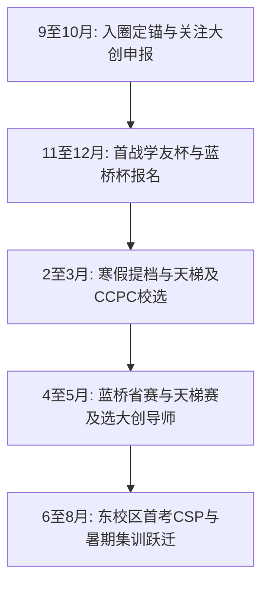

# 附录 A 长江大学学科竞赛认定体系与校内实操速查

前几章面向全国计算机本科生提供了通用路线；本附录专为**长江大学（Yangtze University）**大一大二同学整理**校内竞赛情报速查册**——涵盖红头文件 A+ ~ E 六级认定、推免加分封顶逻辑、东校区官方考点、跨院组队地图与大一全年参赛日历。

请留意每条信息旁的核实标签：**`【公开查证】`** 源自长江大学官网（`yangtzeu.edu.cn`）、CCF CSP 官网、RoboMaster 官网、牛客网及公开权威报道；**`【需校内二次核实】`** 属年度动态文件或校内非公开细则（如当年调整目录、推免精确赋分表、报销比例与招新群号）。本书绝不编造未公开数值，请按指引在报名前核对最新通知。

---

## A.1 制度文件与六级分类规则（A+ / A / B / C / D / E 类）【公开查证】

### A.1.1 核心制度文件与治理架构【公开查证】

1. **《长江大学学生竞赛管理办法》（长大校发〔2024〕12号）**：经 **2024 年 1 月 16 日**校长办公会议通过并印发。教学指导委员会决策，下设**竞赛管理办公室**（挂靠**本科生院**，协同研究生院、团委、发展规划与学科建设处、计划财务处等）；各学院推行**“一院一品”**培育并承担校赛组织。学校设基本竞赛经费、承办资助经费与重大竞赛培育经费，将竞赛成绩纳入学院目标考核、教师教学业绩核拨及学生激励体系。
   - **学长划重点**：竞赛成绩直接关联学院考核与教师教学业绩，向本院或兄弟强院“一院一品”主力赛道靠拢，最易获得场地、算力与指导支持。
2. **《长江大学学生竞赛项目一览表（2025）》（长大校发〔2024〕183号）**：经 **2024 年 12 月 11 日**校长办公会议通过并印发。目录实行**年度动态增补与调级机制**，各培养单位常在**每年 11 月底前**提交新增或调级申请——遇到刚转正的新锐赛或交叉子赛道时，报名前可向本院教务办确认是否已纳入当年动态增补。

### A.1.2 六级分类体系（A+ ~ E 类）【公开查证】

依据《管理办法》（第三章第九条）及《一览表（2025）》，学校直接对标省属高校高质量发展综合绩效考核认可竞赛与中国高等教育学会 84 项竞赛目录及观察目录，划分为六级（速记：**A+ 为三大顶流双创，A 类为算法/数模/硬件皇冠国赛，B 类为计科主力 84 项国赛，C/D/E 对应省赛与校选阶梯**）：

| 长大认定级别 | 制度界定口径 | 代表性 CS 与跨界赛事示例（依 2025 版一览表与规则） |
| :--- | :--- | :--- |
| **A+ 类** | 顶级特列双创赛事（2025 版调级单列，仅 3 项） | 中国国际大学生创新大赛（原“互联网+”）；“挑战杯”全国大学生课外学术科技作品竞赛；“挑战杯”中国大学生创业计划大赛 |
| **A 类** | 国家级核心顶级赛事（教育部主办、影响重大或 84 项高赋分赛事） | ACM-ICPC；CCPC；全国大学生数学建模竞赛（CUMCM）；电赛；RoboMaster / ROBOCON；全国大学生数学竞赛；大创年会展示 |
| **B 类** | 国家级主流赛事（84 项目录中未入 A 类的其他国家级赛及教指委高水平赛） | 蓝桥杯；天梯赛（GPLT）；睿抗（RAICOM）；百度之星；4C 计设；中国软件杯；服创；CISCN；AIC；华为 ICT；CRAIC；中国机器人大赛；嵌赛；物联网设计竞赛 |
| **C 类** | 省部级重点与观察目录赛事（观察目录、较小全国赛、省教育厅重点赛，以及 **A 类赛事省级或区域选拔赛**） | 如湖北省大学生程序设计竞赛（HBCPC，按规则对应 A 类赛事省级/区域选拔赛；当年细则以学院通知为准） |
| **D 类** | 省教育厅未入 C 级赛事、教指委/一级学会全国赛，以及 **B 类赛事省级或区域选拔赛** | 各类 B 类国赛对应的省赛或区域选拔赛（省奖折算口径按当年文件执行） |
| **E 类** | 上述 A / B / C / D 类竞赛对应的**校级选拔赛** | 校内新生赛、学友杯或各大赛校级选拔赛 |

> [!WARNING]
> **【需校内二次核实】**：2026 年及以后年度的《一览表》可能随每年 11 月底前的动态评审调整，报名前务必在**长江大学本科生院官网**核对当年最新红头文件。

### A.1.3 推免加分、实践学分与综测报销口径

- **推免（保研）奖励分上限口径【公开查证】**：主文件为**《长江大学推荐优秀应届本科毕业生免试攻读硕士学位研究生管理办法》（长大校发〔2025〕9号）**及附件《长江大学推免生奖励分认定标准和计算办法》（`yangtzeu.edu.cn`）。`综合成绩 = 学业成绩（必修课首次成绩加权或绩点） + 奖励分`，学科竞赛、论文、专利与荣誉等统一计入奖励分，**合计最高不超过 10 分**；同一方面多项成果原则上**只取最高一项**，**不设单一指标单列计划或破格推荐**；成果须经学院不少于 5 名副教授及以上专家组成的审核小组鉴定。
  - **学长选赛避坑推论**：第一，**学业成绩按必修课首次成绩核算（重修提分一般不替代首次成绩口径，具体以当年细则为准）**，切勿因赶比赛拖垮主课；第二，同方向比赛只取最高一项且总奖励分 10 分封顶，攒一堆 D/E 类低级别奖既不能无限累加，也拼不过 **1~2 项 A+ / A / B 类高含金量国奖**。
- **具体分值提示【需校内二次核实】**：A+ ~ D 各级具体奖项（国一、国二、省一）及团队位次折算系数，仅随教务内网及每年 9 月计科学院推免实施细则附件发布。**严禁轻信网传非官方截图或外校加分表**。
- **双创学分、综测与报销【公开查证 + 需校内二次核实】**：学校建有创新创业实践学分制度（含《大学生创新实践学分管理办法》长大校发〔2006〕235号、现行《本科生学分认定和转化管理办法（试行）》及“第二课堂/自主发展计划”），《管理办法》（长大校发〔2024〕12号）亦挂钩综测、奖学金与经费支持。最低双创学分、综测加分表及报名差旅报销比例，报名前须向**计科学院教务办或指导老师**二次确认。

---

## A.2 长江大学 CS 学子高频核心赛事定级与校情亮点速查总表

把[第 3 章](./03-算法与数据结构竞赛索引.md)与[第 5 章](./05-泛CS竞赛与跨界方向索引.md)赛事落到本校，有两项本地优势值得尽早抓住：

1. **2026 CCPC 国赛荆州主场东风【公开查证】**：**2026 年 11 月 14–15 日，第十二届 CCPC 国赛（荆州站）由长江大学与武汉大学联合承办并在长江大学荆州校区举办**，全国 300 支正式队与 22 支打星队同台竞技，同期联办 CCPC-CANN 昇腾算子性能挑战赛，显著拉高了校内算法梯队与昇腾底层计算竞赛的组织沉淀与支持热度。
2. **足不出校的东校区 CCF CSP 官方考点【公开查证】**：据 CCF CSP 官网（[cspro.org](https://www.cspro.org/)）核实，**长江大学（东校区）即为 CCF CSP 官方正式考点**。计科学院学生在东校区上课即可就近完成这项保研机试与简历硬核认证。

| 赛道分类 | 赛事名称 | 长大查证级别 | 本校承办、参赛实绩与落地贴士 | 核实状态 |
| :--- | :--- | :--- | :--- | :--- |
| **算法主线** | **CCPC 中国大学生程序设计竞赛** | **A 类** | 2026 年 11 月第十二届国赛（荆州站）由长大与武大联合承办（同期联办昇腾 CANN 算子赛）；校内在牛客网办过 CCPC/ICPC 校赛 | 【公开查证】；年度获奖明细查计科学院官宣或 `ccpc.io` |
| **算法主线** | **ACM-ICPC 国际大学生程序设计竞赛** | **A 类** | 明确列为 A 类顶赛；计科学院定期开展竞赛动员会与校内选拔 | 【公开查证】；出队与报销标准【需校内二次核实】 |
| **算法主线** | **团体程序设计天梯赛（GPLT）** | **B 类** | 计科学院常态化在牛客网组织“长江大学天梯赛选拔赛”，选拔组建校队出征国赛 | 【公开查证】 |
| **算法主线** | **蓝桥杯全国软件和信息技术专业人才大赛** | **B 类** | 计科陈应霞、邱林、王鹏等教师多次获优秀指导教师，2024–2026 持续获国奖及省一二三等奖 | 【公开查证】；省赛对应 D 类规则，当年细则【需校内二次核实】 |
| **算法 / 跨界** | **睿抗机器人开发者大赛（RAICOM）** | **B 类** | 高教社第 40 项；CAIP 编程赛与算法主线同源，另有机器人工程与仿真赛道，长大学子在省赛有多支队伍获奖 | 【公开查证】 |
| **算法主线** | **百度之星（Astar）** | **B 类** | 高教社第 58 项；纳入长大 B 类目录，校内选手曾在省赛与全国总决赛斩获奖项 | 【公开查证】 |
| **能力认证** | **CCF CSP 认证（及 CCSP）** | **东校区官方考点** | `cspro.org` 可查东校区为正式考点，保研机试与求职认可度极高 | 考点【公开查证】；CSP 折算综测及 CCSP 定级【需校内二次核实】 |
| **区域算法** | **湖北省大学生程序设计竞赛（HBCPC）** | **按规则对应 C 类** | 省内主力练兵赛、ICPC/CCPC 前置赛（按 A 类赛事省级选拔赛推导） | 按管理办法推导；具体认定与报销向 ACM 老师【需校内二次核实】 |
| **顶级双创** | **中国国际大学生创新大赛（原“互联网+”）** | **A+ 类** | 计科詹炜教授团队等在“智慧农业 + CV/AI”交叉领域指导竞赛近百项，屡获国铜与省金 | 【公开查证】 |
| **顶级双创** | **“挑战杯”（大挑 / 小挑）** | **A+ 类** | 计科谢凯、阮宁君等教师指导学生斩获国铜、省金及省一二等奖 | 【公开查证】 |
| **双创孵化** | **大创项目 / 国创年会展示** | **A 类（国创年会）** | 创新创业学院统筹，常规在秋季 10–11 月立项申报、春季 4–5 月结题检查 | 【公开查证】 |
| **机器人硬件** | **RoboMaster / ROBOCON** | **A 类** | **长江大学“探索者”战队**在 RoboMaster 高校联盟赛曾获一等奖；机械学院等协同指导，计科生主攻视觉自瞄与决策 | 【公开查证】 |
| **电子硬件** | **全国大学生电子设计竞赛（电赛）** | **A 类** | 电信学院建有**电工电子国家级实验教学示范中心**，计科跨院任软件/控制主程优势显著 | 【公开查证】 |
| **机器人硬件** | **全国大学生智能汽车竞赛** | **校级重点支持（A/B 类）** | 高教社第 11 项、学校重点支持高水平工程赛 | 重点支持【公开查证】；归 A 或 B 类【需校内二次核实】 |
| **机器人硬件** | **CRAIC / 中国机器人大赛 / 嵌入式芯片与系统设计竞赛** | **B 类** | 覆盖仿真竞技与软硬协同，计科适合与电信、机械跨院组队切入主控与算法位 | 【公开查证】 |
| **物联网方向** | **全国大学生物联网设计竞赛** | **B 类** | 高教社第 65 项，**精准对口计科院物联网工程本科专业**，主打传感通信与云端后端联动 | 【公开查证】 |
| **AI 与算子** | **全球校园人工智能算法精英大赛（AIC）/ 华为 ICT 大赛** | **B 类** | 大一下可先打 AIC 算法专项赛；华为 ICT 衔接 2026 CCPC 荆州站联办的**昇腾 CANN 算子赛**生态 | 【公开查证】 |
| **软件与设计** | **中国大学生计算机设计大赛（4C）** | **B 类** | 计科高频出奖阵地，龚敏、赵岩、陈慧等教师指导屡获国二、国三及中南赛区奖 | 【公开查证】 |
| **软件与安全** | **中国软件杯 / 服务外包大赛 / CISCN** | **B 类** | 服创曾获国三及省级奖；计科**网络工程为国家级一流本科专业**且建有网络攻防平台 | 【公开查证】 |
| **底层系统顶赛** | **全国大学生计算机系统能力大赛** | **84 项第 63 项（校级待核）** | 2023 年转正进 84 项正式目录，长大教务与双创体系已有收录支持氛围（CPU / OS / 编译 / DB） | 转正【公开查证】；当年《一览表》归 A 或 B 类及子赛道【需校内二次核实】 |
| **AIGC 交叉** | **全国大学生数字媒体科技作品及创意竞赛 / C4-AIGC / 蓝桥视觉设计 AIGC** | **84 项母赛或新增交叉（待核）** | 数媒竞赛为 84 项第 71 项，C4-AIGC（C4 第 26 项母赛延伸）与蓝桥设计 AIGC（蓝桥第 27 项延伸）属近年交叉子项 | 赛事地位【公开查证】；计科院具体归类与交叉认定【需校内二次核实】 |
| **C4 / 能力赛** | **C4（大数据/网络/移动/AI 创意）/ 计算机能力挑战赛** | **重点支持或 C/D（待核）** | C4 系列官网多列重点支持（天梯赛明确 B 类）；全国高校计算机能力挑战赛计科高频动员 | 当年细分子项精确级别【需校内二次核实】 |
| **数模与数理** | **数学建模国赛（CUMCM）/ 全国大学生数学竞赛** | **A 类** | 数模由**信息与数学学院**（如李勇教授等）主力带队，屡获国一、国二，CS 编程手极易搭强队 | 【公开查证】 |
| **国际数模** | **美国大学生数学建模竞赛（MCM/ICM）** | **非 84 项国内榜单** | 寒假低压力练英文写作与团队建模的绝佳练兵场 | 是否纳入校内特定加分项向本科生院【需校内二次核实】 |

> [!TIP]
> **大模型 / AIGC 作品在长大的合规拿分策略【公开查证 + 校内提示】**：计科学院“计科讲坛”已开展大模型讲座并与科大讯飞有产学研合作，但 Kaggle、天池、讯飞独立赛通常不直接进校级 A/B 目录。想兼顾“履历硬实力”与“校内认定”，建议把大模型或 Agent 原型优先投到已明确为 A+ / B 类的母赛子赛道——如 **4C 计设（B 类，AI 应用/AIGC）**、**CRAIC（B 类，大模型赛项）**、**AIC（B 类，AI 智能体）**、**中国软件杯（B 类，大模型真题）**及**创新大赛 / 挑战杯（A+ 类）**；数媒、C4-AIGC 与蓝桥视觉设计 AIGC 等交叉项报名前核查当年《一览表》。

---

## A.3 荆州东校区跨院组队红利、武汉校区贴士与四大必盯入口

### A.3.1 荆州校区跨院“同城零壁垒”组队地图与武汉校区贴士【公开查证】

- **计科学院坐标与底座**：计算机科学学院位于**荆州东校区（湖北省荆州市学苑路 1 号）**，2003 年 4 月成立，拥有计算机科学与技术、智能科学与技术一级学硕点及电子信息专硕点；本科涵盖计科（省一流）、软件工程（省一流）、网络工程（国家一流）、物联网工程、智能科学与技术与信息安全方向。日常实验集中在东校区教学楼（如 12 教、5 教相关机房与实验室），且**东校区即为 CCF CSP 官方考点**。
- **跨院黄金搭档圈**：核心理工与应用兄弟学院同在荆州办学——**电子信息与电气工程学院**（官方通信地址荆州市南环路 1 号 10 号教学楼，建有电工电子国家级实验教学示范中心与人工智能研究院）、**机械工程学院**、**信息与数学学院**同在荆州东校区及周边联动半径内，步行或骑行即达；**农学院**（荆州西校区）、**经济与管理学院**等亦同处荆州城区。联调电赛、智能车与 RoboMaster，找信数学院组数模强队，或联合农学院做“智慧农业 + 视觉 AI”冲 A+ 类双创，**同城线下讨论与硬件调试无跨市地理壁垒**。
- **武汉校区（蔡甸区知音湖畔）新生提示**：武汉校区主要为石油、地科、资环等油气地质特色学院。武汉校区跨专业同学建议以**线上 OJ（牛客 / 洛谷 / Codeforces）+ 蓝桥杯 / 天梯赛 / 数模 / 大创线上协作**切入，提前向本科生院与所在学院核实跨校区组队、考点与报销口径。

### A.3.2 校内四大必盯入口、招新渠道与报名前四步自查

| 官方 / 半官方入口 | 核心查看内容 | 使用频率 | 核实状态 |
| :--- | :--- | :--- | :--- |
| **长江大学本科生院 / 教务处官网**（`yangtzeu.edu.cn` 站群） | 下载当年《学生竞赛项目一览表》红头文件、全校竞赛通知与学分认定文件 | 每学期初与报名前必查 | 【公开查证】 |
| **长江大学创新创业学院官网**（`yangtzeu.edu.cn` 站群） | 盯紧大创立项与结题通知、创新大赛校赛通知、双创学分认定通知 | 3~5 月 & 10~11 月重点盯 | 【公开查证】 |
| **长江大学计算机科学学院官网**（`yangtzeu.edu.cn` 站群） | 查竞赛动员会、“计科讲坛”、本院大创答辩、推免细则与竞赛喜报 | 每两周看一次，保研季细读 | 【公开查证】 |
| **[牛客网竞赛区](https://ac.nowcoder.com/)（搜索“长江大学”）** | 直查往届**“长江大学学友杯程序设计大赛”**、**“长江大学 CCPC/ICPC 校赛”**、**“长江大学天梯赛选拔赛”**真题与榜单，摸清校内门槛 | 大一上起常态化模拟 | 【公开查证】 |

**社团、集训队与实验室入口【公开查证 + 需校内二次核实】**：校内建有省级实验教学示范中心及智能计算、物联网大数据、网络攻防平台，活跃着 **RoboMaster“探索者”战队**、ACM 梯队、信数数模集训与电信国家级实验中心。但 ACM 集训队、计算机协会（计协）、导师实验室的**当年招新 QQ 群号、机房门牌号、校内 OJ 网址及带队老师**属年度动态信息，开学首周请通过**辅导员、直系学长、班助、学院教务办与百团大战**获取一手入口。

**长大学生报名前 4 步自查清单：**
1. **查红头目录**：上**本科生院官网**下载当年最新版《一览表》，核清赛项与具体子赛道级别；
2. **先问统一组织与报销再缴费**：尤其是蓝桥杯、天梯赛与跨校团体赛，切忌看到官网开放报名就自己扫码交钱不管——先看计科学院官网或问教务办、指导老师是否由学院统一汇总报名，并核实获奖后报名费/差旅报销条件，防漏出校内名单或无法报销；
3. **刷真题摸水位**：上**牛客网**搜索往届“长江大学学友杯 / 天梯赛选拔赛 / CCPC 校赛”真题，对照榜单过题数评估校内门槛；
4. **跨院先定“三归属”**：与电信、机械、信数或农学等兄弟学院组队前，先明确**队长归属、作品挂靠学院与第一指导教师归属**，避免赛后登记与学分认定纠纷。

---

## A.4 长江大学 CS 大一新生校内赛事与节点全年参考日历

结合[第 6 章](./06-路线编排与好学心法.md)的两年规划与校内常规办赛周期，整理大一全年落地参考节奏：

沿着五个季节节点推进，每个时段抓牢核心任务即可：

| 校内参考时段 | 能力目标（衔接本书进度） | 重点盯紧的校内节点与赛事 | 实操避坑小贴士 |
| :--- | :--- | :--- | :--- |
| **大一上 · 9~10 月** | 吃透 C 语言流程与指针直觉，稳住高数课 | 参加计科动员会、“计科讲坛”与百团大战，入集训队或战队群；**10~11 月盯创新创业学院“大创”常规秋季立项窗口** | 大一基础尚浅时优先加入靠谱高年级或导师大创项目练手，不牵头空壳项目 |
| **大一上 · 11~12 月** | 切入 C++ 竞赛子集或 Python，刷完[第 7 章](./07-算法实战训练与作业精选.md) Set 1~2 | 参加校内新生赛或牛客**“长江大学学友杯程序设计大赛”**；盯紧**蓝桥杯**校内统一报名通知（常于 10~12 月截止） | 报蓝桥杯前向教务办核实**是否统一组织及获奖报销政策**，防漏报汇总 |
| **大一下 · 2~3 月** | 寒假突破 STL、搜索、贪心与入门 DP；可试水一次美赛 | 3 月前后打牛客网**长江大学天梯赛选拔赛**与 **CCPC / ICPC 校赛**，争取入选校队梯队 | 选拔前做 1~2 套往届长大校赛真题，摸清校内过题门槛 |
| **大一下 · 4~5 月** | 稳住大一下核心专业课，迎来第一波正式考场检验 | **4 月蓝桥杯省赛** + **4 月天梯赛国赛**；5 月衔接 **HBCPC 省赛** 与 **4C 省赛/中南赛区**；观摩 4~5 月**大创结题与阶段检查** | 借大创汇报观察导师方向与指导风格，提前为大二进组或申报物色导师 |
| **大一下 · 6~8 月** | 完成 L2 算法骨架或切入 1 门系统/跨界入门课 | 6 月**蓝桥杯国赛**（晋级者）+ **东校区就近首次报考 CCF CSP**（CSP 每年 4 次（常见 3/5–6/9/12 月，以官网排期为准）；刷题未到位也可顺延至大二上再考）；7~8 月打 **睿抗 RAICOM-CAIP**；参加校内 **ACM 或数模暑期集训** | 按[第 5 章](./05-泛CS竞赛与跨界方向索引.md)“单支线原则”收口，备战大二上 **9 月数模国赛（A 类）** 与 **9 月底~11 月 ICPC/CCPC 区域赛（A 类）** |

> [!NOTE]
> **【需校内二次核实说明】**：以上校内时间节点依据近年公开校历与办赛节奏整理，具体起止日期、考场安排与报销细则，请一律以**长江大学本科生院、创新创业学院与计算机科学学院官网**当年最新通知为准。

