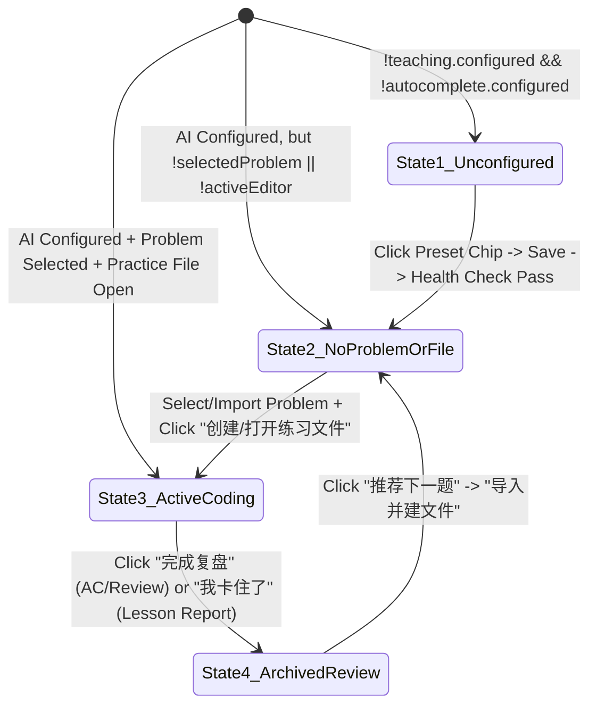
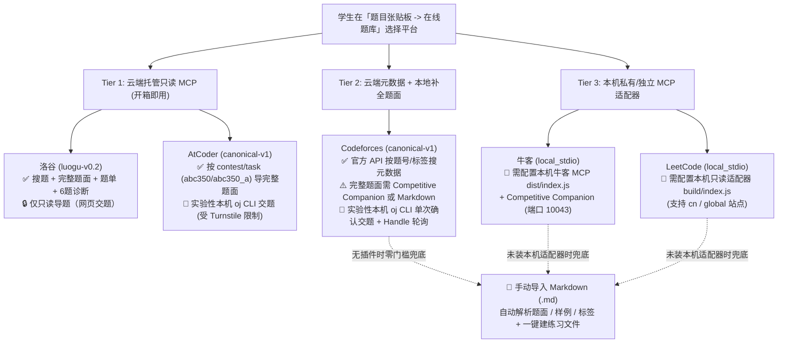

# Student Autocomplete Lab — UX Experience & Product Design Specification (`v0.1.0-beta.1` → `v0.2.0-beta`)

> **Code-Truth Baseline**: Grounded strictly in the shipped codebase (`src/sidebar/ProblemBankViewProvider.ts`, `src/sidebar/webview/{formalDesign,i18n,main,styles}.ts`, `src/extension.ts`, `src/autocomplete/{inlineProvider,context,filter,triggerPolicy,mimoAutocomplete}.ts`, `src/teaching/{studentSkill,studentProfile,solutionScoreGate,teacherPack}.ts`, `src/oj/{broker,vscodeProviderConfiguration}.ts`, `src/submission/*`, `src/ojConsole/*`, `prototypes/oj-console/*`, `package.json`, `README.md`, and `MANUAL-ACCEPTANCE.md`).
>
> **Companion Copy Deck**: See [`docs/USER_JOURNEY_COPY.md`](./USER_JOURNEY_COPY.md) for the complete bilingual (`zh-CN` / `en-US`) microcopy catalog, hero positioning blocks, and error-recovery dictionary.

---

## 0. Executive Summary & Core Product Thesis

**Student Autocomplete Lab** solves the #1 pedagogical failure of general-purpose AI coding assistants (GitHub Copilot, Cursor, standard ChatGPT plugins) in algorithm education: **one `Tab` press spoils the entire 30-line DFS/DP solution before the student has thought through the state transition.**

Our codebase already implements three category-defining technical pillars that no generic AI coding plugin offers:
1. **Architectural Anti-Spoiler Firewall (`src/autocomplete/context.ts:15-26`, `src/autocomplete/filter.ts:1-60`, `src/teaching/studentSkill.ts:62-66`)**:
   - The inline autocomplete lane (`routeAutocompleteModel`) physically strips problem prose (`stripProblemProseBlocks`), never receives the problem statement, `TeacherPack`, standard solution, or coaching thread, and hard-caps completions to **1–3 contiguous lines of local code**.
2. **Socratic 4-Step Coaching Ladder + 3-Stage Post-Attempt Mastery Loop (`src/sidebar/ProblemBankViewProvider.ts:937-1748, 2045-2097`)**:
   - Progressive hints (`给一个提示` → `提示更具体` → `自由追问` → `我卡住了` lesson report with minimal repair path & remedial micro-exercise) paired with pre-submission self-check (`交题前自检 · AI 估计`), 5-dimension independence scoring (`学习评分`, distinguishing brute-force AC from true algorithmic growth), and 2nd-tier complexity review (`优化复盘`, including an honest `无需优化` verdict on simple problems).
3. **Inspectable, Correctable, Version-Rollbackable Local Learning Dossier (`Student Skill`, `src/teaching/studentSkill.ts:483-587`, `ProblemBankViewProvider.ts:5638-5870`)**:
   - Stored 100% locally in JSON/JSONL with evidence counters (`E-01`), source problem provenance, one-click human overrides (`这条不准` demotes & logs counter-evidence, `有帮助`, `禁用`), and snapshot rollback (`回滚到此版本`).

**The UX Gap**: While the backend domain engine and the `"competition-dossier"` visual theme (`ProblemBankViewProvider.ts:3752`) are rich and well-tested (419 unit tests + 1,000-case fixture evaluation), **7 concrete UI/UX disconnects in the sidebar webview, onboarding funnel, and command wiring currently prevent first-time students from reaching these killer features in their first 60 seconds.**

---

## 1. End-to-End Simulated Persona Journeys & Friction Audit

Synthesizing our product design walkthrough and simulated user testing across three primary personas:

| Persona | Profile & Setup | Target Workflow | Top Friction Hit in Current `v0.1.0-beta.1` UI | Top Delight Moment When Unblocked |
| :--- | :--- | :--- | :--- | :--- |
| **Persona A: 大一 CS 新生小林**<br>*(CS Freshman Beginner)* | Windows 11, Python / C, grinding Luogu starter sets (`P1001`, `P5703`, `P4913`), afraid of Copilot spoiling recursion/tree problems | Install extension → click `初始路线 -> 初始诊断` → create `.py` file → get 1–3 line Ghost Text → ask `给一个提示` | 1. Told to run `git clone -> npm ci -> F5` (`README.md:17-25`);<br>2. Clicks `初始诊断` (`importPreset`, `line 389`), which downloads 6 problems **without creating a code file**, and `#problemDetail` has **no `[创建练习文件]` button**;<br>3. Clicks `进入作答现场 -> 给一个提示` and crashes into `"先打开你的代码文件，AI 才能分析当前卡点。"` (`line 956`). | Watching Ghost Text complete `left_depth = dfs(node.left)` without dumping the full tree depth solution, then receiving a single boundary question from `给一个提示`. |
| **Persona B: ICPC 区域赛队员阿杰**<br>*(Competitive Programmer)* | Windows/Linux, C++20 (`#include <bits/stdc++.h>`, `#define ll long long`), DeepSeek dual-model (`deepseek-chat` FIM + `deepseek-reasoner` Coach), Codeforces + AtCoder + NowCoder | Configure DeepSeek `/v1` + `/beta` → import problem → write C++ template → run pre-submit self-check (`交题前自检`) → submit via local `oj` CLI | 1. `#aiBaseUrl` shows internal `xiaomimimo.com` / `mimo-v2.5` placeholders (`lines 4060-4076`);<br>2. `isStrongCodeLine` (`src/autocomplete/context.ts:80-106`) strips `#define` / `typedef` / `using` macros before the first recognized keyword, causing `"No student code context remained"` (`inlineProvider.ts:110`);<br>3. **`交题前自检` (`requestSubmissionJudge`) and `推荐下一题` (`requestRuleRecommendation`) are completely missing from active problems in `作答现场`**—they only render inside `题目张贴板 -> 已归档 -> 更多操作` (`lines 6704-6730`)! | One-click `健康检查` catching the DeepSeek `/beta` FIM requirement (`deepseek-fim-beta-required`, `line 7932`), plus `学习评分` distinguishing brute-force $O(N^2)$ AC from optimal $O(N \log N)$. |
| **Persona C: 双语国际班学生/助教 Maya**<br>*(Bilingual Student & TA)* | macOS/Windows, Rust / Python, `ui.language: "en"`, Codex OAuth + manual `.md` problem imports (`importManualMarkdownFile`) | Switch UI to English → import custom `.md` worksheet → audit which `Student Skill` rules were injected → mark false diagnosis `这条不准` | 1. Switching `#uiLanguage` to `English` (`lines 4551-4583`) translates ~25 top labels while drawer headers (`更多操作`, `提交到 OJ`, `连接状态`, `账户与模型`) remain in Chinese;<br>2. `importManualMarkdownFile` (`line 810`) imports `.md` without creating a starter file;<br>3. `appendContextAudit()` (`line 6193`) is an empty no-op `function appendContextAudit() {}`, dropping the backend's `contextAudit` / `skillAudit` receipt! | Clicking `这条不准` (`diagnosis_wrong`) in `学习档案` and seeing the rule immediately demoted and excluded from subsequent coaching prompts, with 1-click `回滚到此版本`. |

---

## 2. Seven Code-Verified UX & Architecture Bugs (Exact Line References)

### Bug 1: 4-Way Terminology Split Between `README.md`, `package.json`, `src/extension.ts`, and Webview HTML
- **Evidence**:
  - `README.md:30-36, 61-85, 100` refers to tabs/panels as `AI 教练`, `题库`, `学习画像`, and `AI 配置`.
  - The shipped `"competition-dossier"` webview (`src/sidebar/ProblemBankViewProvider.ts:3775-3779, 3999` and `src/sidebar/webview/formalDesign.ts:1-5`) names the 3 tabs **`作答现场`** (`#tabAi`), **`题目张贴板`** (`#tabProblem`), and **`学习档案`** (`#tabSkill`), and places AI settings inside a collapsed bottom drawer titled **`账户与模型`** (`#accountModelDrawer`).
  - Meanwhile, VS Code Command Palette commands (`src/extension.ts:88-99, 120-123`) do **not** execute their actions! Calling `studentAutocomplete.giveHint` (`AI 做题陪练：给点提示`), `moreSpecificHint` (`AI 做题陪练：再具体点`), `revealAnswer` (`AI 做题陪练：我放弃了`), or `recommendNext` (`AI 做题陪练：推荐下一题`) calls `focusCoachView(actionName)`, which only focuses the sidebar and pops an info toast:
    ```ts
    // src/extension.ts:122
    void vscode.window.showInformationMessage(`请在左侧 AI 教练中点击「${actionName}」继续。`);
    ```
    None of those 4 quoted strings match the actual sidebar button labels (`给一个提示`, `提示更具体`, `我卡住了`, `推荐下一题`), and 3 of them are hidden inside collapsed drawers!

### Bug 2: Missing Practice-File Creation on 3 of 5 Import Paths (`importPreset`, `importLuoguProblemSet`, `importManualMarkdownFile`)
- **Evidence**:
  - `this.createPracticeFile(problem, language)` (`ProblemBankViewProvider.ts:1750-1780`) is **only** called inside `importOjProblem` (`line 349`) and `importLuogu` (`line 380`).
  - It is **never** called in `importPreset` (`lines 389-399`, the recommended `"初始路线"` for new students!), `importLuoguProblemSet` (`lines 427-448`), or `handleManualMarkdownFileImport` (`lines 810-836`).
  - Worse, when a student selects any problem in `题目张贴板`, `renderDetail()` (`lines 6843-6866`) only renders two buttons in `.detailActions`: **`[进入作答现场]`** and **`[直接删除]`**. There is **no button anywhere in `题目张贴板` or `作答现场` to create or open the practice source file** (`practice/<platform>-<id>/solution.<ext>`) for an already-imported problem!

### Bug 3: Dead `"从洛谷获取"` Empty-State Button in `题目张贴板` (`renderDetail`)
- **Evidence**:
  - In `ProblemBankViewProvider.ts:6763-6770`, when no active problem is selected (`!problem`), the empty poster renders `[选择 Markdown 题目]` and `[从洛谷获取]`:
    ```js
    // src/sidebar/ProblemBankViewProvider.ts:6767-6770
    luoguButton.addEventListener("click", () => {
      luoguPid.focus();
      setStatus("输入洛谷题号，或展开搜索按标题查找。");
    });
    ```
  - However, `#luoguPid` lives inside `<details class="panel ledgerPanel"><summary>洛谷题号与题单</summary>` (`line 3876`), which is **collapsed by default** (no `open` attribute). Calling `luoguPid.focus()` on an input inside a closed `<details>` element fails silently—the drawer stays closed and the cursor does not move!

### Bug 4: Orphaned Active-Problem Coaching Actions (`交题前自检` & `推荐下一题`)
- **Evidence**:
  - Backend `handleSubmissionJudgeRequest` (`ProblemBankViewProvider.ts:2045-2097`) and frontend `renderSubmissionJudge` (`lines 6195-6238`) explicitly implement two stages:
    - **Active problem (`reviewStage === "active"`)**: `"交题前自检 · AI 估计"` (`"保守判断当前代码可能 AC、WA、RE、TLE，或者需要先运行样例"`).
    - **Archived problem (`reviewStage === "archived"`)**: `"找错复盘 · AI 估计"`.
  - Yet in the webview DOM, `requestSubmissionJudge(...)` (`line 5401`) is **only wired to a button inside `renderCompletedList()`** (`已归档 -> 更多操作 -> 找错复盘`, `line 6708`)! There is **no button** in `作答现场` (`#aiPage`) to run `交题前自检` on an active problem before submitting!
  - Likewise, `requestRuleRecommendation(...)` (`推荐下一题`, `line 5301`) is **only wired inside `renderCompletedList()`** (`已归档 -> 更多操作 -> 推荐下一题`, `line 6729`). An active student in `作答现场` cannot click `推荐下一题` without first archiving a problem and switching to `题目张贴板 -> 已归档`.

### Bug 5: Dropped Context Isolation & Skill Audit Receipt (`appendContextAudit` No-Op)
- **Evidence**:
  - The extension host carefully constructs `toPublicSkillPlanAudit("coach", coachSkillAudit)` (`lines 1042, 1120`) and `toPublicSkillPlanAudit("autocomplete_preview", result.audit)` (`line 1806`), and `MANUAL-ACCEPTANCE.md:55,69` explicitly states:
    > *"侧栏审计可显示 route、language、renderer、稳定规则 ID、规则预算和 enforcement，但不得显示代码前后缀、文件路径、题面、Teacher Pack、标准答案、key 或 token。"*
  - Yet in `ProblemBankViewProvider.ts:6193`, the webview renderer defines:
    ```js
    function appendContextAudit() {}
    ```
    All calls at lines `6076, 6077, 6143, 6144, 6170, 6237, 6283, 6339, 6374` are silently discarded! Restoring this function turns an invisible backend guarantee into a visible, trust-building **"🛡️ 防剧透与上下文回执"** card.

### Bug 6: Over-Aggressive `isStrongCodeLine` Filter Stripping C++/Rust Contest Preambles (`src/autocomplete/context.ts:80-106`)
- **Evidence**:
  - `extractStudentCodeFromText` scans for the first line matching `isStrongCodeLine(trimmed)` (`lines 80-106`).
  - While `isStrongCodeLine` recognizes `#include`, `def`, `fn`, `int`, `for`, `if`, etc., it does **not** match common competitive programming preamble lines when written before `int main()` without `#include` (or in snippet files), such as `using namespace std;`, `typedef long long ll;`, `#define rep(i,a,b)`, `template<typename T>`, or `macro_rules!`.
  - Furthermore, when `extractStudentCodeFromText` returns empty, `inlineProvider.ts:110` emits raw English `"No student code context remained after autocomplete safety filtering."` into the Chinese status bar tooltip (`$(circle-slash) AI 返回空补全`).

### Bug 7: Unconfigured First-Run Cold Start & Legacy `mimo` Placeholders (`ProblemBankViewProvider.ts:4060-4076, 5187-5201`)
- **Evidence**:
  - On first launch (`!teaching.configured && !autocomplete.configured`), `#aiProvider` shows `"需要配置"` (`line 5200`), but `#accountModelDrawer` (`账户与模型`, `line 3998`) remains collapsed at the very bottom of `作答现场` below 4 other sections.
  - Inside `#accountModelDrawer`, `#aiBaseUrl` has placeholder `https://token-plan-cn.xiaomimimo.com/v1` and `#aiChatModel` / `#aiAutocompleteModel` have placeholder `mimo-v2.5` (`lines 4060, 4072, 4076`), leaking internal evaluation harness defaults to public beta users.

---

## 3. vNext Information Architecture & 3-State Guided Workspace Blueprint

### 3.1 High-Level State Machine for `作答现场` (`#aiPage`)

Instead of dumping an unconfigured first-time user into a static `作答现场` where clicking `给一个提示` immediately errors out, `作答现场` adapts its top card (`#coachSelection` + `#accountModelDrawer`) across **3 deterministic readiness states**:



### 3.2 ASCII Wireframes for the 3 Core Sidebar States

#### Wireframe A: First-Run Cold Start (`State 1` + `State 2` Guided Banner in `作答现场`)
```text
+-----------------------------------------------------------------------+
| 做题陪练                                            [1/3 待配置 AI]   |
| 未选择题目 · 未打开练习文件                         界面: [中文 v]    |
| ▎请先完成下方 30 秒模型配置，随后即可导入题目并创建练习代码。         |
+-----------------------------------------------------------------------+
| [ ● 作答现场 ]          [ ○ 题目张贴板 ]          [ ○ 学习档案 ]      |
+-----------------------------------------------------------------------+
| ▼ 1. 账户与模型 (首次使用自动展开)                         [需要配置] |
|   一键预设: [🔥 DeepSeek 双模型] [⚡ OpenAI] [🧪 Codex OAuth] [Anthropic]
|   兼容模式: [OpenAI 兼容 v]         补全协议: [Completions (FIM) v]   |
|   分析接口 Base URL: [https://api.deepseek.com/v1                   ] |
|   补全接口 Base URL: [https://api.deepseek.com/beta                 ] |
|   API Key / 密钥:    [•••••••••••••••••••••••• (存入 SecretStorage) ] |
|   提示/评分模型:     [deepseek-reasoner]  补全模型: [deepseek-chat  ] |
|   [ 保存并运行健康检查 (Primary) ]  [ 拉取模型 ]   API Key: 已保存    |
|   +-----------------------------------------------------------------+ |
|   | ✅ 模型列表 (2个)   ✅ 提示与评分 (620ms)   ✅ 代码补全 (310ms) | |
|   +-----------------------------------------------------------------+ |
+-----------------------------------------------------------------------+
| ▼ 2. 选择第一道练习题                                                 |
|   尚未载入题目。推荐从 6 道零门槛诊断题开始，或直接按洛谷题号导题：   |
|   [ 🎯 一键导入 6 题新手诊断并建文件 ]   [ 📋 去题目张贴板选 Markdown ]|
|   快捷洛谷导题: [ P1001 / P4913        ] [ 下载题面并创建 .py 文件 ]  |
+-----------------------------------------------------------------------+
```

#### Wireframe B: Active Problem Solving (`State 3` — `作答现场` Full Coaching Surface)
```text
+-----------------------------------------------------------------------+
| 做题陪练                                                  [作答中]    |
| P4913 · 【深基16.例3】二叉树深度                                      |
| practice/luogu-P4913/solution.py (Python)                 2 次提示    |
| ▎AI 已根据当前代码分析 P4913。                             [中文 v]   |
+-----------------------------------------------------------------------+
| [ ● 作答现场 ]          [ ○ 题目张贴板 ]          [ ○ 学习档案 ]      |
+-----------------------------------------------------------------------+
| 当前作答                                              [🟢 AI 已就绪]  |
| +-------------------------------------------------------------------+ |
| | P4913 · 【深基16.例3】二叉树深度                                  | |
| | [题面就绪] [文件已打开: solution.py] [2 次提示] [🛡️ 短补全防剧透] | |
| | [ 📄 打开/创建练习文件 ]  [ 📖 查看题面与样例 ]                   | |
| +-------------------------------------------------------------------+ |
| | 给你的提示                                                        | |
| | +---------------------------------------------------------------+ | |
| | | 更具体的下一步                                                | | |
| | | 你的 dfs(u) 在左右子树都为 0（叶子节点）时返回了 0，导致整棵  | | |
| | | 树深度比正确答案少 1。想想：单节点树的深度应该返回几？        | | |
| | +---------------------------------------------------------------+ | |
| | | ▶ 诊断细节（自检点 / 微步骤 / 痛点判断：递归边界 85%）        | | |
| | +---------------------------------------------------------------+ | |
| | | 🛡️ 防剧透与上下文回执 · 路由: coach · 已应用 2 条学习档案规则 | | |
| | |   已注入: 题面 + 当前代码 + 规则 [recursion-base-case]        | | |
| | |   已隔离: 自动补全通道绝不读取本题面与 Teacher Pack           | | |
| | |   [ 画像提示不准？去学习档案纠偏 → ]                          | | |
| | +---------------------------------------------------------------+ | |
| | [ 讲简单点 ]                                                      | |
| +-------------------------------------------------------------------+ |
| | 追问 (Ctrl+Enter 发送)                                            | |
| | [ 如果把空节点返回 0，叶子节点不就是 max(0,0)+1=1 吗？          ] | |
| | [ 发送追问 ]                                                      | |
| +-------------------------------------------------------------------+ |
| | [          💡 给一个提示 (Level 1 方向提醒)           ] (Primary) | |
| | [ 🔎 提示更具体 (Level 2) ]       [ 🔍 交题前自检 (AI 找错) ]     | |
| | [ ✅ 完成复盘 (评分并归档) ]      [ 🏳️ 我卡住了 (看讲解与补救) ] | |
| | ▶ 更多操作 (推荐下一题 · 测试补全接口 · 作答语言/OJ结果选项)      | |
| +-------------------------------------------------------------------+ |
| | ▶ 提交到 OJ (Codeforces / AtCoder 实验性单次确认 · 打开提交控制台)| |
| | ▶ 连接状态 & 账户与模型                                           | |
+-----------------------------------------------------------------------+
```

#### Wireframe C: Inspectable & Rollbackable `学习档案` (`#skillPage` / `Student Skill`)
```text
+-----------------------------------------------------------------------+
| LEARNING FILE / 学习档案                          rev 4 · 07/22 15:40 |
| 可查看、可纠正、100% 本地存储（绝不自动上传云端）                     |
+-----------------------------------------------------------------------+
| [ 已启用: 2 ]              [ 候选观察: 3 ]             [ 已禁用: 1 ]  |
+-----------------------------------------------------------------------+
| 🛡️ 硬性防剧透规则 (Hard Rules)                                        |
| · 短补全读取题面与标程：禁止 (物理隔离)                               |
| · 短补全直接生成整题答案：禁止 (最多 1–3 行局部代码)                  |
| · 用户已禁用规则：枚举转哈希表 (AI 绝不静默恢复)                      |
+-----------------------------------------------------------------------+
| ▼ 已启用 Skill · 2                                                    |
| +-------------------------------------------------------------------+ |
| | E-01                                                     [已启用] | |
| | 递归与树遍历边界检查 (recursion-base-case)                        | |
| | 连续在二叉树题目中漏写空节点 u == 0 的终止条件。                  | |
| | 证据 3 · 分数 4 · 最近 07/22 15:38 · 最近题目 P4913               | |
| | [递归边界] [二叉树遍历]                                           | |
| | · 写递归函数第一行先确认空节点/越界返回值                         | |
| | [ 👎 这条不准 (降级并记反例) ] [ 👍 有帮助 ] [ 查看证据 ] [ 禁用 ]| |
| +-------------------------------------------------------------------+ |
| ▼ 版本回滚 (最近 3 个快照)                                            |
| +-------------------------------------------------------------------+ |
| | rev 3 · 07/22 15:20 — specific P4913 via deepseek-reasoner        | |
| | 启用 1 · 候选 3 · 禁用 1                         [ 回滚到此版本 ] | |
| +-------------------------------------------------------------------+ |
```

---

## 4. Concrete Component-Level UX Fixes & Implementation Specs

### 4.1 Always-Available "Create / Open Practice File" Action (`ProblemBankViewProvider.ts`)

To eliminate the #1 onboarding blocker where `importPreset` (`初始路线`), `importLuoguProblemSet` (`洛谷题单`), and `importManualMarkdownFile` (`导入 Markdown`) leave the student without a source file:

1. **Add Command `openOrCreatePracticeFile` to Webview Protocol (`src/sidebar/messageProtocol.ts` & `ProblemBankViewProvider.ts`)**:
   - Accepts `{ problemKey: string, language: PracticeLanguage }`.
   - Calls `this.createPracticeFile(problem, normalizePracticeLanguage(message.language))` (`line 1750`), opens the document in `ViewColumn.One`, and posts updated `activeEditor` state back to the webview.
2. **Surface `[📄 创建/打开练习文件]` in Two Places**:
   - **In `题目张贴板` (`renderDetail`, `line 6845`)**: Place `[📄 创建/打开练习文件并进入作答]` right alongside `[进入作答现场]` and `[直接删除]`.
   - **In `作答现场` (`renderCoach`, `line 5175`)**: Whenever `problem` is selected, make the file status tag (`文件已打开: solution.py` or `⚠️ 未打开文件`) an interactive button `[+ 创建/打开练习文件]` so the student can spawn `practice/<platform>-<id>/solution.<ext>` in one click without leaving `作答现场`.
3. **Fix Empty-State `[从洛谷获取]` Drawer Focus (`ProblemBankViewProvider.ts:6767`)**:
   ```js
   luoguButton.addEventListener("click", () => {
     const drawer = luoguPid.closest("details");
     if (drawer) {
       drawer.open = true;
     }
     luoguPid.focus();
     setStatus("输入洛谷题号（如 P1001），点击「下载并建文件」即可自动创建代码文件。");
   });
   ```

### 4.2 Promoting `交题前自检` & `推荐下一题` to First-Class Active Controls in `作答现场`

Currently ` coachActions` (`ProblemBankViewProvider.ts:3952-3962`) hides almost everything inside `<details id="coachMoreDrawer"><summary>更多操作</summary>`, and omits `交题前自检` (`requestSubmissionJudge`) and `推荐下一题` (`requestRuleRecommendation`) from `#aiPage` altogether.

**vNext Action Hierarchy in `作答现场` (`#aiPage`)**:

| Tier | Button ID & Label (`zh` / `en`) | Handler | Pedagogical Purpose |
| :--- | :--- | :--- | :--- |
| **Primary CTA (Full Width)** | `#coachHint`: **`💡 给一个提示`** / **`Hint`** | `requestAiCoach("hint")` | Level-1 Socratic nudge: 1 symptom + 1 direction check, zero code spoiler. |
| **2×2 Core Grid (Row 1)** | `#coachSpecific`: **`🔎 提示更具体`** / **`More Specific`** | `requestAiCoach("specific")` | Level-2 concrete clue: narrows to 1 failing condition or tiny counterexample. |
| **2×2 Core Grid (Row 1)** | `#coachSubmissionJudge`: **`🔍 交题前自检`** / **`Pre-Submit Check`** | `requestSubmissionJudge(keyOf(problem))` | Conservative `AI 估计` (`可能 AC / WA / RE / TLE`) + suggested small test cases before OJ submission. |
| **2×2 Core Grid (Row 2)** | `#coachCompleted`: **`✅ 完成复盘`** / **`Finish & Review`** | `requestCompletionReview()` | 5-dimension learning score (`正确性/复杂度/思路成长/代码质量/独立性`), updates `Student Skill`, and archives. |
| **2×2 Core Grid (Row 2)** | `#coachGiveUp`: **`🏳️ 我卡住了`** / **`I'm Stuck`** | `requestAiCoach("giveUp")` | Generates Lesson Report (standard idea, minimal fix path, hidden reference solution, remedial exercise) and archives as错题. |
| **Compact Secondary Drawer (`更多操作`)** | `#coachRecommendNext`: **`🎯 推荐下一题`**<br>`#coachOptimization`: **`⚡ 优化复盘`** (enabled when archived)<br>`#coachAutocomplete`: **`🧪 测试补全接口`** | `requestRuleRecommendation(keyOf(problem))`<br>`requestOptimizationReview(keyOf(problem))`<br>`requestAutocompletePreview()` | Zero-LLM rule-based next problem recommendation; Big-O/memory optimization review; FIM endpoint diagnostic preview. |

### 4.3 Restoring the Visible Anti-Spoiler & Skill Audit Receipt (`appendContextAudit`)

Replace the empty stub `function appendContextAudit() {}` (`ProblemBankViewProvider.ts:6193`) with a clean, collapsible `<details class="resultDetailsDrawer auditReceiptDrawer">` at the bottom of `#aiResponse`:

```js
function appendContextAudit(audit) {
  if (!audit || typeof audit !== "object") {
    return;
  }
  const route = audit.route || audit.action || "coach";
  const isAutocomplete = String(route).includes("autocomplete");
  const appliedRules = (audit.appliedLearnerRuleIds || []).join(", ") || "默认安全基线";
  const lines = [
    "通道类型：" + (isAutocomplete ? "防剧透短补全 (Autocomplete 隔离通道)" : "苏格拉底教学教练 (Coach 诊断通道)"),
    audit.language ? "语言 / 渲染器：" + audit.language + (audit.renderer ? " · " + audit.renderer : "") : "",
    audit.included?.length ? "已读取上下文：" + audit.included.join("、") : "",
    audit.excluded?.length
      ? "物理隔离项：" + audit.excluded.join("、")
      : isAutocomplete
        ? "物理隔离项：完整题面、标准答案、Teacher Pack、教练对话历史"
        : "严格排除项：自动补全提示词、已禁用/判错的学习档案规则",
    "已生效学习档案规则：" + appliedRules
  ].filter(Boolean);

  const block = optionalDetailsBlock(
    "🛡️ 防剧透与上下文回执 · " + (isAutocomplete ? "题面已物理隔离" : "已应用教学规则"),
    lines.join("\n")
  );
  aiResponse.appendChild(block);
}
```

### 4.4 Bridging the Inline `提交到 OJ` Drawer and the Full `OJ 提交控制台` (`OjConsolePanel`)

Currently, students have two disconnected submission surfaces:
1. Inline `<details id="ojSubmissionPanel"><summary>提交到 OJ</summary>` inside `作答现场` (`ProblemBankViewProvider.ts:3965`), which only runs live `oj` CLI previews/submissions.
2. Command Palette `AI 做题陪练：打开 OJ 提交控制台` (`studentAutocomplete.openOjConsole`, `src/ojConsole/OjConsolePanel.ts`), which opens the rich cyber-console (`prototypes/oj-console/frontend/index.html`) supporting **zero-risk `DEMO` mode** (5 simulated verdicts: `Accepted`, `Wrong Answer`, `Compile Error`, `Unknown / Timeout`, `Login Required`, plus 5-stage pipeline timeline `CREATED → SUBMITTING → QUEUED → JUDGING → FINAL` and `Ctrl+K` command palette) alongside gated `REAL` mode (`我确认本次操作可能向在线评测平台真实提交代码`).

**Design Unification**:
- Add a secondary button inside `#ojSubmissionPanel`: **`[🖥️ 打开独立 OJ 提交控制台 (支持免登录 DEMO 演练)]`** that sends `{ command: "openOjConsole" }` → `vscode.commands.executeCommand("studentAutocomplete.openOjConsole")`.
- Pre-populate `#ojProblemUrl` in `#ojSubmissionPanel` automatically whenever the currently selected problem has a `codeforces` or `atcoder` `sourceUrl` (`problem.sourceUrl`), eliminating manual URL copy-pasting!

### 4.5 Preserving C++/Rust Competitive Programming Preambles in `extractStudentCodeFromText`

To fix Persona B (ICPC Contestant Ajie) hitting `"No student code context remained after autocomplete safety filtering"` (`src/autocomplete/context.ts:80-106`, `inlineProvider.ts:110`):
- Expand `isStrongCodeLine(trimmed)` in `src/autocomplete/context.ts:80-106` to recognize C/C++/Rust contest preamble lines (`/^using\s+(namespace\s+\w+|[\w:]+\s*=)/`, `/^typedef\s+/`, `/^#define\s+/`, `/^template\s*</`, `/^macro_rules!\s*/`).
- Localize the status bar fallback messages in `src/autocomplete/inlineProvider.ts:110, 127, 134, 145` so Chinese UI users see clear Chinese diagnostics in the status bar tooltip (`"安全过滤后未检测到有效代码上下文；请先输入头文件或函数骨架。"`).

---

## 5. Five-Platform OJ Capability & Fallback Design Matrix

Students frequently assume all 5 platforms in the `在线题库` dropdown (`洛谷 / LeetCode / 牛客 / Codeforces / AtCoder`) behave identically. The UI and documentation must make the **3 architectural tiers** unmistakable:



---

## 6. First-Time User & Maintainer Onboarding Checklists

### 6.1 60-Second Student Onboarding Checklist (Zero-Spoiler Path)

- [ ] **Step 1 — Install Clean VSIX (Skip `F5` Debug Host)**:
  Run `npm ci && npm run package:beta-release` and `code --install-extension .runtime/student-autocomplete-lab-beta-release-0.1.0-beta.1.vsix`, then open a dedicated practice folder (e.g., `~/algorithm-practice/`) in VS Code and trust the workspace.
- [ ] **Step 2 — Configure AI Provider & Run 3-Step Health Check**:
  Open Activity Bar **`AI 做题陪练`** → in **`作答现场`** expand **`账户与模型`** → select **`OpenAI 兼容`** (for DeepSeek: Analysis URL `https://api.deepseek.com/v1`, Autocomplete URL `https://api.deepseek.com/beta`, Format `Completions`, Key in SecretStorage) → click **`保存 AI 配置`** → click **`健康检查`** and verify **`模型列表` / `提示与评分` / `代码补全`** all show `通过`.
- [ ] **Step 3 — Import First Problem & Create Practice Code File**:
  Switch to **`题目张贴板`** → either click **`初始路线 → 导入这套路线上手`** (6 beginner diagnostic problems) or open **`洛谷题号与题单`**, enter `P1001`, and click **`下载并建文件`** to open `practice/luogu-P1001/solution.py`.
- [ ] **Step 4 — Experience Anti-Spoiler 1–3 Line Ghost Text**:
  Type partial code inside your solution file and pause for **350 ms**. Verify the bottom-right status bar shows `$(check) AI 补全已返回` and grey Ghost Text proposes **at most 1–3 lines** of local code without spoiling the algorithm.
- [ ] **Step 5 — Walk the Socratic Ladder & Audit `学习档案`**:
  Click **`给一个提示`** (direction) → **`提示更具体`** (counterexample/condition) → after solving, select your OJ verdict (`AC` / `WA`) in **`作答选项`** and click **`完成复盘`**. Switch to **`学习档案`** (`#tabSkill`) to inspect the newly recorded `E-01` evidence card and test **`这条不准`** or **`回滚到此版本`**.

### 6.2 Pre-Release UX & Hygiene Verification Gate (Maintainer Checklist)

- [ ] `npm test` passes all unit & frontend comment-hygiene checks (`frontendCommentViolations` in `src/sidebar/webview/formalDesign.ts:20` requires **zero HTML/JS/CSS comments** inside inline webview template strings).
- [ ] `npm run check:hygiene` confirms zero `secrets/`, `.runtime/`, `.student-autocomplete/`, or personal workspace paths inside the release VSIX.
- [ ] All 4 Command Palette coaching commands (`giveHint`, `moreSpecificHint`, `revealAnswer`, `recommendNext`) either directly invoke the webview action or reference the exact shipped button label (`给一个提示` / `提示更具体` / `我卡住了` / `推荐下一题`).
- [ ] Every problem import route (`洛谷题号`, `在线题库`, `初始路线`, `洛谷题单`, `导入 Markdown`) provides a visible 1-click path to create and open the practice code file.
