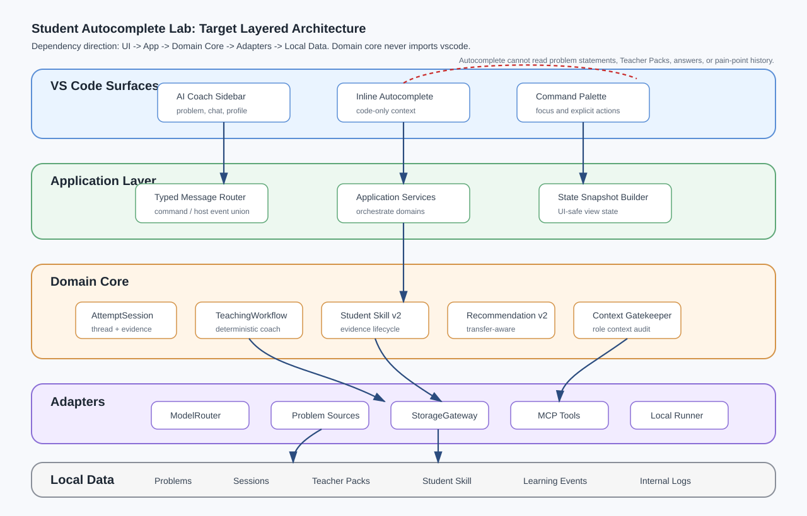

# Architecture Overview

Status: Active — consolidated, code-verified architecture for `student-autocomplete-lab` (`0.1.0-beta.1`, VS Code `^1.125.0`, Node `>=20`).

## 1. Product Core And Non-Negotiable Boundaries

Student Autocomplete Lab is a local-first VS Code algorithm-learning coach. Its architecture enforces one central boundary:

> **Narrow autocomplete saves keystrokes without spoiling the problem; explicit coaching reads problem context only when the student asks; local learning memory stays inspectable, correctable, and rollbackable.**

Core invariants:

1. **Context isolation**: Inline autocomplete reads only the local code prefix/suffix, normalized language, sanitized file label, and bounded safe code habits (`StudentSkill.hardRules`: `autocompleteMayReadProblemStatement: false`, `allowFullSolutionAutocomplete: false`). It never receives problem statements, Teacher Packs, reference solutions, lesson reports, or coach history.
2. **Deterministic orchestration**: Teaching flows are deterministic TypeScript state transitions (`src/teaching/workflow/`), not an autonomous multi-agent runtime. Models propose text/patches; deterministic code validates outputs, merges skills, and enforces gates.
3. **Honest verdicts**: AI submission checks (`src/teaching/submissionJudge.ts`) are always labeled `AI 估计`. Official OJ submission (`src/submission/`) is strictly opt-in, explicitly confirmed once per request, and never retries automatically.
4. **Local-first privacy**: Problems, attempts, Teacher Packs, learning profiles, and optional internal logs stay on disk in VS Code global storage (`src/storage/StoragePaths.ts`). API keys live in VS Code `SecretStorage` (`secrets/models.env` is local dev fallback only).

## 2. System Diagrams

Reference SVG diagrams (conceptual overview + release/context boundaries):

- 
- [Teaching workflow sequence](assets/architecture/teaching-workflow-sequence.svg)
- [Context safety gate](assets/architecture/context-safety-gate.svg)
- [Eval and release lanes](assets/architecture/eval-release-lanes.svg)

## 3. Actual Source Tree Layout

| Directory | Responsibility | Key Modules / Contracts |
| --- | --- | --- |
| `src/extension.ts` | VS Code activation, status bar, inline provider, commands (`studentAutocomplete.*`), webview registration | Registers `ProblemBankViewProvider`, `OjConsolePanel`, `CodexServices`, `OjMcpBroker`, inline completion provider |
| `src/autocomplete/` | Safe 1–3 line inline completion (~350 ms pause trigger) | `context.ts` (prose stripping), `triggerPolicy.ts`, `requestGate.ts`, `filter.ts`, `inlineProvider.ts`, `mimoAutocomplete.ts` |
| `src/skills/` | 4-layer typed `SkillPlan` composition (`head > body > tail > footer`) and provider renderers | `types.ts`, `languageRegistry.ts` (`python`/`c`/`cpp`/`rust`/`generic`), `habitSelector.ts`, `composeSkillPlan.ts`, `auditView.ts`, `renderers/*`, `validators/autocompleteOutputPolicy.ts` |
| `src/models/` | Role-based model routing and provider HTTP transports | `modelRouter.ts` (`analysis` / `autocomplete`), `providerCapabilities.ts`, `chatCompletionsClient.ts`, `completionsClient.ts`, `responsesClient.ts`, `providerModelsClient.ts` |
| `src/codex/` | Experimental Codex OAuth transport via isolated `codex app-server` child process | `appServerProtocol.ts`, `appServerClient.ts`, `codexAuthService.ts`, `codexModelService.ts`, `codexTextClient.ts`, `codexServices.ts` |
| `src/config/` | Provider config & secret mapping | `modelEnv.ts` (`openai` / `openai-compatible` / `anthropic-native`), `vscodeModelEnv.ts` |
| `src/sidebar/` | Competition-dossier webview UI, typed command protocol, and host state coordination | `ProblemBankViewProvider.ts`, `messageProtocol.ts`, `stateView.ts`, `hostEvents.ts`, `practiceFile.ts`, `problemArchive.ts`, `manualMarkdownImport.ts`, `webview/formalDesign.ts` |
| `src/oj/` | Single read-only 5-platform OJ MCP broker (lazy-loaded) | `broker.ts`, `contracts.ts` (`oj.*/v1`), `mcpSdkClient.ts`, `problemDocument.ts`, `vscodeProviderConfiguration.ts` |
| `src/problemBank/` | Luogu HTTP/search clients, Chinese/English Markdown parser, source policy | `manualProblemParser.ts`, `luoguClient.ts`, `luoguProblemSetClient.ts`, `luoguSearchClient.ts`, `catalog.ts`, `sourcePolicy.ts` |
| `src/submission/` | Experimental user-confirmed OJ write path (Codeforces + AtCoder via external `online-judge-tools/oj`) | `submissionTarget.ts`, `codeforcesTarget.ts`, `codeforcesVerdict.ts`, `onlineJudgeTools.ts`, `confirmationStore.ts`, `processHost.ts` |
| `src/ojConsole/` | Integrated VS Code WebviewPanel bridge for the OJ Submission Console | `OjConsolePanel.ts`, `consoleService.ts`, `contracts.ts`, `modeGate.ts`, `confirmationStore.ts`, `sourceStore.ts`, `demoSubmission.ts`, `realSubmission.ts` |
| `src/attempt/` | Per-problem attempt session & coach thread persistence | `schema.ts` (`attempt-session/v1`), `session.ts`, `store.ts` |
| `src/teaching/` | Core coaching domain: diagnosis, follow-up, lesson reports, scoring, optimization, Teacher Pack, Student Skill, taxonomy, eval runners | `workflow/*`, `teachingCycle.ts`, `teachingPrompt.ts`, `teachingReport.ts`, `teachingTaxonomy.ts`, `coachFollowUp.ts`, `lessonReport.ts`, `solutionScore.ts`, `optimizationReport.ts`, `submissionJudge.ts`, `teacherPack.ts`, `studentSkill.ts`, `studentSkillStore.ts`, `studentSkillLifecycle.ts`, `transferValidation.ts`, `longitudinalSelfEvolution.ts` |
| `src/recommendation/` | Rule-based next-problem ranking with explicit rationale | `schema.ts`, `rules.ts`, `transfer.ts`, `candidatePool.ts`, `explain.ts` |
| `src/mcp/` | Local stdio MCP server for external problem discovery (`npm run mcp:problem-search`) | `problemSearchServer.ts`, `problemSearchTools.ts` |
| `src/storage/` | Local JSON / JSONL storage & migration helpers | `StoragePaths.ts`, `JsonStore.ts`, `jsonlStore.ts`, `Migration.ts` |
| `src/practice/` | Local Python runner, fixture store, budget, and evaluation helpers | `pythonRunner.ts`, `fixtureStore.ts`, `learningEvents.ts`, `practiceVerifier.ts`, `budget.ts` |
| `src/internalTesting/` & `src/release/` | Local-only friend-test JSONL recorder (replaced by `noopInternalTestRecorder.ts` in beta release) | `internalTestRecorder.ts`, `noopInternalTestRecorder.ts` |
| `src/cli/` | Dev/evaluation CLI scripts (excluded from beta-release VSIX) | `longitudinalSelfEvolution.ts`, `selfEvolutionEval.ts`, `mimoJourneyTrial.ts`, `internalTestReport.ts`, etc. |
| `prototypes/oj-console/` | Standalone localhost OJ Console server + shared frontend assets (`frontend/` is bundled in VSIX for `OjConsolePanel`; `backend/` & `scripts/` stay repo-only) | `backend/server.ts`, `backend/api.ts`, `frontend/{index.html,app.js,styles.css}` |

## 4. Context Gatekeeper Matrix

| Data Source | Autocomplete | Coach (Hint / Follow-up) | Abandon Lesson | Score / Optimize | Recommendation |
| --- | --- | --- | --- | --- | --- |
| Local code prefix/suffix | Yes (prose stripped) | Yes | Yes | Yes | No |
| Normalized language & file label | Yes | Yes | Yes | Yes | Optional |
| Full problem statement | **No** | Yes | Yes | Yes | Metadata/tags only |
| Hidden Teacher Pack | **No** | Yes (hidden) | Yes (hidden) | Yes (hidden) | Summary only |
| Reference / standard solution | **No** | **No** | Gated reveal | **No** | **No** |
| Coach thread history | **No** | Yes | Yes | Yes | No |
| Safe code habits (bounded) | Yes (max 2) | Yes | Yes | No | No |
| Pain points & Student Skill | **No** | Yes | Yes | Yes | Yes |
| API keys / OAuth tokens | **Never** | **Never** | **Never** | **Never** | **Never** |

## 5. Persistent Local Data Contracts

All extension data is stored under `ExtensionContext.globalStorageUri` via `src/storage/StoragePaths.ts`:

- `problems.jsonl`, `problemSets.jsonl`, `completedProblems.jsonl` — imported problems, training sets, and archived records.
- `attemptEvents.jsonl`, `attemptSessions.jsonl` — append-only attempt events and `attempt-session/v1` sessions (`status: "active" | "archived" | "deleted"`, `latestOutcome`, `eventIds`, `coachThread`).
- `teacherPacks.jsonl` — cached hidden reference packs keyed by problem.
- `studentProfile.json` — legacy pain-point counter profile (still merged with Student Skill in recommendation).
- `studentSkill.json` & `studentSkillVersions/` — `student-skill/v1` inspectable learner model (`status: "candidate" | "active" | "mastered" | "disabled"`, `hardRules`, `capabilityMap`, `errorModel`, `codeHabits`, `teachingPreferences`, `skills`, `transferEvidence`, `correctionLog`) plus rollback snapshots.
- `codex-oauth/{home,runtime}` — isolated `CODEX_HOME` and empty working directory for `codex app-server`.
- `oj-console/` — ephemeral temp workspace used by `OjConsolePanel` real-mode runs and cleaned up in `finally`.

## 6. Subsystems Detailed In Focused Specs

- **Codex OAuth transport**: [superpowers/specs/2026-07-12-codex-oauth-design.md](superpowers/specs/2026-07-12-codex-oauth-design.md)
- **Language skill composition & DeepSeek FIM rendering**: [superpowers/specs/2026-07-14-language-skill-composition-design.md](superpowers/specs/2026-07-14-language-skill-composition-design.md)
- **Formal competition-dossier sidebar UI**: [superpowers/specs/2026-07-14-formal-frontend-redesign.md](superpowers/specs/2026-07-14-formal-frontend-redesign.md)
- **Multi-platform OJ submission (`src/submission/`)**: [superpowers/specs/2026-07-21-multi-platform-oj-submission-design.md](superpowers/specs/2026-07-21-multi-platform-oj-submission-design.md)
- **OJ Console harness & webview bridge**: [superpowers/specs/2026-07-14-oj-console-prototype-design.md](superpowers/specs/2026-07-14-oj-console-prototype-design.md)
- **Local stdio problem-search MCP**: [problem-search-mcp.md](problem-search-mcp.md)
- **Markdown problem authoring format**: [ai-problem-writing-standard.md](ai-problem-writing-standard.md)
- **Release lanes & packaging hygiene**: [release-lanes.md](release-lanes.md)

## 7. Governance Rules & Known Architecture Debt

Engineering rules for ongoing changes:

1. Never pass problem statements, Teacher Packs, reference answers, or coach history into autocomplete prompts or audit payloads.
2. Keep domain logic in `src/teaching/`, `src/skills/`, `src/recommendation/`, `src/attempt/`, and `src/submission/` free of `vscode` imports.
3. Never treat `AI 估计` as an official OJ verdict, and never bypass CAPTCHA/Turnstile or auto-retry OJ submissions.
4. Keep frontend files (`src/sidebar/webview/*`, embedded sidebar HTML/CSS/JS, `prototypes/oj-console/frontend/*`) comment-free as enforced by contract tests.
5. Stage public beta releases via allowlist (`scripts/packageBetaReleaseVsix.js`) and gate every release with `npm run check:hygiene`.

Tracked structural debt (see [current-gaps-and-next-steps.md](current-gaps-and-next-steps.md) and [education-scenario-evaluation-2026-07-22.md](education-scenario-evaluation-2026-07-22.md)):

| Debt Item | Severity | Current State | Target |
| --- | --- | --- | --- |
| Sidebar host/UI monolith | High | `src/sidebar/ProblemBankViewProvider.ts` is ~8.3k lines combining host dispatch with inline HTML/CSS/JS | Extract command handlers & externalized webview modules so provider stays thin |
| Cross-module educational hard-gate bugs | High | 7 reproduced bugs (duplicate evidence promotion, disabled-skill transfer leak, global vs per-skill difficulty lift, legacy `StudentProfile` override, prompt-only no-answer gate, non-idempotent replay, rollback reactivating disabled skill) | Add deterministic regression tests and fix all 7 gates before human learning pilots |
| Legacy `mimo` naming in runtime/CLI | Medium | `mimoAutocomplete.ts`, `mimoTeacher.ts`, `trial:mimo*` still carry legacy names | Neutralize generic OpenAI-compatible naming |
| Per-role OpenAI-compatible secrets | Medium | One saved API key per provider mode | Support independent chat vs autocomplete keys |
| Automated VS Code UI & inline E2E gates | Medium | Unit/contract tests are strong; real sidebar & Ghost Text still require manual verification | Add Playwright/VS Code smoke harness |
| Deferred v2 ideas (unimplemented) | Low | `StudentSkillV2`, `TeachingTrace` span ledger, spaced retrieval/micro-drill scheduler, `LearningEventV3` | Implement incrementally only after hard-gate bugs and sidebar decoupling are closed |
